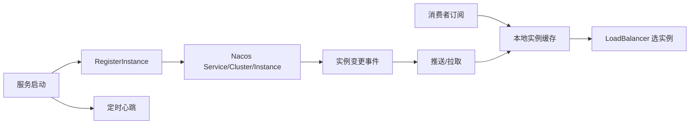

# 注册中心-Nacos

> [!abstract] 一句话总结
> Nacos 注册中心维护服务实例、健康状态和订阅推送；精通点是临时/持久实例、心跳、保护阈值、客户端缓存和故障切换语义。

## 📌 精准定位

- 负责服务实例注册、发现、健康检查和变更通知。
- 不负责替代负载均衡、限流熔断和版本治理。
- 关键边界：注册中心故障不代表调用立即失败，客户端缓存会继续工作一段时间。

## 🧩 核心概念

| 概念 | 具体含义 | 精通要点 |
| ---- | -------- | -------- |
| 临时实例 | 客户端心跳续约，超时剔除。 | 适合普通微服务实例。 |
| 持久实例 | 服务端主动探测健康。 | 适合固定资源。 |
| 服务订阅 | 客户端订阅变更并本地缓存。 | 推送失败要定时拉取兜底。 |
| 保护阈值 | 避免大量实例误摘。 | 保护期可能返回不健康实例。 |

## ⚙️ 工作原理 / 主流程



1. 服务启动注册 IP、端口、权重、metadata。
2. 临时实例定期心跳，超时标记不健康并可能剔除。
3. 消费者订阅服务，收到变更后刷新本地缓存。
4. Nacos 集群内部维护服务数据一致性。
5. Spring Cloud Alibaba 接入 DiscoveryClient 和 LoadBalancer。

## 💻 代码 / 配置 / 伪代码

```yaml
spring:
  application:
    name: order-service
  cloud:
    nacos:
      discovery:
        server-addr: nacos-1:8848,nacos-2:8848
        namespace: prod
        group: DEFAULT_GROUP
```

## 🔍 源码入口 / 关键组件

- NamingService registerInstance/subscribe/selectInstances
- ClientBeatProcessor / health check
- ServiceManager / Instance metadata
- NacosDiscoveryClient
- Nacos naming 日志

## ⚠️ 生产坑与注意事项

- namespace/group 配错导致发现不到。
- 容器注册了不可达 IP。
- 保护阈值触发时不健康实例仍可能返回。
- 只依赖注册中心摘除，没有客户端超时熔断。
- 权重灰度遇到长连接未及时切换。

## 🧭 排查路径

- 发现不到服务核对 namespace、group、serviceName、metadata。
- 调用坏实例查健康状态、保护阈值、客户端缓存。
- 注册 IP 错检查 discovery.ip、网卡和容器网络。
- 实例频繁上下线看心跳、GC、网络、server 日志。

## 🎯 面试问题

> [!question] 高频问题
> - Q: 临时和持久实例区别？
>   - A: 临时靠客户端心跳，持久由服务端探测。
> - Q: 注册中心挂了调用全挂吗？
>   - A: 已有缓存可短期调用，新变更和摘除受影响。
> - Q: 保护阈值风险？
>   - A: 防误摘雪崩，但可能返回不健康实例。
> - Q: 如何灰度路由？
>   - A: metadata、权重、命名空间配合网关或客户端规则。
> - Q: Nacos naming 和 config 区别？
>   - A: 同产品两类能力，数据模型和链路不同。

## ✅ 精通检查清单

- 能画出主流程，并标出最容易失败的节点。
- 能说出至少 3 个源码入口或关键组件。
- 能写出最小配置、SQL、伪代码或状态机。
- 能结合生产故障说明监控指标、排查命令和修复动作。
- 能和相邻方案做取舍对比，而不是只背定义。

## 🔗 关联笔记

- [[_index]]
- [[20-Java后端/00-总览/学习仪表盘]]

## 📚 参考资料

- Nacos Documentation: Naming Service
- Spring Cloud Alibaba Nacos Discovery
