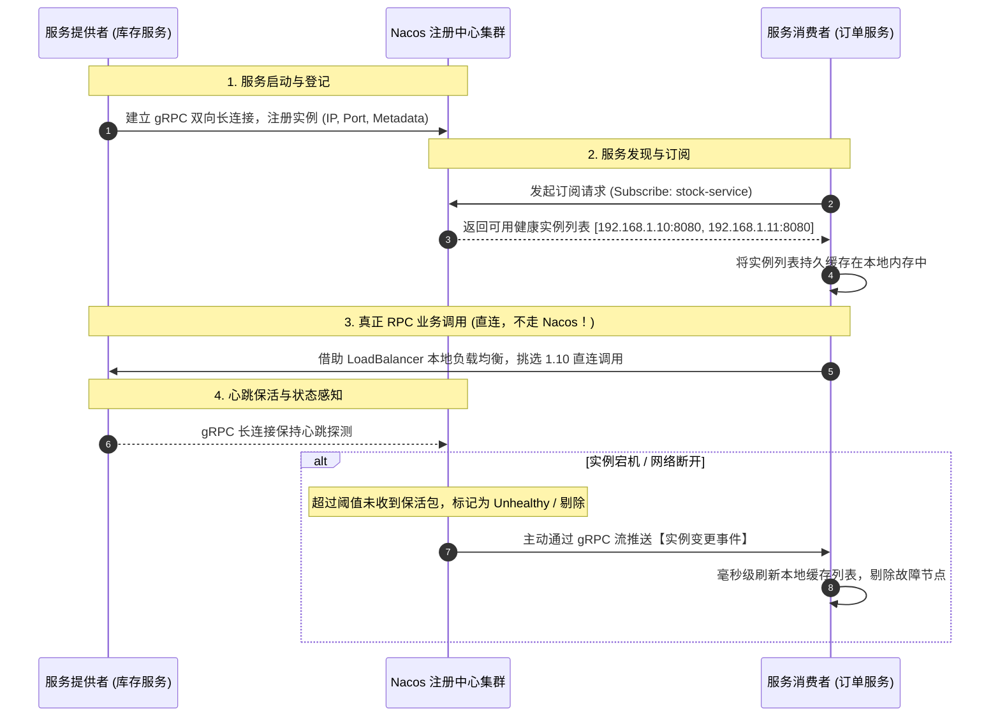
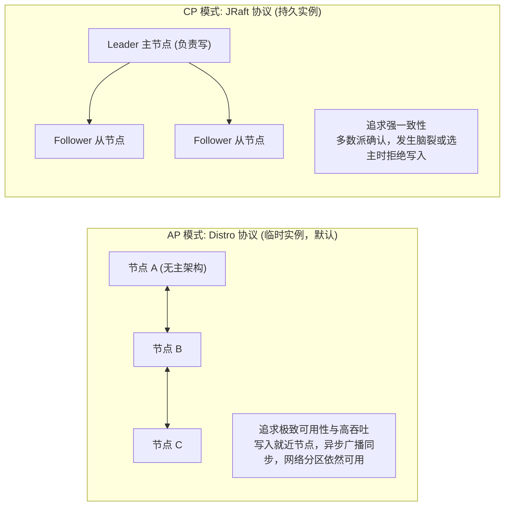
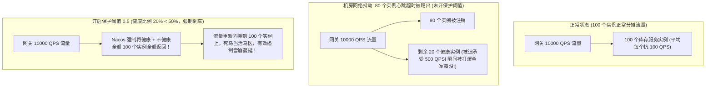
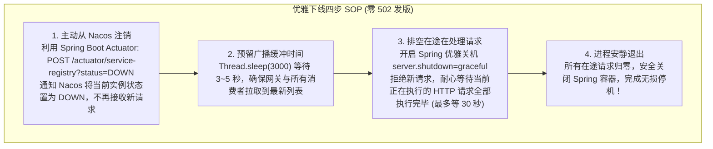

# 注册中心：Nacos 原理与微服务治理

> [!abstract] 一句话心智模型
> 如果把微服务集群比作全国连锁商业街：
> - **注册中心（Nacos Discovery）** 就是**动态工商黄页与总机查号台**。每个商家（服务实例）开门营业时主动来报备门牌号（IP 和端口），打烊或倒闭时自动注销；
> - **为什么 2.x 比 1.x 快 10 倍？** 从 1.x 时代“每隔 5 秒跑腿送一次纸质心跳卡（HTTP 短轮询）”，全面升级为 2.x 时代的**“gRPC 专线双向长连接”**，毫秒级打卡，网络开销直降 90%；
> - **高可用第一性原理（AP 胜过 CP）**：在注册中心的世界里，**可用性（A）永远高于强一致性（C）**！宁可拿到陈旧的店铺电话去试着打通，也绝不能因为总机在开会选举（CP 阻塞）导致全国客户全打不通电话！

---

## 🏛️ 一、服务注册与发现全流程



### 核心认知防线：
- **Nacos 不转发业务流量**：订单服务调用库存服务是**点对点直接建立 TCP/HTTP 连接通信**，数据流根本不经过 Nacos！Nacos 仅仅扮演“查号黄页”的控制平面角色。
- **客户端本地缓存（Client Cache）是救命稻草**：消费者会将拉取到的实例列表缓存在本地内存和磁盘文件中。**哪怕 Nacos 整个集群瞬间全挂了，消费者依然可以依靠本地缓存列表继续正常调用提供者长达几十分钟！**

---

## ⚡ 二、架构跨时代演进：Nacos 1.x vs Nacos 2.x

| 对比维度 | Nacos 1.x（旧时代） | Nacos 2.x（现代工业标准） |
| :--- | :--- | :--- |
| **底层通信协议** | **HTTP 1.1 短轮询** | **gRPC 双向流长连接（基于 Netty + HTTP/2）** |
| **客户端保活方式** | 客户端每 5 秒发起一次 HTTP POST 心跳请求 | **复用 gRPC 长连接保活**，5 秒无交互发送轻量 ping/pong |
| **变更通知机制** | 客户端长轮询（Long Polling）反复向服务端发起探测挂起 | **服务端通过 gRPC 流主动毫秒级向下推送** |
| **连接开销与吞吐** | 万级实例下，服务端每秒承受数万次 HTTP 连接握手与线程开销 | 单连接复用多路复用，**服务端连接数下降 90%，性能提升 10 倍！** |
| **端口要求** | 仅需开放 `8848` 端口 | **必须同时开放 `8848`（主端口）与 `9848`（客户端 gRPC 端口）！** |

> [!CAUTION] 生产必踩网络坑：Nacos 2.x 防火墙端口漏开
> 升级 Nacos 2.x 时，许多运维仅映射了主端口 `8848`。
> - **诡异现象**：客户端可以在浏览器正常打开 Nacos 控制台，但微服务启动时死活无法注册，日志疯狂报 `Client not connected, current status:STARTING`！
> - **根因**：Nacos 2.x 的客户端通信基于 gRPC，其默认通信端口是 **`主端口 + 1000`**，即 **`9848`**！在 K8s Service、Nginx 反代或安全组配置中，**必须把 8848、9848、9849 一并对外放通！**

---

## ⚖️ 三、CAP 架构切换：Distro（AP）与 Raft（CP）

Nacos 是业内极其罕见的**同时支持 AP 和 CP 模式**的注册中心。



### 1. 为什么微服务注册中心默认必须是 AP？
- 假设在 CP 模式（如 ZooKeeper）下，发生跨机房网络抖动，ZK 节点开始重新选举 Leader。在选举的 30~120 秒内，**整个集群停止对外服务，所有新节点无法注册，服务列表不可查询，全站微服务调用全部瘫痪！**
- 在 AP 模式（Distro）下，即使网络分区，各个分区各自对外提供服务。虽然消费者可能会在几秒内看到稍旧一点的节点列表，但绝大部分服务依然能正常连通！**在分布式高并发在线业务中，可用性远比秒级的一致性重要！**

### 2. Distro 协议核心机制（AP）
- **无主对等设计（Peer to Peer）**：每个 Nacos 节点都是平等的，没有 Master/Slave 区别；
- **分区分摊（Hash 取模）**：每个 Nacos 节点各自负责一部分服务数据的写操作与心跳维护；
- **异步广播同步**：一个节点收到注册请求，写完本地内存后立刻向客户端返回成功，并在后台异步广播给其他所有 Nacos 节点。

---

## 🛡️ 四、保护阈值（Protect Threshold）：防雪崩的救命刹车

在 Nacos 服务详情页面中，有一个至关重要的参数：**保护阈值（Protect Threshold，取值 0 ~ 1，默认 0）**。



- **雪崩场景**：某核心服务拥有 100 个实例。由于底层交换机抖动或机器网络卡顿，80 个实例的心跳迟到了几秒，被 Nacos 判定为死亡并踢出。如果此时网关只把剩下的 20 个实例拿来路由，10000 QPS 会瞬间把这 20 个好实例压垮烧死，导致系统彻底 100% 瘫痪！
- **救命逻辑**：
  - 如果配置了保护阈值 `0.5`，当健康实例数与总实例数的比例低于 50% 时，**Nacos 判定系统发生大规模异常，强行触发自我保护**！
  - 此时，**Nacos 会把“健康实例 + 不健康实例”一股脑全部返回给消费者**！
  - 虽然请求打到那些不健康实例可能会有一部分报错，但由于客户端有重试机制，**至少有相当一部分流量能够成功消化，避免了整个微服务集群瞬间连环猝死！**

---

## 🚀 五、微服务“优雅无损上下线”实战 SOP

在微服务频繁发布的日常开发中，许多团队经常遇到：**“每次发版上线，监控告警群里就狂刷几百条 502 Bad Gateway 或 Connection Refused 报错！”**

### 报错根因：时间差（在途请求被粗暴斩断）
1. 发布系统直接向老容器发送 `kill -9`；
2. 正在处理中的业务请求被强行杀死；
3. Nacos 感知到实例死亡并通知到网关和调用方需要 1~3 秒的时间差，在这几秒内，网关依然把新流量往已经死掉的 IP 上转发，导致请求全部报错！



### 关键配置（Spring Boot 生产标准）：
```yaml
server:
  shutdown: graceful # 开启优雅停机，等待在途请求完成

spring:
  lifecycle:
    timeout-per-shutdown-phase: 30s # 最多等待 30 秒排空请求
```

---

## ⚡ 一分钟面试必杀卡

> [!NOTE] 面试高频问题标准答题套路
> 
> **Q1：Nacos 1.x 和 Nacos 2.x 的底层通信架构有什么区别？**
> - **A**：
>   - **1.x** 是基于 **HTTP 1.1 短轮询**：客户端每 5 秒发一次 HTTP 心跳请求，通过 HTTP 长轮询监听服务变更。在实例规模较大时，频繁的 TCP 握手和 HTTP 报头解析对服务端造成了巨大的网络和 CPU 负载。
>   - **2.x** 升级为基于 **gRPC 的双向流长连接**：客户端与服务端只保持一条长连接，心跳检测和配置/服务变更推送全部复用该长连接多路复用传输。网络连接数降低 90%，服务端支持的实例容量提升一个数量级，服务变更通知进入毫秒级。
> 
> **Q2：为什么注册中心通常选择 AP 模型，而不是 CP 模型？**
> - **A**：
>   - 注册中心的核心诉求是**高可用（Availability）**。如果采用 CP 模型（如 ZooKeeper），当集群发生网络分区或节点选举时，整个注册中心会停止对外写入和服务发现，导致整个系统的微服务无法寻址而瘫痪。
>   - 采用 AP 模型（如 Nacos Distro 协议），即使发生网络分区，各个节点依然可以对外提供读写服务。虽然可能产生短暂的节点状态不一致，但客户端配合本地缓存与重试机制，绝大多数调用依然能成功连通，保障了核心业务的不中断。
