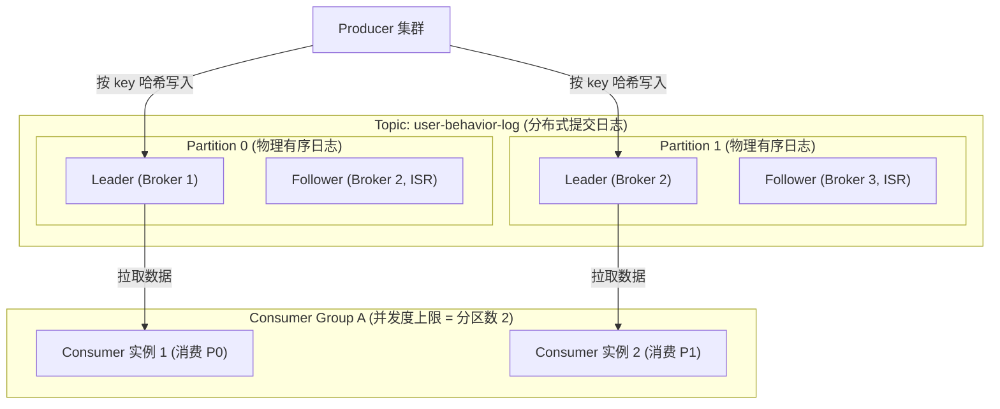
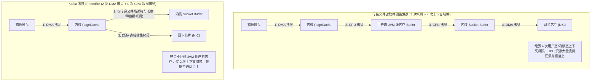
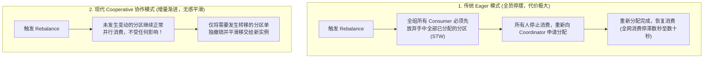

# 05 · Kafka 架构原理与实战手册

> [!abstract] 一句话第一性原理
> Kafka 的本质是**高吞吐、分布式的分布式提交日志系统（Distributed Commit Log）**。其极致性能依托于**磁盘顺序追加写、操作系统 PageCache、Linux `sendfile` 零拷贝与批量压缩**四大物理支柱，并以 **ISR 副本机制与 Leader Epoch** 确保数据强一致性。

---

## 一、 核心架构拓扑与消费并发度



### 并发度与局部有序本质：
- **单分区内严格单调递增有序**，跨分区无法保证全局顺序；
- **并发度铁律**：同一消费组内，单个分区同一时刻最多只能被一个消费者线程消费。若分区数为 4，部署 6 个实例，多出的 2 个实例将处于闲置状态。

---

## 二、 极致吞吐量的四大物理支柱

Kafka 单机写入能够支撑数十万至百万 QPS，依赖于现代硬件与操作系统的物理特性：

### 1. 传统 I/O vs Linux `sendfile` 零拷贝深度对比



### 2. 四大支柱协同大表

| 支柱维度 | 物理原理 | 性能收益 |
| :--- | :--- | :--- |
| **磁盘顺序追加写** | 磁盘臂无需来回随机寻道，连续磁道顺序追加写速度堪比内存（机械硬盘顺序写可达 100~200MB/s，SSD 更高达数 GB/s） | 彻底消除磁盘随机 I/O 寻道瓶颈 |
| **操作系统 PageCache** | 放弃 JVM 堆内缓存，直接利用 Linux 内核页缓存读写文件 | 避免海量消息对象引发的 Java 堆空间膨胀与频繁 Full GC 停顿；Broker 重启缓存依然有效 |
| **`sendfile` 零拷贝** | 消费拉取时通过 Linux `sendfile` 系统调用，数据直接从内核 PageCache 走 DMA 传给网卡 | 节省 2 次 CPU 拷贝与 2 次上下文切换，打满万兆网卡 |
| **客户端攒批与压缩** | `RecordAccumulator` 在客户端内存按批次聚合成批（`batch.size`），配合 LZ4/Zstandard 算法整批压缩 | 极大减少网络请求系统调用次数与网络带宽消耗 |

---

## 三、 数据一致性底层基石：HW、LEO 与 Leader Epoch

### 1. 高水位（High Watermark）与 LEO 机制

Kafka 分区中的日志通过两个关键位点控制可见性与一致性：

```text
Log 物理偏移量:   0    1    2    3    4    5    6    7    8    9
Leader 副本:    [M0] [M1] [M2] [M3] [M4] [M5] [M6] [M7] [M8]
                                        ▲                   ▲
                                        │ HW = 5            │ LEO = 9
                                   (消费者可见边界)      (最新写入位置)
Follower 副本:  [M0] [M1] [M2] [M3] [M4] 
                                        ▲
                                        │ LEO = 5 (追平 HW)
```

- **LEO（Log End Offset）**：当前副本日志中**下一条待写入消息的 offset**。每写入一条消息，LEO 加 1。
- **HW（High Watermark）**：高水位线。**等于该分区 ISR 集合中所有副本最小的 LEO**。
  - **核心铁律**：**HW 及其之前的消息才被判定为“已提交”，消费者只能看到 HW 之前的消息**！HW 之后的处于同步中，对消费者不可见。

### 2. 为什么需要 Leader Epoch（代数版本号）？

在早期 Kafka（0.11 之前），副本发生故障恢复后，依靠自身的 **HW 进行日志截断**。这会导致严重的**数据丢失与幽灵数据不一致**：
- **场景**：Leader A 收到消息写入本地日志（LEO 增加），但在向 Follower B 同步以及更新 HW 之前，机器断电宕机；
- 此时 B 当选为新 Leader，A 重启后成为 Follower。若 A 按照旧的 HW 截断日志，当 A 重新连上 B 时，由于两个节点的 HW 更新存在时延，可能导致已被确认的消息被错误截断删除，或者新 Leader 写入了相同 offset 但内容不同的冲突数据。
- **Leader Epoch 解决方案**：
  Kafka 引入了 `LeaderEpoch`（每个 Leader 任期递增整数）+ `StartOffset` 组成的版本映射表。
  Follower 恢复时不盲目按 HW 截断，而是先向新 Leader 询问该 Epoch 的最大位点，**严格按 Leader Epoch 边界做对齐截断**，彻底消除了 HW 延迟导致的丢数据与错乱隐患。

---

## 四、 高可用与防丢核心配置（ISR 机制）

- **ISR（In-Sync Replicas）**：与 Leader 保持紧密同步的副本集合。如果 Follower 超过 `replica.lag.time.max.ms`（默认 30s）未向 Leader 发送抓取请求，将被踢出 ISR。

### 生产金融级“零丢失”黄金配置组合：

```properties
# 1. 生产者端
acks = all                           # Leader 等待所有 ISR 副本全部同步完成
retries = 2147483647                 # 遇网络异常无限重试
max.in.flight.requests.per.connection = 1 # 防止重试引发乱序 (开启幂等后可设为 5)
enable.idempotence = true            # 开启生产端幂等性

# 2. Broker 端
min.insync.replicas = 2              # 至少 2 个 ISR 副本写入成功才算成功
unclean.leader.election.enable = false # 严禁非 ISR 副本参与竞选 Leader (宁停服不丢数据)

# 3. 消费者端
enable.auto.commit = false           # 显式关闭自动提交位点，业务落库后手动 commitSync
```

---

## 五、 Consumer Group 重平衡演进：从 Eager 到 Cooperative

当消费组成员发生变动（增减实例、实例崩溃或 Topic 扩容分区）时，会触发 **Rebalance（重平衡）**。

### 两种重平衡机制对比：



- **主流分区分配策略**：
  1. **Range（范围分配，默认）**：按单个 Topic 的分区序号平均分段。缺点是订阅多个 Topic 时极易造成头部消费者倾斜过载；
  2. **RoundRobin（轮询分配）**：将所有 Topic 的全部物理分区按字典序排序后依次轮询分配；
  3. **CooperativeSticky（协作式粘性分配，Kafka 2.4+ 强烈推荐）**：既保持最大化的分区粘性（尽量不迁移旧分区），又采用协作式重平衡，彻底消灭全员停摆抖动。

- **规避线上无限 Rebalance 避坑准则**：
  1. 调大 `max.poll.interval.ms`（单次拉取处理的最大耗时，默认 5 分钟），或适当调小 `max.poll.records`（单次拉取最大条数，默认 500），防止业务处理耗时过长导致心跳超时被 Coordinator 误判踢出；
  2. 配置 `group.instance.id`（静态成员机制）：滚动部署重启时保留原有分区绑定关系，不触发全组 Rebalance。

---

## 六、 架构演进：从 ZooKeeper 到 KRaft

| 对比维度 | 传统 ZooKeeper 模式 | 现代 KRaft 模式（Kafka 3.x+ / 4.0 彻底移除 ZK） |
| :--- | :--- | :--- |
| **元数据存储** | 存储在外部独立的 ZK 树形节点中 | 存储在 Kafka 内部专有的元数据分区日志中（`@metadata`） |
| **控制器选举** | 多 Broker 争抢向 ZK 创建临时节点，故障时需向 ZK 同步全量元数据 | 内置 Quorum 节点运行 Raft 共识协议，Leader 内存常驻最新元数据 |
| **分区上限** | 受限于 ZK 性能，单集群分区数通常在数万级 | 支持 **百万级分区**，秒级故障恢复转移 |
| **运维复杂度** | 必须维护两套独立的分布式集群（ZK + Kafka） | **单二进制程序一体化运维**，架构极度纯粹 |

---

## 七、 高频面试自测

> [!question]- Q1：Kafka 单机为什么读写吞吐极高？sendfile 零拷贝省去了哪几步？
> 四大核心支柱：磁盘顺序追加写（无随机寻道）、利用 OS PageCache（避开 JVM GC）、批量压缩，以及 Linux `sendfile` 零拷贝。
> 传统读写经历 4 次上下文切换与 4 次数据拷贝（硬盘 $\to$ PageCache $\to$ JVM Buffer $\to$ Socket Buffer $\to$ 网卡）。`sendfile` 只需 2 次上下文切换与 2 次 DMA 数据拷贝，数据直接从内核 PageCache 传至网卡，完全不进入 JVM 用户态，CPU 仅需复制少量文件描述符。

> [!question]- Q2：什么是 Kafka 的 HW 和 LEO？为什么 Kafka 后来引入了 Leader Epoch？
> LEO（Log End Offset）是分区末端下一条待写位置；HW（High Watermark）是 ISR 集合中所有副本最小的 LEO，决定了消费者可见的安全边界。
> 早期 Kafka Follower 恢复时按 HW 截断日志，由于主从 HW 更新存在时间差，宕机切换时会导致已确认数据被误截断丢失，或产生冲突的幽灵数据。引入 Leader Epoch 后，Follower 恢复时与新 Leader 的代数版本对齐截断，彻底消除了 HW 滞后带来的数据丢失隐患。

---

## 🔗 上下篇导航
- **上一篇**：[[04-API网关与流量治理]]
- **下一篇**：[[06-RocketMQ架构原理与实战手册]]
