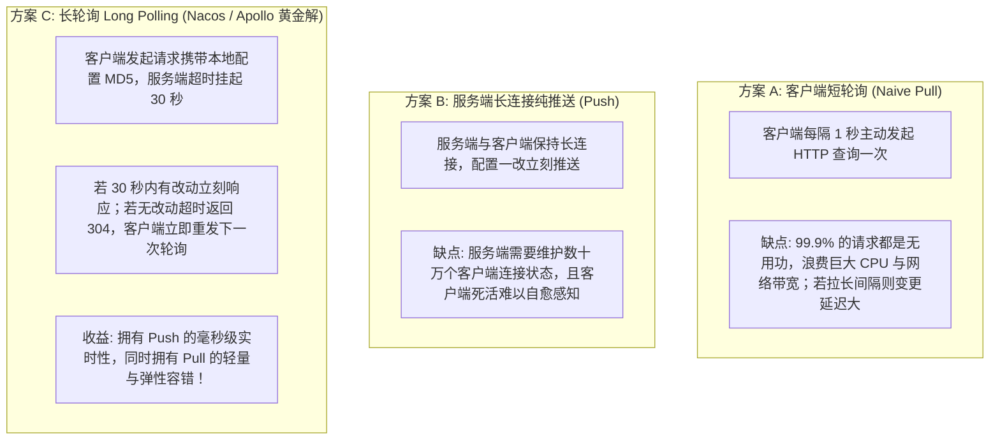
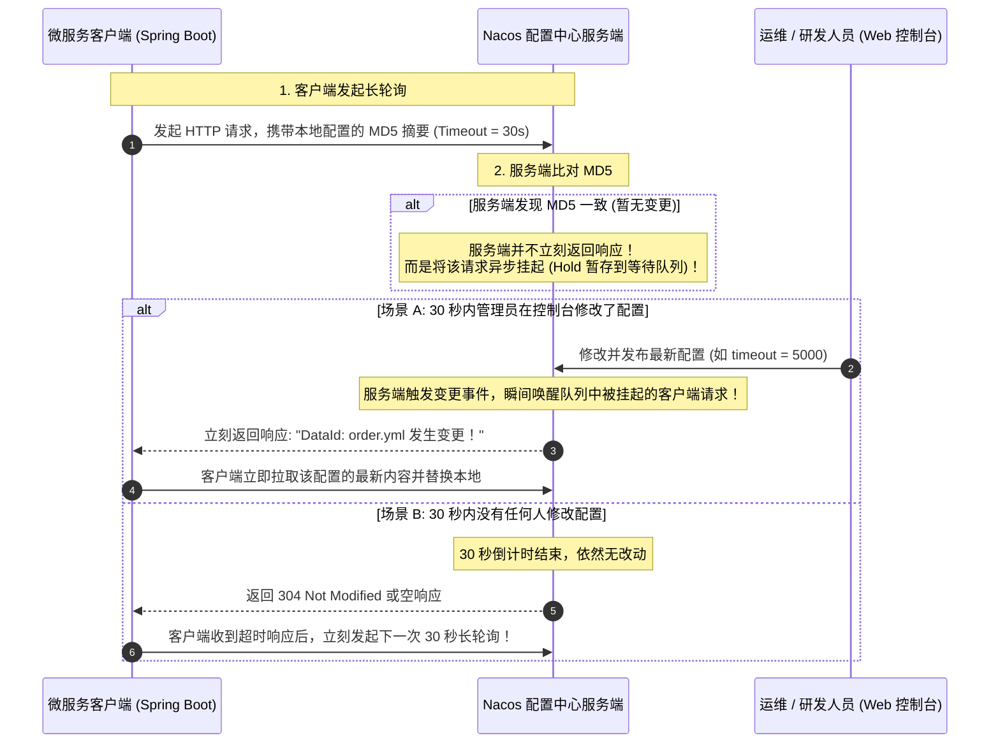
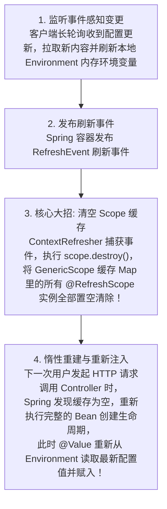
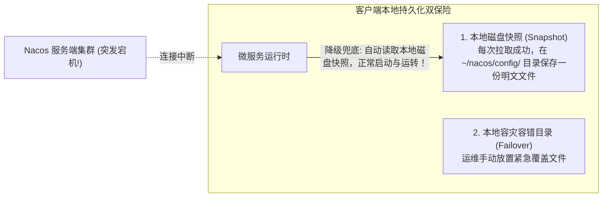

# 分布式配置中心

> [!abstract] 一句话心智模型
> 如果把微服务集群比作庞大的集团军：
> - **本地配置文件（application.yml）** 是每个士兵口袋里的一张**出厂纸质守则**，一旦指挥官想调整某个战术参数（如开关、超时时间），就必须把全军所有士兵全部召回营房（重新打包编译发布），效率极低；
> - **分布式配置中心（Nacos Config / Apollo）** 是**集团军中央数字对讲网络与公文广播台**。指挥官在控制台鼠标轻轻一点，公文毫秒级下达，所有在线服务**不重启、不掉线、无感热更新生效（`@RefreshScope`）**；
> - **核心通信黑科技（长轮询 Long Polling）**：既兼顾了 Push 的毫秒级响应，又兼顾了 Pull 的轻量可靠，用 MD5 摘要比对化解海量实例通信风暴。

---

## 🎯 一、为什么需要分布式配置中心？

| 对比维度 | 传统本地配置（application.yml） | 分布式配置中心（Nacos / Apollo） |
| :--- | :--- | :--- |
| **生效方式** | 修改代码 -> Git 提交 -> CI/CD 打包 Docker 镜像 -> 滚动发布 -> **应用重启**（耗时 10~30 分钟） | 控制台修改 -> 点击发布 -> **毫秒级推送到所有实例，业务无感热更新** |
| **多环境管理** | 维护 `application-dev.yml`、`application-prod.yml`，容易打包错漏，敏感密码明文易泄漏 | 通过 Namespace（环境隔离）与 Group 分组管理，支持敏感配置脱敏与加解密 |
| **故障容灾与回滚** | 修改失误需要漫长回滚重新发版 | **内置历史版本全量快照，一键秒级回滚**到上一个健康版本 |
| **配置一致性** | 几百个容器 Pod，可能由于灰度发布或镜像不一致导致节点配置碎片化 | 单一事实来源（Single Source of Truth），所有节点状态一目了然 |

---

## 🔄 二、核心通信机制：基于 MD5 摘要的“长轮询（Long Polling）”

客户端究竟是如何感知到远程配置中心发生改变的？业内曾经历过两次技术选型的交锋：



### 长轮询底层交互详细时序图



- **Nacos 2.x 的升级**：Nacos 2.x 在 gRPC 双向流长连接的基础上，直接复用了长连接的多路复用通道，连 HTTP 长轮询的请求头开销都彻底免除，做到了真正纯粹的**亚秒级长连接事件分发**！

---

## 🧬 三、Spring Boot 热更新底层原理：`@RefreshScope` 源码剖析

在 Spring Boot 业务代码中，我们只需在一个类上标注 `@RefreshScope`，修改配置后该 Bean 的属性就会自动更新，**底层究竟发生了什么黑科技？**

```java
@RestController
@RefreshScope // 开启配置动态热更新
public class OrderController {

    @Value("${order.discount.rate:0.9}")
    private Double discountRate;

    @GetMapping("/discount")
    public Double getDiscount() {
        return discountRate;
    }
}
```

### 1. `@RefreshScope` 的本质是什么？
- 在 Spring 中，默认的对象生命周期作用域只有两种：`Singleton`（单例）和 `Prototype`（原型）。
- `@RefreshScope` 本质是一个 **自定义 Scope（Custom Scope）**，其底层实现类是 Spring Cloud 的 **`GenericScope`**（继承自 Spring 框架的 `Scope` 接口）。
- **缓存机制**：`GenericScope` 内部维护了一个线程安全的 `BeanLifecycleDecorator` 缓存 Map。当代码请求一个 `@RefreshScope` 的 Bean 时，Spring 会先查这个缓存 Map，没有才创建并放入缓存。

### 2. 热更新四步闭环（为什么不需要重启 JVM？）



> [!TIP] 第一性原理透视：
> Spring 并没有去“强行修改旧对象内存里的那个 `private Double discountRate` 字段值”。
> 而是**直接把旧的整个 Bean 实例从缓存中扔掉！在下一次被调用时，重新 new 了一个全新的 Bean 实例，并在初始化阶段顺理成章地注入了新配置值！** 这就是 `@RefreshScope` 极其优雅的设计智慧。

---

## 🛡️ 四、生产多环境隔离与容灾铁律

### 1. 命名空间（Namespace）与分组（Group）的标准落地模型
大型互联网企业中，配置必须严格按照三级结构分层管控：

```
Nacos 配置层级：
Namespace（租户/环境隔离）
 ├── dev（开发环境）
 ├── test（测试环境）
 └── prod（生产环境，严格只读权限）
      └── Group（业务线/系统分组，默认 DEFAULT_GROUP）
           ├── ORDER_GROUP（订单业务组）
           └── PAY_GROUP（支付业务组）
                └── DataId（具体配置文件名）
                     ├── order-service.yml（应用私有配置）
                     └── common-redis.yml（跨服务共享公共配置）
```

### 2. 生产高可用与“脱机自愈”（客户端容灾快照）
如果生产环境 Nacos 配置中心服务器遭遇火灾断电、全盘宕机，线上微服务会当场崩溃吗？



- **第一性原理**：Nacos 客户端设计了严密的**本地容灾快照机制**。
  - 每次成功拉取配置后，客户端都会悄悄在本地磁盘目录（如 `${user.home}/nacos/config/`）写入一份完全相同的文本快照；
  - **当 Nacos 服务端全线瘫痪时，新启动的微服务会自动从本地磁盘快照中加载全部配置，平稳拉起服务！** 彻底杜绝了“因为配置中心挂了导致全站业务无法启动”的单点故障风险。

---

## ⚡ 一分钟面试必杀卡

> [!question]- Q1：Nacos 配置中心是如何做到配置变更后秒级推送到客户端的？
> - 核心机制是**基于 MD5 摘要比对的长轮询（Long Polling）机制**。
> - 客户端向服务端发起配置监听请求，携带本地配置的 MD5 摘要，并设置 30 秒超时时间。
> - 服务端若发现 MD5 一致（无修改），会将该 HTTP 请求挂起暂不返回；如果在 30 秒内配置发生变动，服务端会立刻唤醒挂起的请求并返回变动通知；若 30 秒到期依然未改动则返回空，客户端立刻发起下一次长轮询。
> - （加分项：Nacos 2.x 更是全面升级为基于 gRPC 的长连接双向流通信，服务端直接通过多路复用长连接主动推送变更事件，延迟降低至毫秒级）。

> [!question]- Q2：Spring Cloud 中的 `@RefreshScope` 是如何实现动态刷新配置的？
> - `@RefreshScope` 是 Spring 的一个自定义作用域，底层由 `GenericScope` 维护一个 Bean 实例的缓存 Map。
> - 当配置中心推送变更触发 `ContextRefresher.refresh()` 时，Spring 会首先更新本地 Environment 的键值，随后调用 `scope.destroy()` **清空该 Scope 缓存中的旧 Bean 实例**。
> - 当下一次业务代码再次访问该 Bean 时，由于缓存为空，Spring 会重新走一遍该 Bean 的创建与初始化生命周期，此时最新的配置值便会被自然注入到新 Bean 中，实现了运行期无感刷新。