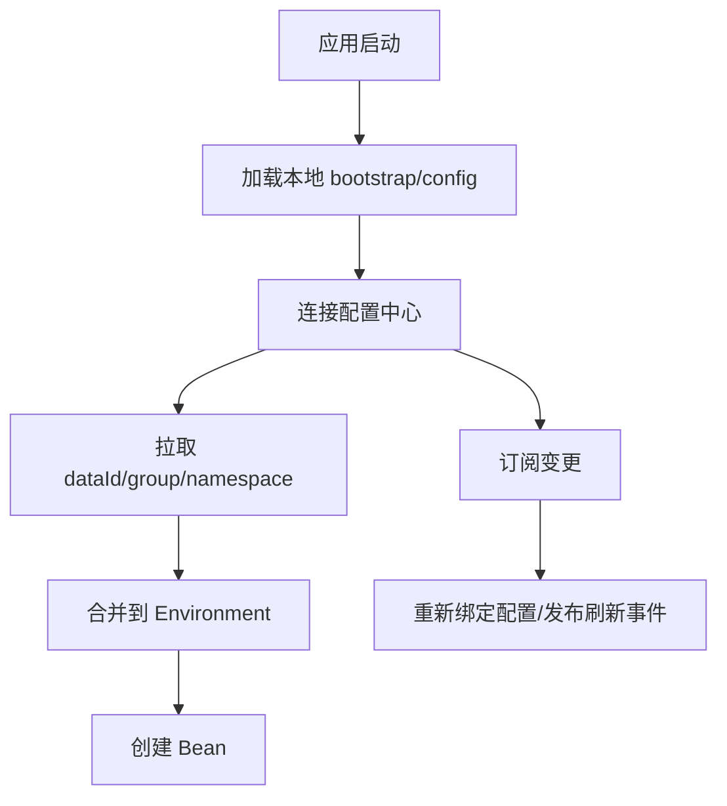

# 配置中心

> [!abstract] 一句话总结
> 配置中心把运行参数从应用包中抽离，提供集中存储、版本、发布、订阅和动态刷新；精通点是配置优先级、热更新边界和发布安全。

## 📌 精准定位

- 负责跨环境配置管理、灰度发布、变更审计和动态下发。
- 不负责让任意代码逻辑都能无风险热变更，资源类配置往往要重建。
- 关键边界：配置变更就是生产变更，必须有审批、回滚和影响面控制。

## 🧩 核心概念

| 概念 | 具体含义 | 精通要点 |
| ---- | -------- | -------- |
| DataId/Group/Namespace | 配置定位三元组。 | 环境隔离和服务隔离要清楚。 |
| 监听推送 | 客户端长轮询或连接订阅变更。 | 推送失败要有拉取兜底。 |
| 配置优先级 | 本地、远端、profile、环境变量覆盖。 | 排障先确认最终生效值。 |
| 动态刷新 | 重新绑定属性或刷新 Bean。 | 线程池连接池要定制刷新。 |

## ⚙️ 工作原理 / 主流程



1. 启动早期加载配置中心地址和身份信息。
2. 远端配置合并到 Spring Environment。
3. 变更后客户端更新本地缓存并触发刷新。
4. ConfigurationProperties 重新绑定相对安全，Value 和单例刷新要看支持。
5. 敏感配置要加密、脱敏展示并控制权限。

## 💻 代码 / 配置 / 伪代码

```yaml
payment:
  timeout-ms: 800
  retry: 1
feature:
  coupon-enabled: false
```

## 🔍 源码入口 / 关键组件

- Nacos ConfigService / Apollo ConfigService
- Spring Environment / PropertySource
- ContextRefresher / RefreshScope
- 发布历史与回滚记录
- 客户端本地 snapshot

## ⚠️ 生产坑与注意事项

- 把开关、限流、连接池都当成同一种热更新。
- 配置发布没有灰度，所有实例同时抖动。
- 配置项缺默认值导致中心故障时启动失败。
- 敏感信息明文存储和日志打印。
- 多个 dataId 定义同名 key 覆盖关系不清。

## 🧭 排查路径

- 不生效查 namespace、group、dataId、profile、优先级。
- 部分实例生效看监听、网络、snapshot、版本号。
- 刷新后异常确认 Bean 是否支持重建。
- 误发布用版本历史回滚并检查实例生效状态。

## 🎯 面试问题

> [!question] 高频问题
> - Q: 配置中心解决什么？
>   - A: 集中管理环境配置、动态发布、审计和回滚。
> - Q: 动态刷新限制？
>   - A: 只对可重新绑定或可重建资源安全。
> - Q: 优先级怎么排查？
>   - A: 查看 Spring Environment 的 PropertySource 顺序。
> - Q: 配置中心挂了能启动吗？
>   - A: 取决于 fail-fast、本地 snapshot、默认值和启动策略。
> - Q: 如何安全发布？
>   - A: 灰度、审批、校验、监控、回滚、敏感信息保护。

## ✅ 精通检查清单

- 能画出主流程，并标出最容易失败的节点。
- 能说出至少 3 个源码入口或关键组件。
- 能写出最小配置、SQL、伪代码或状态机。
- 能结合生产故障说明监控指标、排查命令和修复动作。
- 能和相邻方案做取舍对比，而不是只背定义。

## 🔗 关联笔记

- [[_index]]
- [[20-Java后端/00-总览/学习仪表盘]]

## 📚 参考资料

- Nacos Config Documentation
- Spring Cloud Commons: Refresh Scope
