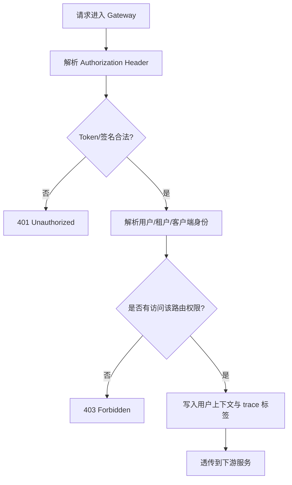
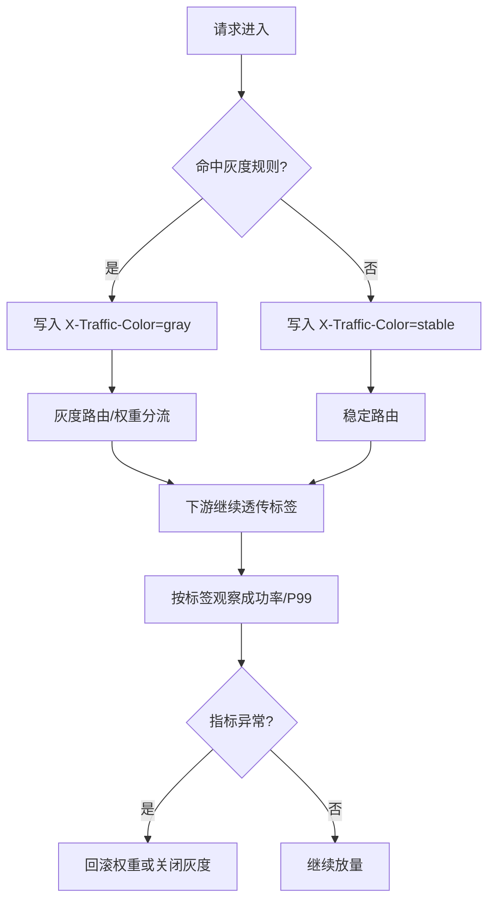
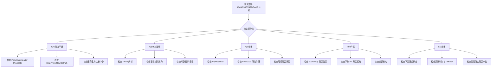

# API网关

> [!abstract] 一句话总结
> API 网关是南北向流量的统一入口，负责路由、认证、鉴权、限流、灰度、协议适配和观测；真正决定网关水平的不是会不会配路由，而是能否在高并发、低延迟和强治理约束下把通用能力做对且不拖垮后端。

## 📌 精准定位

- 网关负责统一入口控制面，把路由、认证、鉴权、限流、灰度、审计、日志和 trace 前置。
- 网关适合做“通用能力”，不适合做“重业务编排”，否则会把入口层做成单点复杂系统。
- API 网关解决的是南北向流量治理；服务间调用治理更多依赖注册发现、客户端负载均衡和服务治理框架。
- 关键边界：网关必须低延迟、可横向扩展、可快速回滚，过滤器里不能塞无界阻塞逻辑。
- 面试重点：要能讲清过滤器链、认证鉴权边界、灰度发布、RequestRateLimiter、重试幂等限制、Reactive 非阻塞约束和故障排查路径。

## 🧩 核心概念

| 概念 | 具体含义 | 工程要点 |
| ---- | -------- | -------- |
| Route Predicate | 根据 path、host、header、cookie、method、weight 等匹配路由。 | 路由匹配顺序直接影响命中结果。 |
| GatewayFilter / GlobalFilter | 在请求前后执行通用处理。 | 顺序不对会改变鉴权、限流和日志语义。 |
| 认证 Authentication | 判断“你是谁”。 | 常见是 JWT、Session、AK/SK、OAuth2/OIDC。 |
| 鉴权 Authorization | 判断“你能访问什么”。 | 资源、租户、角色、数据范围要分层设计。 |
| RequestRateLimiter | 在网关层做限流。 | KeyResolver 设计不当会误伤用户。 |
| Weight 路由 | 按权重分流到不同路由。 | 适合灰度放量，但要结合流量观测。 |
| Reactive 非阻塞 | 基于 Netty/Reactor 事件循环处理请求。 | 阻塞 IO 会直接卡住 event loop。 |
| 可观测性 | access log、trace、指标、审计。 | 网关是排障第一跳，日志字段必须完整。 |

## ⚙️ 工作原理 / 主流程

```mermaid
flowchart LR
A[Client 请求] --> B[SLB/WAF/Nginx]
B --> C[Gateway Route Predicate 匹配]
C --> D[Pre Filter: traceId/流量染色]
D --> E[认证 Authentication]
E --> F[鉴权 Authorization]
F --> G[限流/黑白名单/风控]
G --> H[路径改写/头处理]
H --> I[LoadBalancer 选择下游实例]
I --> J[转发到后端服务]
J --> K[Post/Error Filter: 指标/日志/异常映射]
K --> L[Response 返回客户端]
```



主流程要点：

1. 请求先匹配路由规则，确定该请求要走哪条链路。
2. 前置过滤器一般先做 traceId、流量染色，再做认证鉴权和限流。
3. 路由确定后，通过服务发现和负载均衡选出目标实例。
4. 转发完成后，后置过滤器负责日志、指标、审计和统一异常映射。
5. 任何一步都不应该做长时间阻塞，否则会拖慢整条 event loop。

## 🛂 网关认证与鉴权

### 常见边界划分

| 层次 | 负责内容 | 不该负责的内容 |
| ---- | -------- | -------------- |
| Gateway | 登录态校验、Token 解析、签名校验、基础黑白名单、租户识别、基础权限拦截 | 细粒度业务规则、复杂领域授权 |
| 业务服务 | 资源级权限、数据级权限、业务状态校验 | 重复做所有通用 Token 解析 |
| 身份中心 | 用户身份、角色、客户端凭证 | 业务服务内部授权逻辑 |

### 典型认证链路



工程建议：

- 401 和 403 要严格区分，前者是“未认证”，后者是“已认证但无权访问”。
- Token 解析后不要把完整敏感信息透传给下游，通常只传用户 ID、租户 ID、角色摘要、traceId。
- 权限模型复杂时，网关只做第一层粗过滤，细权限由业务服务再判断。
- 所有拒绝动作都要打审计日志，便于安全排查。

## 🌗 灰度发布、权重路由与流量染色

Spring Cloud Gateway 常见能力：

- `Header`、`Cookie`、`Host`、`Path` Predicate 做人群路由。
- `Weight` Predicate 做权重分流。
- 自定义 Filter 打流量标签并向下游透传。



生产要点：

- 灰度规则最好可热更新、可回滚、可审计。
- 仅做权重还不够，必须有流量染色，否则服务间调用会串色。
- 需要把灰度流量的成功率、延迟、状态码分布单独统计。
- MQ 消费、定时任务、回调链路是否参与灰度要提前定义清楚。

## ⚖️ 限流、重试与超时预算

### 网关限流常见维度

- 用户 ID
- 租户 ID
- API key / clientId
- Path + Method
- 来源 IP
- 设备 ID / 渠道

### KeyResolver 设计原则

- 不能只按 IP，NAT、公司出口、CDN 回源场景会误伤。
- 不能只按用户，匿名用户或未登录请求要有兜底 key。
- 核心接口和普通查询接口要区分阈值。
- 多租户场景一般要同时考虑租户级和用户级限流。

### 关于网关重试

- 网关层重试只能用于明确幂等的 GET、HEAD 或带幂等键的请求。
- POST、支付、下单、扣库存类请求默认不要在网关层做自动重试。
- 网关重试会放大全局流量，因此必须受总 deadline 约束。
- 下游服务已经有重试时，网关通常不应再做一层全局重试。

## 💻 代码 / 配置 / 伪代码

```yaml
spring:
  cloud:
    gateway:
      routes:
        - id: order-stable
          uri: lb://order-service
          predicates:
            - Path=/api/orders/**
            - Weight=order-group, 95
          filters:
            - StripPrefix=1
        - id: order-gray
          uri: lb://order-service
          predicates:
            - Path=/api/orders/**
            - Header=X-Traffic-Color, gray
            - Weight=order-group, 5
          filters:
            - StripPrefix=1
```

```java
public Mono<Void> filter(ServerWebExchange exchange, GatewayFilterChain chain) {
    String token = resolveToken(exchange.getRequest().getHeaders());
    UserContext user = authService.verify(token);
    String trafficColor = grayRule.match(user, exchange.getRequest()) ? "gray" : "stable";
    ServerHttpRequest request = exchange.getRequest().mutate()
        .header("X-User-Id", user.userId())
        .header("X-Tenant-Id", user.tenantId())
        .header("X-Traffic-Color", trafficColor)
        .build();
    return chain.filter(exchange.mutate().request(request).build());
}
```

## 🛠️ 工程案例：统一 BFF + 微服务网关

场景：

- App、H5、管理后台统一接入 Spring Cloud Gateway。
- 下游包括订单、用户、支付、营销多个微服务。
- 需要支持 JWT 鉴权、租户隔离、灰度发布、接口限流和 trace 透传。

落地方案：

1. Gateway 前面接 WAF/SLB，网关自身多实例部署。
2. GlobalFilter 统一生成 traceId、解析 JWT、识别租户与用户。
3. 权限粗过滤在网关做，资源级权限在业务服务二次校验。
4. 使用 `RequestRateLimiter` 做用户级和租户级限流。
5. 对订单接口按 header 做 5% 灰度，透传 `X-Traffic-Color`。
6. 所有 access log 带 routeId、status、latency、traceId、userId、tenantId。

收益：

- 鉴权和审计统一，避免每个服务重复做一套。
- 灰度发布和限流策略统一入口配置，回滚快。
- 排障时可以从网关第一跳快速拆分是入口问题还是下游问题。

## 🧨 常见故障图谱



## ⚠️ 生产坑与注意事项

- 在 Reactive Gateway 里直接调用阻塞式 JDBC、老版 Redis 客户端或同步 HTTP 客户端，卡死 event loop。
- 过滤器顺序混乱，先限流后鉴权或先改写路径后验签，导致语义错误。
- 网关 timeout 大于下游 timeout，用户已经超时，网关还在傻等下游。
- 开启全局 Retry 且作用在 POST，请求被重复提交。
- access log 没有 routeId、traceId、userId，排障只能靠猜。
- 只按 IP 限流，NAT 场景下误伤整片用户。
- 灰度只切入口不切服务间流量，造成版本串色。
- 在网关做复杂业务聚合，导致入口层又慢又难回滚。

## 🧭 排查路径

### 1. 404 或路由不通

- 查 Predicate 是否命中：Path、Host、Method、Header、Cookie。
- 查路径改写：`StripPrefix`、`RewritePath` 是否写错。
- 查服务发现：`lb://service-name` 的服务名是否正确注册。
- 查是否灰度条件把请求路由到不存在的分支。

### 2. 401/403 突然增多

- 看 Token 是否过期、签名密钥是否更新、时钟是否漂移。
- 看权限规则是否刚发布，是否误拦截正常租户或角色。
- 核对 401 和 403 是否被错误混用。
- 结合审计日志看具体拒绝原因。

### 3. 429 大量出现

- 先确认限流是在网关还是下游。
- 查 KeyResolver 维度是否合理，是否只按 IP。
- 看 Redis/Lua 或限流存储是否本身抖动，导致误判拒绝。
- 核对阈值是否与活动峰值和容量评估匹配。

### 4. 网关延迟高或 5xx 增多

- 先拆：是网关自身慢，还是下游服务慢。
- 看 Netty event loop、CPU、连接数、GC、下游 RT。
- 查是否有阻塞过滤器、全局重试、连接池耗尽。
- 用 trace 区分 TLS、路由、过滤器、下游调用哪段最慢。

## 🎯 面试问题

> [!question] 高频问题
> - Q: API 网关和 Nginx 有什么区别？
>   - A: Nginx 更偏通用反向代理，API 网关在路由基础上进一步承接认证、鉴权、限流、灰度、服务发现和统一观测。
> - Q: 为什么过滤器顺序很重要？
>   - A: 因为 trace、认证、鉴权、限流、路径改写、日志的先后不同会直接改变请求语义和安全边界。
> - Q: Spring Cloud Gateway 为什么强调不能阻塞？
>   - A: 它基于 Netty/Reactor 的事件循环模型，阻塞一个 event loop 就会影响同线程上的大量连接。
> - Q: 网关层能不能做重试？
>   - A: 只能对明确幂等的请求谨慎做，且要受总超时预算约束，非幂等请求默认不能在网关层自动重试。
> - Q: 网关认证和服务鉴权怎么分工？
>   - A: 网关做统一身份校验和基础权限拦截，细粒度业务权限仍要在服务内根据资源和数据范围判断。

## 🎤 面试 3 层回答

### 30 秒版

API 网关是所有外部流量进入系统的第一跳，核心职责是统一路由、认证鉴权、限流、灰度和观测。真正难点不在配路由，而在于既要做强治理，又不能把入口层做成高延迟和大单点。

### 2 分钟版

一个成熟的网关会先通过 Route Predicate 做路由匹配，然后在过滤器链里完成 trace、认证、鉴权、限流、路径改写和灰度打标，最后通过服务发现和负载均衡把请求转发到下游。Spring Cloud Gateway 是基于 Netty/Reactor 的，所以最大的坑是阻塞 event loop。生产上还要特别注意 RequestRateLimiter 的 key 设计、灰度发布的流量染色、网关重试的幂等限制，以及 access log 和 trace 的完整性。网关适合承接统一能力，但不应该堆复杂业务编排，否则会拖垮整个入口层。

### 项目版

在一个多端统一接入项目里，我用 Spring Cloud Gateway 做过 JWT 认证、租户识别、接口限流和灰度发布。入口先在 GlobalFilter 里解析 token、写 traceId 和流量标签，再按 route 做权限和限流，最后把用户 ID、租户 ID、灰度标签透传给下游。排障时，我一般先从 routeId、status、latency、traceId 看是网关问题还是下游问题。如果 429 突增，会先查 KeyResolver；如果 P99 升高，会重点查是否有阻塞过滤器或下游 RT 抖动。

## ✅ 精通检查清单

- 能讲清 Route Predicate、Filter Chain、LoadBalancer 的主流程。
- 能区分认证 Authentication 和鉴权 Authorization 的职责边界。
- 能说明网关限流、灰度、重试、超时预算的设计原则。
- 能解释 Reactive 网关为什么不能做阻塞 IO。
- 能从 404、401/403、429、5xx、P99 升高五类问题切入排障。

## 🔗 关联笔记

- [[_index]]
- [[20-Java后端/00-总览/学习仪表盘]]
- [[../07-分布式与微服务/07-服务治理与负载均衡]]
- [[../07-分布式与微服务/06-限流-熔断-降级]]
- [[../07-分布式与微服务/08-链路追踪]]
- [[04-注册中心-Nacos]]
- [[05-配置中心]]
- [[../04-Spring生态/08-SpringCloud组件概览]]

## 📚 参考资料

- Spring Cloud Gateway Reference
- Spring Security Reference
- Envoy Architecture Overview
- OAuth 2.0 / OpenID Connect Specifications
