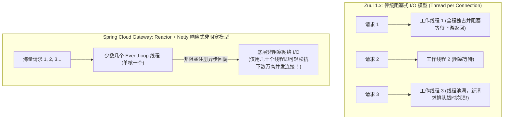
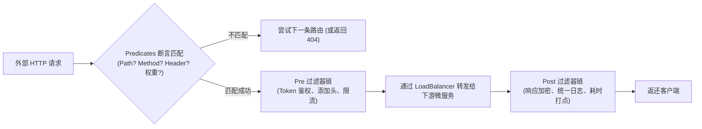
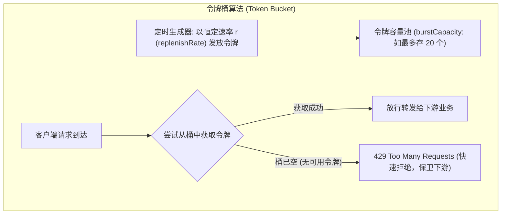

# API 网关原理与实战

> [!abstract] 一句话心智模型
> 如果把整个微服务集群比作**一座高度安保的现代化大型产业生态园区**：
> - **API 网关（Spring Cloud Gateway）** 就是**园区唯一的正门主关卡与智能安检大厅**；
> - **统一海关安检（认证鉴权）**：外来访客（客户端）在此统一核验身份证与通行证（Token 校验、签名验证、黑名单拦截），合法的访客被贴上内部工牌（解析后的用户上下文 Header 透传），内部服务无需各自重复进行繁重的安检工作；
> - **智能摆渡与路线指引（动态路由与断言）**：根据访客的目的地凭证（Predicate 匹配路径、Header、权重），将请求精准引导至对应的业务大楼（微服务集群）；
> - **防踩踏限流阀门（Rate Limiter）**：在关卡处安置基于**令牌桶算法**的高速旋转闸机，遭遇千万级洪峰时将超标流量无情阻挡在门外，誓死保卫园区内核心服务的生命安全！

---

## 🏛️ 一、架构演进：为什么 Gateway 淘汰了 Zuul 1.x？

在微服务早期，Netflix 的 **Zuul 1.x** 是最广为人知的网关。为什么在 Spring Cloud 生态中它被彻底废弃，全面转向 **Spring Cloud Gateway**？



### 底层第一性原理剖析：
- **Zuul 1.x 的线程泥潭**：
  - 基于传统的 Java Servlet 规范，采用**同步阻塞 I/O**。
  - 每个 HTTP 请求必须绑定一个独立的 Worker 线程。如果下游微服务出现慢查询或网络卡顿，这个线程就会被死死卡在 `read()` 上无法释放。当并发量稍大，网关的 200 个线程瞬间全部被耗尽，整个网关立刻拒绝服务！
- **Spring Cloud Gateway 的响应式革命**：
  - 基于 **Spring 5、Project Reactor 和 Netty** 构建。
  - 核心工作在 **事件循环（EventLoop）** 线程上。当网关向下游发起 RPC 调用时，当前线程**绝不阻塞等待**，而是直接注册一个异步回调后立刻抽身去处理下一个请求！下游响应回来时，通过事件驱动触发回调将数据返还给客户端。
  - **收益**：**仅仅依靠极少的 CPU 核心线程（通常等于 CPU 核数），就能以极低的内存开销从容支撑数万级并发长短连接！**

> [!CAUTION] 响应式网关铁律：严禁在 Gateway 过滤器中执行任何阻塞代码！
> 既然 EventLoop 线程数量极少（比如 8 核 CPU 只有 8 个工作线程），**一旦有新手在自定义的 `GlobalFilter` 中写了 `Thread.sleep()`、同步读取 Redis、或者用 JDBC 执行了耗时 SQL**：
> - 这个宝贵的 EventLoop 线程会被当场卡死！
> - 如果 8 个核心线程全被阻塞代码卡死，**整个网关将彻底瘫痪，所有微服务的流量入口瞬间冰冻！**
> - **军规**：在网关内部进行任何外部调用，必须使用基于响应式的非阻塞客户端（如 `WebClient`、Reactive Redis）！

---

## 🧭 二、三大核心支柱：Route、Predicate 与 Filter

在 Spring Cloud Gateway 中，一切逻辑围绕三大概念展开：

```
Route（路由） = ID + 目标 URI + Predicates（一组断言条件） + Filters（一组过滤器）
```



### 1. Predicates（断言工厂：决定流量走哪条路）
断言就像是一组 `if` 条件语句，必须全部满足（与逻辑）才算匹配该路由：
```yaml
spring:
  cloud:
    gateway:
      routes:
        - id: order-service-route
          uri: lb://order-service # lb 代表使用 Spring Cloud LoadBalancer 动态负载均衡
          predicates:
            - Path=/api/order/** # 路径断言
            - Method=GET,POST    # 请求方式断言
            - Header=X-Request-Id, \d+ # 请求头必须携带纯数字的 RequestId
            - Weight=order-group, 80   # 权重路由：承担 80% 流量 (灰度发布利器)
```

### 2. Filters（过滤器：在转发前后大显身手）
过滤器分为 `GatewayFilter`（针对单条路由生效）和 `GlobalFilter`（对所有路由全局生效）：
- **Pre 阶段**：在请求转发给下游之前执行。经典职能：**解析 JWT Token 校验登录态、从白名单中放行静态资源、提取 `user_id` 写入 Header 透传给下游、令牌桶限流**。
- **Post 阶段**：在下游服务响应之后、返回给客户端之前执行。经典职能：**计算接口全链路耗时、打印 Access 访问日志、统一追加安全响应头**。

---

## 🚦 三、高并发流量防护：令牌桶限流算法与 Redis 实战

面对大促秒杀或恶意黑客攻击，网关是全站的第一道防线，必须具备**秒级限流与熔断自愈能力**。

### 1. 经典限流算法对比（为什么选择令牌桶？）

| 限流算法 | 工作机制 | 致命缺陷 | 适用场景 |
| :--- | :--- | :--- | :--- |
| **固定窗口 (Fixed Window)** | 限制每秒最多 100 个请求。 | **临界突刺问题**：在第 0.9 秒冲入 100 个请求，在第 1.1 秒又冲入 100 个请求，在中间 0.2 秒内承受了 200 个并发，直接打穿系统！ | 粗粒度防刷 |
| **滑动窗口 (Sliding Window)** | 将 1 秒切分为 10 个 100ms 窗口，平滑滑动。 | 解决了临界突刺，但无法处理**突发流量的平滑削峰**。 | 监控大盘计数 |
| **漏桶算法 (Leaky Bucket)** | 水滴以任意速率滴入桶，以**恒定速率**从底孔漏出。 | 过于死板！**无法应对合理的突发流量**，哪怕下游服务容量充沛，突发流量也会被直接拒绝。 | 强平滑输出（如流量整形） |
| **令牌桶算法 (Token Bucket)** | 系统以**恒定速率向桶中发放令牌**；桶满则溢出；请求到达时必须**取出一枚令牌才能放行**。 | 允许**在桶容量允许的范围内应对瞬时突发洪峰**，且长期平均速率受发牌速率严格约束！ | **网关高并发限流业界首选（Gateway 默认算法）** |



### 2. Spring Cloud Gateway + Redis 令牌桶生产落地

Spring Cloud Gateway 官方内置了基于 **Redis + Lua 脚本** 的分布式令牌桶限流器（`RequestRateLimiter`）：

```yaml
spring:
  cloud:
    gateway:
      routes:
        - id: order-service-rate-limit
          uri: lb://order-service
          predicates:
            - Path=/api/order/**
          filters:
            - name: RequestRateLimiter
              args:
                redis-rate-limiter.replenishRate: 100 # 每秒向令牌桶中发放 100 个令牌 (平均 QPS)
                redis-rate-limiter.burstCapacity: 200 # 桶的最大容量，允许应对最大 200 的瞬时洪峰
                key-resolver: "#{@userKeyResolver}"   # 限流维度解析器 (按用户、IP 或接口)
```

**编写限流维度解析器（Java Bean）**：
```java
@Configuration
public class RateLimiterConfig {

    // 按照客户端真实 IP 进行限流
    @Bean
    public KeyResolver ipKeyResolver() {
        return exchange -> Mono.just(
            exchange.getRequest().getRemoteAddress().getAddress().getHostAddress()
        );
    }

    // 按照登录用户 ID 进行限流 (防单用户刷接口)
    @Bean
    public KeyResolver userKeyResolver() {
        return exchange -> Mono.justOrEmpty(
            exchange.getRequest().getHeaders().getFirst("X-User-Id")
        ).defaultIfEmpty("anonymous");
    }
}
```

---

## ⚡ 一分钟面试必杀卡

> [!NOTE] 面试高频问题标准答题套路
> 
> **Q1：Spring Cloud Gateway 为什么性能远高于传统的 Zuul 1.x？**
> - **A**：
>   - **Zuul 1.x** 基于传统 Servlet 规范，采用**同步阻塞 I/O**模型，每个请求分配一个线程。当下游微服务变慢时，Worker 线程池会被迅速耗尽，并发上限极低。
>   - **Spring Cloud Gateway** 基于 **Spring 5、Project Reactor 和 Netty** 构建，采用**异步非阻塞的响应式事件驱动模型**。少量几个 EventLoop 线程即可多路复用处理海量并发请求，遇到远程调用立刻注册异步回调而释放当前线程，内存占用更低、吞吐量实现质的飞跃。
> 
> **Q2：网关如何实现高并发限流？令牌桶与漏桶有什么区别？**
> - **A**：
>   - 网关通常选用**令牌桶算法（Token Bucket）**，配合 Redis + Lua 脚本实现分布式原子限流。
>   - **核心区别**：
>     - **漏桶算法**的出水速率是绝对恒定的，无法处理任何突发并发，超出恒定速率的流量只能排队或被丢弃；
>     - **令牌桶算法**在限制长期平均速率的同时，由于桶内允许积攒一定额度的令牌（`burstCapacity`），因此**允许系统应对合理范围内的瞬时突发洪峰**，更符合互联网真实业务流量特征。
