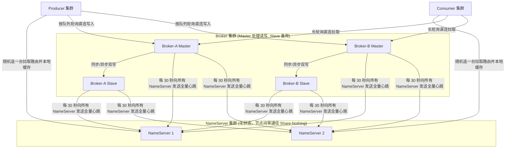
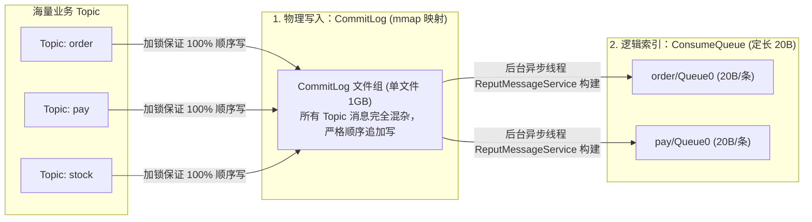
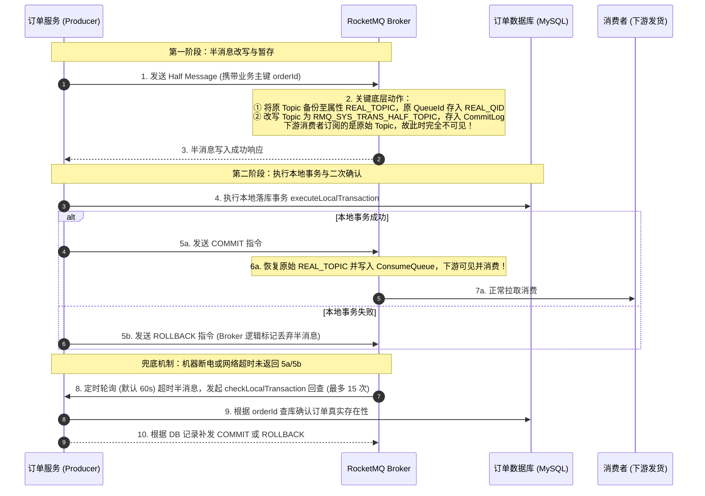
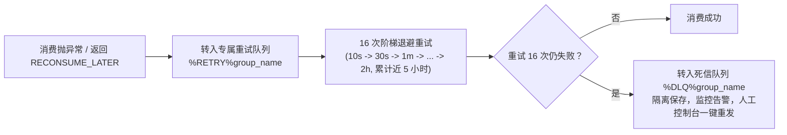

# 06 · RocketMQ 架构原理与实战手册

> [!abstract] 一句话第一性原理
> RocketMQ 是**专为在线核心业务打造的高可靠消息引擎**。其核心架构特征是：**AP 极简无状态路由（NameServer）**、**全 Topic 混合顺序写与定长索引读写分离（CommitLog + ConsumeQueue + mmap）**，以及**二阶段半消息与事务状态回查**。

---

## 一、 集群架构与 NameServer 极简设计

### 1. 架构拓扑全景



### 2. 为什么放弃 ZooKeeper 转向自研 NameServer？

| 维度 | ZooKeeper (传统 CP 方案) | NameServer (RocketMQ 自研 AP 方案) |
| :--- | :--- | :--- |
| **一致性模型** | 强一致性 CP，基于 ZAB 协议进行分布式选主与同步 | 最终一致性 AP，内存维护几个简单的 `HashMap` |
| **节点通信** | 节点间频繁网络投票通信，一旦网络抖动重新选主停服 30s+ | **节点间完全不通信（Share-Nothing）**，无 Leader/Follower |
| **数据同步机制** | 内部日志复制 | 每台 Broker 每隔 30 秒同时向**全量 NameServer** 上报路由心跳 |
| **容灾韧性** | 集群过半节点挂掉即不可用 | 即使全量 NameServer 宕机，客户端依靠**本地路由缓存**依然正常收发 |

---

## 二、 底层存储架构：CommitLog + ConsumeQueue 读写分离与 mmap

### 1. 为什么上千个 Topic 时 Kafka 性能下降，而 RocketMQ 依然稳定？

- **Kafka 机制**：每个 Partition 对应一个独立的物理文件夹和日志段（`.log`）。当集群创建上千个 Topic 时，单机对应上万个独立文件，磁盘磁头在不同文件之间频繁切换寻道，**顺序追加写退化为随机 I/O**。
- **RocketMQ 破局**：采用 **单一物理日志混合写入 + 定长轻量逻辑索引读取** 的读写分离架构。



### 2. 三大核心文件职责

#### （1）`CommitLog`（物理数据文件）
- 单机唯一消息存储中心，所有 Topic 的消息全部混杂、严格按到达先后追加写入。
- 单文件固定大小 **1 GB**，文件名以起始物理偏移量命名（20 位补零）。
- **优势**：磁盘永远仅有一个当前写入文件，保证 100% 纯粹的顺序写。

#### （2）`ConsumeQueue`（消费逻辑索引）
- 每个 Topic 下的每个 Queue 对应独立的 `ConsumeQueue` 文件。
- **条目严格定长 20 字节**：
  $$\text{[CommitLog 物理偏移量 (8B)]} + \text{[消息体大小 (4B)]} + \text{[Tag 哈希值 (8B)]}$$
- **优势**：
  1. **$O(1)$ 定位**：根据逻辑 Offset 直接寻址（Offset $\times$ 20 字节）；
  2. **PageCache 极高命中**：文件微小（30 万条约 5.72MB），全量索引常驻内存；
  3. **服务端高效过滤**：直接在内存中比对 8 字节 Tag 哈希，不匹配直接跳过，零磁盘读取。

#### （3）`IndexFile`（业务主键索引）
- 基于消息业务 Key（如订单号）构建的文件级哈希表（Hash 槽 + 链表），支持在控制台秒级定位消息物理位置。

---

### 3. 高性能读写基石：mmap 零拷贝与内存锁定

为什么 Kafka 采用 `sendfile`，而 RocketMQ 采用 `mmap`？

- **`sendfile` 的局限**：数据直接从内核 PageCache 走 DMA 发送给网卡，**用户态程序完全无法接触并修改数据**（无法在服务端做过滤、改写或消息体解析）；
- **`mmap`（内存映射）的优势**：
  RocketMQ 底层通过 Java NIO `MappedByteBuffer`（封装为 `MappedFile` 与 `MappedFileQueue`），将物理磁盘文件映射到进程虚拟内存地址空间。
  - **收益**：应用读写磁盘就像直接读写内存数组一样高效，规避了用户空间与内核空间的数据拷贝；同时，RocketMQ 在 Broker 端可以灵活解析消息头进行 **Tag 过滤** 与 **事务半消息改写**。
  - **内存锁定（mlock）与预热**：为了防止高并发下物理内存不足触发 Linux 将 PageCache 交换到 Swap 分区导致卡顿，RocketMQ 提供了文件预热与 `mlock` 系统调用，强制将映射内存锁定在物理 RAM 中。

---

## 三、 分布式事务消息：二阶段半消息与状态回查底层实现

解决“本地数据库落库”与“发送 MQ 消息”的分布式原子性问题：



### 实战代码核心接口：`TransactionListener`

```java
@Component
public class OrderTransactionListener implements TransactionListener {

    @Autowired
    private OrderService orderService;
    @Autowired
    private OrderMapper orderMapper;

    // 阶段二：半消息发送成功后执行本地事务
    @Override
    public LocalTransactionState executeLocalTransaction(Message msg, Object arg) {
        try {
            orderService.createOrder((OrderDTO) arg);
            return LocalTransactionState.COMMIT_MESSAGE;
        } catch (Exception e) {
            return LocalTransactionState.ROLLBACK_MESSAGE;
        }
    }

    // 兜底：Broker 超时主动回查本地事务状态
    @Override
    public LocalTransactionState checkLocalTransaction(MessageExt msg) {
        String orderId = msg.getKeys();
        OrderDO order = orderMapper.selectByOrderId(orderId);
        return (order != null) ? LocalTransactionState.COMMIT_MESSAGE : LocalTransactionState.ROLLBACK_MESSAGE;
    }
}
```

---

## 四、 顺序消息底层：分布式队列锁机制

RocketMQ 实现顺序消费（`MessageListenerOrderly`）的底层原理依靠**三级锁防护**：

1. **Broker 队列锁（分布式锁）**：
   消费者拉取消息前，必须先向 Broker 发送 `lockBatchMQ` 请求，在 Broker 端为当前消费者锁定该物理队列。如果锁定失败，拒绝拉取；
2. **ProcessQueue 内存锁**：
   消费者内部维护 `ProcessQueue` 消费进度，加锁防止同实例内部多线程并发消费同一队列；
3. **Rebalance 锁释放保障**：
   发生重平衡时，原消费者必须等待正在处理中的消息完全提交位点并向 Broker 发送 `unlockBatchMQ` 释放锁后，新消费者才能成功锁定并接管该队列，杜绝乱序。

---

## 五、 延时消息与死信队列（DLQ）

### 1. 延时消息底层机制（4.x 预设队列 vs 5.x 时间轮）

- **4.x 机制（18 个固定级别）**：
  预设 `1s 5s 10s 30s 1m 2m 3m 4m 5m 6m 7m 8m 9m 10m 20m 30m 1h 2h`。
  消息暂存内部主题 `SCHEDULE_TOPIC_XXXX` 对应队列。因同一队列延时时长一致，**队列内部天然按到期时间绝对有序**，定时调度线程 `ScheduleMessageService` 仅需盯住队列头，到期则还原至原 Topic。
- **5.x 机制（时间轮 TimerWheel）**：
  基于时间轮算法与 `TimerLog`，支持任意毫秒级精准定时（`deliverTimeStamp`）。

### 2. 消费重试与死信隔离（DLQ）



---

## 六、 生产架构选型指南：Kafka vs RocketMQ

| 对比维度 | Apache Kafka | Apache RocketMQ |
| :--- | :--- | :--- |
| **核心定位** | **大数据日志传输与流计算管道**（极致吞吐） | **金融级在线业务消息引擎**（高可靠与丰富业务支持） |
| **单机极限吞吐** | 百万级 QPS（大批次压缩 + `sendfile` 零拷贝） | 十万级 QPS（需维护索引且使用 `mmap`） |
| **多 Topic 支撑** | 弱（数百个），过多 Topic 分区导致磁盘顺序写退化为随机写 | **极强（支持数万个）**，所有 Topic 混写单个 `CommitLog` |
| **元数据协调** | 早期 ZK，现代版本使用内置 **KRaft**（Raft 协议） | **自研极简无状态 NameServer**（Share-Nothing AP 架构） |
| **事务消息** | 仅支持流处理内部 Exactly-Once，不支持业务 DB 回查 | **原生二阶段半消息 + 业务状态主动回查** |
| **延时消息** | 不支持（需业务引入时间轮自行封装） | **原生支持**（4.x 预设 18 级，5.x 时间轮任意毫秒） |
| **重试与死信** | 无原生机制（需客户端框架封装模拟） | **原生内置 16 次阶梯退避重试队列与死信队列（DLQ）** |
| **服务端过滤** | 仅支持分区消费 | **支持服务端 Tag 哈希过滤与 IndexFile 主键秒级检索** |
| **选型口诀** | **埋点采集、日志收集（ELK）、实时数仓（Flink） $\to$ Kafka** | **电商订单、支付、积分、延时关单、分布式事务 $\to$ RocketMQ** |

---

## 七、 高频面试自测

> [!question]- Q1：RocketMQ 的存储结构为什么是 CommitLog + ConsumeQueue？为什么它比 Kafka 更适合在线业务多 Topic 场景？
> Kafka 每个 Partition 对应独立日志文件，几千个 Topic 会产生上万个文件，引发磁盘随机寻道导致吞吐暴跌。
> RocketMQ 采用读写分离：物理写统一由单机唯一的 `CommitLog`（1GB/个，基于 mmap 映射）负责，所有 Topic 消息完全混杂且 100% 顺序追加写；读取时通过定长 20 字节的 `ConsumeQueue` 索引（物理偏移 + 大小 + Tag 哈希）在 PageCache 内存中直接定位，既保证了多 Topic 并发写的高吞吐，又提供了高效的索引与服务端 Tag 过滤。

> [!question]- Q2：RocketMQ 的事务消息是如何做到生产者本地数据库落库与发消息最终一致的？
> 采用“二阶段半消息 + 状态回查”：
> 1. 先发半消息，Broker 将其改写并存入系统内部主题 `RMQ_SYS_TRANS_HALF_TOPIC`，原始 Topic 暂存属性中，对下游完全隐藏；
> 2. 生产端执行本地事务；
> 3. 本地事务成功发 Commit，Broker 恢复原 Topic 写入 ConsumeQueue 放行消息；失败发 Rollback 物理丢弃；
> 4. 若宕机或网络中断导致未发送二次确认，Broker 定时扫描超时半消息，主动向生产端发起事务回查接口，生产端查库确认后补发 Commit/Rollback。

---

## 🔗 上下篇导航
- **上一篇**：[[05-Kafka架构原理与实战手册]]
- **下一篇**：[[07-Nacos架构原理与实战手册]]
