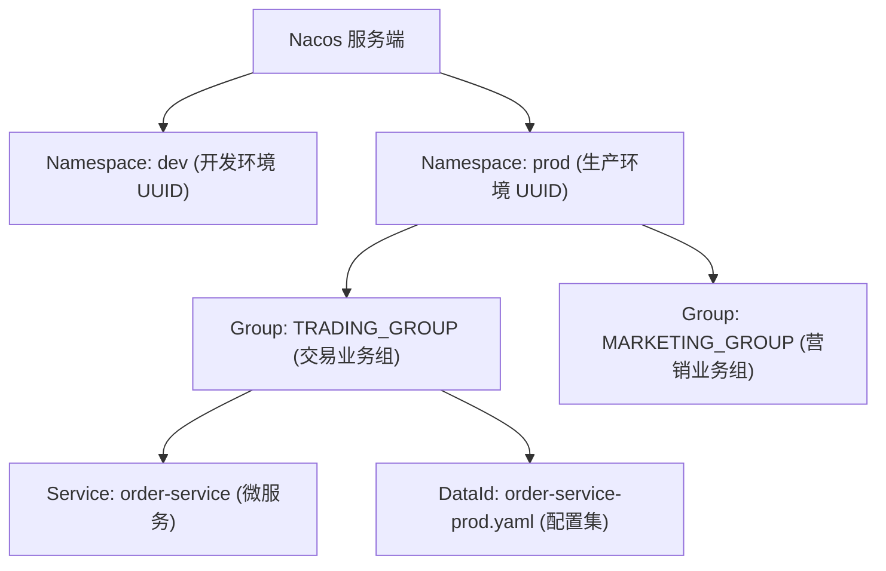
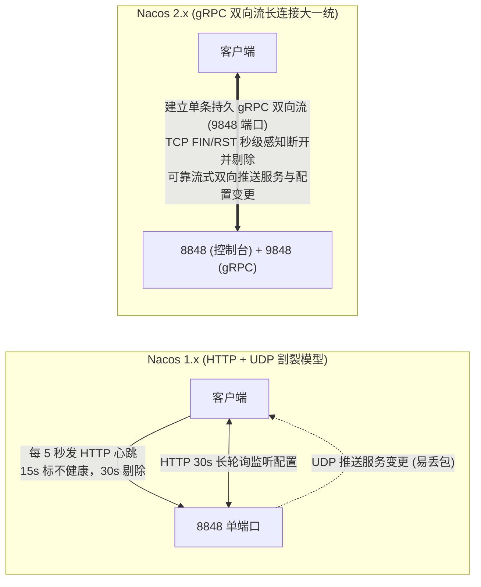
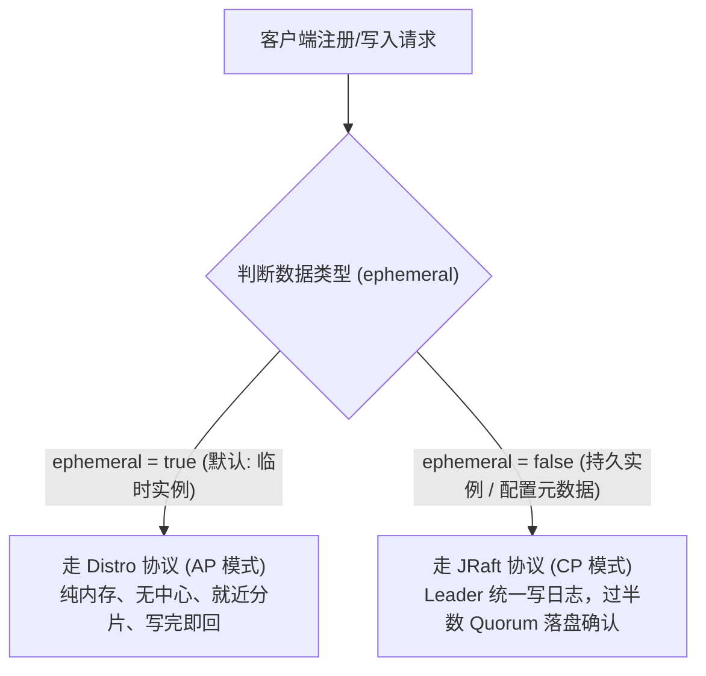
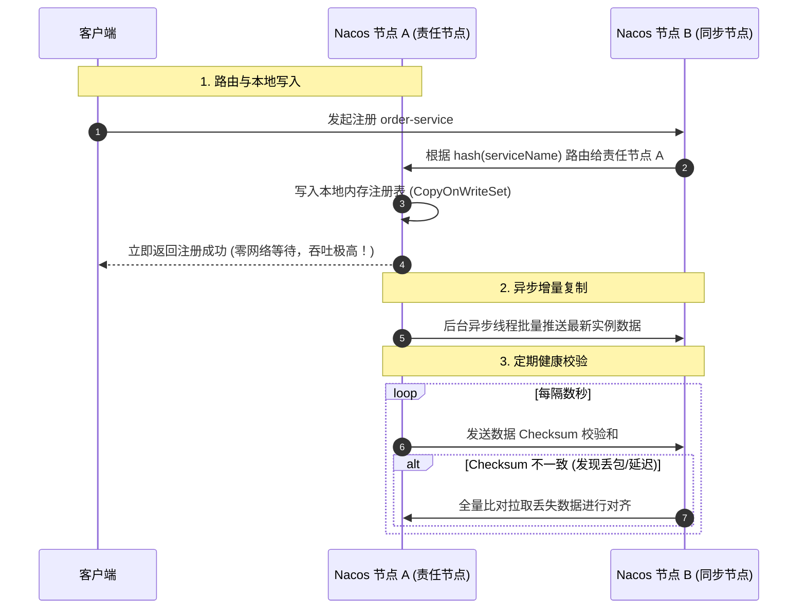
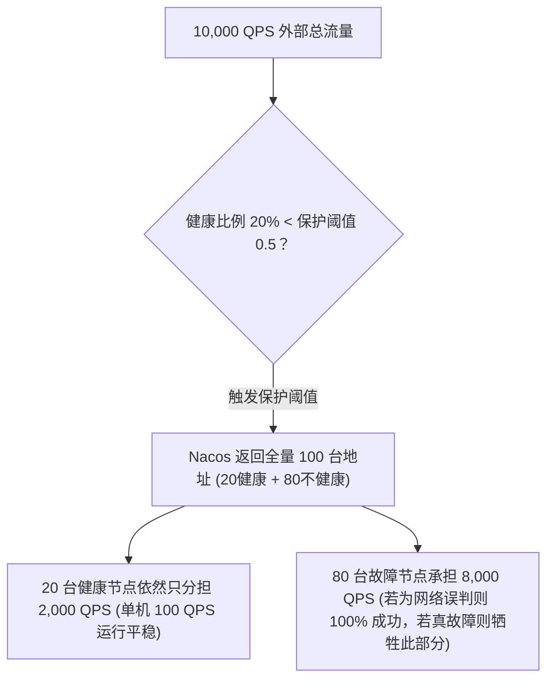

# 07 · Nacos 架构原理与实战手册

> [!abstract] 一句话第一性原理
> Nacos 将**服务注册发现（Naming）**与**分布式配置中心（Configuration）**合二为一。其架构核心在于：**Namespace 三级隔离模型**、**gRPC 双端口（8848/9848）长连接**、**Distro（AP）与 JRaft（CP）双模协议**，以及**保护阈值防雪崩机制**。

---

## 一、 数据分层隔离模型与生产规范

为避免开发、测试、生产环境串线与配置互相覆盖，Nacos 提供了清晰的三级隔离模型：



| 层级 | 概念定位 | 隔离级别与生产规范 |
| :--- | :--- | :--- |
| **Namespace** | 命名空间 | **环境强隔离**：不同 Namespace 间服务互不可见、配置互不可调。生产严格按环境划分（如 `dev`、`test`、`prod`），生成独立 UUID。 |
| **Group** | 业务分组 | **业务线/模块分类**：相同环境下不同业务线划分（如 `ORDER_GROUP`、`PAY_GROUP`），默认 `DEFAULT_GROUP`。 |
| **Service / DataId** | 服务名 / 配置集 | 具体目标对象。DataId 标准格式为 `${spring.application.name}-${profile}.${file-extension}`。 |

```yaml
# 生产集成基线配置
spring:
  cloud:
    nacos:
      discovery:
        server-addr: 10.0.0.1:8848
        namespace: 7a8b9c-prod-uuid # 生产环境 Namespace ID
        group: TRADING_GROUP
        cluster-name: SH-ZONE-A     # 同机房优先就近路由
      config:
        server-addr: 10.0.0.1:8848
        namespace: 7a8b9c-prod-uuid
        group: TRADING_GROUP
        file-extension: yaml
```

---

## 二、 通信架构大演进：1.x vs 2.x 与端口规则

### 1. 通信架构演进对比



| 维度 | Nacos 1.x | Nacos 2.x |
| :--- | :--- | :--- |
| **注册保活** | HTTP 短连接定时心跳（每 5 秒一次），高并发下心跳请求量巨大 | **gRPC 单条 TCP 双向长连接**复用，开销降低 70%+ |
| **故障感知时效** | 缓慢（15 秒标记不健康，30 秒才剔除实例） | **极快（毫秒/秒级，依赖操作系统 TCP 连接断开事件立即剔除）** |
| **变更通知** | **UDP 广播推送**（容器虚拟网络极易丢包） + 定时拉取兜底 | **gRPC 服务端流式推送**，基于 TCP 可靠传输不丢包 |
| **配置监听** | 30 秒 HTTP 长轮询（Hold 住连接） | 复用现成 gRPC 长连接直接事件推流 |

### 2. 生产必防大坑：端口偏移规则（8848 / 9848 / 9849）

Nacos 2.x 采用**主端口 + 固定偏移量**规则，外部网络策略或容器端口映射必须成对开放：

- **`8848`（主端口）**：处理 Web 控制台访问及兼容 1.x 的 HTTP OpenAPI。
- **`9848`（`主端口 + 1000`）—— 客户端 gRPC 端口**：**2.x 客户端建立长连接的唯一端口**。防火墙、Docker `-p`、K8s `Service` 与负载均衡器**必须配置四层 TCP 代理开放 9848**，否则微服务启动报 `Connection refused: 9848`。
- **`9849`（`主端口 + 1001`）—— 集群同步端口**：Nacos 集群节点间内部数据同步端口，仅需内网互通。

---

## 三、 CAP 双模架构与自研 Distro 协议底层运转

Nacos 针对不同业务数据的特征，在同一引擎内实现了两种一致性协议，通过 `ephemeral` 参数路由：



### 1. 临时实例：自研 Distro 协议（AP，99% 微服务默认）深度拆解

Distro 协议是阿里巴巴专为临时注册数据研发的高可用、纯内存无中心共识协议。其完整生命周期包含五大机制：



#### Distro 五大关键机制：
1. **数据初始化（启动同步）**：新节点启动加入集群时，向健康节点全量拉取全部服务的实例数据，构建本地读副本；
2. **服务责任分片（Data Sharding）**：每个节点通过对服务名进行一致性哈希，明确各自负责的“责任服务”。任何节点收到非自己负责的服务写请求时，直接内部转发给对应的责任节点；
3. **极速写内存返回**：责任节点写入本地内存后，**立刻返回成功**，无需等待多数派节点确认，单机写吞吐轻松达到每秒数万 QPS；
4. **异步批量同步与 Checksum 校验**：责任节点异步广播变更给全集群节点。为防网络丢包，节点间定期互发 Checksum（数据校验和），若不匹配则全量对齐；
5. **网络脑裂容灾**：网络分区发生时，脑裂两侧的节点依然能正常提供读写服务，数据保留在各自内存中；分区恢复后通过 Checksum 自动合并恢复。

---

### 2. 持久实例与配置中心：JRaft 协议（CP）

- **适用场景**：数据库代理/静态硬件服务（`ephemeral: false`）及配置中心数据，绝不允许写入冲突或丢失。
- **运行机制**：基于 Raft 共识协议，全部写请求由唯一 Leader 处理，并广播复制给 Follower，**必须过半数节点（Quorum）落盘确认后才返回成功**。

---

## 四、 防雪崩机制：保护阈值（Protect Threshold）

### 1. 雪崩场景剖析

假设 `order-service` 承载 10,000 QPS，部署 100 台实例（单机安全上限 150 QPS）。
若网络抖动导致 **80 台机器与 Nacos 心跳中断**：
- **未开保护（阈值 = 0）**：Nacos 剔除 80 台不健康节点，仅将剩余 20 台健康实例推给网关。全站 10,000 QPS 瞬间全部砸向这 20 台机器（单机飙升至 500 QPS），导致幸存节点瞬间被压死，**全站可用性直接跌至 0%**！



### 2. 保护阈值工作原理与边界

- **计算公式**：$$\text{健康比例} = \frac{\text{当前健康实例数}}{\text{总实例数}}$$
- **触发机制**：当设置保护阈值为 `0.5` 且健康比例跌破 50% 时，Nacos 强行开启自我保护：**不再过滤不健康实例，而是将全量（健康 + 不健康）实例列表同时返回给消费者**。
- **核心价值**：
  1. 若 80 台机器仅为心跳假死（业务网络通畅），请求可 100% 正常处理；
  2. 若 80 台机器真实宕机，通过牺牲部分请求，**死死保住幸存健康节点的负载不超过上限，保住系统底线有生力量**。
- **调用端注意**：调用端 RPC/Feign **必须严格限制重试次数（甚至写操作禁重试）**，否则打到故障节点的重试流量最终仍会转移压垮健康节点。

---

## 五、 高频面试自测

> [!question]- Q1：Nacos 1.x 和 2.x 底层通信机制有什么区别？升级 2.x 为什么总遇到 9848 连接失败？
> 1.x 采用 HTTP 短连接（5s 心跳保活，15s/30s 感知故障较慢）+ UDP 推送变更（容器网络易丢包）+ HTTP 30s 长轮询监听配置。
> 2.x 全面重构为基于 gRPC 的单条 TCP 双向长连接，秒级感知连接断开并剔除故障节点，通过服务端主动推流下发变更，性能提升近 10 倍。
> 2.x 采用主端口偏移规则：客户端建立 gRPC 连接使用的是 `8848 + 1000` 即 **`9848` 端口**。若部署时仅开放 8848 而未开放 9848，微服务将无法注册。

> [!question]- Q2：为什么 Nacos 能同时支持 AP 和 CP？临时实例的 Distro 协议是如何工作的？
> 微服务临时实例追求可用性（网络抖动时允许微小延迟，重试可容错），走 **Distro 协议（AP）**；配置数据与持久实例追求强一致持久化，走 **JRaft 协议（CP）**。
> Distro 协议五大机制：数据初始化全量同步、按服务名一致性哈希确定责任节点、写本机内存即返回（超高吞吐）、异步增量广播与定期 Checksum 校验和比对防丢，以及网络脑裂时的独立读写容灾。

> [!question]- Q3：Nacos 的“保护阈值”是用来解决什么问题的？
> 防止网络抖动导致大批实例失联时，Nacos 仅将少量幸存健康节点推给网关，造成全量高并发集中砸向幸存节点引发团灭雪崩。
> 当健康比例低于设定阈值（如 0.5），Nacos 触发保护，将健康与不健康节点一同返回，避免幸存节点过载被击垮，保住系统底线可用性。

---

## 🔗 上下篇导航
- **上一篇**：[[06-RocketMQ架构原理与实战手册]]
- **下一篇**：[[99-本章总结与复习]]
