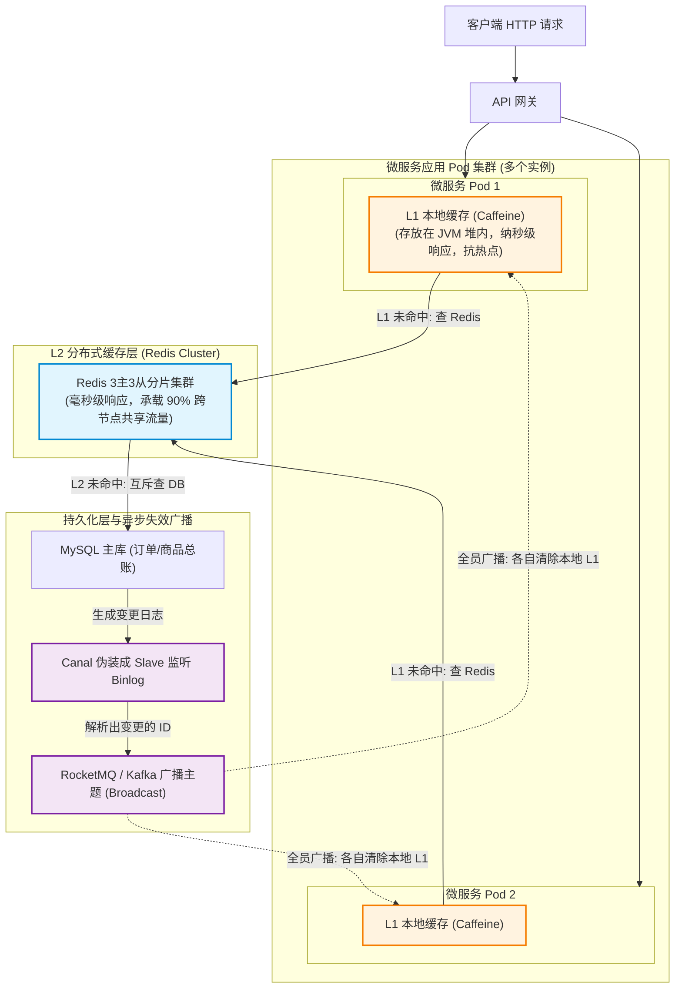
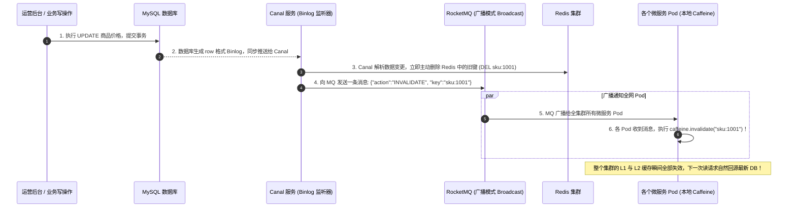
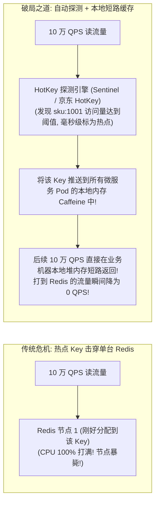

# 分布式缓存与多级缓存架构

> [!abstract] 一句话心智模型
> 如果把海量数据检索比作**现代城市的快速消费品供应网络**：
> - **中央总仓库（MySQL 关系型数据库）**：存着全量档案，安全稳固，但调货手续繁琐（磁盘 I/O 慢），一旦全市几百万人同时冲进总仓，大门瞬间被挤塌（数据库宕机）；
> - **区域中心批发站（Redis 分布式缓存集群）**：存放热销商品，毫秒级出货，全市所有营业网点共享，但依然要跑一段城际公路（网络 RPC 开销）；
> - **家门口便利店前置货架（Caffeine 进程内本地缓存）**：摆在收银台前（JVM 堆内存），纳秒级直取，零网络延迟！
> - **架构设计的终极精髓（多级协同）**：先查便利店货架（L1），没有再去中心批发站（L2），最后才准打扰中央总仓（DB）；同时依靠 **Canal 监听 Binlog 实时广播**，确保总仓一旦改价，全市所有便利店货架在 100 毫秒内同步下架旧标价！

---

## 🏗️ 一、多级缓存全链路架构图谱

在双十一秒杀、微博热搜等超高并发场景下，仅仅依靠一个 Redis 集群远远不够。工业界成熟的标杆方案是**“L1 进程内本地缓存（Caffeine） + L2 分布式缓存（Redis 集群） + 异步变更广播（Canal + MQ）”**的三级防线架构。

---

## 🔄 二、读写完整路径与时序闭环

### 1. 读请求执行路径（三级穿透降级）
1. **第一级探测（Caffeine）**：请求进入当前微服务 Pod，首先读取本地内存中的 `Caffeine` 缓存。
   - **命中**：耗时几乎为 **0 毫秒（纳秒级）**，直接将对象返回给客户端，完全不消耗任何网络带宽！
2. **第二级探测（Redis）**：若本地缓存未命中，当前 Pod 发起网络连接读取 Redis 集群。
   - **命中**：耗时约 **1~2 毫秒**。将结果回填到当前 Pod 的本地 Caffeine 中，并返回给客户端。
3. **第三级回源（MySQL）**：若 Redis 中也未命中（Cache Miss）。
   - 此时为了防止并发击穿数据库，使用**分布式互斥锁（或进程内 SingleFlight）**只允许一个线程去查询 MySQL。
   - 查询到数据后，**首先写入 Redis（设置合理 TTL）**，随后**写入本地 Caffeine**，最终返回。

---

### 2. 写请求与数据一致性：为什么选“Canal 异步监听 Binlog”？

在多级缓存架构中，最折磨人的问题是：**“如果运营在后台修改了商品价格，分散在 50 台机器上的微服务 Pod 各自缓存的本地 Caffeine 怎么知道要更新？”**

#### 为什么这是业界推荐的黄金方案？
1. **对业务逻辑零侵入**：开发业务写接口时，只需要专心把本地事务写进 MySQL 即可，完全不需要在代码里手写一堆“先删这个缓存、再通知那个节点”的恶心代码；
2. **绝对防丢与解耦**：依靠 MySQL 的 Binlog 作为可靠日志源，就算应用层崩溃或者网络抖动，Canal 会基于位点自动重试，确保每条缓存失效消息百分之百送达；
3. **MQ 广播模式（Broadcast）天然契合**：每个微服务 Pod 使用相同的 Consumer Group 但开启广播消费，确保全集群的每一个机器节点都能收下这条失效通知并清空自己内存中的私有堆缓存！

---

## 💥 三、热点 Key（Hot Key）与大 Key（Big Key）深度治理

### 1. 热点 Key 危机与毫秒级自动探测短路

- **什么是热点 Key？**
  - 突发重大新闻（如明星官宣）、顶流直播带货，成千上万个请求在同一秒内同时读取某一个具体的 Key（例如 `news:10086`）。
- **致命后果**：
  - 虽然 Redis 做了集群分片（16384 个槽分布在多台机器），但**某一个具体的 Key 永远只能落在某一台特定的 Master 机器上！**
  - 瞬时 10 万 QPS 全部涌向单台 Redis 物理机，该节点的 CPU 瞬间被拉满到 100%，网卡带宽被彻底打爆，导致该节点上托管的其他数千个正常业务的 Key 全部超时，引发系统级雪崩！

#### 工业级治理策略：
1. **提前预热与备份 Key（加后缀）**：
   - 对于预知的大促爆品，在存入 Redis 时建立 20 个备份 Key：`sku:1001_copy1`、`sku:1001_copy2`……通过 Hash 取模把流量均匀分散到不同的 Redis 分片节点上。
2. **实时动态探测（如京东 HotKey 引擎 / Sentinel）**：
   - 客户端内部嵌入滑动窗口计数器。一旦某一个 Key 在 1 秒内被访问超过 1000 次，立即上报热点事件。
   - 引擎毫秒级向全系统所有微服务节点下发指令，强制**将该 Key 动态加入本地 Caffeine 缓存中，设置 10 秒短暂过期时间**。让绝大多数海量读请求在本地内存直接短路返回，保全分布式缓存集群！

---

### 2. 大 Key（Big Key）治理

- **什么是 Big Key？**
  - 不是指 Key 的名字很长，而是指**对应的 Value 占用内存极大或元素过多**（例如一个 String 类型 Value 超过 10MB；或者一个 Hash、List、ZSet 集合包含了超过 10000 个元素）。
- **致命危害**：
  - **单线程阻塞**：Redis 核心执行网络命令是单线程的。如果执行 `HGETALL` 或 `DEL` 一个包含 100 万元素的 Hash，Redis 会陷入长达数百毫秒甚至数秒的阻塞停顿，期间所有其他客户端的请求全部超时！
  - **网络拥塞与集群倾斜**：该 Key 所在节点内存被过度占满，传输时打爆内网交换机带宽。
- **治理军规**：
  - **禁止粗暴读取**：严禁在生产执行 `HGETALL`，必须使用基于游标渐进式读取的 `HSCAN` 或 `SSCAN`；
  - **数据分片打散**：将一个超大 Hash 拆分成多个小 Hash（如按用户 ID 取模拆成 `user_cart_01` 到 `user_cart_10`）；
  - **禁止用 `DEL` 删除大 Key！**：删除大 Key 会引发同步阻塞。必须使用 Redis 4.0+ 引入的 **`UNLINK` 命令（惰性异步删除）**，该命令只是把 Key 从字典中剥离，真正的内存空间释放交给后台由独立的后台子线程慢慢释放，完全不阻塞主线程！

---

## ⚡ 一分钟面试必杀卡

> [!NOTE] 面试高频问题标准答题套路
> 
> **Q1：你们系统是如何设计多级缓存的？如何保证多级缓存之间的数据一致性？**
> - **A**：
>   - 采用 **L1 本地缓存（Caffeine） + L2 分布式缓存（Redis 集群）** 的二级防线架构。读请求先查本地 Caffeine，未命中查 Redis 并回填本地，再未命中查数据库。
>   - **一致性保证**：采用 **Canal 监听 MySQL Binlog + MQ 广播** 方案。业务写操作直接更新 MySQL 数据库；Canal 实时捕获行级 Binlog 变更，提取修改的业务主键并向 MQ 的广播主题发送消息；集群中所有微服务 Pod 订阅广播消息后，各自执行本地 `caffeine.invalidate(key)`，同时删除 Redis 缓存。全链路延迟控制在 100ms 左右，保证最终一致性，且对业务代码完全解耦。
> 
> **Q2：什么是热点 Key？线上突然遭遇热点 Key 访问该如何防范与治理？**
> - **A**：
>   - 热点 Key 是指在极短时间内遭遇巨量并发访问的某个特定 Key（如大促爆品、热搜新闻）。由于单 Key 只能路由到特定的单个 Redis 节点，会导致单机 CPU 和网卡被瞬间打爆。
>   - **防范与治理手段**：
>     1. **事前备份分流**：给热点 Key 增加随机后缀（如 `key_01` 到 `key_10`）打散到不同的 Redis 节点分摊压力。
>     2. **事中动态探测与本地短路（核心）**：接入阿里 Sentinel 或类似 HotKey 探测框架，当监控到某 Key 访问频率突破阈值时，毫秒级通知所有微服务实例，自动将该热点数据加载到各 Pod 本地的 Caffeine 内存中，让 99% 的请求在 JVM 内存层直接短路拦截，完全不打入 Redis，从根源上化解集群压力。
