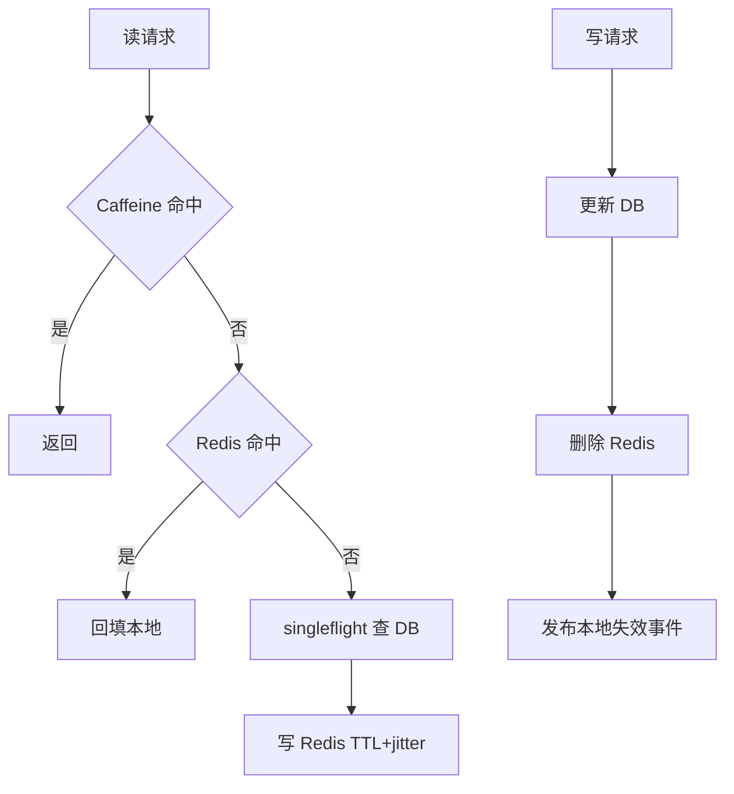

# 分布式缓存架构

> [!abstract] 一句话总结
> 分布式缓存围绕容量、热点、可用性和一致性设计，常见组合是本地缓存、Redis Cluster/Sentinel 和 DB 的 cache-aside。

## 📌 精准定位

- 负责降低数据库读压力、缩短读延迟、吸收热点。
- 不负责替代数据库成为唯一事实来源，除非业务按内存数据库设计。
- 关键边界：缓存越靠近应用越快，但一致性和失效传播越难。

## 🧩 核心概念

| 概念 | 具体含义 | 精通要点 |
| ---- | -------- | -------- |
| Cache Aside | 先读缓存，miss 查 DB 回填，写 DB 后删缓存。 | 最常见也最需要处理并发回填。 |
| 本地缓存 | Caffeine/Guava 纳秒级读取。 | 适合热点小集合，需失效通知。 |
| Redis Cluster | 按 slot 分片，主从复制。 | 跨 slot 操作受限，热点 key 仍可能打爆单分片。 |
| 多级缓存 | L1 本地 + L2 Redis。 | 命中率高但一致性链路更长。 |

## ⚙️ 工作原理 / 主流程



1. 按热度和一致性要求决定是否上本地缓存。
2. Redis Cluster 通过 16384 slots 分片。
3. 写路径常用先 DB 后删缓存，失败要重试或补偿。
4. 热点 key 做请求合并、分片副本、本地缓存或预热。
5. 容量规划要算 key 数、value、TTL、碎片、复制和持久化开销。

## 💻 代码 / 配置 / 伪代码

```java
LoadingCache<Long, Product> l1 = Caffeine.newBuilder()
  .maximumSize(50000)
  .expireAfterWrite(Duration.ofSeconds(30))
  .recordStats()
  .build(id -> redisThenDb(id));
```

## 🔍 源码入口 / 关键组件

- Caffeine Cache stats
- Redis Cluster slots、MOVED/ASK
- Sentinel failover
- Canal/Debezium 订阅 binlog 失效缓存
- hit rate、evicted_keys、used_memory、hot key

## ⚠️ 生产坑与注意事项

- 多级缓存没有失效通知，本地长期旧值。
- 热点 key 放同一 hash tag 形成单槽热点。
- TTL 过长脏读，过短回源抖动。
- 容量没算复制和碎片。
- Redis 故障时应用线程全部阻塞重试。

## 🧭 排查路径

- 命中率低分 key 前缀、接口、场景统计。
- 热点看单 key、单 slot QPS 和 Redis CPU。
- 脏读追踪写 DB、删 Redis、本地失效时序。
- 雪崩看过期分布、Redis 可用性、DB fallback。

## 🎯 面试问题

> [!question] 高频问题
> - Q: 本地缓存适合什么？
>   - A: 极热点、小体积、允许短暂不一致的数据。
> - Q: Redis Cluster 怎么分片？
>   - A: CRC16 映射到 16384 slot。
> - Q: 写路径为什么常删缓存？
>   - A: 更新缓存可能被并发旧值覆盖，删除后回填更稳。
> - Q: 热点 key 怎么办？
>   - A: 本地缓存、请求合并、拆 key、读副本、预热、限流。
> - Q: 多级缓存最大风险？
>   - A: 失效链路复杂，容易旧值或放大回源。

## ✅ 精通检查清单

- 能画出主流程，并标出最容易失败的节点。
- 能说出至少 3 个源码入口或关键组件。
- 能写出最小配置、SQL、伪代码或状态机。
- 能结合生产故障说明监控指标、排查命令和修复动作。
- 能和相邻方案做取舍对比，而不是只背定义。

## 🔗 关联笔记

- [[_index]]
- [[20-Java后端/00-总览/学习仪表盘]]

## 📚 参考资料

- Redis Cluster Specification
- Caffeine Wiki
