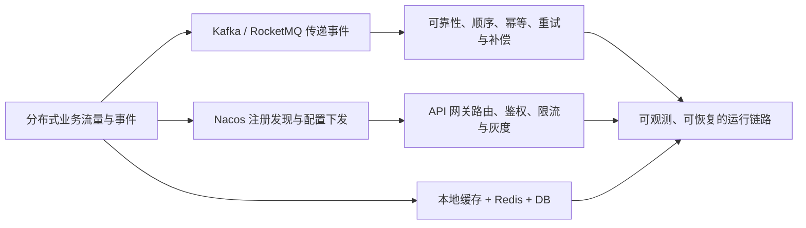

# 中间件：本章总结与复习

> [!abstract] 一句话总结
> 中间件把单体中的事件传递、服务定位、运行配置、入口流量和缓存能力拆成分布式基础设施，而工程落点始终是明确可靠性边界，并让失败可观测、可重试、可回滚、可补偿。

## 核心知识概览

| 模块 | 核心问题 | 关键结论 | 对应笔记 |
| --- | --- | --- | --- |
| Kafka 消息流 | 如何承载高吞吐事件流 | 分区追加日志、批量、page cache 和分区并行提供吞吐；顺序只在 partition 内成立，可靠性还取决于 ack、ISR、offset 与业务幂等 | [[01-Kafka原理与应用]] |
| RocketMQ 业务消息 | 如何支持事务、延迟、顺序与失败重试 | CommitLog 顺序写、ConsumeQueue 建立逻辑索引；事务消息靠 half message 与回查，失败消息经重试后进入 DLQ | [[02-RocketMQ原理]] |
| 消息正确性 | 如何系统处理丢失、重复、乱序和堆积 | 按生产、Broker、消费三段设计可靠性；DB 与 MQ 一致用 outbox、事务消息或 CDC，消费者必须幂等并在业务成功后确认 | [[03-消息可靠性-顺序-幂等]] |
| 注册与配置 | 服务如何发现彼此并安全获得运行参数 | Nacos 通过注册、心跳、订阅和本地缓存维护实例；配置中心负责版本、发布与刷新，但热更新必须尊重资源重建边界 | [[04-注册中心-Nacos]]、[[05-配置中心]] |
| API 网关 | 外部流量如何统一进入并接受治理 | 网关承接路由、认证鉴权、限流、灰度和观测；过滤器顺序影响语义，Reactive 事件循环中不能放阻塞逻辑 | [[06-API网关]] |
| 分布式缓存 | 如何降低数据库压力并吸收热点 | 常用 L1 本地缓存 + L2 Redis + DB 的 Cache Aside；收益来自更近的数据，风险集中在热点、容量、故障与多级失效一致性 | [[07-分布式缓存架构]] |

## 全章主线

## 快速复习

1. Kafka 用 append-only partition log 提供高吞吐；`acks=all` 还需结合 `min.insync.replicas`，消费者组的并行度受 partition 数限制，offset 提交过早可能丢处理、过晚可能重复。
2. RocketMQ 由 NameServer 提供路由，Broker 将消息顺序写入 CommitLog，再构建 ConsumeQueue；事务消息依赖 half message、本地事务和可靠回查，延迟消息只应触发状态检查。
3. MQ 可靠性必须拆成生产确认与重试、Broker 持久化与副本、消费处理与确认三段；多数系统按至少一次投递设计，因此业务幂等不是可选项。
4. 顺序通常按业务 key 固定到同一 partition 或 MessageQueue，并在消费端串行处理；状态机条件更新继续兜底乱序，坏消息要有重试上限、退避、DLQ 和补偿入口。
5. DB 与 MQ 不能靠“本地事务里直接发消息”获得一致性，应按场景选择 outbox、RocketMQ 事务消息或 CDC；幂等记录与业务更新要处于同一个本地事务。
6. Nacos 注册中心通过心跳、健康检查、订阅推送和客户端缓存维护实例；注册中心短时故障不等于调用立即中断，但新实例变更和故障摘除会受影响。
7. 配置中心的关键不是集中存值，而是明确 DataId/Group/Namespace、最终生效优先级、动态刷新边界，以及灰度、审批、监控和回滚；连接池等资源配置不能假定能无风险热更新。
8. API 网关适合统一路由、认证鉴权、限流、灰度和观测，不适合承载重业务编排；重试只用于明确幂等且受总超时预算约束的请求，过滤器中的阻塞 IO 会拖慢 event loop。
9. 分布式缓存按一致性与热度组合本地缓存、Redis Cluster/Sentinel 和 DB；写路径常用更新 DB 后删缓存，多级缓存还必须传播失效并防止热点、回源风暴和 Redis 故障时的阻塞重试。

## 自测问题

1. Kafka 与 RocketMQ 的生产、存储、消费路径分别是什么？它们的顺序边界、失败重试和业务幂等有哪些共同约束？
2. 如何为“数据库事务成功后发布订单事件”设计不丢且可重复执行的链路？请说明 outbox 或事务消息、稳定业务 key、消费确认和幂等事务的位置。
3. 当服务发现异常或配置只在部分实例生效时，如何沿 namespace/group/serviceName、健康状态、客户端缓存、配置优先级、监听与版本号排查？
4. 面对网关 P99 升高和缓存回源量同时上涨，如何分别检查 event loop 阻塞、下游延迟、重试放大、热点 key、多级失效和 Redis 可用性？

## 下一章衔接

下一章进入 [[../07-分布式与微服务/_index|分布式与微服务]]：把本章中已经出现的副本、最终一致、幂等、状态机、限流和链路观测，提升为 CAP/BASE、一致性算法、分布式事务、分布式锁与完整服务治理方法。

## 相关编号双链

- 消息队列：[[01-Kafka原理与应用]] · [[02-RocketMQ原理]] · [[03-消息可靠性-顺序-幂等]]
- 注册与配置：[[04-注册中心-Nacos]] · [[05-配置中心]]
- 流量与缓存治理：[[06-API网关]] · [[07-分布式缓存架构]]
