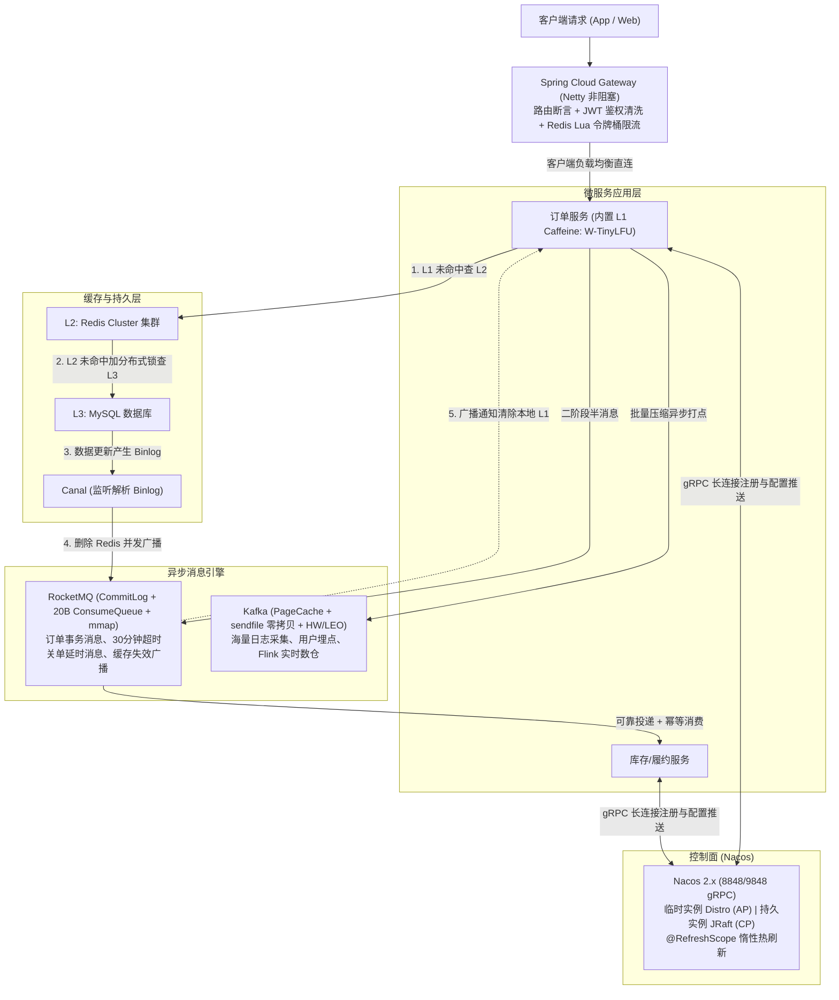

# 06 · 中间件：本章总结与复习

> [!abstract] 全章心智模型
> 分布式中间件是围绕**线上请求生命周期与数据一致性流转**构建的工程防护体系：
> 1. **统一入口网关（Gateway）**：Netty 主从多 Reactor 响应式非阻塞承接全站流量，Redis+Lua 令牌桶限流防卫；
> 2. **元数据控制面（Nacos）**：gRPC 长连接动态寻址，Distro（AP）与 JRaft（CP）双模，`@RefreshScope` 惰性热刷新，优雅上下线消除 502；
> 3. **多级读缓存（Caffeine + Redis）**：W-TinyLFU 算法高效淘汰，JD-hotkey 架构动态晋升热点，Canal 监听 Binlog 广播失效保障最终一致；
> 4. **异步削峰解耦（Kafka / RocketMQ）**：HW/LEO 与 Leader Epoch 确保数据对齐，CommitLog 混合写与 20B 索引读写分离，二阶段半消息实现分布式事务闭环。

---

## 一、 全章中间件协同全景架构

---

## 二、 核心中间件选型与底层机制速查总表

| 领域 | 代表组件 | 解决痛点 | 核心底层机制与设计精髓 | 生产避坑红线 |
| :--- | :--- | :--- | :--- | :--- |
| **多级缓存** | **Caffeine + Redis + Canal** | 突破单级 Redis 跨网络序列化延迟与单 Key 热点打爆单节点瓶颈 | **读路径**：查 L1 Caffeine $\to$ 查 L2 Redis $\to$ 互斥锁查 DB； **算法**：Caffeine 采用 **W-TinyLFU**（Window 1% + Main 99%，Count-Min Sketch 4-bit 草图比对淘汰）； **写路径**：Canal 监听 Binlog 删 Redis 并广播失效 L1（带版本号防乱序覆写） | 本地缓存必须配置短 TTL（如 5min）与最大容量防 OOM；大 Key 必须用 `UNLINK` 异步删除；热点 Key 通过滑动窗口动态晋升本地 |
| **服务注册与配置** | **Nacos 2.x** | 动态容器 IP 频繁变动，修改配置需重新打包含重启机器 | **通信**：gRPC 单条 TCP 双向长连接，秒级断连感知； **CAP 双模**：临时实例走 **Distro 协议（AP，写内存即回+异步复制+Checksum对齐）**，持久与配置走 **JRaft 协议（CP）**； **动态刷新**：`@RefreshScope` 销毁旧 Bean 缓存，下次调用惰性重建 | 容器与防火墙必须同时开放 `8848`（HTTP）与 `9848`（gRPC）；生产发版按“先反注册 $\to$ 等 10s 缓冲 $\to$ `SIGTERM`”优雅停机 |
| **API 网关** | **Spring Cloud Gateway** | 客户端与多服务强耦合，横切鉴权逻辑到处重复，缺乏入口流量屏障 | **并发模型**：Netty EventLoop 异步非阻塞，少量工作线程对应独立 Selector，不霸占线程； **限流**：令牌桶算法（兼顾突发与均速）+ **Redis Lua 脚本惰性计算原子扣减** | **严禁在 Filter 中编写任何同步阻塞代码**（导致 EventLoop 挂起数千请求瘫痪）；入口处必须强行剥离外部可伪造的敏感 Header（如 `X-User-Id`） |
| **高吞吐 MQ** | **Apache Kafka** | 百万级日志流、埋点事件传输与实时大数据流计算管道 | **四大高吞吐基石**：磁盘顺序追加写、利用 OS PageCache、Linux `sendfile` 零拷贝（仅 2 次 DMA 拷贝）、客户端攒批压缩； **一致性**：**HW/LEO** 机制控制可见性，**Leader Epoch** 解决高水位截断丢数据；KRaft 彻底取代 ZK | 同一消费组内并发度上限受限于分区数；防丢必须配 `acks=all` + `min.insync.replicas=2` + `max.in.flight=1`；使用 CooperativeSticky 协作重平衡 |
| **业务高可靠 MQ** | **Apache RocketMQ** | 在线交易链路海量多 Topic 写入、分布式事务一致性与延时任务 | **读写分离与零拷贝**：单机全 Topic 混合顺序写唯一 `CommitLog`（1GB，基于 **`mmap`** 映射），定长 20B `ConsumeQueue` 索引常驻内存； **事务消息**：二阶段半消息（`RMQ_SYS_TRANS_HALF_TOPIC`）+ 事务状态主动回查 | NameServer 节点间零通信无选举，靠 Broker 全量心跳；顺序消费依赖向 Broker 申请队列锁 `lockBatchMQ`；重试 16 次后进入 `%DLQ%` 死信队列 |

---

## 三、 高频面试折叠自测 10 连问

> [!question]- Q1：Caffeine 为什么命中率和性能远超 Guava Cache？它的 W-TinyLFU 是怎么运作的？
> 传统 LRU 易被突发偶发冷数据污染，LFU 维护高计数器内存消耗大且历史过期热点滞留。
> Caffeine 创新提出 **W-TinyLFU**：
> 1. **Window Cache（1%）**：新进入的数据先进入小 LRU 队列，给予冷启动缓冲机会；
> 2. **Main Cache（99%）**：分为 Probation（试用段，20%）与 Protected（保护段，80%），高频被命中的数据自动晋升至保护段；
> 3. **淘汰比对**：Window 满后淘汰候选者，与试用段队尾元素通过 **Count-Min Sketch（4-bit 频率草图）** 比对访问频率，优胜劣汰；配合定期全局除以 2 衰减机制，彻底消除历史陈旧热点。

> [!question]- Q2：多级缓存中数据库更新后，如何解决多节点本地缓存并发写覆写与乱序更新问题？
> 采用 **Canal 监听 MySQL Binlog + MQ 广播通知 + 版本号比对**：
> 1. 业务只管提交数据库事务，Canal 解析 Binlog 删除 Redis 并发送广播失效消息；
> 2. 全集群 Pod 广播订阅该消息调用 `caffeine.invalidate(key)`；
> 3. 在数据库行记录与缓存中增加递增版本号（`version`）。当并发更新导致失效消息乱序到达时，客户端若发现传入数据版本号低于本地现有版本，拒绝覆写更新；
> 4. 本地缓存设置 5 分钟硬性短 TTL 兜底防网络丢包。

> [!question]- Q3：为什么生产环境 Kafka 发送端配置了重试参数，还可能会导致消息乱序？如何彻底解决？
> 根因：Kafka 生产端默认允许在收到前一个请求的 ACK 前，管道化发送后续请求（由 `max.in.flight.requests.per.connection` 控制，默认 5）。若消息 1 发送网络超时触发重试，而消息 2 发送成功并落盘，重试成功的消息 1 随后落盘，单分区内原本的先 1 后 2 就变成了先 2 后 1。
> 解决：设置 `max.in.flight.requests.per.connection = 1`（严格限制单个连接未决请求数为 1）；或者开启生产端幂等性 `enable.idempotence = true`（此时参数允许设为 $\le 5$，Broker 会依据 Sequence Number 自动保证物理落盘顺序）。

> [!question]- Q4：什么是 Kafka 的 HW 和 LEO？为什么 Kafka 后来引入了 Leader Epoch？
> LEO（Log End Offset）是分区末端下一条待写位置；HW（High Watermark）是 ISR 集合中所有副本最小的 LEO，决定了消费者可见的安全边界。
> 早期 Kafka Follower 恢复时按 HW 截断日志，由于主从 HW 更新存在时间差，宕机切换时会导致已确认数据被误截断丢失，或产生冲突的幽灵数据。引入 Leader Epoch 后，Follower 恢复时与新 Leader 的代数版本对齐截断，彻底消除了 HW 滞后带来的数据丢失隐患。

> [!question]- Q5：为什么 Kafka 选 sendfile 零拷贝，而 RocketMQ 选 mmap？
> - **Kafka（追求极致大吞吐管道）**：使用 `sendfile`，数据从内核 PageCache 经 DMA 直接传输到网卡，完全不进入 JVM 用户态内存，节省 2 次 CPU 拷贝与 2 次上下文切换；但其局限是用户态程序无法查看和修改数据。
> - **RocketMQ（追求丰富在线业务特性）**：使用 `mmap`（内存映射），将物理文件映射到进程虚拟内存。应用读写文件如同读写内存数组，且在用户态可以直接解析消息头执行 **服务端 Tag 过滤**、**IndexFile 索引构建** 以及 **事务半消息改写**。

> [!question]- Q6：RocketMQ 的事务消息是如何做到本地数据库落库与发消息最终一致的？
> 采用“二阶段半消息 + 状态回查”：
> 1. 先发半消息，Broker 将其改写并存入系统内部主题 `RMQ_SYS_TRANS_HALF_TOPIC`，原始 Topic 暂存属性中，对下游完全隐藏；
> 2. 生产端执行本地事务；
> 3. 本地事务成功发 Commit，Broker 恢复原 Topic 写入 ConsumeQueue 放行消息；失败发 Rollback 物理丢弃；
> 4. 若宕机或网络中断导致未发送二次确认，Broker 定时扫描超时半消息，主动向生产端发起事务回查接口（最多 15 次），生产端查库确认后补发 Commit/Rollback。

> [!question]- Q7：Spring Cloud Gateway 为什么性能远超 Zuul 1.x？为什么严禁在网关 Filter 中写阻塞代码？
> Zuul 1.x 基于 Servlet 阻塞模型，一请求一线程，下游慢调用迅速占满 200 个线程导致雪崩。
> Gateway 基于 Netty + Reactor 响应式非阻塞模型，仅维护等于 CPU 核心数的 EventLoop 线程，每个线程维护独立 Selector 调度成千上万个 Channel。异步发起非阻塞请求并挂载回调后立即脱身处理下一请求。全网关仅有数个工作线程，一旦在 Filter 中执行阻塞 I/O（如同步 JDBC / `Thread.sleep`），该线程承载的上千个客户端连接当场卡死瘫痪。

> [!question]- Q8：为什么分布式网关限流首选令牌桶算法，且必须结合 Redis + Lua 脚本实现？
> 漏桶算法流出速率恒定，无法利用下游空闲弹性应对合理的瞬时高峰；令牌桶算法允许桶内存量令牌吸收瞬时突发，并在令牌耗尽后按稳定速率发牌，兼顾弹性与限速。
> 集群部署需依赖 Redis 集中存储令牌状态，采用“惰性计算（当前时间差 × 速率）”免去定时任务开销；将读取、计算、扣减封装在 Lua 脚本中，利用 Redis 执行 Lua 的单线程原子性，规避高并发下的并发超卖与失效。

> [!question]- Q9：为什么生产环境微服务发版时经常出现 502/Connection Refused？为什么仅配置 `server.shutdown: graceful` 还不够，必须加 `sleep 10`？
> 根因是 Kubernetes 控制面通知更新 Endpoints 与各节点 kube-proxy 刷新 iptables/IPVS 路由转发规则存在 **2~5 秒的异步网络传播延迟**。
> 如果仅配置优雅停机，Pod 在收到信号的瞬间即关闭了网络监听端口，而在网络规则刷新完成前的几秒内，网关和负载均衡器依然会把新请求转发过来，导致连接被拒绝报 502。通过在 `preStop` 钩子中先反注册并 **强制 `sleep 10` 秒**，可以确保全集群网络路由规则彻底完成切换后，再正式执行优雅停机排空在途请求。

> [!question]- Q10：Nacos 的 Distro 协议是如何实现 AP 高可用与高并发吞吐的？
> 1. **数据初始化**：新节点启动向健康节点全量同步数据；
> 2. **一致性哈希责任分片**：无主对等架构，每个节点负责一部分服务的写请求；
> 3. **写内存即返回**：责任节点写入本地内存 CopyOnWrite 结构后立即返回成功，单机吞吐数万 QPS；
> 4. **异步批量复制与 Checksum 校验**：后台异步广播增量数据，定期比对数据校验和对齐差异；
> 5. **网络脑裂容灾**：网络分区时两侧节点均可独立提供读写，恢复后自动合并。

---

## 四、 生产落地 Checklist 十条红线

- [ ] **1. 多级缓存防击穿与雪崩**：回源加分布式锁；Redis 过期时间加随机抖动；Caffeine 配短 TTL 与最大容量防 OOM。
- [ ] **2. 大 Key 与慢命令红线**：排查 String > 10KB、集合 > 5000 元素大 Key；严禁 `KEYS *`、`HGETALL`，删除大 Key 用 `UNLINK`。
- [ ] **3. 网关非阻塞与安全清洗**：Filter 严禁同步阻塞调用；入口强制清洗外部伪造内部 Header（`X-User-Id`）。
- [ ] **4. 网关分布式限流**：核心写接口配置 Redis+Lua 令牌桶限流，校验发牌速率与桶容量。
- [ ] **5. Nacos 多环境与双端口**：按 `dev/test/prod` 划分独立 Namespace；防火墙/容器必须同时开放 `8848` 与 `9848`。
- [ ] **6. 微服务优雅停机闭环**：开启 `server.shutdown: graceful`；K8s `preStop` 先反注册并 `sleep 10` 缓冲。
- [ ] **7. MQ 消息防丢全链路**：生产端同步确认/重试；Broker 多副本同步写入（Kafka: `acks=all` + `min.insync.replicas=2`）；消费端手动 ACK。
- [ ] **8. 消费端 100% 幂等**：基于业务唯一键建立数据库唯一索引、防重表或状态机条件更新。
- [ ] **9. 消费组并发与防 Rebalance**：队列数 $\ge$ 消费者数；合理调小 Kafka `max.poll.records` 防止处理超时 Rebalance；首选 CooperativeSticky 分配。
- [ ] **10. 死信与积压告警**：对 Consumer Lag 与 RocketMQ 死信队列（`%DLQ%`）建立自动化监控与重放预案。
