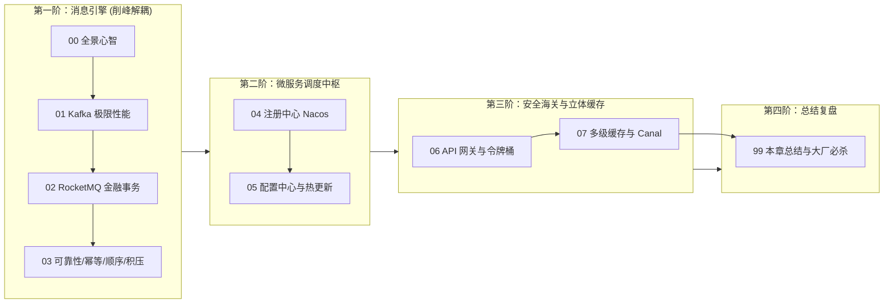

# 🚀 06 · 中间件

> [!info] 本区心智模型
> 中间件 = **分布式商贸物流生态网与黄页调度枢纽**。
> 消息队列（Kafka/RocketMQ）是削峰解耦的专线物流中转港，Nacos 是商户动态工商黄页与政令广播台，Spring Cloud Gateway 是统一安检海关关卡，多级缓存是前置便利专柜。没有中间件，微服务就是一盘散沙！

---

## 📚 知识笔记清单

- [x] [[00-中间件全景与心智模型]] — **宏观心智模型**（商贸物流与黄页心智模型、高可用/高并发/一致性权衡、知识全景路线图）
- [x] [[01-Kafka原理与应用]] — **海量日志吞吐**（磁盘顺序追加写、PageCache 缓存、Linux `sendfile` 零拷贝、ISR 黄金防线、Rebalance 风暴规避与 KRaft 架构演进）
- [x] [[02-RocketMQ原理]] — **金融级业务消息**（NameServer 无状态轻量设计、CommitLog 物理大一统存储机制、ConsumeQueue 微型索引、二阶段事务消息与延时/死信队列）
- [x] [[03-消息可靠性-顺序-幂等]] — **消息工程化三大件**（端到端零丢失防线、消费端三大幂等设计方案、局部一致性 Hash 顺序保证、千万级消息积压救火 SOP）
- [x] [[04-注册中心-Nacos]] — **动态黄页查号台**（gRPC 双向流长连接演进、Distro 与 Raft 双模切换、保护阈值防雪崩、微服务无损优雅上下线 SOP）
- [x] [[05-配置中心]] — **集团公文广播台**（长轮询 Long Polling 挂起机制与 MD5 校验、`@RefreshScope` 源码清缓存再重建原理、多环境隔离与容灾快照）
- [x] [[06-API网关]] — **生态园区智能海关**（Zuul1 vs Gateway 架构演进、Reactor/Netty 非阻塞 EventLoop 避坑铁律、三大支柱、Redis 令牌桶分布式限流）
- [x] [[07-分布式缓存架构]] — **立体前置仓储**（L1 本地 Caffeine + L2 Redis 集群、Canal 监听 Binlog 异步广播一致性、Hot Key 自动探测本地短路与 Big Key 治理）
- [x] [[99-本章总结与复习]] — **全景复盘**（中间件全景对照表、大厂 30 秒必杀 10 连问、生产架构避坑十诫）

---

## 🧭 四阶通关路线

---

## 🧪 终极通关能力自测

1. 为什么 Kafka 在海量 Topic 下吞吐量会急剧下降，而 RocketMQ 却能轻松顶住数万个 Topic？底层物理文件存储结构有何本质区别？
2. 在跨服务分布式事务中，RocketMQ 的 Half Message 是如何配合本地事务和超时回查机制确保最终一致性的？
3. 如果生产环境突然发生了 2000 万条消息严重积压，只给消费者加机器为什么可能毫无作用？正确的临时分流泄洪步骤是什么？
4. Nacos 2.x 为什么要用基于 Netty 的 gRPC 双向流长连接替代 1.x 的 HTTP 短轮询？
5. Spring Cloud Gateway 基于非阻塞响应式模型，为什么在自定义过滤器中绝对禁止写 `Thread.sleep()` 或同步 JDBC 调用？
6. 在多级缓存（Caffeine + Redis + MySQL）架构中，当商品价格发生修改时，如何借助 Canal 监听 Binlog 实现秒级一致性？

---

## 🔗 跨模块串联

- 上级：[[20-Java后端/00-总览/学习仪表盘|Java 学习仪表盘]]
- 前置存储：[[20-Java后端/05-数据库与存储/_index|05 · 数据库与存储]]（Redis 与 MySQL 是中间件的持久化与缓存基石）
- 后续微服务：[[20-Java后端/07-分布式与微服务/_index|07 · 分布式与微服务]]（在 MQ 与注册中心基础之上，深入 CAP、分布式事务 Seata、分布式锁 Redisson 与链路追踪）
- 高并发实战：[[20-Java后端/10-知识串联与专题/05-高并发系统的流量保护链路]]
