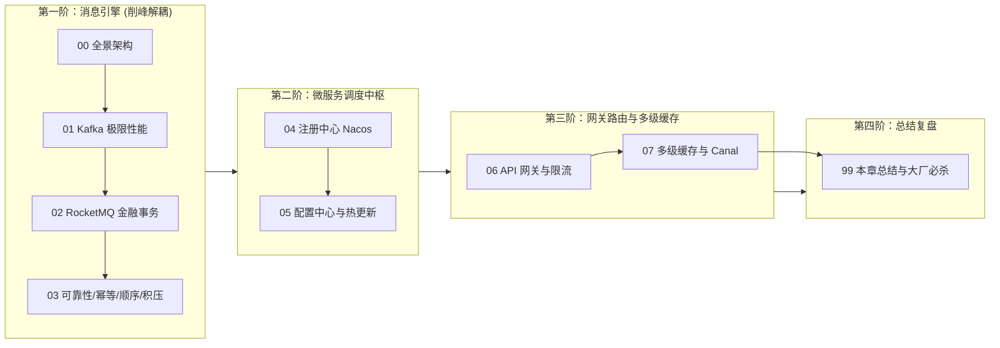

# 🚀 06 · 中间件

> [!info] 本区心智模型
> 中间件是连接底层存储与高层业务系统的分布式基础设施。核心涵盖：高吞吐/金融级消息队列（Kafka / RocketMQ）、注册与配置中心（Nacos）、高性能 API 网关以及分布式多级缓存体系。本模块按技术演进与架构协作顺序递进。

---

## 📚 知识笔记清单

- [x] [[00-中间件全景与心智模型]] — **架构概览**（中间件核心分类、高可用/高并发/一致性权衡、知识全景路线图）
- [x] [[01-Kafka原理与应用]] — **高吞吐消息引擎**（磁盘顺序追加写、PageCache、Linux `sendfile` 零拷贝、ISR 机制、Rebalance 规避与 KRaft 演进）
- [x] [[02-RocketMQ原理]] — **高可靠业务消息**（NameServer 架构、CommitLog 物理存储、ConsumeQueue 逻辑索引、二阶段事务消息与延时/死信队列）
- [x] [[03-消息可靠性-顺序-幂等]] — **消息工程化保障**（端到端防丢失方案、消费端幂等性实现、分区有序性保证与海量消息积压排障 SOP）
- [x] [[04-注册中心-Nacos]] — **服务注册与发现**（gRPC 双向流长连接、Distro 与 Raft 双协议机制、保护阈值与微服务优雅上下线）
- [x] [[05-配置中心]] — **动态配置管理**（长轮询 Long Polling 机制与 MD5 变更监听、`@RefreshScope` 动态刷新原理、多环境隔离与容灾）
- [x] [[06-API网关]] — **统一网关架构**（Spring Cloud Gateway 响应式模型、Netty EventLoop 非阻塞避坑、路由断言/过滤器与分布式限流）
- [x] [[07-分布式缓存架构]] — **多级缓存体系**（Caffeine 本地缓存 + Redis 集中缓存、Canal 监听 Binlog 缓存一致性、HotKey 探测与 BigKey 治理）
- [x] [[99-本章总结与复习]] — **全景复盘**（中间件全景对照表、大厂高频面试题复盘与生产架构避坑规约）

---

## 🧭 四阶通关路线

---

## 🧪 终极通关能力自测

1. 为什么 Kafka 在海量 Topic 下吞吐量会急剧下降，而 RocketMQ 却能轻松顶住数万个 Topic？底层物理文件存储结构有何本质区别？
2. 在跨服务分布式事务中，RocketMQ 的 Half Message 是如何配合本地事务和超时回查机制确保最终一致性的？
3. 如果生产环境突然发生了 2000 万条消息严重积压，只给消费者加机器为什么可能毫无作用？正确的临时分流泄洪步骤是什么？
4. Nacos 2.x 为什么要用基于 Netty 的 gRPC 双向流长连接替代 1.x 的 HTTP 短轮询？
5. Spring Cloud Gateway 基于非阻塞响应式模型，为什么在自定义过滤器中绝对禁止写 `Thread.sleep()` 或同步 JDBC 调用？
6. 在多级缓存（Caffeine + Redis + MySQL）架构中，当商品价格发生修改时，如何借助 Canal 监听 Binlog 实现秒级一致性？

---

## 🔗 跨模块串联

- 上级：[[../00-总览/学习仪表盘|Java 学习仪表盘]]
- 前置存储：[[../05-数据库与存储/_index|05 · 数据库与存储]]（Redis 与 MySQL 是中间件的持久化与缓存基石）
- 后续微服务：[[../07-分布式与微服务/_index|07 · 分布式与微服务]]（在 MQ 与注册中心基础之上，深入 CAP、分布式事务 Seata、分布式锁 Redisson 与链路追踪）
- 高并发实战：[[../10-知识串联与专题/05-高并发系统的流量保护链路]]
