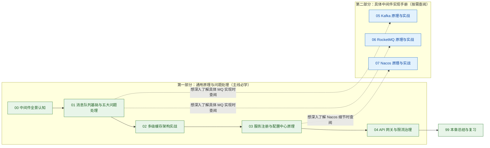

# 06 · 中间件：先掌握通用原理与问题处理，再按需查阅具体实现

> [!info] 本章学习方法与编排逻辑
> 学习中间件切忌一上来就死背某个具体框架（如 Kafka、RocketMQ）的底层参数。
> 本章采用**“先学通用原理与共性问题处理，后查具体中间件实现”**的两段式编排：
> 1. **第一部分（00 ~ 04，必学主线）**：不绑死任何特定产品，用清晰易懂的语言讲明白**什么是消息队列、消息队列遇到的五大核心问题怎么解决、为什么需要多级缓存、微服务怎么互相发现与动态改配置、网关怎么路由和限流**。掌握这一部分，就能应对 80% 的架构设计与问题排查。
> 2. **第二部分（05 ~ 07，具体中间件手册，按需查阅）**：当你在项目中实际用到 Kafka、RocketMQ 或 Nacos，或者需要针对性准备专项面试时，再查阅这部分的具体实现细节与配置手册。

---

## 🗺️ 章节全景导航与打卡清单

### 第一部分：通用核心原理与工程问题处理（主线必学）
- [x] [[00-中间件全景与心智模型]] — **全局导览**：从单体到分布式遇到了什么麻烦？四大类中间件各自解决什么问题？
- [x] [[01-消息队列基础与核心问题处理]] — **🔥 核心重头戏**：为什么用消息队列（异步/解耦/削峰）？两种消费模型是什么？**消息丢失、重复消费（幂等）、顺序错乱、海量积压、延时与事务消息**这五大共性问题怎么解决？
- [x] [[02-多级缓存架构实战]] — **缓存进阶**：为什么有了 Redis 还要加本地缓存（Caffeine）？两级缓存怎么协同？如何通过监听 MySQL Binlog 保证数据最终一致？
- [x] [[03-服务注册与配置中心原理]] — **微服务协调**：服务之间怎么自动感知上下线？怎么做到不重启服务动态热更新配置？发版时怎么做“优雅上下线”避免报错？
- [x] [[04-API网关与流量治理]] — **统一入口**：网关负责干什么？响应式非阻塞模型为什么严禁写阻塞代码？固定窗口、滑动窗口、漏桶、令牌桶四种限流算法怎么选？

### 第二部分：具体中间件底层实现与实战手册（按需选读 / 专项进阶）
- [x] [[05-Kafka架构原理与实战手册]] — **Kafka 专篇**：Topic / Partition / Offset 核心模型、为什么单机能抗高吞吐（顺序写 / 页缓存 / 零拷贝 / 批处理）、ISR 副本防丢配置、重平衡（Rebalance）规避与 KRaft 演进
- [x] [[06-RocketMQ架构原理与实战手册]] — **RocketMQ 专篇**：NameServer 轻量路由、CommitLog + ConsumeQueue 存储设计、二阶段事务消息与延时队列实现、**Kafka vs RocketMQ 选型对比**
- [x] [[07-Nacos架构原理与实战手册]] — **Nacos 专篇**：Nacos 1.x 与 2.x（gRPC 长连接）架构对比、临时实例（AP）与持久实例（CP）一致性协议、保护阈值与生产避坑
- [x] [[99-本章总结与复习]] — **全景复盘**：核心架构对照表、高频面试自测 10 连问与生产落地准则

---

## 🧭 渐进式学习路线图

---

## 🔗 跨模块串联

- **返回看板**：[[../00-总览/学习仪表盘|Java 后端学习仪表盘]]
- **前置基础**：[[../05-数据库与存储/_index|05 · 数据库与存储]]（MySQL 事务与 Redis 缓存是学习中间件的前置基础）
- **后续进阶**：[[../07-分布式与微服务/_index|07 · 分布式与微服务]]（深入 CAP 理论、分布式锁、分布式事务与全链路追踪）
