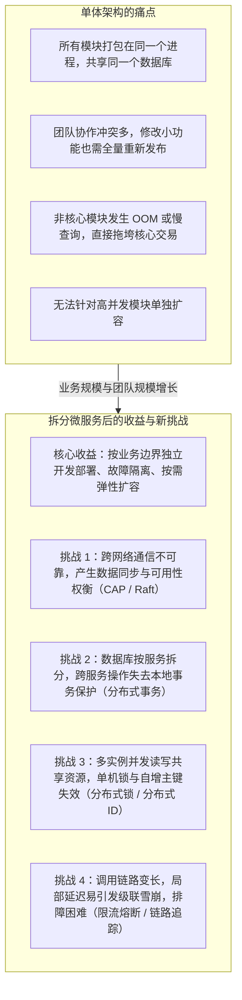
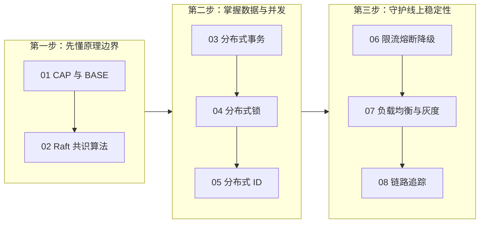

# 分布式与微服务全景与心智模型

> [!abstract] 一句话心智模型
> 微服务架构的本质是用**系统内部的网络通信复杂度**去置换**业务研发与部署的灵活性**。把单体应用拆分成多个独立服务后，原本在同一个进程、同一个数据库里天然解决的方法调用、事务控制、并发加锁和日志排查，全部变成了跨网络、跨进程、跨数据库的分布式问题。

---

## 🎯 一、为什么要从单体架构演进到微服务？

在业务发展初期，把所有功能模块（用户、商品、订单、支付、报表）全部写在一个工程里，打包成一个可执行 Jar 包，连同一个数据库，这就是**单体架构（Monolithic Architecture）**。单体架构开发简单、部署方便、本地事务天然生效，非常适合早期业务快速迭代。

但随着业务规模和研发团队扩大到数十甚至上百人，单体架构会遇到四个明显的瓶颈：

1. **协作与发布效率低下**：上百名开发人员往同一个代码仓库提交代码，分支合并频繁冲突；哪怕只修改了一行边缘功能的代码，也需要将整个庞大的应用重新编译、测试并全量重启发布。
2. **故障无法隔离**：所有模块共享同一个 JVM 进程和同一个数据库连接池。如果某个非核心功能（例如后台导出大报表）触发了慢 SQL 或内存泄漏（OOM），整个 JVM 进程就会卡死或崩溃，导致下单、支付等核心交易跟着一起瘫痪。
3. **无法按需精准扩容**：在大促期间，商品浏览和下单模块的并发量可能是平时的十倍，而后台管理模块的流量几乎不变。单体架构下只能把整个应用完整复制多份进行扩容，造成服务器资源的浪费。
4. **单库连接与性能触顶**：所有模块共用一个数据库实例，当表数量膨胀到上千张、并发连接数达到数千时，单个数据库的连接数、磁盘 I/O 和 CPU 会成为全站的共同瓶颈。

为了解决这些问题，我们将单体应用按照业务领域（如用户服务、商品服务、订单服务、库存服务）拆分为多个独立开发、独立部署、各自拥有独立数据库的进程，这就是**微服务架构（Microservices）**。

---

## 🧩 二、拆分微服务后必须解决的四大核心问题

一旦把一个单体系统拆分成多个通过网络通信的微服务，我们就必须按顺序解决以下四个层面的技术挑战。这也是本章所有后续文档的组织脉络：

### 1. 节点通信与数据副本一致性问题（对应 01、02 篇）
- **问题背景**：在分布式系统中，为了防止单台机器宕机导致数据丢失或服务中断，同一份数据通常会保存在多个节点上。但节点之间的网络随时可能出现延迟、丢包甚至彻底断开（网络分区）。
- **解决思路**：
  - **CAP 与 BASE 理论**：当网络断开导致节点间无法同步最新数据时，系统必须在“拒绝服务以保证不返回旧数据（CP）”和“先返回本地数据以保证服务可用（AP）”之间做出选择。对于大多数互联网业务，通常采用 **BASE 理论**，允许短暂的中间状态，通过异步同步与补偿达到**最终一致性**。
  - **Raft 共识算法**：对于注册中心、配置中心或分布式存储等必须保证数据强一致的组件，使用 Raft 算法通过“多数派投票选主”和“多数派日志复制”，确保只要超过半数节点正常，集群就能对外提供一致的读写服务。

### 2. 跨库事务与跨进程并发协调问题（对应 03、04、05 篇）
- **问题背景**：微服务拆分后，订单有订单库，库存有库存库，每个服务还部署了多个实例。
  - 下单时既要写订单库又要扣库存库，单个数据库的 `@Transactional` 本地事务无法跨服务生效；
  - 多个订单服务实例同时修改同一份共享数据时，Java 进程内的 `synchronized` 或 `ReentrantLock` 无法跨机器互斥；
  - 分库分表或多实例并发生成数据时，单库自增 ID 会产生冲突。
- **解决思路**：
  - **分布式事务**：根据业务场景选择方案。高并发场景优先采用**本地消息表或 RocketMQ 事务消息**实现最终一致性；需要显式资源预留的场景采用 **TCC**；长流程编排采用 **Saga**；内部管理或低频短事务可使用 **Seata AT** 或 **2PC**。
  - **分布式锁**：借助 Redis 实现跨进程的互斥访问，通过唯一标识配合 Lua 脚本保证安全释放，通过 Redisson 看门狗机制解决业务未执行完锁提前过期的问题。
  - **分布式 ID**：使用**号段模式（Leaf）**或**雪花算法（Snowflake）**生成全局唯一且趋势递增的 64 位整数 ID，既保证多节点发号不冲突，又契合 MySQL InnoDB 聚簇索引的顺序写入特性。

### 3. 局部故障引发的调用链雪崩问题（对应 06 篇）
- **问题背景**：一个前端请求可能依次调用网关 -> 订单服务 -> 库存服务 -> 积分服务。如果末端的积分服务因为慢 SQL 响应变慢，订单服务调用积分服务的线程就会大量阻塞等待，很快把订单服务的线程池占满，进而导致网关调用订单服务也全部超时，最终整个系统瘫痪（级联雪崩）。
- **解决思路**：
  - **限流**：在流量入口或关键接口限制每秒放行的请求数（QPS），把超出系统承载能力的流量提前拦截在外。
  - **资源隔离与超时控制**：为远程调用设置明确的超时时间和最大并发数，防止单个慢依赖耗尽所有工作线程。
  - **熔断与降级**：当检测到下游服务错误率或慢调用比例超过阈值时，熔断器自动跳闸，后续请求不再发起真实网络调用，而是直接执行本地降级逻辑（如返回默认值或友好提示），给下游留出恢复时间。

### 4. 动态寻址、灰度发布与跨服务排障问题（对应 07、08 篇）
- **问题背景**：每个微服务都部署了十几个实例，且随时可能扩缩容或发布新版本。调用方怎么知道该把请求发给哪个 IP？新版本上线时怎么只让 5% 的测试流量走进新版本实例？一个请求经过五六个服务后报错了，怎么从几十台机器的日志里快速找出是哪一跳出了问题？
- **解决思路**：
  - **服务治理与负载均衡**：服务实例启动时向注册中心（如 Nacos）注册地址，调用方拉取实例列表并通过平滑加权轮询、最小活跃数等负载均衡算法挑选节点。
  - **全链路灰度发布**：在网关层给满足条件的请求打上灰度标签（流量染色），通过拦截器在 RPC 调用链中全程透传该标签，配合负载均衡器优先匹配同标签的灰度实例。
  - **分布式链路追踪**：使用 SkyWalking 等工具，通过 JavaAgent 字节码插桩自动为每次请求生成全局唯一的 `TraceId` 和标识各阶段调用的 `SpanId`，将跨服务、跨线程的调用耗时与业务日志串联成一棵完整的调用树。

---

## 🗺️ 三、分布式与微服务知识体系速查表

| 核心专题 | 解决的核心问题 | 生产主流技术方案 | 核心关注点 |
| :--- | :--- | :--- | :--- |
| **01 CAP 与 BASE** | 网络故障时数据一致性与服务可用性的冲突 | CP / AP 权衡、BASE 最终一致性 | 理解网络分区下的二选一逻辑，掌握最终一致性的异步重试与对账机制 |
| **02 分布式一致性** | 多副本如何选出唯一主节点并安全同步数据 | Raft / Paxos 共识算法 | 任期（Term）、随机选举超时、多数派（Quorum）日志提交、选举投票限制 |
| **03 分布式事务** | 跨数据库、跨微服务操作如何保证数据一致 | 本地消息表 / MQ 事务消息、TCC、Seata AT、Saga | 2PC 阻塞缺陷、TCC 空回滚与防悬挂、Seata 前后镜像、异步消息最终一致 |
| **04 分布式锁** | 多实例并发操作同一资源时如何保证互斥 | Redis + Lua、Redisson | 原子加锁与过期时间、防误删 Lua 脚本、看门狗自动续期、主从切换与数据库兜底 |
| **05 分布式 ID** | 多节点高并发下如何生成全局唯一且有序的主键 | 雪花算法（Snowflake）、美团 Leaf 号段模式 | InnoDB B+ 树页分裂原因、64 位比特划分、时钟回拨处理、前端 Long 转 String |
| **06 限流熔断降级** | 如何防止局部慢调用或流量洪峰拖垮整个系统 | Alibaba Sentinel、Resilience4j | 雪崩形成过程、熔断器三态流转（闭合/打开/半开）、漏桶匀速排队与冷启动预热 |
| **07 治理与负载均衡** | 如何将流量合理分发到多实例并实现平滑发版 | Spring Cloud LoadBalancer、Nacos、Dubbo | 客户端与服务端负载区别、平滑加权轮询算法推导、流量染色与全链路灰度透传 |
| **08 链路追踪** | 如何快速定位跨多个微服务的慢调用与报错点 | Apache SkyWalking、OpenTelemetry | TraceId / SpanId 父子结构、JavaAgent 字节码增强、线程池上下文传递、MDC 日志关联 |

---

## 🧭 四、本章学习路线建议

1. **先看 01 和 02**：建立分布式系统的底层直觉，明白为什么网络不可靠是一切问题的源头，以及多数派协议是如何工作的。
2. **再看 03、04、05**：这是日常写业务代码最常遇到的三个实战问题——怎么发 ID、怎么加锁防并发、怎么保证跨服务数据一致。
3. **最后看 06、07、08**：站在架构和运维视角，掌握如何用限流熔断保护系统不挂、如何平滑发布新版本、如何用链路追踪快速排查线上问题。
