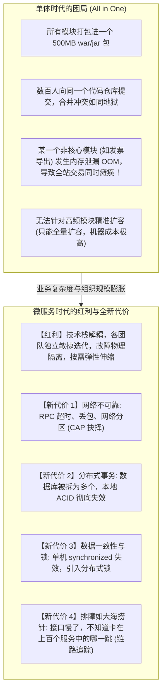
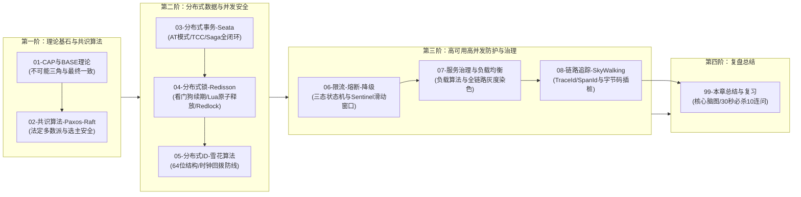

# 分布式与微服务全景与心智模型

> [!abstract] 一句话心智模型
> 如果把单体应用比作**一家中央集权的独立小王国**，微服务架构就是**现代联合国与跨国商业联邦体系**：
> - **联邦最高宪法（CAP 与 BASE 理论）**：宣布“既要强一致、又要百分百高可用、还要容忍网络断交（P）是不可能的”，指导各国在基本可用与最终一致性之间达成妥协；
> - **联合国安理会表决机制（Raft / Paxos 共识算法）**：通过“多数派胜出（Quorum）”的民主投票与法定人数裁决，彻底解决联邦群龙无首（选主）与两极脑裂危机；
> - **跨国多方履约合同（分布式事务 2PC / TCC / Seata）**：保障跨国资金调拨、扣库存与生成订单在跨越多个国家（服务）时，要么全员履约，要么一键自动毁约回滚；
> - **限量资源独占令牌（分布式锁 Redisson）**：跨国抢购极度稀缺资源时的全球排他通行证；
> - **全球唯一公民身份证编码（雪花算法 Snowflake）**：按毫秒时序有序递增，保障全球数十亿物料绝不重码；
> - **电网超负荷跳闸保护（限流、熔断与降级 Sentinel）**：在遭遇超级风暴时自动切断次要线路，守护核心电网免遭全域瘫痪；
> - **跨国物流包裹面单轨迹（链路追踪 SkyWalking）**：以 TraceId 穿针引线，毫秒级还原一次请求在跨国海陆空各节点间的流转全景。

---

## 🎯 为什么单体一定要走向微服务？第一性原理权衡

**分布式微服务架构的核心使命**：不是让系统变简单，而是**用工程化的基础设施与治理协议（共识、分布式事务、分布式锁、熔断限流、链路追踪），驯服网络不可靠所带来的混沌复杂度！**

---

## 🗺️ 分布式微服务核心模块大白话对照表

| 核心专题 | 现实生活比喻 | 核心技术代表 | 第一性原理解决的根本痛点 |
| :--- | :--- | :--- | :--- |
| **CAP 与 BASE** | **联邦宪法与生存妥协** | 分布式基石理论 | 证明了在不可靠网络分区（P）下，**线性一致性（C）与高可用性（A）不可兼得**；指导业务走向“最终一致性”。 |
| **共识算法** | **议会表决与法定多数** | **Raft** (简单可理解) **Paxos** (鼻祖级但晦涩) | 在节点随时可能宕机、网络随时可能分区的恶劣环境下，**一群对等的节点如何安全、快速地选出一个唯一合法领袖并就日志达成一致**。 |
| **分布式事务** | **跨国履约与反悔保障** | **Seata (AT 模式)** **TCC / Saga / 本地消息表** | 打破单库事务边界后，保障“订单、库存、积分、账户”等多个跨库跨服务的操作具备**全局原子性与最终一致性**。 |
| **分布式锁** | **全球限量资源争夺令** | **Redisson (看门狗机制)** **Redlock (红锁)** | 跨 JVM 进程实现排他性互斥访问，解决高并发超卖、定时任务多节点重复执行等并发安全问题。 |
| **分布式 ID** | **全球唯一条形码与身份证** | **Snowflake (雪花算法)** **美团 Leaf / 百度 Uid** | 分库分表后替代单机自增 ID，提供**全局唯一、单调自增、带时间戳、高性能无锁生成**的 64 位数字主键。 |
| **限流熔断降级** | **防踩踏闸机与电网空气开关** | **Sentinel** (阿里开源流量防卫) **Resilience4j** | 当突发洪峰或下游依赖故障变慢时，**主动切断故障链路，快速返回托底结果**，防止级联雪崩压垮全站。 |
| **服务治理负载** | **交警分流与就近智能调度** | **Spring Cloud LoadBalancer** 全链路流量染色 | 动态健康剔除、加权轮询、最小活跃数、灰度发布分流与故障隔离。 |
| **链路追踪** | **跨国快递单号全程追踪** | **SkyWalking** (字节码插桩) **Zipkin / OpenTelemetry** | 用全局唯一的 `TraceId` 贯穿整个请求链路，直观展示每个微服务的调用关系与毫秒级耗时瀑布图。 |

---

## 🚀 本章学习拓扑与通关路线

### 🧭 章节通关指南
1. **理论基石篇**：
   - 研读 [[01-CAP与BASE理论]]：不再死记硬背三个字母，从真实物理网络分区看懂为什么分布式系统必须做 CP 与 AP 的战略取舍。
   - 研读 [[02-分布式一致性-Paxos-Raft]]：搞懂 Raft 的三大核心机制（选举、日志复制、安全性）以及法定人数 $N/2+1$ 杜绝脑裂的数学逻辑。
2. **数据与并发深水区**：
   - 研读 [[03-分布式事务-2PC-TCC-Saga]]：掌握阿里 Seata AT 模式的前后镜像与 Undo Log 机制，厘清 TCC 的防悬挂与空回滚。
   - 研读 [[04-分布式锁]]：吃透 Redisson 看门狗后台自动续期原理，理解 Martin Kleppmann 与 Antirez 关于分布式锁与 Fencing Token 的经典论战。
   - 研读 [[05-分布式ID]]：掌握 64 位雪花算法的比特位设计，掌握时钟回拨发生时的兜底架构方案。
3. **稳定性与可观测性守护**：
   - 研读 [[06-限流-熔断-降级]]：搞清熔断器三大状态机（Closed, Open, Half-Open）的流转逻辑。
   - 研读 [[07-服务治理与负载均衡]]：掌握微服务全链路灰度发布的“流量染色（Traffic Coloring）”方案。
   - 研读 [[08-链路追踪]]：理解基于 JavaAgent 字节码增强的无侵入链路追踪，看懂 TraceId 与 SpanId 的父子级联结构。
   - 最后通关 [[99-本章总结与复习]]：全景脑图与大厂 30 秒必杀 10 连问。
