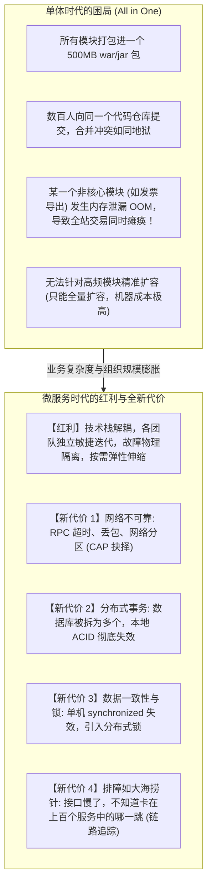
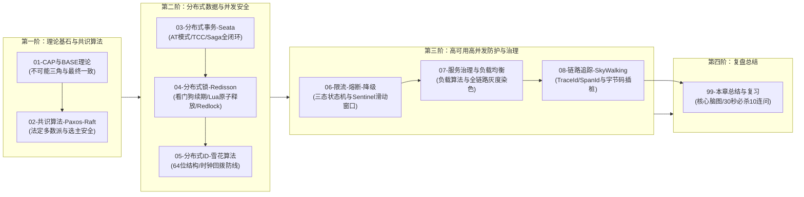

# 分布式与微服务全景与心智模型

> [!abstract] 一句话心智模型
> 如果把单体应用比作**一家中央集权的独立小王国**，微服务架构就是**现代联合国与跨国商业联邦体系**：
> - **联邦最高宪法（CAP 与 BASE 理论）**：宣布“既要强一致、又要百分百高可用、还要容忍网络断交（P）是不可能的”，指导各国在基本可用与最终一致性之间达成妥协；
> - **联合国安理会表决机制（Raft / Paxos 共识算法）**：通过“多数派胜出（Quorum）”的民主投票与法定人数裁决，彻底解决联邦群龙无首（选主）与两极脑裂危机；
> - **跨国多方履约合同（分布式事务 2PC / TCC / Seata）**：保障跨国资金调拨、扣库存与生成订单在跨越多个国家（服务）时，要么全员履约，要么一键自动毁约回滚；
> - **限量资源独占令牌（分布式锁 Redisson）**：跨国抢购极度稀缺资源时的全球排他通行证；
> - **全球唯一公民身份证编码（雪花算法 Snowflake）**：按毫秒时序有序递增，保障全球数十亿物料绝不重码；
> - **电网超负荷跳闸保护（限流、熔断与降级 Sentinel）**：在遭遇超级风暴时自动切断次要线路，守护核心电网免遭全域瘫痪；
> - **跨国物流包裹面单轨迹（链路追踪 SkyWalking）**：以 TraceId 穿针引线，毫秒级还原一次请求在跨国海陆空各节点间的流转全景。

---

## 🎯 为什么单体一定要走向微服务？第一性原理权衡

**分布式微服务架构的核心使命**：不是让系统变简单，而是**用工程化的基础设施与治理协议（共识、分布式事务、分布式锁、熔断限流、链路追踪），驯服网络不可靠所带来的混沌复杂度！**

---

## 🗺️ 分布式微服务核心机制与治理体系全景对照表

| 核心专题 | 主流技术与理论代表 | 核心解决问题与第一性原理 | 架构场景类比（辅助说明） |
| :--- | :--- | :--- | :--- |
| **CAP 与 BASE 理论** | 分布式系统基石理论 | 在不可靠网络发生分区（P）的客观物理前提下，**强一致性（C）与高可用性（A）无法同时兼得**；指导分布式工程转向可落地的最终一致性。 | 类比为生存妥协与宪法级权衡 |
| **分布式共识算法** | **Raft**（强领导者与易理解性） **Paxos**（共识算法鼻祖） | 在网络可能分区、节点随时宕机的恶劣环境下，**多副本对等节点如何通过法定多数派（Quorum）快速达成单一决策与日志复制一致**。 | 类比为多节点民主表决与唯一领袖任期制 |
| **分布式事务** | **Seata (AT 模式)** **TCC / Saga / 本地消息表** | 打破单库单机 ACID 事务边界后，保障跨库、跨服务的业务操作实现**全局原子性与最终一致性**。 | 类比为多方协作的阶段性提交与逆向补偿保障 |
| **分布式锁** | **Redisson (看门狗自动续期)** **Redlock (红锁多节点共识)** | 跨 JVM 进程边界实现全局排他互斥，彻底防范高并发下的库存超卖、防刷与定时任务多节点重复并发执行。 | 类比为全局唯一且带租约时效的通行令牌 |
| **分布式 ID** | **Snowflake (雪花算法)** **美团 Leaf / 百度 Uid-Generator** | 替代分库分表后的单机自增 ID，提供**全局唯一、趋势递增、包含时间戳信息且无中心化锁竞争**的高性能 64 位数字主键。 | 类比为分布式唯一的机器+时间指纹条形码 |
| **流量防卫与熔断** | **Sentinel** (阿里开源流量防护) **Resilience4j** | 在突发洪峰或下游依赖故障响应迟滞时，**通过流量整形、并发隔离与快速熔断返回 Fallback**，阻止级联雪崩摧毁整个微服务集群。 | 类比为电网中的高压过载空气开关与自动断路保护 |
| **客户端负载均衡** | **Spring Cloud LoadBalancer** 全链路金丝雀灰度染色 | 从注册中心动态获取健康实例列表，通过加权轮询、随机或最小活跃数算法分发流量，支撑无感扩缩容与版本灰度切流。 | 类比为智能分流派单与就近调度中枢 |
| **全链路追踪 (APM)** | **SkyWalking** (JavaAgent 无侵入字节码插桩) **OpenTelemetry / Zipkin** | 通过全链路透传全局唯一的 `TraceId` 与 `SpanId`，直观呈现复杂分布式拓扑中每个微服务的调用上下游关系与毫秒级耗时瀑布流。 | 类比为跨服务请求流转的全局全景监控录像 |

---

## 🚀 本章学习拓扑与通关路线

### 🧭 章节通关指南
1. **理论基石篇**：
   - 研读 [[01-CAP与BASE理论]]：不再死记硬背三个字母，从真实物理网络分区看懂为什么分布式系统必须做 CP 与 AP 的战略取舍。
   - 研读 [[02-分布式一致性-Paxos-Raft]]：搞懂 Raft 的三大核心机制（选举、日志复制、安全性）以及法定人数 $N/2+1$ 杜绝脑裂的数学逻辑。
2. **数据与并发深水区**：
   - 研读 [[03-分布式事务-2PC-TCC-Saga]]：掌握阿里 Seata AT 模式的前后镜像与 Undo Log 机制，厘清 TCC 的防悬挂与空回滚。
   - 研读 [[04-分布式锁]]：吃透 Redisson 看门狗后台自动续期原理，理解 Martin Kleppmann 与 Antirez 关于分布式锁与 Fencing Token 的经典论战。
   - 研读 [[05-分布式ID]]：掌握 64 位雪花算法的比特位设计，掌握时钟回拨发生时的兜底架构方案。
3. **稳定性与可观测性守护**：
   - 研读 [[06-限流-熔断-降级]]：搞清熔断器三大状态机（Closed, Open, Half-Open）的流转逻辑。
   - 研读 [[07-服务治理与负载均衡]]：掌握微服务全链路灰度发布的“流量染色（Traffic Coloring）”方案。
   - 研读 [[08-链路追踪]]：理解基于 JavaAgent 字节码增强的无侵入链路追踪，看懂 TraceId 与 SpanId 的父子级联结构。
   - 最后通关 [[99-本章总结与复习]]：全景脑图与大厂 30 秒必杀 10 连问。
