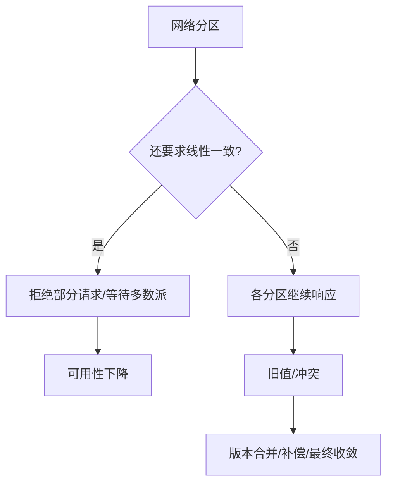

# CAP与BASE理论

> [!abstract] 一句话总结
> CAP 描述网络分区时一致性和可用性的取舍，BASE 是接受中间状态并通过重试、补偿、对账实现最终一致的工程思想。

## 📌 精准定位

- 负责帮助在分区故障、复制延迟、故障恢复时说清系统选择。
- 不负责给系统贴 CP/AP 标签后结束设计，真实系统常在操作级别取舍。
- 关键边界：P 不是可选项，分布式系统必须假设网络分区会发生。

## 🧩 核心概念

| 概念 | 具体含义 | 精通要点 |
| ---- | -------- | -------- |
| Consistency | CAP 中指线性一致读写。 | 所有客户端像读写单副本。 |
| Availability | 非故障节点必须有限时间响应。 | 响应可以不是最新值。 |
| Partition tolerance | 节点间通信丢失或延迟时仍运行。 | 跨机房默认存在。 |
| BASE | 基本可用、软状态、最终一致。 | 靠幂等、补偿、对账收敛。 |

## ⚙️ 工作原理 / 主流程



1. CAP 只在分区故障下逼迫选择。
2. CP 通常通过多数派保证一致，少数派不可写。
3. AP 优先响应，之后用复制和冲突解决收敛。
4. BASE 需要幂等、重试、对账和人工兜底。
5. 余额扣减可偏 CP，商品浏览可偏 AP。

## 💻 代码 / 配置 / 伪代码

```text
下单链路取舍：
库存预扣：宁可失败也不能超卖，偏 CP。
订单详情读：允许短暂查不到，重试后可见。
积分到账：异步最终一致，靠消息重试和对账。
```

## 🔍 源码入口 / 关键组件

- Raft/Paxos 多数派复制
- Dynamo quorum / vector clock
- 业务补偿任务和对账系统
- SLA/SLO 文档
- 故障演练报告

## ⚠️ 生产坑与注意事项

- 把 CAP 的 C 误解成 ACID 一致性。
- 说 AP 却没有冲突解决和补偿。
- 所有接口追求强一致导致可用性不可接受。
- 忽略读己之写。
- 把最终一致当成最终一定一致。

## 🧭 排查路径

- 一致性投诉还原写入位点、复制延迟、读路由和缓存。
- 可用性下降看是否等待多数派和超时过长。
- 补偿失败查幂等键、重试、死信、人工队列。
- 跨机房异常区分分区、DNS、时钟和复制延迟。

## 🎯 面试问题

> [!question] 高频问题
> - Q: P 能不能不要？
>   - A: 分布式系统无法避免网络分区，只能在分区时取舍 C/A。
> - Q: CAP 的 C 是什么？
>   - A: 线性一致，不是 ACID 约束。
> - Q: BASE 如何落地？
>   - A: 状态可中间化，消息重试，幂等补偿，对账。
> - Q: CP/AP 如何选？
>   - A: 看业务能否接受旧值或失败。
> - Q: 最终一致最大风险？
>   - A: 没有检测和补偿闭环，异常不收敛。

## ✅ 精通检查清单

- 能画出主流程，并标出最容易失败的节点。
- 能说出至少 3 个源码入口或关键组件。
- 能写出最小配置、SQL、伪代码或状态机。
- 能结合生产故障说明监控指标、排查命令和修复动作。
- 能和相邻方案做取舍对比，而不是只背定义。

## 🔗 关联笔记

- [[_index]]
- [[20-Java后端/00-总览/学习仪表盘]]

## 📚 参考资料

- Brewer CAP Theorem
- Dynamo and Raft papers
