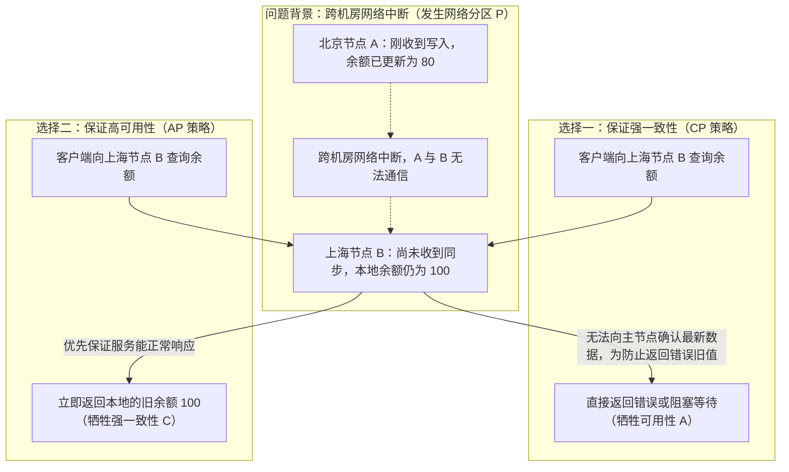
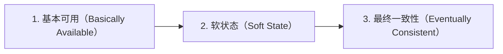

# CAP 与 BASE 理论

> [!abstract] 一句话心智模型
> 在分布式系统中，数据会被复制到多个节点上。当节点之间的网络正常时，系统可以同时兼顾数据一致性和服务可用性；但**一旦节点之间的网络发生中断（网络分区 P），系统就必须在“拒绝响应以保证数据强一致（CP）”和“允许返回本地旧数据以保证服务可用（AP）”之间做出二选一的权衡**。BASE 理论则是工程界应对这一矛盾的核心方案：通过允许短暂的中间状态，用异步同步与补偿机制换取高可用与最终一致性。

---

## 📐 一、从一个具体场景看懂 CAP 定理

### 1. 跨节点数据同步的物理矛盾

假设我们的系统有两个跨机房部署的数据库节点：**北京节点 A** 和 **上海节点 B**，初始状态下两边的用户余额都是 `100` 元。

在网络正常的情况下：
1. 用户向北京节点 A 发起扣款 20 元的请求，节点 A 将余额更新为 `80` 元；
2. 节点 A 通过机房专线将最新余额 `80` 同步给上海节点 B；
3. 同步完成后，向用户返回“扣款成功”；
4. 紧接着另一个请求从上海节点 B 查询余额，立即读到最新的 `80` 元。此时系统既有强一致性，又有高可用性。

但是，物理网络随时可能出现故障。假设在节点 A 把余额改成 `80` 之后，**北京到上海的跨机房光纤突然中断了**（即发生了**网络分区 Partition**），数据无法从节点 A 同步到节点 B。此时，一个客户端正好连接到上海节点 B 查询余额，节点 B 面临一个无法回避的二选一抉择：

从这个例子可以直接推导出 CAP 定理的核心结论：
- 如果你要保证**强一致性（C）**，绝不允许客户端读到落后的旧数据 `100`，那么失联的节点 B 就只能拒绝这次请求或无限期等待网络恢复，这就牺牲了**可用性（A）**。
- 如果你要保证**可用性（A）**，要求节点 B 必须在合理时间内给出正常响应，那么它只能把自己手里现有的 `100` 返回给客户端，这就牺牲了**强一致性（C）**。

---

### 2. CAP 三大要素的准确定义

1. **C（Consistency，线性一致性）**：
   - 在分布式系统中，CAP 里的 C 指的是**线性一致性（Linearizability）**，即所有节点在同一时刻看到的数据完全一致。
   - 一旦某个写操作完成并返回成功，后续无论客户端从集群中的哪一个节点发起读请求，都必须立即读到这次最新写入的值，就像所有操作都在操作同一个单机变量一样。（注意与数据库事务 ACID 中的 C 区分：ACID 的 C 指的是业务完整性约束，如转账前后总金额不变；而 CAP 的 C 指的是多副本之间的数据实时一致）。
2. **A（Availability，可用性）**：
   - 集群中每一个未宕机的正常节点，在收到客户端请求后，都必须在有限时间内返回正常的、非错误的响应结果。如果节点因为联系不上其他节点而直接返回 `503 Service Unavailable` 错误或超时挂起，就违背了可用性。
3. **P（Partition Tolerance，分区容忍性）**：
   - 网络分区是指由于交换机故障、光纤被挖断或网络拥塞，导致集群中的节点被切割成多个无法互相通信的子集。
   - 只要数据分布在多台通过网络连接的机器上，网络故障就是客观存在的物理事实，无法通过软件消除。因此，**分布式系统天生必须具备分区容忍性（P）**。

---

### 3. 为什么常说“CAP 不能简单理解为任意三选二”？

初学者常有一个误区，认为系统架构可以在 `CA`、`CP`、`AP` 三种组合中随便选一种。实际上：
1. **分布式系统无法选择“放弃 P（即 CA）”**：只要系统跨机器部署，网络分区就一定会发生。只有在单机数据库（不涉及跨节点网络同步）中，才不存在网络分区问题。
2. **C 与 A 的冲突只在网络分区发生期间才被激化**：在日常 99.9% 网络通畅的时间里，分布式系统完全可以同时做到返回快（可用）和数据准（一致）。所谓的 `CP` 或 `AP` 架构，本质上是在定义**“当那 0.1% 的网络中断发生时，系统的应急预案是优先保数据准确，还是优先保服务不断”**。
3. **同一个系统内部可以按业务模块混合使用 CP 与 AP**：例如在同一个电商平台中，商品详情页和评论列表使用 AP 策略（优先用缓存兜底响应），而扣减库存和账户扣款则采用强一致控制。

---

## 🏛️ 二、BASE 理论：互联网高并发系统的工程实践

如果在所有场景下都要求跨节点实时强一致（每写一笔数据都要锁住所有副本同步完才返回），系统在高并发下的响应延迟和可用性都会受到严重影响。

为此，eBay 架构师总结了互联网大规模分布式系统的实践经验，提出了 **BASE 理论**。它的核心思想是：**既然无法做到每时每刻的强一致，那就退一步，允许系统在短时间内存在中间状态，只要在业务可接受的时间窗口内让数据最终达成一致即可。**

BASE 是三个核心概念的缩写：

### 1. Basically Available（基本可用）
当系统遇到突发大促流量或部分节点故障时，允许损失一部分非核心体验，以保障核心业务流程可用：
- **响应时间上的妥协**：平时下单接口 50ms 返回，双十一零点高峰期通过队列削峰，响应时间延长到 500ms，但用户依然能完成下单。
- **非核心功能的降级**：流量过载时，暂时关闭商品推荐、积分明细查询等次要功能，或者对超出承载能力的请求返回排队提示页，确保核心交易链路不崩溃。

### 2. Soft State（软状态）
允许系统中的数据存在短暂的**中间状态（过渡状态）**，并且这个中间状态不会影响系统整体的可用性：
- 例如用户在电商平台下单支付后，订单状态不会立刻变成“已发货”，而是先进入 **“支付确认中”** 或 **“待出库”** 的中间状态。此时订单库、支付库和仓储库之间的数据正在通过后台消息队列异步同步，处于短暂未完全同步的“软状态”。

### 3. Eventually Consistent（最终一致性）
系统中所有的数据副本不需要在写入完成的瞬间立刻一致，但经过一段时间的异步同步、重试或定时对账后，所有副本的数据最终会收敛到完全一致的状态：
- 在实际工程中，最终一致性通常通过 **“本地事务 + 消息队列异步通知 + 消费端幂等重试 + 定时对账任务”** 的组合拳来落地。

---

## ⚖️ 三、典型技术组件与业务场景的 CP / AP 选型

### 1. 注册中心对比：ZooKeeper (CP) vs Eureka / Nacos (AP)

微服务注册中心的选择是理解 CP 与 AP 差异最经典的案例：

| 对比维度 | ZooKeeper（偏 CP 设计） | Eureka / Nacos 临时实例（偏 AP 设计） |
| :--- | :--- | :--- |
| **网络分区时的表现** | 当发生网络分区时，如果当前分区节点数不足半数，或者集群正在重新选主，ZooKeeper 会**直接拒绝读写请求**，保证不会返回过期数据。 | 当发生网络分区时，哪怕节点之间失联，每个节点依然**继续对外提供服务注册与查询**，返回本地缓存的服务实例列表。 |
| **为什么注册中心更倾向 AP？** | 如果注册中心因为选主而在几十秒内拒绝返回服务列表，调用方就拿不到下游 IP，会导致本来正常的微服务之间也无法调用。 | 相比之下，即使返回了包含个别已下线节点的旧列表，调用方也可以通过客户端负载均衡的重试机制跳过坏节点，保障业务调用不中断。 |

*(注：Nacos 同时支持两种模式——用于普通微服务发现的**临时实例**走 AP 协议（Distro），用于配置中心和持久元数据的**持久化实例**走 CP 协议（Raft）。)*

### 2. 常见业务场景选型指南

| 业务场景 | 推荐策略 | 原因分析与落地方式 |
| :--- | :---: | :--- |
| **账户余额扣款、核心账务** | **强一致 / CP** | 涉及资金安全，绝不允许透支或账目错乱。在同一服务内使用数据库本地事务与行锁/乐观锁；跨服务时采用严密的预留确认或可靠的分布式事务机制。 |
| **用户下单送积分、发优惠券** | **最终一致 / AP** | 用户付款成功后，积分晚到几秒钟完全不影响体验，但绝不能因为积分服务抖动而导致用户付不了款。通过 RocketMQ/Kafka 异步发送消息完成积分发放。 |
| **商品详情页、评论与点赞数** | **最终一致 / AP** | 读多写少、高并发场景。用户发表评论后，其他用户刷新页面晚 1~2 秒看到毫无影响。广泛采用多级缓存 + 异步落库策略。 |
| **分布式锁、集群选主与元数据** | **强一致 / CP** | 选主或核心配置一旦出现多节点不一致就会引发状态冲突，通常依赖 Etcd、ZooKeeper 或基于 Raft 协议的存储组件。 |

---

## ⚡ 四、一分钟面试复盘

> [!question]- Q1：请用自己的话解释什么是 CAP 定理？为什么说分布式系统只能在 CP 和 AP 之间做权衡？
> 1. **CAP 的含义**：**C（线性一致性）**指每次读取都能拿到最新写入的数据；**A（可用性）**指每个未故障的节点都能在有限时间内返回正常响应；**P（分区容忍性）**指节点间网络中断时系统仍能继续运行。
> 2. **为什么是 CP 和 AP 的权衡**：因为只要系统跨多台机器部署，物理网络就一定可能出现故障（即网络分区 P 必然存在）。当网络正常时，系统可以同时兼顾 C 和 A；但当网络分区发生、节点间无法同步最新数据时，如果要求节点必须返回最新数据（保 C），失联节点就只能报错或阻塞（弃 A）；如果要求节点必须立刻正常响应（保 A），它就只能返回本地尚未同步的旧数据（弃 C）。

> [!question]- Q2：什么是 BASE 理论？它和数据库 ACID 是什么关系？
> - **ACID** 是传统数据库本地事务的强一致性模型，追求在事务完成瞬间所有数据严格一致。
> - **BASE**（基本可用、软状态、最终一致性）是分布式系统为了兼顾高并发性能与高可用性而采取的工程落地方案。
> - 在微服务架构中，两者是**局部与全局的配合关系**：在单个微服务内部操作自己的数据库时，依然依赖 **ACID 本地事务**保证单步操作的准确性；而在跨多个微服务协同（如下单后扣库存、加积分）时，则遵循 **BASE 理论**，允许存在“订单处理中”等软状态，通过可靠消息队列、幂等重试与定时对账实现跨服务的**最终一致性**。
