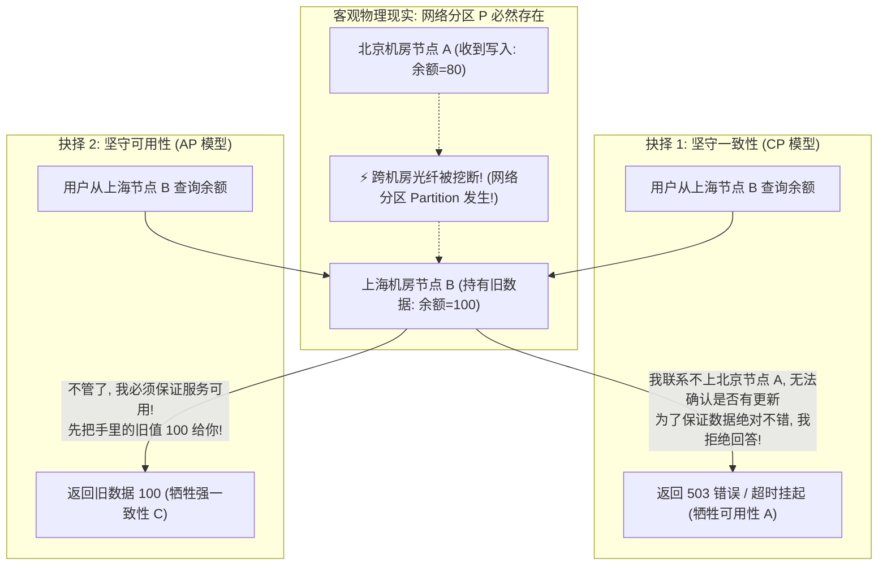
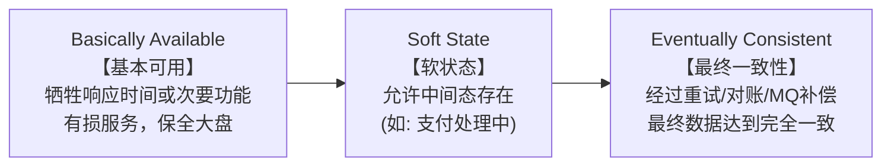

# CAP 与 BASE 理论

> [!abstract] 一句话心智模型
> 在分布式物理世界中，网络断缆与丢包就像不可预测的天灾（网络分区 P）：
> - **CAP 定理（不可能三角）** 宣布了一条铁律：当天灾降临（网络隔断）时，你必须面临生死抉择：
>   - **要面子（CP 强一致）**：联系不上对岸，宁可关门停业（拒绝请求），也绝不对客户报虚假旧数据；
>   - **要肚皮（AP 高可用）**：不管对岸发生了什么，照常开门营业，哪怕给客户看几秒钟前过时的旧数据也绝不报错；
> - **BASE 理论（终极妥协艺术）**：既然做不到神仙般的强一致，工程师们退而求其次——**基本可用（允许降级排队） + 软状态（允许中间流转中） + 最终一致性（事后对账补偿，最终完全一致）**，这是支撑现代万亿级互联网大促的真正支柱！

---

## 📐 一、CAP 定理第一性原理严格推导

在讨论 CAP 之前，必须先纠正业内流传最广的误区：**“CAP 三者选其二，我可以选 CA 架构”**。
- **事实真相：在任何跨机器、跨网络的真实分布式系统中，CA 架构在物理上根本不存在！分布式系统永远只能在 CP 和 AP 之间做二选一！**



### 1. CAP 三大要素精准定义

1. **C（Consistency，线性强一致性）**：
   - 这里的 Consistency **不是 ACID 里的 C（完整性约束）**，而是指 **线性一致性（Linearizability）**！
   - 含义：客户端向分布式集群写入成功后，**随后的任意客户端在任意节点上的读操作，必须读到这次最新写入的值**。在外界看来，整个分布式集群表现得就像访问一台单机强一致的单点一样。
2. **A（Availability，可用性）**：
   - 含义：集群中**每一个非故障的健康节点，在收到客户端请求后，必须在有限时间内给出非错误的响应结果**。
   - **硬性界定**：返回 500 内部异常、抛出系统错误、或者连接无限挂起超时，在 CAP 严谨学术定义中都**不算满足可用性**！
3. **P（Partition Tolerance，分区容忍性）**：
   - 含义：分布式系统的各个节点分布在不同服务器或不同机房，节点之间的网络通信**随时可能遭遇延迟、丢包、甚至彻底断绝（网络分区）**。在面对这种恶劣网络环境时，系统依然要能够存活运转。

---

### 2. 为什么 P 是必选项？为什么没有 CA 系统？
- 在单体单机系统中，CPU、内存全在同一块主板上，通过物理总线直接通信，不存在网络丢包，此时可以做到 **CA 系统（如单机单库 MySQL）**。
- 但只要你的系统是**多台机器、多节点部署**，节点之间就必须跨越网线、路由器和交换机。在物理现实中，**网络丢包、交换机抖动、光纤被挖断是不可抗拒的客观规律**！
- 既然**网络分区 P 是物理世界中必定会发生的事实**，那么当分区降临时，系统只剩下两种活法：
  - **选择 CP**：为了保证所有节点数据绝对一致，节点在无法同步最新数据时**选择拒绝服务**（牺牲可用性 A）；代表：**ZooKeeper、HBase、Consul、Etcd**。
  - **选择 AP**：为了保证服务百分之百能响应用户，节点在无法同步最新数据时**允许返回过期的本地旧数据**（牺牲强一致性 C）；代表：**Eureka、Nacos 临时实例、Cassandra、DynamoDB**。

---

## 🏛️ 二、BASE 理论：互联网高并发工程的黄金妥协

由于物理定律的约束，强一致的 CP 系统在高并发互联网大促面前往往显得过于沉重和脆弱。
eBay 架构师 Dan Pritchett 提出了著名的 **BASE 理论**（对 ACID 强一致性的反向平衡）：

```
BASE = Basically Available（基本可用） + Soft State（软状态） + Eventually Consistent（最终一致性）
```



### 1. Basically Available（基本可用）
当系统遭遇不可预测的极端流量冲顶或部分节点故障时，**允许损失部分可用性，优先保全核心大盘不倒**：
- **响应时间上的损失**：平时页面响应 50ms，高峰期由于排队削峰，响应时间降级到 500ms，但依然算“可用”；
- **功能上的有损降级**：
  - 双十一零点秒杀时，由于流量过大，将非核心的“历史订单评价”、“运费险赠送”功能临时降级关闭；
  - 核心下单链路开启降级限流，向部分超标用户展示“系统正忙，请稍候重试”的静态排队页，而不是全站雪崩 502。

### 2. Soft State（软状态）
- 传统的 ACID 事务要求状态切换必须是**瞬时原子完成的**（从 A 状态瞬间跃迁到 B 状态）。
- 软状态允许**系统在不同节点之间的数据存在中间同步延迟**，允许存在“中间状态”，且该中间状态不影响系统的整体运转：
  - 比如跨行转账时，账户状态显示为 **“转账处理中（Processing）”**，用户可以继续浏览其他业务，不需要卡死在转账窗口等待三分钟。

### 3. Eventually Consistent（最终一致性）
- 系统无需在每一次操作完成的瞬间保证全网节点强一致。
- 但在**经过一定时间期限的自动补偿、重试、消息异步同步或定时对账之后，系统内所有节点的数据最终必须收敛并达到完全一致的状态！**

---

## ⚖️ 三、工业业务场景选型：你的系统到底该走 CP 还是 AP？

| 业务场景 | 优先选择 | 核心理由与权衡考量 | 架构支撑手段 |
| :--- | :---: | :--- | :--- |
| **银行核心转账、金融账单** | **CP** | **涉及真实真金白银，强一致性是绝对红线！** 宁可让用户等待 3 秒，或者交易失败报错，也绝对不能因为网络不一致多扣钱或凭空记账。 | 采用两阶段提交、Raft 强一致共识、分布式锁。 |
| **微服务服务注册发现** | **AP** | **高可用压倒一切！** 消费者哪怕拿到一张包含个别下线节点的旧实例列表，靠客户端重试也能调用成功；若因选举停止服务，全站微服务将直接瘫痪！ | Nacos Distro 协议、Eureka。 |
| **电商商品浏览、评论、点赞** | **AP** | **高并发抗压第一！** 某个用户发了一条评论，其他用户晚 2 秒才刷出来完全不影响用户体验，但页面如果卡顿打不开就是重大故障。 | 多级缓存、最终一致性异步 MQ 写入。 |
| **电商库存扣减** | **混合模式** | **严格防超卖（偏 CP） + 异步扣积分发优惠券（偏 AP）**。核心扣减依赖 Redis Lua 脚本或数据库乐观锁保证原子强一致，后续通知走 MQ 保证最终一致。 | 核心链路强一致，非核心链路异步最终一致。 |

---

## ⚡ 一分钟面试必杀卡

> [!question]- Q1：为什么说分布式系统中“CA 模型”在物理上是不存在的？
> - 因为在任何真实物理分布式网络中，节点跨机房、跨服务器通信，**网络丢包、延迟与断网（即网络分区 P）是不可避免的客观事实**。
> - 一旦网络分区发生，要保证数据强一致（C），无法同步的节点就必须拒绝响应（牺牲可用性 A）；要保证随时可用（A），节点就必须返回自己手头的旧数据（牺牲强一致性 C）。因此网络分区发生时，系统**只能在 CP 和 AP 之间做二选一**，不可能同时保证 CA。

> [!question]- Q2：什么是 BASE 理论？它与 ACID 有什么区别？
> - ACID 是传统单机关系型数据库追求的**刚性事务特性**（原子性、一致性、隔离性、持久性），强调任何时刻数据的绝对强一致。
> - BASE 是面对超大规模分布式高并发系统时提炼出的**柔性可用哲学**（Basically Available 基本可用、Soft State 软状态、Eventually Consistent 最终一致性）。它通过允许有损降级、允许中间状态存在，放弃了瞬时的强一致性，换取了系统极限的高并发吞吐与可用性，最终通过异步补偿机制达成数据的一致。