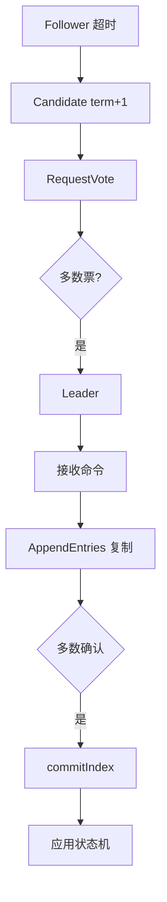

# 分布式一致性-Paxos-Raft

> [!abstract] 一句话总结
> Paxos/Raft 用多数派复制让多个节点对日志顺序达成一致；Raft 更工程化，核心是 leader、term、日志复制和安全提交。

## 📌 精准定位

- 负责复制状态机、元数据一致、配置变更、选主等强一致问题。
- 不负责解决所有业务最终一致，它提供底层共识。
- 关键边界：多数派不可用时必须停止写入，牺牲可用性换一致性。

## 🧩 核心概念

| 概念 | 具体含义 | 精通要点 |
| ---- | -------- | -------- |
| Term | 逻辑任期。 | 发现更大 term 必须退位。 |
| Leader | 唯一写入口。 | 客户端写先到 leader。 |
| Log Matching | 相同 index/term 之前日志一致。 | AppendEntries 用 prevLog 校验。 |
| Commit Index | 多数派复制后可提交。 | 提交后应用状态机。 |

## ⚙️ 工作原理 / 主流程



1. Leader 通过心跳维持权威。
2. 投票要求 candidate 日志至少和自己一样新。
3. 复制失败时 leader 回退 nextIndex 找共同前缀。
4. 当前任期日志多数派复制后才能安全推进提交。
5. 成员变更要用联合共识避免脑裂配置。

## 💻 代码 / 配置 / 伪代码

```text
Raft 写入伪流程：
1. leader 追加 entry(term,index,command)。
2. 并行 AppendEntries 给 follower。
3. 多数节点持久化成功。
4. leader 推进 commitIndex 并应用状态机。
```

## 🔍 源码入口 / 关键组件

- Raft paper leader election/log replication/safety
- etcd/raft
- JRaft / SOFAJRaft
- ZooKeeper Zab 可类比
- leader changes、apply lag、proposal latency

## ⚠️ 生产坑与注意事项

- 把 leader 本地写入成功当提交成功。
- 选举超时太短导致频繁换主。
- 状态机应用不幂等，日志重放错误。
- 快照和日志截断处理不好，新节点追赶极慢。
- 跨机房多数派延迟高。

## 🧭 排查路径

- 频繁选主看 GC、磁盘 fsync、网络、election timeout。
- 写入慢看多数派 RTT、磁盘、leader 负载。
- 节点追不上看 snapshot、log compaction、带宽。
- 读一致性确认 leader read、read index 或 lease read。

## 🎯 面试问题

> [!question] 高频问题
> - Q: 为什么要多数派？
>   - A: 任意两个多数派有交集，已提交日志不会被新 leader 丢。
> - Q: term 作用？
>   - A: 标识逻辑任期，发现更大 term 必须承认新权威。
> - Q: Leader 如何复制日志？
>   - A: AppendEntries 带前一条 index/term 匹配后追加。
> - Q: 如何保证安全选主？
>   - A: 投票时要求候选人日志足够新。
> - Q: Paxos 和 Raft 区别？
>   - A: 都基于多数派，Raft 拆成选主、复制、安全，更易工程实现。

## ✅ 精通检查清单

- 能画出主流程，并标出最容易失败的节点。
- 能说出至少 3 个源码入口或关键组件。
- 能写出最小配置、SQL、伪代码或状态机。
- 能结合生产故障说明监控指标、排查命令和修复动作。
- 能和相邻方案做取舍对比，而不是只背定义。

## 🔗 关联笔记

- [[_index]]
- [[20-Java后端/00-总览/学习仪表盘]]

## 📚 参考资料

- In Search of an Understandable Consensus Algorithm
- Paxos Made Simple
