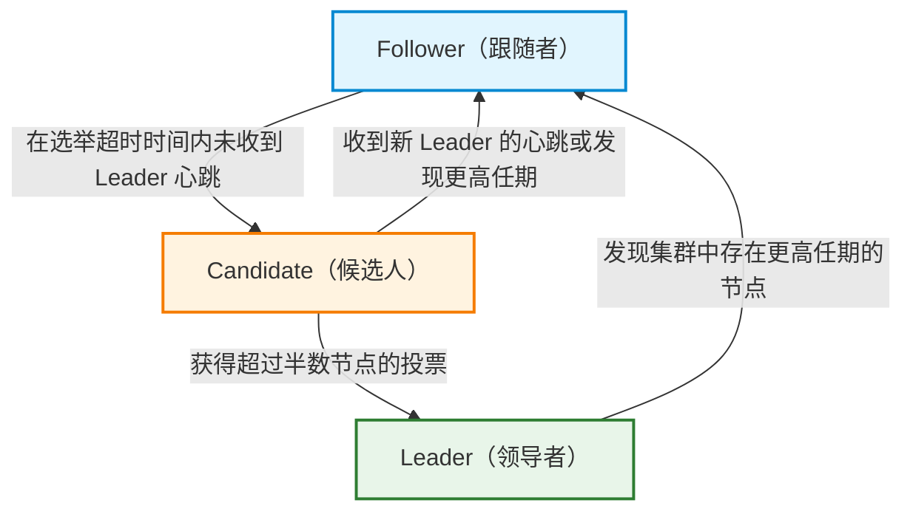
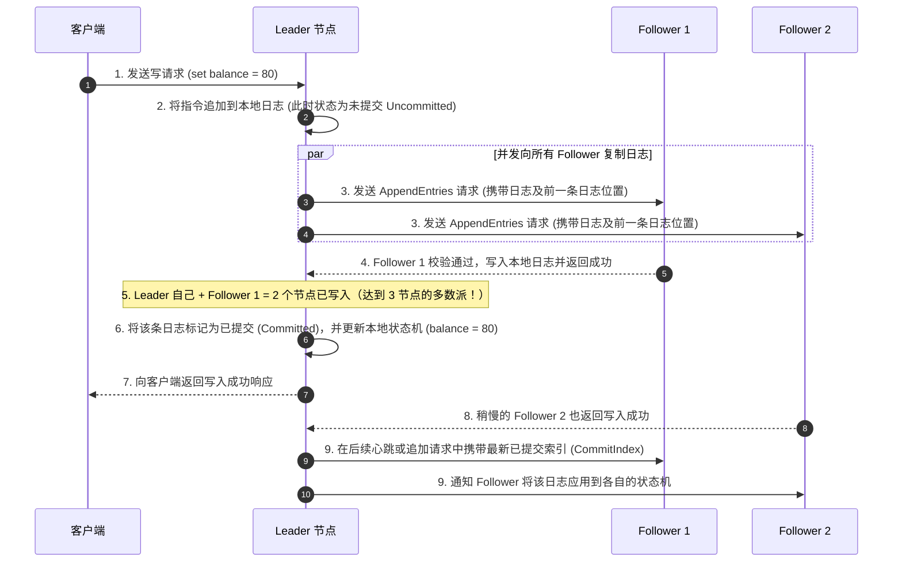
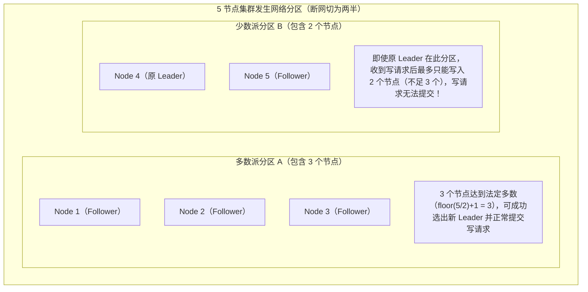

# 分布式一致性：Paxos 与 Raft 共识算法

> [!abstract] 一句话心智模型
> 当一份数据保存在多个节点上时，如何保证即使部分机器宕机或网络抖动，所有节点依然能对“听谁的指挥”和“按什么顺序修改数据”达成一致？**Raft 算法将这个复杂的共识问题拆解为三个清晰的步骤：Leader 选举（选出唯一主节点）、日志复制（主节点将写操作同步给超过半数节点后提交）、安全性约束（只有包含全部已提交日志的节点才能当选主节点）**。

---

## 🎯 一、为什么需要分布式共识算法？

在单机系统中，所有数据都在一台机器上，不存在副本不一致的问题；但如果这台机器硬盘损坏或断电，服务就会彻底中断。

为了实现高可用，分布式系统（如 Etcd、Nacos 配置中心、Kafka KRaft、TiDB）通常会把同一份数据复制到 3 台或 5 台机器上。一旦引入多台机器，就会面临三个核心问题：
1. **谁来拍板？** 如果多个节点同时接收客户端的修改请求，数据先后顺序就会错乱。因此需要先选出一个唯一的 **Leader（主节点）**，所有写请求统一由 Leader 接收。
2. **数据怎么同步？** Leader 收到写请求后，不能只改自己的内存就返回成功（否则 Leader 宕机数据就丢了），也不能死等所有节点都同步完才返回（否则只要有一台机器卡顿，整个集群就被拖死）。
3. **主节点挂了怎么办？** 如果当前 Leader 宕机，剩下的节点必须自动选出新的 Leader，而且新选出的 Leader **绝对不能丢失之前已经向客户端确认成功的任何数据**。

早期的 **Paxos** 算法虽然在理论上完美解决了这些问题，但它的推导过程和工程实现非常晦涩难懂。2014 年提出的 **Raft** 算法采用“分治法”，通过明确的角色划分和严格的日志顺序，让分布式共识变得清晰易懂，成为了目前工业界应用最广泛的共识算法。

---

## 🧭 二、Raft 的基础骨架：三大角色与任期（Term）

### 1. 节点的三种角色

在 Raft 集群中，任意时刻每个节点都处于以下三种角色之一：

- **Follower（跟随者）**：完全被动的角色。平时只负责接收并处理来自 Leader 的日志同步请求和心跳包；如果在规定时间内没有收到心跳，就会主动转变为 Candidate 发起选举。
- **Candidate（候选人）**：处于选举过程中的临时角色。当 Follower 怀疑 Leader 已经失联时，就会变成 Candidate，向其他节点发请求拉票，争取成为新的 Leader。
- **Leader（领导者）**：集群的唯一主节点。负责接收客户端的写请求，将数据变更整理成日志同步给所有 Follower，并定期向所有 Follower 发送心跳包以维持自己的领导地位。

### 2. 任期（Term）：分布式系统的逻辑时钟

由于不同机器上的物理时钟无法做到绝对同步，Raft 引入了 **任期（Term）** 作为全局的逻辑时钟：
- Term 是一个**连续递增的整数**（如 Term 1、Term 2、Term 3……），每一次新的选举都会开启一个新的 Term。
- 每个节点都在本地维护自己当前所知的最新 Term 编号，并在每次节点间通信时带上这个编号。
- **核心规则**：如果一个节点（哪怕它是当前的 Leader）收到了来自其他节点的消息，发现对方的 Term 比自己的 Term 更大，说明集群已经进入了新的任期，该节点会**立即把自己的 Term 更新为较大的值，并无条件退回 Follower 状态**。

---

## 🗳️ 三、第一步：Leader 选举（Leader Election）

理解了角色和任期后，我们按时间顺序看 Raft 是如何选出唯一 Leader 的：

### 1. 正常心跳与触发选举的因果过程
1. **正常维持阶段**：集群刚启动时所有节点都是 Follower。一旦选出 Leader 后，Leader 会每隔一小段时间（例如 50ms）向所有 Follower 发送一次心跳包（实际上是空的 `AppendEntries` 请求）。Follower 每次收到心跳包，就会重置自己本地的**选举超时计时器（Election Timeout）**，继续安心做 Follower。
2. **心跳超时触发竞选**：如果 Leader 所在机器宕机或网络中断，某个 Follower 的选举计时器走完了还没收到心跳，它就会认为当前集群没有可用的 Leader，立即触发新一轮选举：
   - 将自己本地的 `Term` 加 1（例如从 Term 1 变成 Term 2）；
   - 将自己的角色从 Follower 切换为 **Candidate**；
   - 先投自己一票，然后向集群其他所有节点并发发送 `RequestVote`（请求投票）消息。
3. **投票与当选**：
   - 每个节点在**同一个 Term 内最多只能投出一票**（遵循“先到先得”原则，且候选人的日志不能比自己落后）。
   - 如果该 Candidate 收到了**超过半数节点（$\lfloor N/2 \rfloor + 1$，加上自己那一票）**的赞成票，它就正式当选为当前任期的 **Leader**，并立即向全网广播心跳，宣告新 Leader 诞生，其他节点收到后全部转为 Follower。

### 2. 为什么要设计“随机选举超时”？
假设一个 3 节点集群中 Leader 挂了，如果剩下的两个 Follower 配置了完全相同的选举超时时间（比如都是固定的 200ms）：
- 它们会在同一时刻超时，同时变成 Candidate，各自把 Term 加 1，并先给自己投一票；
- 随后它们互相向对方索要选票，但因为每个节点在同一任期内只能投一票（且都已经投给了自己），双方都会拒绝给对方投票；
- 结果本轮无人拿到 2 票（多数票），导致**选票瓜分（Split Vote）**，选举失败！如果下一轮超时时间还是固定一样的，它们会陷入无限平票的死循环。

**Raft 的解法非常巧妙——随机化选举超时（Randomized Election Timeout）**：
- 不给节点设置固定的超时时间，而是让每个节点在一段区间内（例如 **150ms ~ 300ms**）随机生成一个超时时间。
- 这样一来，当 Leader 宕机后，总有一个 Follower（比如随机到了 165ms）会比另一个 Follower（比如随机到了 280ms）**先超时**。
- 先超时的节点抢先变成 Candidate 并发起拉票，此时另一个节点还没超时，迅速投出赞成票。先超时的节点立刻凑够多数票当选 Leader，并发出心跳重置其他节点的计时器，从而高效避免了选票瓜分。如果极端巧合下仍然发生平票，各节点只需等待下一个重新随机生成的超时时间，进入 `Term + 1` 重新选举即可。

---

## 📜 四、第二步：日志复制（Log Replication）

选出 Leader 之后，集群开始对外处理客户端的写请求。在 Raft 中，所有对数据的修改都必须先记录为一条**日志（Log Entry）**，再按相同顺序应用到各个节点的**状态机（State Machine，即真正的数据库或内存数据）**中。

每一条日志包含三个核心信息：**日志索引下标（Index）**、**产生该日志时的任期号（Term）**、**具体的写指令（如 `set balance = 80`）**。

我们以一个 3 节点集群（1 个 Leader + 2 个 Follower）为例，完整走一遍写入流程：

### 日志复制的三个关键环节：

1. **为什么写满“超过半数节点”就能提交（Commit）？**
   - 在上面 3 节点的例子中，只要 Leader 自己写完，并且收到 Follower 1 的写入成功回复（共 2 个节点写入，达到了 $\lfloor 3/2 \rfloor + 1 = 2$ 的多数派），Leader 就可以立即将该日志标记为 **Committed（已提交）**，更新自己的状态机并向客户端返回成功，完全不需要等待较慢的 Follower 2。
   - 这就是 Raft 兼顾性能与高可用的核心：**只要集群中超过半数的节点存活且网络通畅，个别节点变慢或宕机完全不会阻塞集群的正常写入**。

2. **Follower 日志不一致时怎么对齐？（日志匹配机制）**
   - 网络抖动或主从切换可能导致某个 Follower 上多出几条未提交的脏日志，或者少了几条日志。
   - Leader 在发送 `AppendEntries` 追加新日志时，总是会附带**紧挨着新日志的前一条日志的索引（PrevLogIndex）和任期号（PrevLogTerm）**。
   - Follower 收到后会检查自己本地相同位置是不是也是这条日志：如果是，就顺利追加新日志；如果不匹配，Follower 就会拒绝这次追加。Leader 收到拒绝后，会将发送位置往前退格，找到双方最后一条完全一致的日志位置，然后用 Leader 的日志覆盖掉 Follower 后面冲突的未提交日志，最终让所有 Follower 的日志与 Leader 完全一致。

---

## 🛡️ 五、第三步：安全性约束（为什么落后节点选不上 Leader？）

思考一个非常关键的极端场景：
假设在 3 节点集群中，Follower 2 因为网络故障断线了 5 分钟，漏掉了 100 条已经向客户端确认成功的日志。5 分钟后 Follower 2 网络恢复，紧接着原 Leader 突然宕机了。这时候如果让数据严重落后的 Follower 2 当选为新 Leader，并用它落后的日志去覆盖其他节点，那之前已经提交的 100 条数据岂不是丢失了？

为了彻底杜绝这种情况，Raft 制定了严格的**选举投票限制（Election Restriction）**：

### 1. 投票时的日志新旧比对规则
当 Candidate 发出 `RequestVote` 请求拉票时，必须在请求里亮出自己的“家底”——自己本地**最后一条日志的任期号（`LastLogTerm`）**和**最后一条日志的索引下标（`LastLogIndex`）**。
投票节点收到拉票请求后，会拿对方的最后一条日志和自己本地的最后一条日志做比对，只有对方的日志**至少和自己一样新**时才会投赞成票。比对规则只有两步：
1. **先比最后一条日志的任期号（`LastLogTerm`）**：谁的任期号大，谁的日志就更新；
2. **如果任期号相同，再比日志长度（`LastLogIndex`）**：谁的索引下标大（即包含的日志条数更多），谁的日志就更新。

### 2. 抽屉原理保证“已提交数据绝不丢失”
把“日志复制必须写满多数派”和“当选 Leader 必须拿到多数派选票”结合起来看：
- 假设集群有 5 个节点，一条日志要成为“已提交（Committed）”，至少要写入 **3 个节点**（多数派 A）；
- 后来发生选举，一个 Candidate 要想当选新 Leader，也必须拿到至少 **3 个节点**（多数派 B）的赞成票；
- 根据数学上的抽屉原理（鸽巢原理），两个超过半数的集合 A 和 B，**至少有 1 个共同的重叠节点**！
- 这个重叠节点身上一定保存着那条最新已提交的日志。如果某个候选人缺少这条已提交日志，它的日志就一定比这个重叠节点旧，重叠节点就会拒绝给它投票，从而保证**缺少已提交日志的落后节点永远凑不够多数票，选出来的 Leader 一定拥有全部已提交的数据**。

*(补充细节：在跨任期切换的极端情况下，为了防止旧任期尚未完全同步的日志被误判提交，Raft 还规定新 Leader 必须通过提交一条属于自己当前任期的新日志，来顺带将之前任期的遗留日志一并确认提交。)*

---

## 🧠 六、什么是分布式脑裂？Quorum 机制如何防脑裂？

### 1. 脑裂（Split-Brain）的成因与危害
在主从架构中，如果机房之间的网络突然断开，把一个集群切成了两个互不通信的孤岛（分区 A 和分区 B）：
- 原来的 Leader 在分区 B 中继续接收客户端写入；
- 分区 A 里的节点因为收不到原 Leader 的心跳，以为原 Leader 挂了，于是自己又选出了一个新的 Leader 也开始接收客户端写入。
- 此时一个集群里同时存在**两个接受写入的 Leader**（就像一个人裂成了两个大脑），两边的数据各自修改，网络恢复后根本无法合并，导致严重的数据错乱。

### 2. 法定多数派（Quorum）如何从根源上阻止脑裂？
Raft 通过**法定人数（Quorum，即必须超过半数 $\lfloor N/2 \rfloor + 1$）**同时约束“选举”和“日志提交”，彻底解决了脑裂导致的双写冲突：

我们看图中的 5 节点集群被网络切成“3 节点（分区 A）”和“2 节点（分区 B）”时的表现：
1. **原 Leader 所在的少数派分区 B（2 个节点）**：虽然原 Leader（Node 4）还以为自己是 Leader，但当客户端向它发送写请求时，它最多只能把日志同步给 Node 4 和 Node 5（共 2 票），凑不够 5 节点的法定多数（3 票）。因此，**原 Leader 上的任何新写请求都无法完成提交，客户端不会收到错误的成功确认**。
2. **多数派分区 A（3 个节点）**：因为收不到原 Leader 心跳，经过超时后发起选举，由于正好有 3 个节点，能够凑齐 3 票选出新的 Leader（任期变为 `Term + 1`），并正常凑够 3 票处理新的写请求。
3. **网络恢复后**：原 Leader 收到新 Leader 更高 Term 的消息，立刻退位变成 Follower，并丢弃自己在断网期间未提交的脏日志，与新 Leader 同步一致。

### 3. 为什么 Raft 集群通常部署奇数个节点（3、5、7 台）？
根据多数派公式 $\text{Quorum} = \lfloor N/2 \rfloor + 1$，我们可以对比奇数节点和偶数节点的容错能力：
- **3 台节点**：多数派为 2 台，最多允许挂掉 **1 台**（$3 - 2 = 1$）；
- **4 台节点**：多数派为 3 台，最多也只允许挂掉 **1 台**（$4 - 3 = 1$，如果挂 2 台就只剩 2 台，凑不够 3 台了）；
- **5 台节点**：多数派为 3 台，最多允许挂掉 **2 台**（$5 - 3 = 2$）；
- **6 台节点**：多数派为 4 台，最多也只允许挂掉 **2 台**（$6 - 4 = 2$）。

可以看到：**4 台机器和 3 台机器所能容忍的宕机数量完全一样（都是 1 台），但 4 台机器不仅多花了一台服务器的钱，每次写数据还必须多等一台机器确认**。因此在工程部署中，总是选择 **3 台、5 台或 7 台**这样的奇数节点。

---

## 🔗 七、补充视野：Paxos 与 Raft 的关系

在面试中如果被问到 Paxos 和 Raft 的联系与区别，可以从以下两个层面清晰作答：
1. **底层数学原理相通**：无论是 Paxos 还是 Raft，它们解决非拜占庭故障（即节点可能宕机、网络可能延迟丢包，但节点不会伪造恶意数据）的核心基石都是**多数派交集原理（Quorum Intersection）**与**逻辑递增编号（Paxos 的 Proposal Number 对应 Raft 的 Term）**。
2. **演进路径不同**：
   - **Basic Paxos** 最初只定义了如何对“单个值”达成共识（分为 Prepare 准备阶段和 Accept 接受阶段，没有常驻主节点，多个提议者并发提议时容易互相覆盖产生“活锁”）。
   - 为了在工程中连续写入多条日志，工业界基于 Basic Paxos 演进出了 **Multi-Paxos**，引入了稳定的 Leader 节点来省略每次写操作的 Prepare 阶段。
   - **Raft** 本质上就是一种结构化、规范化的 Multi-Paxos：它直接规定**所有日志必须从 Leader 流向 Follower**，且**日志必须严格按顺序连续追加、不允许出现空洞**，并把选举、复制、安全边界定义得清清楚楚，大幅降低了工程师理解和实现分布式共识的门槛。

---

## ⚡ 八、一分钟面试复盘

> [!question]- Q1：请简述 Raft 算法是如何选主的？如何解决选举时选票被平分的问题？
> 1. **选主触发**：集群正常运行时，Leader 定期向所有 Follower 发送心跳。如果某个 Follower 在**选举超时时间**内没收到心跳，就会将当前任期 `Term + 1`，转变为 Candidate，先投自己一票，然后向其他所有节点发起 `RequestVote` 拉票。
> 2. **当选条件**：每个节点在同一任期内只能投一票，且只投给日志不落后于自己的候选人。谁先拿到**超过半数（$\lfloor N/2 \rfloor + 1$）**的选票，谁就成为新 Leader。
> 3. **解决平票（选票瓜分）**：如果多个节点同时超时拉票，会导致谁都拿不到半数以上选票。Raft 通过**随机化选举超时时间**（例如在 150ms ~ 300ms 之间随机取值）来错开各节点发起选举的时刻，让最先超时的节点大概率在别的节点超时前收集够多数票；若偶发平票，则等待下一个随机超时进入新任期重新选举。

> [!question]- Q2：Raft 写数据的流程是怎样的？如果旧 Leader 宕机前有几条数据还没同步给其他节点，重启后旧 Leader 会不会把新集群的数据覆盖掉？
> 1. **写数据（日志复制）流程**：客户端将写请求发给 Leader -> Leader 先把操作追加到本地日志 -> Leader 并发发送 `AppendEntries` 将日志复制给所有 Follower -> 一旦**超过半数节点**写入成功，Leader 就将该日志标记为“已提交（Committed）”，应用到本地状态机并向客户端返回成功 -> 随后在下次心跳中通知 Follower 也提交该日志。
> 2. **旧 Leader 重启绝不会覆盖新数据**：
>    - 首先，那些只写在旧 Leader 本地、还没同步给多数派的数据属于“未提交数据”，本来就没有向客户端返回成功。
>    - 其次，新集群选出新 Leader 时，任期号 `Term` 已经增加了。当旧 Leader 重启重新连入集群时，发现新 Leader 的 `Term` 比自己大，会立即自动退化为 Follower，并按照新 Leader 的日志位置截断自己本地未提交的冲突日志，与新 Leader 保持一致。
