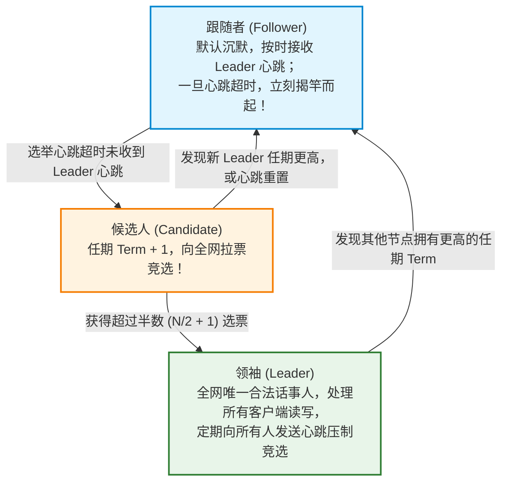
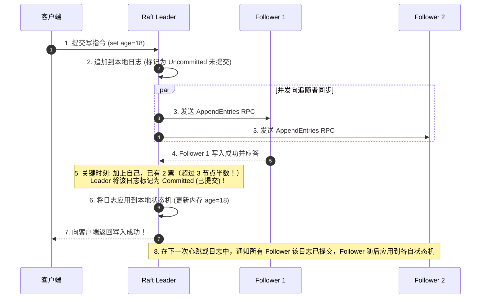
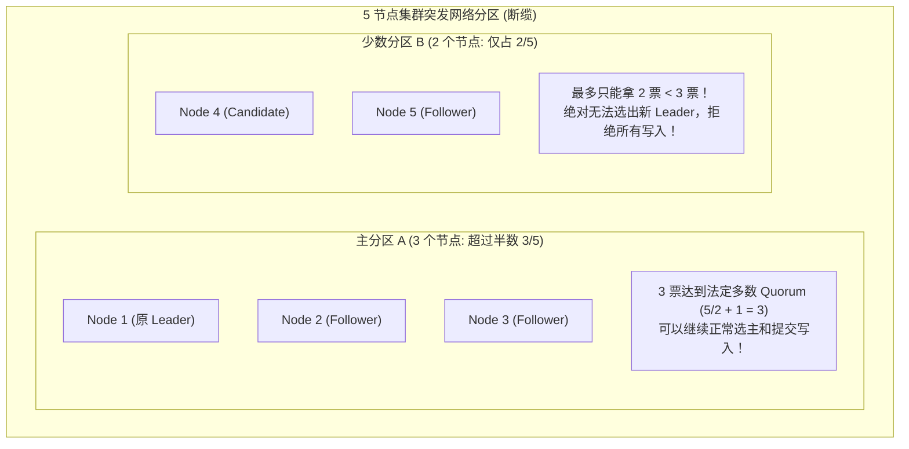

# 分布式共识算法：Paxos 与 Raft

> [!abstract] 一句话心智模型
> 如果把分布式集群比作**一个没有绝对权威独裁者的议会**：
> - **拜占庭将军 vs 非拜占庭故障**：Raft 和 Paxos 解决的是“内部有好人但可能会生病（宕机）、信使可能会迷路（丢包延迟）”的非恶意故障，不解决叛徒特务恶意伪造篡改数据（那是区块链的工作）；
> - **Paxos（古老晦涩的罗马元老院哲学）**：学术严谨但极其难懂、难以工业实现；
> - **Raft（专为人类易懂而生的高效议事规则）**：化繁为简，将共识拆解为三大铁律：
>   1. **民主竞选 Leader（选主）**：群龙无首时，谁先心跳超时谁竞选，依靠**随机化超时时间**防止瓜分选票；
>   2. **下达决议（日志复制）**：Leader 拟定法令（写入日志），超过半数议员（多数派 Quorum）签字后正式生效（Commit）；
>   3. **安全性保障（防篡改选主）**：只有掌握最全、最新法令的议员才有资格竞选新领袖，彻底粉碎“脑裂”与决议倒退！

---

## 🧭 一、Raft 的三大角色与状态机流转

在 Raft 体系中，任何时刻一个节点只能处于以下三种角色之一：

- **任期（Term）**：充当分布式系统中的“逻辑时钟”。每个任期从一次选举开始，单调递增。若节点收到任何带有更高 Term 的消息，说明自己已经落后，必须立刻退化为 Follower。

---

## 🗳️ 二、机制一：Leader 选举与“随机超时”防瓜分

### 1. 竞选触发时序
1. 正常运行时，Leader 定期向所有 Follower 广播空的 `AppendEntries`（心跳包），Follower 收到后重置自己的选举定时器。
2. 一旦 Leader 物理断电或网络中断，某个 Follower 在其**选举超时时间（Election Timeout）**内未收到心跳，便判定领袖已死！
3. 该 Follower 状态变为 **Candidate**，将当前任期 `Term + 1`，投自己一票，并向其他所有节点广播 `RequestVote` 请求投票。

### 2. 黑科技：随机化选举超时（Randomized Election Timeout）
- **痛点思考**：如果所有 Follower 的选举超时时间都固定是 200ms，那么当 Leader 宕机时，所有节点会**在同一微秒同时发起竞选并把票投给自己**！结果每个人都只有 1 票，没人能拿到多数派，选举无限死锁流局（Split Vote）！
- **破局神来之笔**：Raft 规定每个节点的选举超时时间是在 **150ms ~ 300ms 之间随机抽取**的！
  - 节点 A 抽到了 160ms，节点 B 抽到了 280ms。
  - 节点 A 会比 B 提前整整 120ms 率先超时并发出拉票广播！B 还没来得及竞选就收到了 A 的请求，把票投给 A。A 轻松拿到多数票迅速成为新 Leader，彻底杜绝了选票被瓜分的僵局！

---

## 📜 三、机制二：日志复制（Log Replication）

Raft 的核心使命是维护所有节点上**日志状态机（Replicated State Machine）的一致性**：

### 核心铁律：
- **两阶段提交**：Leader 必须收到**超过半数节点（Quorum: $N/2 + 1$）**的成功应答，才能将日志正式提交（Commit）；
- **单向流动**：日志**永远只能从 Leader 流向 Follower**，Leader 绝对不会覆盖或截断自己的日志，只有 Follower 会被 Leader 强制对齐修正。

---

## 🛡️ 四、机制三：选举限制（安全性 Safety 防线）

如果一个 Follower 之前由于网络不好掉线了，漏掉了好几条已提交的日志，随后旧 Leader 挂了，这个“缺少数据的后进生”能被选为新 Leader 吗？
- **如果它当选，会导致全网已经生效的数据被它洗白覆盖，酿成毁灭性灾难！**
- **Raft 的防线：选举投票限制（Election Restriction）**
  - 当 Candidate 发起拉票时，必须带上自己**最后一条日志的任期（LastLogTerm）与索引位置（LastLogIndex）**。
  - 任何 Voter 收到拉票请求后，会拿自己的最新日志去比对：
    1. 如果 Candidate 的 `LastLogTerm` 比自己的小，**直接拒绝投票**！
    2. 如果两者的 `LastLogTerm` 相同，但 Candidate 的 `LastLogIndex` 比自己的小（日志比自己短），**直接拒绝投票**！
  - **数学证明**：一条日志既然已经被提交，说明它必然存在于**多数派（> 50%）节点**中。而任何一个 Candidate 想要当选，又必须获得**多数派（> 50%）的投票**。根据抽屉原理（鸽巢原理），**这两组多数派集合中至少存在一个重叠的健康节点！**
  - 这个重叠节点必然拥有最新日志，它会坚决把票投给同样拥有最新日志的候选人，**从而绝对保证了新当选的 Leader 必定拥有全网历史上所有已提交的日志！**

---

## 🧠 五、脑裂（Split-Brain）与法定人数 Quorum 数学推导

什么是分布式脑裂？当机房之间网络断开，集群被切分为两个孤立的孤岛，两边各自推举出一个“土皇帝（Leader）”，导致两头同时接受写入，数据彻底错乱！

### 法定人数（Quorum）数学铁律：
- 集群总节点数为 $N$（**强烈推荐奇数：3、5、7**）。
- 提交一条日志或选主必须达到的最小投票数：
  $$\text{Quorum} = \left\lfloor \frac{N}{2} \right\rfloor + 1$$
- **为什么必须是奇数？**
  - 3 个节点最多容忍挂 1 台（$3/2 + 1 = 2$）；
  - 4 个节点同样只能容忍挂 1 台（$4/2 + 1 = 3$，挂 2 台只剩 2 票无法凑齐 3 票）；
  - 4 节点相比 3 节点没有增加任何容灾能力，反而多增加了一台机器的网络故障概率，因此生产必须部署 **3 或 5 节点**！
- **脑裂彻底免疫**：任何一个集群被网络分区切开，**绝对不可能存在两个分区同时凑齐 $\lfloor N/2 \rfloor + 1$ 票**！其中必然有一边因凑不够多数票而自动停写，从而彻底杜绝了脑裂发生！

---

## ⚡ 一分钟面试必杀卡

> [!question]- Q1：Raft 算法是如何解决选票瓜分（Split Vote）导致选举失败的问题的？
> 通过 **随机化选举超时时间（Randomized Election Timeout）** 机制。Raft 将每个节点的选举超时时间随机打散在 150ms 到 300ms 之间。这使得节点之间超时的时间错落有致，通常只有一个节点率先超时并发起竞选，抢在其他节点反应过来之前迅速集齐多数派选票当选，彻底避免了大家同时竞选瓜分选票的死锁局面。

> [!question]- Q2：当旧 Leader 宕机重启后，它上面未提交的旧数据会不会把新 Leader 的数据覆盖掉？
> **绝对不会！**
>   - 根据 Raft 的**选举限制原则**，新 Leader 在竞选时必须获得多数派投票，因此新 Leader 必然包含了全网所有已提交的最新日志。
>   - 当旧 Leader 重新加入集群时，它会收到新 Leader 带有更高任期（Term）的心跳，自动退化为 Follower。
>   - 新 Leader 会向其发送 `AppendEntries`，强制用新 Leader 的日志覆盖并截断旧 Leader 上那些从未提交过的脏日志，保证全集群日志与 Leader 强一致。