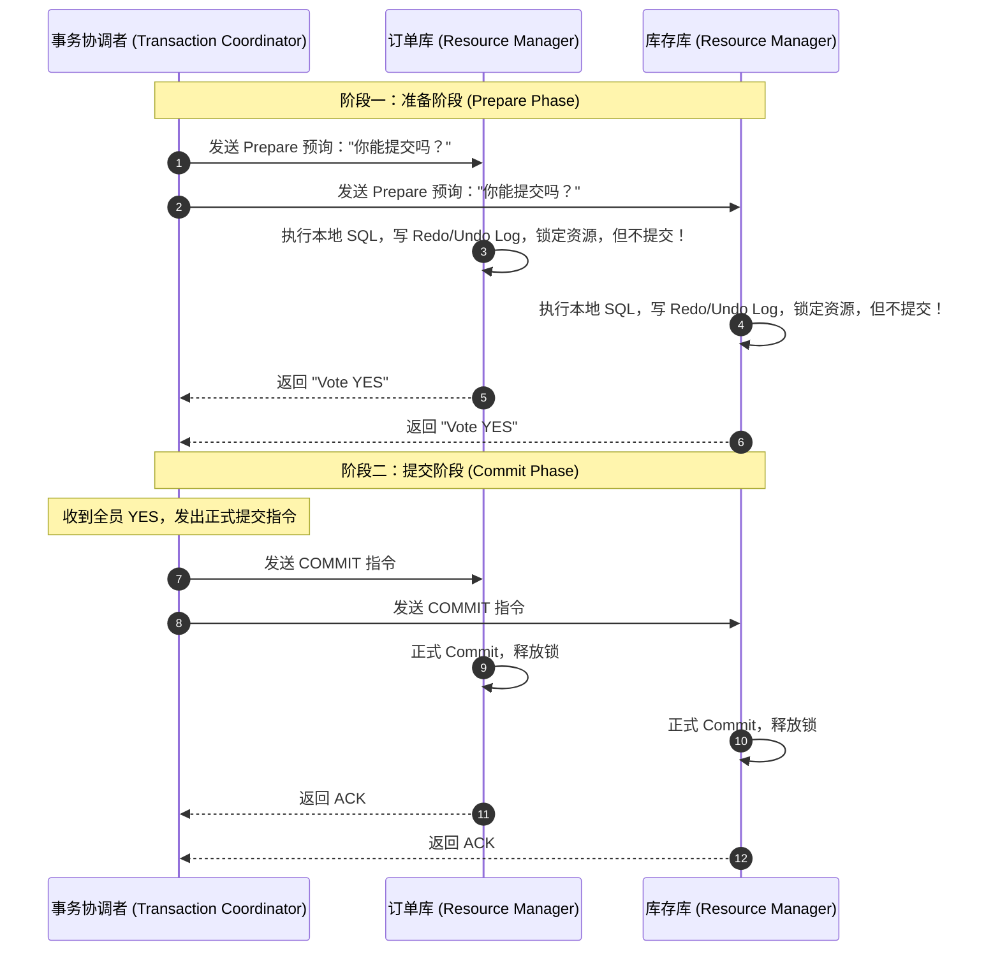
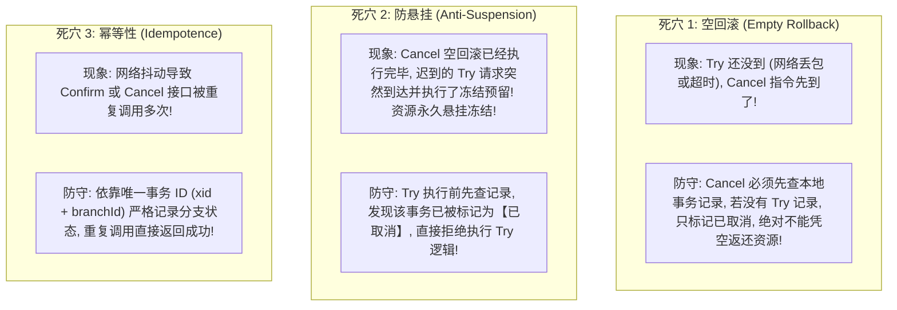
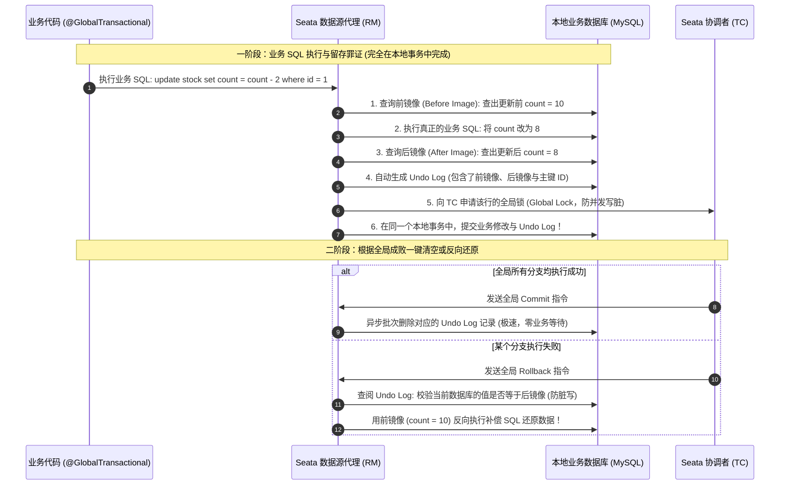

# 分布式事务：2PC、TCC、Saga 与 Seata

> [!abstract] 一句话心智模型
> 在单体时代，Spring 的 `@Transactional` 就像一家公司的内部调账，本地数据库 ACID 轻松搞定。
> 一旦服务拆分，下单操作横跨**订单库、库存库、账户库**，本地事务彻底失效：
> - **刚性事务 2PC / XA（老式全员原地立正）**：协调者问一嘴“准备好没”，大家锁住资源原地不动等命令，性能极低，协调者宕机全员卡死；
> - **柔性事务 TCC（精算师预留定金）**：业务方自写 Try（冻结）、Confirm（转正）、Cancel（退还），性能高但业务代码量翻倍，还需防范“空回滚与防悬挂”；
> - **长事务 Saga（冲正补偿流）**：先往前冲，中途暴毙再依次执行反向补偿操作；
> - **工业界降维打击：Seata AT 模式（无感黑科技）**：通过数据源代理拦截 SQL，在本地事务提交前自动拍摄**“数据前镜像”与“数据后镜像”**并生成 Undo Log！成功则异步删日志，失败则一键还原，**对业务代码零侵入**！

---

## 🗺️ 一、主流分布式事务全景对比矩阵

| 模式 | 属于类型 | 一致性级别 | 性能表现 | 代码侵入性 | 典型工业应用场景 |
| :--- | :--- | :--- | :--- | :--- | :--- |
| **XA / 2PC** | 刚性事务 | **强一致性** | **极低**（全局锁长久阻塞） | 零侵入（底层数据库支持） | 传统银行跨库资金转账、极短链路强一致场景。 |
| **TCC** | 柔性事务 | **最终一致性** | **极高**（无全局锁，独立本地提交） | **极高**（一个业务须手写 Try/Confirm/Cancel 3个接口） | 核心支付交易、跨机构严密资产预留扣减。 |
| **Saga** | 柔性事务 | **最终一致性** | **高**（长周期流转） | 中等（编写前向与逆向补偿） | 复杂的跨企业供应链审批流、跨行长事务结算。 |
| **Seata AT** | 柔性事务 | **最终一致性** | **较高**（本地事务快，短全局行锁） | **零侵入**（只需加 `@GlobalTransactional` 注解） | **当前 80% 国内互联网微服务架构的标准首选！** |
| **本地消息表 / MQ** | 柔性事务 | **最终一致性** | **最高**（完全异步解耦） | 较低（发消息与消费幂等） | 下单后发短信、加积分、异步通知履约仓储。 |

---

## 🏛️ 二、刚性事务：2PC 与 3PC 演进

### 1. 2PC（两阶段提交，XA 协议规范）

#### 2PC 的三大致命硬伤（为什么互联网互联网基本不用？）：
1. **同步阻塞与性能灾难**：在阶段一准备好之后，**所有参与的数据库必须死死持有行锁或表锁**，直到阶段二收到 Commit。如果一个节点网络慢，其他所有节点都要陪着它干等，高并发瞬间崩溃！
2. **单点故障（Coordinator Failure）**：协调者如果发生宕机，所有的参与者数据库将永远卡在准备好的中间状态，锁永远无法释放，数据处于未决僵死状态！
3. **数据不一致（脑裂盲区）**：在阶段二中，协调者发出 Commit 指令后，若突然断网，只有 RM1 收到了 Commit，RM2 没有收到。此时 RM1 提交了数据，RM2 最终超时回滚，**强一致性直接被打破，分布式数据永久错乱！**

---

## ⚡ 三、柔性事务：TCC 模式与三大工业死穴

TCC 不依赖底层数据库的 XA 协议，而是**在应用业务层自己实现两阶段提交**。

### 1. Try - Confirm - Cancel 业务流转
- **Try 阶段（初步尝试）**：完成所有业务检查（一致性），**预留必需的业务资源**（如不是直接扣减库存，而是将 10 件可售库存挪到“冻结库存”中）。
- **Confirm 阶段（确认提交）**：不做任何业务检查，只使用 Try 阶段预留的资源，真正执行业务确认。Confirm 操作必须满足幂等。
- **Cancel 阶段（取消回滚）**：释放 Try 阶段预留的业务资源，将冻结库存原路归还。Cancel 操作必须满足幂等。

---

### 2. TCC 三大工业级致命天坑与防守方案（面试高频考点）

- **工业实战落地方案**：必须在业务库中建立一张**事务控制表（TCC 状态日志表）**，将 `(xid, branch_id)` 设为主键，记录分支状态是 `INIT`、`CONFIRMED` 还是 `CANCELLED`。每次执行前先在同一数据库本地事务内抢占更新状态，彻底阻断空回滚与防悬挂！

---

## 🚀 四、企业级王者：Seata AT 模式（无代码侵入黑科技）

阿里开源的 **Apache Seata** 是目前微服务生态中最流行的分布式事务框架。其核心王牌是 **AT（Automatic Transaction）模式**，做到了对业务代码几乎零侵入！

### 1. Seata 的三大核心角色
- **TC（Transaction Coordinator，事务协调者）**：独立的 Seata Server 集群，负责维护全局事务的运行状态，驱动全局提交或回滚。
- **TM（Transaction Manager，事务管理器）**：业务发起方，控制全局事务的边界（标注了 `@GlobalTransactional` 的服务）。
- **RM（Resource Manager，资源管理器）**：控制分支事务资源，负责向 TC 注册分支事务并报告状态。

---

### 2. AT 模式底层原理：前后镜像与 Undo Log

Seata 是如何做到在不侵入业务代码的情况下，自动实现二阶段回滚的？核心就在于它对数据库连接池进行了**代理（DataSourceProxy）**！

#### Seata AT 模式为什么如此高性能？
1. **一阶段本地事务立刻提交**：与 2PC 必须长期持锁等阶段二不同，Seata AT 在一阶段执行完后，**立刻就把本地数据库连接和行锁释放掉了！** 极大减少了数据库持锁时间；
2. **全局锁轻量化隔离**：TC 仅在内存中维护行级 `Global Lock`（主键级锁），只有当两个全局事务并发修改同一行数据时才会发生短暂等待；
3. **二阶段提交完全异步化**：如果全部分支成功，二阶段只是去异步批量删掉 Undo Log 的几条日志，整个过程完全不阻碍任何前端业务调用！

---

## ⚡ 一分钟面试必杀卡

> [!NOTE] 面试高频问题标准答题套路
> 
> **Q1：什么是 TCC 的空回滚和防悬挂？如何防范？**
> - **A**：
>   - **空回滚**：当 Try 请求由于网络丢包或延迟尚未到达分支节点时，TC 判定超时直接发出了 Cancel 请求。分支节点必须识别出 Try 根本未执行过的事实，只记录取消状态，绝对不能凭空倒退返还资源。
>   - **防悬挂**：当 Cancel 已经执行过空回滚后，原本迟到的 Try 请求又慢吞吞到达了。如果此时分支执行了 Try 预留逻辑，而后续再也不会有新的 Cancel 来释放它，该资源就会永久被悬挂冻结。
>   - **解决方案**：在本地数据库建立 TCC 状态表，以事务唯一 ID 为主键。执行 Cancel 时先检查并插入取消记录；执行 Try 时先检查是否存在该事务的 Cancel 记录，若存在则直接拒绝执行，彻底杜绝悬挂。
> 
> **Q2：Seata AT 模式的底层工作原理是怎样的？**
> - **A**：
>   - Seata 依靠数据源代理（DataSourceProxy）拦截业务 SQL。
>   - **一阶段**：在执行业务更新前，代理会先自动查询出目标记录的“前镜像（Before Image）”，然后执行业务 SQL，再查询出“后镜像（After Image）”，将前后镜像打包生成一条 `Undo Log` 记录，与业务操作放入**同一个本地数据库事务**中一并提交并释放数据库行锁，随后向 TC 汇报。
>   - **二阶段**：若全局提交，TC 驱动异步清空 Undo Log；若全局回滚，RM 根据 Undo Log 中的前镜像反向生成还原 SQL，将数据精准恢复为更新前的初始值。
