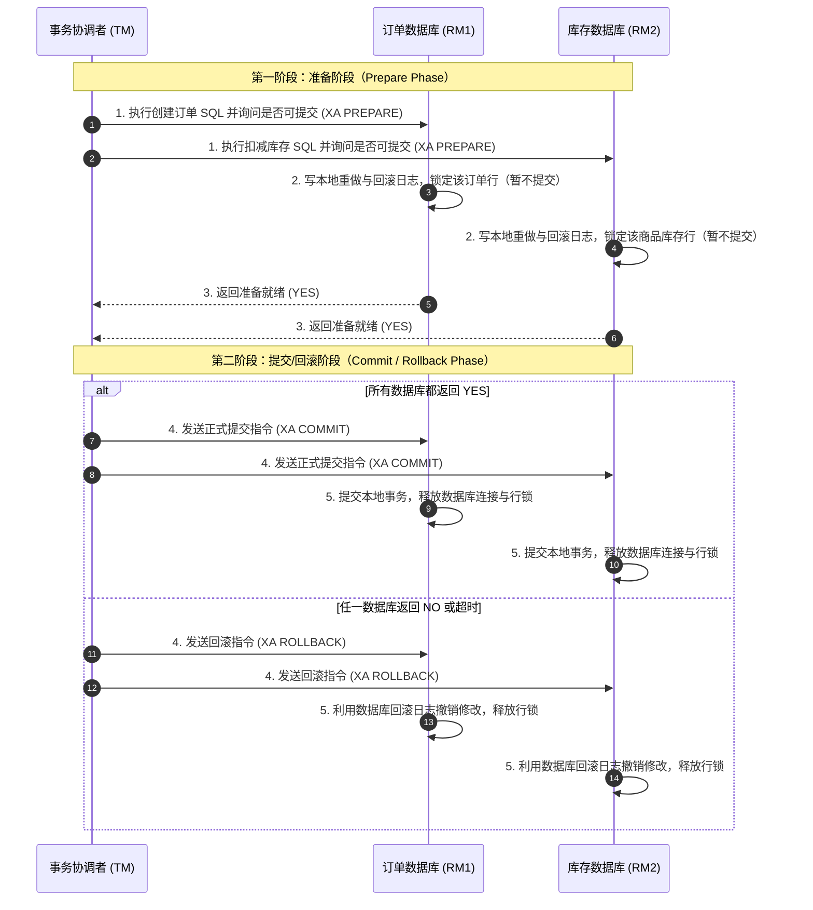
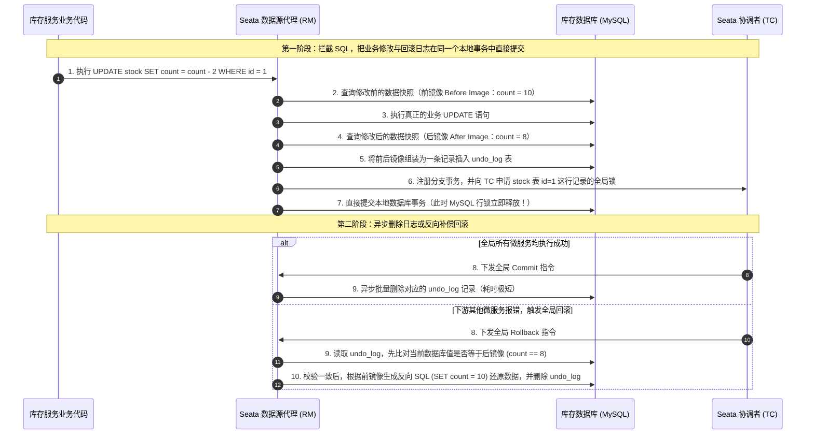
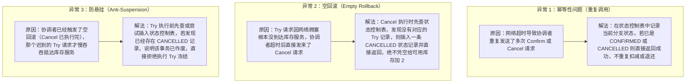
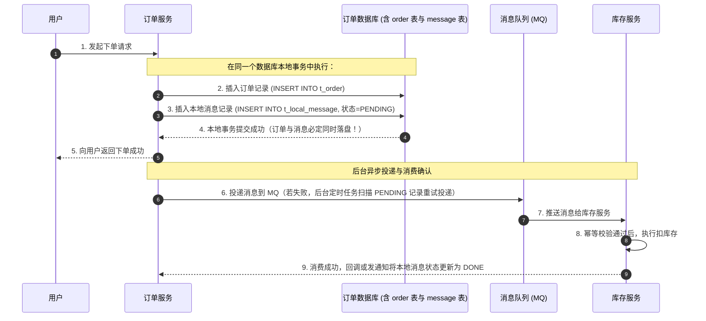
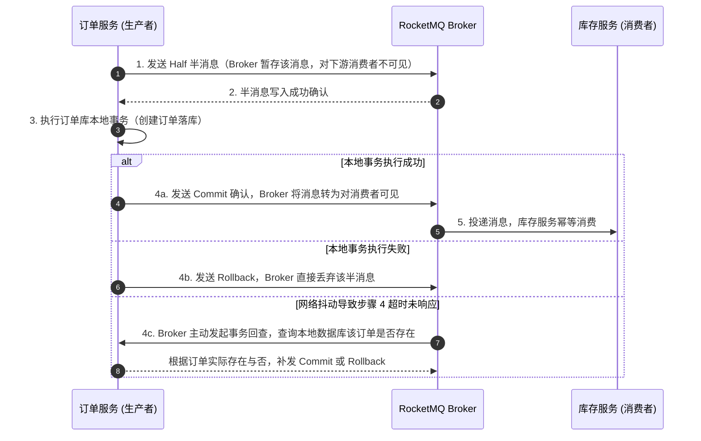

# 分布式事务：2PC、TCC、Saga、Seata 与可靠消息

> [!abstract] 一句话心智模型
> 微服务拆分后，订单服务和库存服务各自拥有独立的数据库，单个数据库的本地事务（`@Transactional`）无法跨网络回滚另一个服务的数据。解决跨服务数据一致性共有五种主流方案：**2PC/XA（底层数据库两阶段锁等待）、Seata AT（数据源代理 + Undo Log 自动补偿）、TCC（业务层 Try-Confirm-Cancel 三阶段预留）、Saga（长流程正向执行 + 逆向业务补偿）、本地消息表与 MQ 事务消息（异步最终一致性）**。在互联网高并发生产环境中，**优先采用“本地消息表 / MQ 事务消息”实现最终一致性，次选 TCC 或 Saga，尽量避免高并发链路使用长周期持锁的 2PC**。

---

## 🎯 一、为什么本地事务在微服务下失效了？

我们以电商最核心的**“用户下单扣库存”**场景为例：
- 在**单体架构**中，订单表 `t_order` 和库存表 `t_stock` 在同一个 MySQL 实例里。我们只需要在下单方法上加一个 `@Transactional` 注解，借用同一个数据库连接，一旦扣库存失败或抛异常，MySQL 的 Undo Log 会把订单表和库存表的修改一起回滚。
- 在**微服务架构**中，订单服务连的是 `order_db`，库存服务连的是 `stock_db`，中间隔着一次 HTTP/RPC 网络调用：
  1. 如果库存服务扣减成功并返回了，但订单服务在接下来写本地库时报错回滚，库存库那边已经提交的本地事务无法自动撤回；
  2. 如果库存服务其实已经执行完了扣减，只是返回响应时网络超时了，订单服务以为失败并回滚了订单，导致库存被白白扣掉。

为了解决这个跨服务、跨数据库的数据一致性问题，工业界发展出了从“强一致刚性事务”到“最终一致柔性事务”的五种标准解法。

---

## 🏛️ 二、方案一：2PC（两阶段提交 / XA 协议）

### 1. 怎么做？（结合下单扣库存流程）
**2PC（Two-Phase Commit）** 是数据库层面最早提供的分布式事务规范（典型实现为 MySQL XA 事务）。它引入了一个集中的**事务协调者（TM）**，把跨库事务拆成两个阶段：

### 2. 优缺点与适用场景
- **优点**：对业务代码几乎无侵入，完全复用底层数据库的事务能力，强一致性高。
- **致命缺点**：
  1. **同步阻塞时间太长（性能极差）**：在第一阶段 Prepare 完成后，订单库和库存库**必须一直持有数据库连接和行锁**，傻等所有其他节点都响应、协调者下发第二阶段指令后才能释放锁。如果库存里的某个爆款商品正在秒杀，一行库存记录被锁住几十毫秒，并发吞吐量会直接跌到个位数。
  2. **协调者单点与脑裂风险**：如果第一阶段大家都锁定了资源，此时协调者突然宕机，所有参与者数据库都会一直卡在持有锁的阻塞状态；更极端地，如果第二阶段协调者只给订单库发了 Commit 就挂了，库存库没收到指令，还会产生数据不一致。
- **适用场景**：只适合并发量低、跨多个数据库实例的后台内部管理系统或传统金融账务短事务，**不适合互联网高并发核心链路**。

---

## 🚀 三、方案二：Seata AT 模式（基于数据源代理的改进版两阶段）

既然传统 2PC 最大的痛点是“第一阶段锁着数据库行不放，一直等到第二阶段结束”，阿里开源的 **Seata AT 模式** 就针对这一点做了优化：**能不能在第一阶段就直接把本地数据库事务提交掉，把数据库行锁释放出来？如果第二阶段需要回滚，再自动生成一条反向 SQL 把数据改回去？**

### 1. Seata 的三个核心角色
- **TC（Transaction Coordinator，事务协调者）**：独立部署的 Seata Server 服务端，负责维护全局事务状态，下发全局提交或全局回滚指令。
- **TM（Transaction Manager，事务管理器）**：标注了 `@GlobalTransactional` 注解的业务发起方服务，负责开启、提交或回滚整个全局事务。
- **RM（Resource Manager，资源管理器）**：内嵌在各个微服务里的 Seata 客户端（数据源代理 `DataSourceProxy`），负责拦截 SQL、生成回滚日志并与 TC 通信。

### 2. 怎么做？（前后镜像与 Undo Log 机制）
假设库存表里原本有 `10` 件商品，现在下单要扣减 `2` 件（执行 `UPDATE stock SET count = count - 2 WHERE id = 1`）：

### 3. 为什么要同时记录“前镜像”和“后镜像”？
- **前镜像（Before Image）**：记录修改前的值（`count = 10`），用于在二阶段回滚时把数据恢复原状。
- **后镜像（After Image）**：记录一阶段修改后的值（`count = 8`），用于在回滚前做**脏写校验**。因为一阶段已经把数据库行锁释放了，如果在二阶段回滚前，有某个没接入 Seata 的外部程序绕过全局锁把 `count` 改成了 `5`，Seata 回滚时发现当前数据库里的 `5` 不等于后镜像的 `8`，就会立即停止自动覆盖并触发告警，防止把别人的修改盲目冲掉。

### 4. 优缺点与适用场景
- **优点**：业务代码零侵入（只需加一个 `@GlobalTransactional` 注解，并在每个库建一张 `undo_log` 表）；一阶段直接提交释放了数据库本地锁，性能比传统 XA 提升明显。
- **缺点**：每次写操作都要多执行查询前镜像、查询后镜像和写 `undo_log` 三次数据库操作；同时为了防止其他 Seata 事务在一阶段提交后并发修改同一行，TC 依然要维护全局锁，在秒杀等单行高频热点扣减场景下仍会有全局锁排队瓶颈。

---

## ⚡ 四、方案三：TCC 模式（Try - Confirm - Cancel 业务层两阶段）

如果是在高并发核心交易链路（如资金账户扣款、秒杀库存锁定），既不能容忍 2PC 的数据库锁等待，又嫌 Seata AT 多查两次镜像及全局锁太重，就可以采用 **TCC 模式**。

### 1. 怎么做？（把资源预留拿到业务代码里自己写）
TCC 不依赖底层数据库自动回滚，而是要求程序员为每一个参与分布式事务的微服务手动编写三个配套接口。以“下单扣减 2 件库存”为例，我们需要在库存表里增加一个 **`frozen_stock`（冻结库存）** 字段：

1. **Try 阶段（业务检查与资源预留）**：
   - 检查可用库存 `available_stock >= 2` 是否满足；
   - 如果满足，执行预留操作：`available_stock = available_stock - 2`，同时 `frozen_stock = frozen_stock + 2`。
   - 注意：这一步直接作为普通本地事务提交！因为只是把库存挪到了“冻结字段”里，其他并发请求看到可用库存减少了，不会超卖，也不用锁住整行等别的微服务跑完。
2. **Confirm 阶段（确认执行，真正消耗资源）**：
   - 当所有微服务的 Try 都成功后，协调者调用 Confirm 接口。
   - 此时不需要再做可用库存检查，直接把刚刚冻结的那 2 件库存核销掉：`frozen_stock = frozen_stock - 2`。
3. **Cancel 阶段（取消执行，释放预留资源）**：
   - 如果任何一个微服务的 Try 失败了，协调者调用 Cancel 接口。
   - 把刚刚冻结的 2 件库存退回到可用库存中：`frozen_stock = frozen_stock - 2`，同时 `available_stock = available_stock + 2`。

---

### 2. TCC 落地必须解决的三大异常问题（高频面试必考）

因为 Try、Confirm、Cancel 是通过网络远程调用的，网络随时可能丢包、超时重试或乱序到达。编写 TCC 接口时必须通过一张**本地事务状态控制表**解决以下三个问题：

- **标准工程实现**：在每个微服务的数据库里建一张 `tcc_Fence_log`（事务控制表），以 `(xid, branch_id)` 作为联合主键，状态包含 `TRIED`、`CONFIRMED`、`CANCELLED`。每次执行 Try、Confirm、Cancel 时，在同一个本地事务里先锁定并检查这张表的状态，就能一次性解决幂等、空回滚和悬挂问题。

### 3. 优缺点与适用场景
- **优点**：每一阶段都是极短的独立本地事务，不长久占用数据库锁，性能高，且能精确控制中间状态的资源隔离（如展示“冻结余额”、“锁定库存”）。
- **缺点**：**代码侵入性极强**！原本写 1 个接口就能搞定的事，现在每个微服务都要写 Try、Confirm、Cancel 3 个接口，还要改造数据库表增加冻结字段和状态控制表，开发维护成本高。
- **适用场景**：对并发性能和强隔离性要求极高的核心金融支付、账务划扣、高并发库存扣减场景。

---

## 🔄 五、方案四：Saga 模式（长事务编排与逆向补偿）

### 1. 什么场景下连 TCC 都用不了？
假设你正在开发一个跨国旅游预订系统，或者跨多个外部银行/第三方物流公司的供应链系统：
- 整个业务流程非常长，包含 $T_1$（订机票） -> $T_2$（订酒店） -> $T_3$（租车） -> $T_4$（扣款）。
- 这些外部系统的接口是别人写的，**对方根本不可能为了配合你去改造数据库、提供 Try/Confirm/Cancel 三个接口**，他们只提供一个正向的“下单接口”和一个逆向的“退订/退款接口”。

### 2. 怎么做？
**Saga 模式** 的做法非常直观：**不设准备阶段，一步接一步直接提交正向本地事务；如果中间某一步失败了，就按相反的顺序，依次调用前面已成功步骤的逆向补偿接口，把数据撤销回来**。
- **正常路径**：$T_1 \rightarrow T_2 \rightarrow T_3 \rightarrow T_4$（全部执行成功，流程结束）。
- **异常回滚路径**：假设 $T_1$、$T_2$ 成功了，执行到 $T_3$ 时失败了，Saga 引擎就会自动依次调用补偿操作 $C_2$（退酒店） $\rightarrow C_1$（退机票）。

### 3. 优缺点与适用场景
- **优点**：一阶段直接提交，无锁等待，非常适合跨多个团队、跨外部系统、执行耗时很长（几秒到几分钟）的业务流程。
- **缺点**：**完全没有隔离性**！因为在 $T_1$ 执行完、$T_3$ 报错触发 $C_1$ 补偿之前的这段时间里，$T_1$ 的修改已经真实提交到数据库里了，其他用户能直接看到这笔中间数据；如果此时用户把这笔钱提现了，补偿操作 $C_1$ 就会失败，因此 Saga 必须配套完善的重试与人工兜底机制。

---

## 📩 六、方案五：本地消息表与 RocketMQ 事务消息（生产首选）

在实际的互联网生产环境中，90% 以上的跨服务协同（例如：订单支付成功后 -> 通知库存服务扣减实物库存、通知积分服务增加积分、通知优惠券服务核销优惠券）其实并不需要“同时成功或同时回滚”，只要保证**“既然上游订单已经支付成功了，那么下游的扣库存和加积分就一定要最终执行成功”**。

这就是基于 **可靠消息的最终一致性方案**，主要有两种落地方式：

### 1. 方式 A：本地消息表（最经典、零中间件特性的通用解法）

核心思想：**利用数据库本地事务的 ACID 特性，把“跨服务发消息”变成“往同一个数据库里插一条记录”**。

- **为什么绝对可靠？** 因为 `t_order` 订单表和 `t_local_message` 消息表在**同一个数据库实例**里！插入订单和插入消息在同一个 `@Transactional` 本地事务中提交，绝不可能出现“订单建成功了但消息没记下来”的情况。只要消息记在了表里，哪怕当时 MQ 挂了，后台的定时任务（如 XXL-Job）每隔几秒扫一次 `PENDING` 状态的记录重新发 MQ，配合库存服务的**消费幂等性**，最终一定能把库存扣掉。

### 2. 方式 B：RocketMQ 事务消息（免建本地消息表）

如果不想在每个业务数据库里都建一张本地消息表，可以使用 **RocketMQ 原生支持的事务消息（Half Message 半消息机制）**：

---

## 🧭 七、总结：五种方案全景对比与生产选型指南

### 1. 五大方案横向对比表

| 方案 | 一致性模型 | 性能与并发能力 | 代码侵入性 | 核心原理简述 |
| :--- | :--- | :--- | :--- | :--- |
| **本地消息表 / MQ 事务消息** | **最终一致性** | **极高**（全异步解耦，无跨库锁） | 低（需写消费幂等逻辑） | 本地事务保证业务数据与消息同时成功，下游异步重试消费直至成功 |
| **TCC** | **强一致 / 准实时** | **高**（仅短暂本地锁，无长锁等待） | **高**（需手写 Try/Confirm/Cancel 并建冻结字段） | 业务层自己实现资源预留（冻结）、确认核销与取消退回 |
| **Seata AT** | **最终一致（带全局锁隔离）** | **中等**（省去二阶段本地锁，但有全局锁开销） | **极低**（仅需加注解与 `undo_log` 表） | 数据源代理拦截 SQL，一阶段连同前后镜像一起提交，二阶段自动反向补偿 |
| **Saga** | **最终一致性** | **高**（长流程无锁顺序执行） | 中等（需编写逆向补偿接口） | 拆分长事务为多个正向本地事务，失败时按反方向依次调用补偿接口 |
| **2PC / XA** | **强一致性** | **低**（一阶段锁定数据库行直到二阶段结束） | 极低（数据库原生支持） | 协调者统一询问所有数据库准备就绪后，统一发送 Commit 提交 |

### 2. 生产环境选型优先级（面试加分总结）

在实际架构设计中，我们遵循**“能不用分布式事务就不用，非要用时优先选最终一致性”**的原则：
1. **第一优先级：本地消息表 / RocketMQ 事务消息（占生产 80% 以上场景）**
   - 只要业务允许上下游存在几百毫秒到几秒的异步延迟（例如：支付成功后改订单状态、扣减发货库存、发优惠券、加积分），一律采用**本地消息表或 MQ 事务消息 + 下游幂等消费 + 定时对账兜底**。这种方式把跨服务同步调用解耦成了异步消息，吞吐量最高、稳定性最好。
2. **第二优先级：TCC 或 Saga（占核心强管控或长链路场景）**
   - 如果下游操作必须立刻拿到确定结果、且并发极高（例如下单时必须当场预扣库存或冻结账户余额），选择 **TCC**（或者直接在 Redis/数据库层先做预扣减，再走异步流转）；
   - 如果是跨多个内外部系统的长链路业务编排，选择 **Saga**。
3. **第三优先级：Seata AT 或 2PC/XA（仅用于低频内部系统）**
   - 如果是企业内部 ERP、后台管理系统，并发量不高（QPS 在几十到几百以内），但跨了多个微服务且希望开发成本最低、不改业务代码，可以直接使用 **Seata AT** 模式。高并发C端核心交易链路应避免依赖 2PC。

---

## ⚡ 八、一分钟面试复盘

> [!question]- Q1：什么是 TCC 的幂等、空回滚和防悬挂？在代码里怎么一次性解决？
> 1. **幂等性**：网络超时重试会导致 Confirm 或 Cancel 被重复调用多次，必须保证多次执行结果一致。
> 2. **空回滚**：Try 请求因网络延迟或丢包根本没执行，协调者超时后直接发来了 Cancel 请求。此时 Cancel 必须识别出 Try 未执行，不能凭空把库存或余额加回去。
> 3. **防悬挂**：当 Cancel 空回滚已经执行完毕后，原本网络延迟的 Try 请求才到达。如果此时还去执行 Try 冻结资源，后面再也不会有 Cancel 来释放它了，资源就会永久被冻结（悬挂）。
> 4. **统一解决方案**：在数据库中建一张**TCC 事务状态控制表**，以全局事务号和分支号 `(xid, branch_id)` 为联合主键。
>    - 若 Cancel 先到，查不到记录，就往表里插入一条状态为 `CANCELLED` 的记录后直接返回（解决空回滚）；
>    - 随后迟到的 Try 到达时，尝试插入记录会触发主键冲突，且发现状态已是 `CANCELLED`，直接放弃执行（解决悬挂）；
>    - 每次执行 Confirm/Cancel 前先检查状态是否已完成，已完成则直接返回（解决幂等）。

> [!question]- Q2：Seata AT 模式和传统 2PC（XA）有什么区别？它是怎么实现自动回滚的？
> 1. **核心区别（锁的持有时间不同）**：传统 2PC 在第一阶段 Prepare 后必须一直持有数据库连接和行锁，直到第二阶段 Commit 才释放，阻塞极其严重；而 Seata AT 模式在**第一阶段就直接提交了本地数据库事务并立即释放了数据库行锁**，把锁等待开销降到了最低。
> 2. **自动回滚原理**：Seata 通过数据源代理（`DataSourceProxy`）拦截业务 SQL。在一阶段执行 UPDATE 前，先查询**前镜像（修改前旧值）**，执行完业务 SQL 后再查询**后镜像（修改后新值）**，把前后镜像组成一条回滚记录写入同库的 `undo_log` 表中，与业务修改在同一个本地事务中提交。如果二阶段全体成功，只需异步删除 `undo_log`；如果二阶段需要回滚，Seata 先对比当前数据库的值是否等于后镜像（防止期间被外部脏写），校验通过后用前镜像生成反向 SQL 把数据恢复原状。
