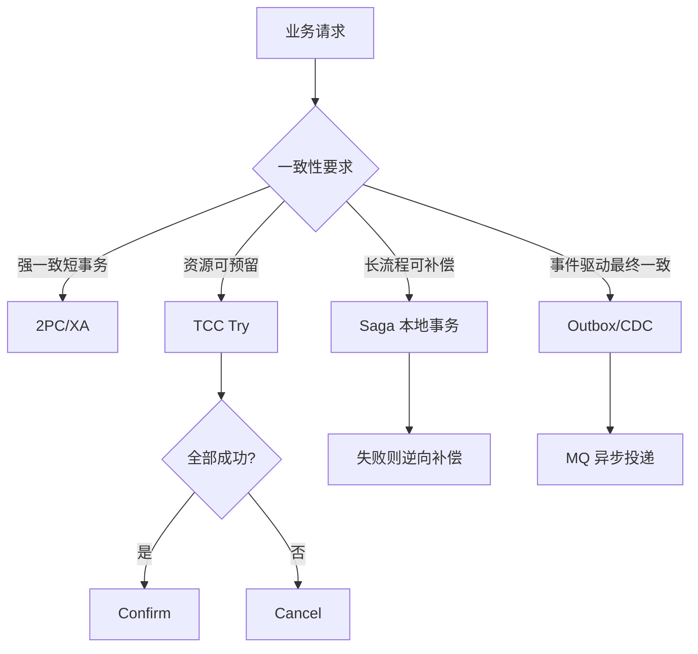
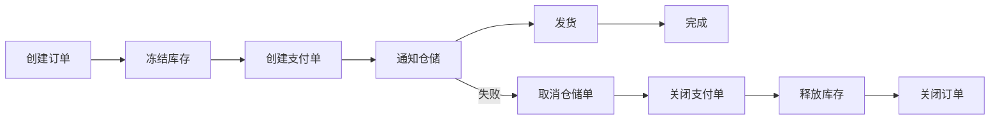
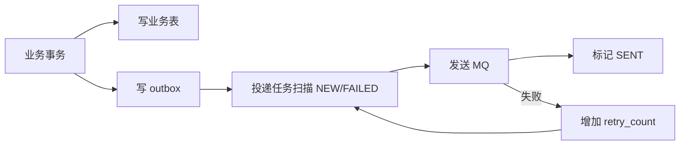

# 分布式事务-2PC-TCC-Saga

> [!abstract] 一句话总结
> 分布式事务协调多个资源的状态变化，2PC 追求强一致但阻塞，TCC 显式预留资源，Saga 用本地事务和补偿实现最终一致；工程上更多时候优先用状态机、幂等和 Outbox 降低分布式事务需求。

## 📌 精准定位

- 负责跨服务/跨库业务操作的正确性边界设计。
- 不负责让远程调用像本地事务一样透明可靠。
- 关键边界：一致性越强，锁持有、阻塞和可用性成本越高。
- 面试重点：能根据业务场景选择方案，而不是所有场景都上分布式事务框架。

## 🧩 核心概念

| 概念 | 具体含义 | 精通要点 |
| ---- | -------- | -------- |
| 2PC | prepare + commit/rollback。 | 协调者故障和资源锁定是主要成本。 |
| TCC | Try 预留，Confirm 确认，Cancel 释放。 | 接口要幂等、空回滚、防悬挂。 |
| Saga | 多个本地事务串联，失败补偿。 | 适合长流程，允许中间状态。 |
| Outbox | 本地事务写业务表和消息表。 | 异步投递或 CDC 保证最终一致。 |
| 状态机 | 用状态流转约束并发和补偿。 | 条件更新、幂等、可重试。 |
| 对账补偿 | 定时校验最终状态。 | 分布式系统最后一道兜底。 |

## ⚙️ 工作原理 / 主流程



1. 先判断业务能否接受中间状态和补偿。
2. 2PC 适合参与者少、短事务、强一致要求高的场景。
3. TCC 的 Try 必须真的冻结资源，而不是只校验。
4. Saga 每一步都要有补偿动作和状态记录。
5. Outbox 适合“本地事务成功后可靠发事件”的场景。
6. 所有方案都需要 xid、状态机、超时扫描、幂等和人工干预。

## 🧭 方案选型表

| 方案 | 一致性 | 性能/可用性 | 侵入性 | 适合场景 | 不适合场景 |
| ---- | ------ | ----------- | ------ | -------- | ---------- |
| 2PC/XA | 强一致 | 低，阻塞持锁 | 中 | 参与者少、短事务、强一致 | 高并发、长流程、跨组织系统 |
| TCC | 较强一致 | 中，需要预留资源 | 高 | 库存冻结、资金冻结、名额占用 | 无法设计 Try/Cancel 的业务 |
| Saga | 最终一致 | 高 | 中高 | 订单履约、物流、审批长流程 | 不能接受中间状态的业务 |
| Outbox | 最终一致 | 高 | 中 | DB + MQ、事件驱动 | 要求同步强一致的交易 |
| CDC | 最终一致 | 高 | 低到中 | 基于 binlog 投递事件 | 链路治理能力弱的团队 |

## 🧱 TCC 深挖

### TCC 扣库存示例

```text
Try: available_stock -= n, frozen_stock += n，记录 xid 和 try 状态。
Confirm: frozen_stock -= n, sold_stock += n。
Cancel: available_stock += n, frozen_stock -= n。
```

### TCC 三大问题

| 问题 | 含义 | 解决方案 |
| ---- | ---- | -------- |
| 幂等 | Confirm/Cancel 可能被重复调用 | xid + branchId 唯一记录，状态机判断 |
| 空回滚 | Try 没执行，Cancel 先到了 | Cancel 发现无 Try 记录，插入空回滚记录并返回成功 |
| 防悬挂 | Cancel 后 Try 才到 | Try 前检查是否已有 Cancel/空回滚记录，有则拒绝 |

### TCC 事务表设计

```sql
CREATE TABLE tcc_branch_transaction (
  id BIGINT PRIMARY KEY,
  xid VARCHAR(128) NOT NULL,
  branch_id VARCHAR(128) NOT NULL,
  biz_key VARCHAR(128) NOT NULL,
  action_name VARCHAR(64) NOT NULL,
  status VARCHAR(32) NOT NULL,
  try_time DATETIME NULL,
  confirm_time DATETIME NULL,
  cancel_time DATETIME NULL,
  created_at DATETIME NOT NULL,
  updated_at DATETIME NOT NULL,
  UNIQUE KEY uk_xid_branch(xid, branch_id),
  UNIQUE KEY uk_biz_action(biz_key, action_name)
);
```

## 🔁 Saga 深挖

### 订单履约 Saga 示例



### Saga 状态表

```sql
CREATE TABLE saga_instance (
  id BIGINT PRIMARY KEY,
  saga_type VARCHAR(64) NOT NULL,
  biz_key VARCHAR(128) NOT NULL,
  current_step VARCHAR(64) NOT NULL,
  status VARCHAR(32) NOT NULL,
  context JSON NOT NULL,
  retry_count INT NOT NULL DEFAULT 0,
  next_retry_time DATETIME NULL,
  created_at DATETIME NOT NULL,
  updated_at DATETIME NOT NULL,
  UNIQUE KEY uk_saga_biz(saga_type, biz_key)
);

CREATE TABLE saga_step_log (
  id BIGINT PRIMARY KEY,
  saga_id BIGINT NOT NULL,
  step_name VARCHAR(64) NOT NULL,
  action_type VARCHAR(32) NOT NULL,
  status VARCHAR(32) NOT NULL,
  request JSON NULL,
  response JSON NULL,
  created_at DATETIME NOT NULL,
  UNIQUE KEY uk_saga_step_action(saga_id, step_name, action_type)
);
```

### Saga 关键点

- 每一步本地事务都要可重试。
- 补偿不是简单反向 SQL，要考虑业务语义。
- 补偿也可能失败，因此要有重试、告警和人工处理。
- 用户侧要能接受中间状态，如“履约中、补偿中、待人工处理”。

## 📬 Outbox / CDC 深挖

### Outbox 表结构

```sql
CREATE TABLE outbox_event (
  id BIGINT PRIMARY KEY,
  event_type VARCHAR(64) NOT NULL,
  biz_key VARCHAR(128) NOT NULL,
  payload JSON NOT NULL,
  status VARCHAR(32) NOT NULL,
  retry_count INT NOT NULL DEFAULT 0,
  next_retry_time DATETIME NULL,
  created_at DATETIME NOT NULL,
  updated_at DATETIME NOT NULL,
  UNIQUE KEY uk_event_biz(event_type, biz_key)
);
```

### 投递流程



### CDC 方式

业务事务写 outbox 后，不由应用扫描，而是通过 Debezium/Canal 等监听 binlog，把 outbox 变更投递到 MQ。

优点：应用侵入小。缺点：运维链路更复杂，需要监控 binlog 延迟、投递重复、顺序和失败补偿。

## 🧪 工程案例

### 案例 1：下单扣库存不要直接分布式强事务

问题：订单服务、库存服务、优惠券服务如果用强一致 2PC，高并发下会长时间持锁，影响可用性。

更常见方案：

- 下单本地创建订单。
- 库存用 Try/冻结或本地库存服务条件更新。
- 后续通过 MQ/Saga 推进状态。
- 失败进入补偿和对账。

表达：高并发业务优先把强一致收敛在单服务本地事务内，跨服务用最终一致和补偿。

### 案例 2：支付回调和关单并发

不一定需要分布式事务框架，用状态机条件更新即可：

```sql
UPDATE orders
SET status = 'PAID'
WHERE id = ? AND status = 'WAIT_PAY';

UPDATE orders
SET status = 'CLOSED'
WHERE id = ? AND status = 'WAIT_PAY';
```

谁先更新成功，谁获得状态流转权。失败方根据更新行数判断不再继续执行补偿动作。

### 案例 3：MQ 事件驱动导致数据短暂不一致

订单创建后，积分服务异步增加积分。用户马上查积分可能还没更新。

解决：

- 页面提示“积分稍后到账”。
- 查询侧展示事件处理状态。
- 消费失败进入重试和 DLQ。
- 定时对账修复漏处理事件。

## ⚠️ 生产坑与注意事项

- TCC Try 只校验不预留资源，导致 Confirm 时资源不足。
- Cancel 没处理空回滚。
- Cancel 后 Try 又成功，形成悬挂。
- Saga 补偿不是简单反向 SQL，可能涉及退款、库存、优惠券、发票等业务语义。
- 全局事务状态没持久化，系统重启后无法恢复。
- 2PC 参与者锁资源太久，拖垮吞吐。
- Outbox 投递成功但标记 SENT 失败，会导致重复投递，所以消费者必须幂等。
- 对账补偿缺失，最终一致变成“最终不一致”。

## 🧭 排查路径

- 事务悬挂：查全局事务表、分支事务表、Try/Cancel/Confirm 状态。
- 补偿失败：看幂等键、重试次数、错误原因、人工队列。
- 锁冲突高：检查 2PC/TCC Try 资源持有时间。
- 数据不一致：按 xid/bizKey 串业务表、消息、undo/outbox、消费者幂等表。
- 消息漏投：查 outbox 状态、投递日志、MQ 发送确认和 CDC 延迟。

## 🎯 面试问题

> [!question] 高频问题
> - Q: 2PC 最大问题？
>   - A: prepare 后参与者持锁等待协调者，协调者故障或网络异常会阻塞资源，影响可用性和吞吐。
> - Q: TCC 三动作？
>   - A: Try 预留资源，Confirm 确认使用资源，Cancel 释放资源。Try 必须真的预留，不是只校验。
> - Q: 空回滚和悬挂？
>   - A: Try 没执行 Cancel 先到是空回滚；Cancel 后 Try 又成功是悬挂。需要用事务记录表和状态机防住。
> - Q: Saga 适合什么？
>   - A: 长流程、可补偿、允许最终一致和中间状态的业务，例如订单履约、审批、物流。
> - Q: DB+MQ 常用方案？
>   - A: 本地消息表/outbox、事务消息或 CDC。核心是业务数据和消息记录先在本地事务中一致。
> - Q: 为什么不建议所有场景都上分布式事务？
>   - A: 成本高、侵入强、性能和可用性下降。很多场景用状态机、幂等、MQ、对账补偿更简单可靠。

## 🎤 面试 3 层回答

### 30 秒版

分布式事务不是一个万能技术，要先看业务能不能接受最终一致。强一致短事务可考虑 2PC，资源可预留用 TCC，长流程用 Saga，DB+MQ 常用 Outbox。无论哪种方案，都离不开状态机、幂等、超时重试、补偿和对账。

### 2 分钟版

2PC 的问题是 prepare 后资源持锁，协调者故障会阻塞；TCC 把资源操作显式拆成 Try、Confirm、Cancel，适合库存/资金冻结，但要处理空回滚、防悬挂和幂等；Saga 把大事务拆成本地事务和补偿，适合订单履约这类长流程。工程上我会优先把一致性收敛在单服务本地事务内，跨服务用事件驱动、状态机和补偿，而不是一上来就强分布式事务。

### 项目版

在订单履约项目里，订单创建、支付、库存、发货不会放进一个大事务。我会用订单状态机驱动流程：本地事务更新订单状态并写 outbox，库存冻结或释放通过幂等消息推进，支付回调和关单通过条件更新互斥，失败后由 Saga 补偿和对账任务兜底。

## ✅ 精通检查清单

- 能区分 2PC、TCC、Saga、Outbox、CDC 的适用边界。
- 能讲清 TCC 空回滚、悬挂、幂等。
- 能画出订单履约 Saga 状态流。
- 能设计 outbox 表和投递重试机制。
- 能说明为什么很多场景不适合强分布式事务。
- 能结合订单/秒杀项目讲状态机、补偿和对账。

## 🔗 关联笔记

- [[_index]]
- [[20-Java后端/00-总览/学习仪表盘]]
- [[../06-中间件/03-消息可靠性-顺序-幂等]]
- [[../04-Spring生态/03-Spring事务管理]]
- [[../08-系统设计/07-订单系统设计]]
- [[../09-项目实战/03-项目-订单履约系统]]
- [[../09-项目实战/01-项目-高并发秒杀系统]]

## 📚 参考资料

- Seata Documentation
- Microservices Patterns: Saga and Transactional Outbox
- Designing Data-Intensive Applications
