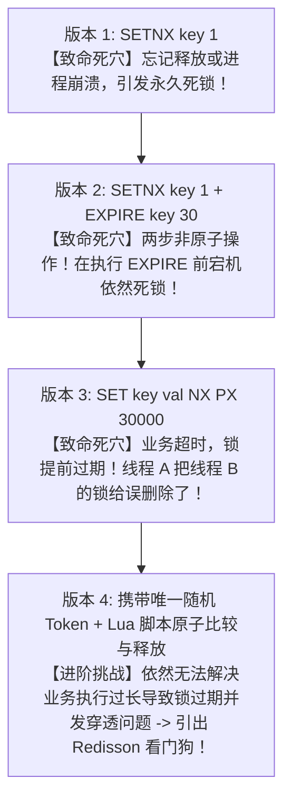
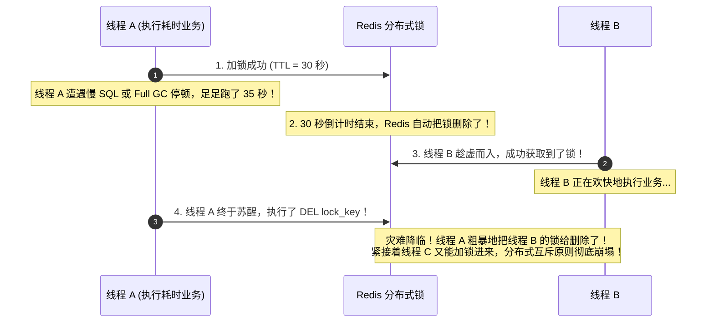
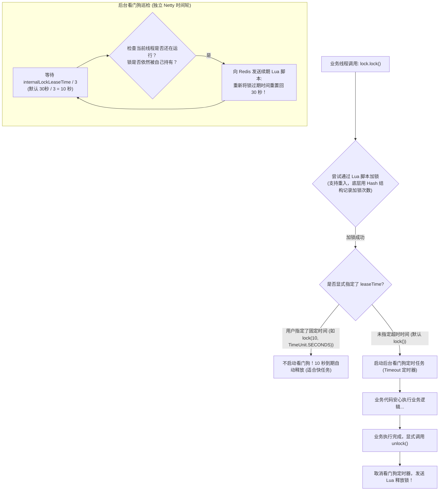
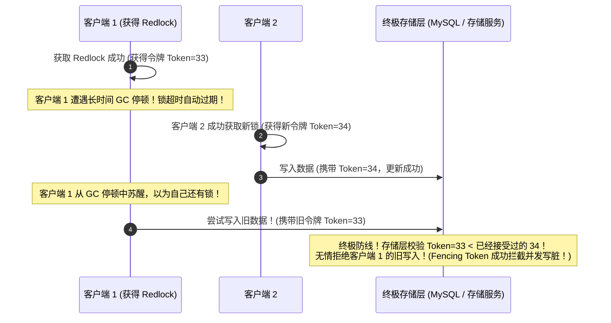

# 分布式锁原理与实战

> [!abstract] 一句话心智模型
> 在单机多线程环境下，Java 的 `synchronized` 和 `ReentrantLock` 就像一家公司的**会议室门锁**，锁住的是同一个 JVM 内存里的线程；
> 一旦业务扩容到 50 台微服务 Pod，每个 Pod 都是一栋独立的写字楼，单机内存锁当场失效：
> - **分布式锁** 就是**全市公用的中央数字化防盗门禁系统（Redis / ZooKeeper）**，所有写字楼里的员工想抢同一件物料，必须统一向中央系统申请唯一的排他令牌；
> - **Redisson 看门狗（Watchdog）** 是**门禁自带的智能巡检卫士**：只要你还在会议室里干活（线程未死），卫士每隔 10 秒自动向系统续卡延期；一旦你突发疾病晕倒（进程崩溃），卫士停止续卡，30 秒后门禁自动弹开，杜绝永久死锁！

---

## 🧗 一、从零手写 Redis 分布式锁：四大连环翻车陷阱

很多开发者认为“分布式锁不就是执行一条 Redis 命令吗”，实际上从最粗糙的实现到生产就绪，经历了四次血泪翻车迭代：



### 1. 翻车陷阱 1：两步非原子操作引发死锁
```java
// 错误示范：
Boolean success = redisTemplate.opsForValue().setIfAbsent("lock_key", "1");
// 假设就在这里，JVM 突然遭遇 OOM 崩溃，或者运维执行了 kill -9！
redisTemplate.expire("lock_key", 30, TimeUnit.SECONDS);
```
- **后果**：锁被成功写入，但过期时间永远没有设置成功！该键永久驻留 Redis，后续所有线程再也拿不到锁，系统彻底卡死！
- **修复**：使用 Redis 2.6.12+ 引入的复合原子命令：`SET key value NX PX 30000`。

---

### 2. 翻车陷阱 2：锁提前过期导致“误删他人之锁”



- **破局原则**：**谁加的锁，必须只能由谁来解！绝对严禁误删别人的锁！**
- **方案**：
  1. 加锁时，Value 必须是一个**全局唯一的随机 UUID 或请求流水号**（如 `UUID.randomUUID() + ":" + threadId`）；
  2. 解锁时，必须先比对当前的 Value 是否等于自己刚才存入的 UUID，确认无误才能执行删除！

---

### 3. 翻车陷阱 3：GET 比对与 DEL 删除的非原子性

```java
// 错误示范：
String lockVal = redisTemplate.opsForValue().get("lock_key");
if (myUuid.equals(lockVal)) {
    // 假设就在这里，线程恰好发生长时间 GC 停顿，锁刚好在这几毫秒内过期并被别人抢占！
    redisTemplate.delete("lock_key"); // 依然误删了别人的锁！
}
```

- **终极防御：必须使用 Lua 脚本保证“比对 + 删除”的绝对原子性**：
```lua
-- release_lock.lua
if redis.call('GET', KEYS[1]) == ARGV[1] then
    return redis.call('DEL', KEYS[1])
else
    return 0
end
```
- Redis 保证单条 Lua 脚本在执行期间不会被其他任何网络命令打断，彻底消除了竞态条件。

---

## 🐕 二、Redisson 看门狗（Watchdog）底层自动续期内幕

上面的版本 4 已经很完美了，但依然有一个不可回避的物理难题：**如果业务真实耗时真的不可预测（比如由于第三方接口延迟跑了 40 秒），如何防止锁在 30 秒时自动过期？**

Redisson 框架引入了著名的**看门狗机制（Watchdog）**，优雅地解决了锁提前超期的世纪难题！



### 看门狗三大核心设计细节：
1. **只有不传 `leaseTime` 才会触发看门狗**：如果你写了 `lock.lock(10, TimeUnit.SECONDS)`，Redisson 会完全尊重你的配置，绝对不启动看门狗！
2. **续期间隔是周期的 1/3**：默认锁超时时间是 30 秒（`lockWatchdogTimeout`），看门狗每隔 **10 秒** 触发一次续期，将 TTL 重新拨回 30 秒；
3. **死锁免疫（自愈性）**：如果承载业务的服务器突然物理断电或发生死机，看门狗后台定时器随进程一同毁灭。Redis 中的锁得不到下一次续期，在 30 秒到期后**自动被 Redis 物理删除**，下一个竞争者从容加锁，系统实现完全自愈！

---

## ⚔️ 三、Redlock（红锁）与 Martin 世纪大论战

分布式领域的泰斗 **Martin Kleppmann** 与 Redis 之父 **Salvatore Sanfilippo (Antirez)** 曾就“基于 Redis 的分布式锁究竟安不安全”展开过一场载入史册的技术论战。

### 1. Redis 主从异步复制的致命缺陷（单点集群破防）
- 现存的 Redis 集群几乎都是**主从异步复制（Asynchronous Replication）**。
- 线程 A 在 Master 上加锁成功；
- **还没等 Master 把这把锁同步给 Slave，Master 物理机突然瞬间断电挂掉！**
- 哨兵或集群将该 Slave 紧急选为新的 Master；
- 此时新 Master 内部根本没有这把锁的数据！线程 B 跑来加锁，**再次加锁成功！**
- **结论：在毫秒级故障切换的极端场景下，同一个系统同时出现了两个持有锁的线程，并发安全性被彻底打破！**

---

### 2. Antirez 的解法：Redlock（红锁）
为了解决主从复制丢失问题，Antirez 提出了 **Redlock 算法**：
- 部署 $N$ 个（通常是 **5 个**）**完全相互独立、绝不建立主从复制关系的物理 Redis Master 节点**；
- 客户端依次向这 5 个独立的 Master 发起加锁请求；
- **成功判定条件**：
  1. 客户端在**超过半数（$5/2 + 1 = 3$ 个）节点**上成功拿到锁；
  2. 并且获取锁消耗的总时间，小于锁的有效时间。
- 如果加锁失败，客户端必须向所有 5 个节点逐一发送解锁 Lua 脚本。

### 3. Martin Kleppmann 的致命质疑与 Fencing Token（击剑令牌）
Martin 撰文指出，即便是 Redlock，在面对现实世界中复杂的 **GC 停顿（STW）、网络延迟和物理时钟漂移（Clock Drift）** 时，依然无法保证强一致性！



- **第一性原理启示**：
  - **如果你使用分布式锁是为了效率（避免重复计算、减少浪费）**：单节点 Redis 或标准 Redisson 看门狗已经完全足够好，性价比极高；
  - **如果你使用分布式锁是为了正确性（真金白银、绝对严禁并发写脏）**：**千万不能仅仅迷信锁本身！下游存储层必须配合单调递增的“Fencing Token”或者数据库行级版本号（乐观锁）进行最终拦截校验！**

---

## ⚡ 一分钟面试必杀卡

> [!NOTE] 面试高频问题标准答题套路
> 
> **Q1：Redis 分布式锁如何防止误删其他线程的锁？**
> - **A**：
>   - 在获取锁时，传入的 Value 必须设置为当前线程独一无二的随机标识（如 UUID 或分布式链路 ID）。
>   - 在释放锁时，不能直接使用 `DEL` 命令，而必须使用 **Lua 脚本**：先通过 `GET` 查询当前锁的值是否等于自己加锁时存入的唯一标识，只有完全相等才执行 `DEL`。由于 Lua 脚本在 Redis 内部是原子执行的，彻底杜绝了并发误删他人锁的隐患。
> 
> **Q2：Redisson 的看门狗（Watchdog）机制工作原理是怎样的？**
> - **A**：
>   - 当加锁方法未显式传入超时时间参数时，Redisson 会自动激活看门狗机制，默认将锁的过期时间设置为 30 秒。
>   - 加锁成功后，后台会立刻启动一个基于 Netty 时间轮的定时任务，每隔 `lockWatchdogTimeout / 3`（即每隔 10 秒）向 Redis 发送一次续期 Lua 脚本，将该锁的过期时间重新刷新为 30 秒。
>   - 只要当前业务线程未执行完毕，锁就永远不会过期；当业务执行完毕显式调用 `unlock()` 时，看门狗任务被取消并释放锁；若应用服务器突发宕机，看门狗停止续约，锁在 30 秒后由 Redis 自动删除，有效避免了死锁。
