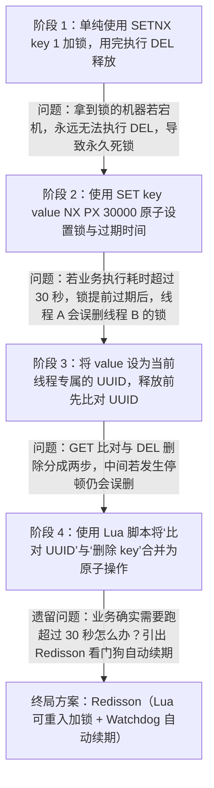
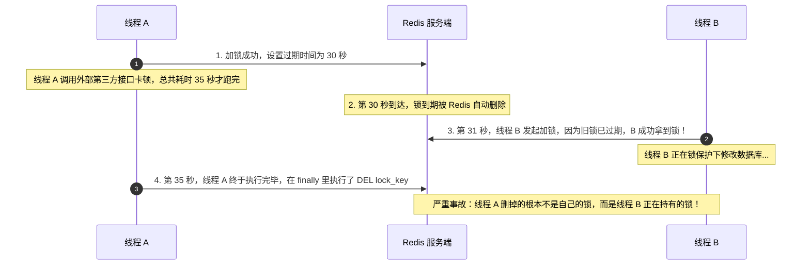
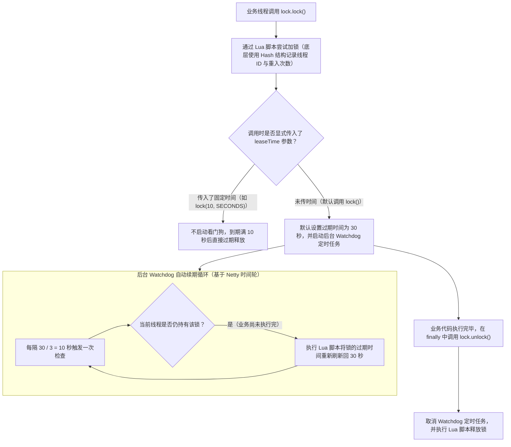
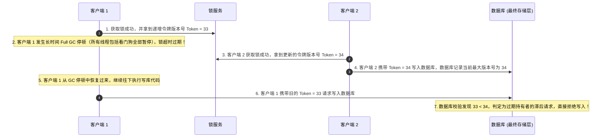

# 分布式锁原理与实战

> [!abstract] 一句话心智模型
> Java 自带的 `synchronized` 和 `ReentrantLock` 只能锁住同一个 JVM 进程内的线程；在多实例部署的微服务中，必须借助所有节点共享的外部存储（如 Redis）来实现跨进程互斥。一个生产可用的 Redis 分布式锁必须闭环解决三个核心问题：**加锁与过期时间的原子性（防死锁）、唯一标识配合 Lua 脚本原子删除（防误删他人锁）、后台看门狗自动续期（防业务未执行完锁提前过期）**；而在资金、库存等严苛场景下，还需在数据库层配合乐观锁版本号或唯一索引做最终防线。

---

## 🎯 一、为什么需要分布式锁？

假设我们在开发一个“领取限量优惠券”或“扣减商品库存”的接口。为了防止同一个用户并发点击两次领走两张券，或者两个用户同时读到剩余 1 件库存导致超卖，在单机时代我们只需要加一把本地锁：

```java
// 单机时代：只能在当前这台服务器的 JVM 内存里生效
synchronized (this) {
    // 1. 查询数据库剩余库存是否 > 0
    // 2. 如果 > 0，执行扣减库存
}
```

但在微服务生产环境中，订单服务通常会部署 3 台甚至 10 台机器，前面由负载均衡器分发请求：
- 如果两个并发请求分别被转发到了 **机器 A** 和 **机器 B**；
- 机器 A 锁住的是机器 A 自己的 JVM 内存，机器 B 锁住的是机器 B 自己的 JVM 内存，两边的 `synchronized` 互不感知；
- 结果两台机器同时查到库存还剩 1 件，同时执行扣减，直接导致库存被扣成负数（超卖）。

因此，在分布式环境下，这把锁不能放在某一台机器的内存里，而必须放在一个**所有服务器实例都能共同访问的外部中心节点**上。由于 Redis 具备极高的读写性能和丰富的原子命令，基于 Redis 实现分布式锁成为了工业界最主流的方案。

---

## 🧗 二、从零实现 Redis 分布式锁：四步演进过程

要把 Redis 当作分布式锁来用，不能只简单写一句 `SETNX`，下面我们按因果顺序看它是如何一步步演进到生产标准的：



---

### 第 1 步：最基础的互斥加锁与“死锁”问题
Redis 提供了 `SETNX`（**SET** if **N**ot e**X**ists）命令：当指定的 Key 不存在时才设置成功并返回 `1`；如果 Key 已经存在，则设置失败并返回 `0`。
- **做法**：多个服务实例同时向 Redis 执行 `SETNX lock:order:1001 1`，谁返回 `1` 谁就抢到了锁；业务执行完后，调用 `DEL lock:order:1001` 把 Key 删掉，释放锁让别人抢。
- **问题所在**：如果抢到锁的机器 A 正在执行业务代码时，突然遭遇服务器断电、进程被 `kill -9` 强杀或者发生死循环，导致最后那句 `DEL` 永远没机会执行。那么 `lock:order:1001` 这个 Key 就会永久留在 Redis 里，其他所有机器永远抢不到锁，形成**永久死锁**。

---

### 第 2 步：给锁加上过期时间，并保证原子性
为了防止机器宕机导致死锁，我们必须给这把锁设置一个**自动过期时间（TTL，比如 30 秒）**。哪怕持锁机器彻底挂了，30 秒后 Redis 也会自动把这个 Key 清理掉。

但这里有一个新手常踩的坑——把“加锁”和“设置过期时间”分成了两条命令写：
```java
// 错误写法：两条命令之间不是原子的！
Boolean locked = redisTemplate.opsForValue().setIfAbsent("lock:order:1001", "1");
if (Boolean.TRUE.equals(locked)) {
    // 如果程序刚跑到这里，机器突然断电或重启了，下面这行 expire 永远不会执行，依然会死锁！
    redisTemplate.expire("lock:order:1001", 30, TimeUnit.SECONDS);
}
```
- **正确做法**：必须使用 Redis 提供的复合原子命令，在一条指令里同时完成判断不存在（`NX`）和设置毫秒级过期时间（`PX`）：
```bash
SET lock:order:1001 "1" NX PX 30000
```
对应在 Spring `StringRedisTemplate` 中就是一句话：
```java
Boolean locked = redisTemplate.opsForValue()
    .setIfAbsent("lock:order:1001", "1", 30, TimeUnit.SECONDS);
```

---

### 第 3 步：锁提前过期引发的“张冠李戴（误删别人的锁）”
加上了 30 秒过期时间后，死锁问题解决了，但又引出了一个更隐蔽的并发 Bug：



如上图所示：如果因为慢 SQL、Full GC 停顿或第三方接口延迟，线程 A 的业务实际执行了 35 秒，而锁在第 30 秒就已经自动过期并被线程 B 抢走了；等到第 35 秒线程 A 执行完去调用 `DEL` 时，它会把**线程 B 正在使用的锁**给直接删掉！紧接着线程 C 又能抢锁进来，导致锁彻底失去互斥作用。

- **解决思路**：**“解铃还须系铃人”——谁加的锁，只能由谁来删！**
  1. 在加锁时，不要随便存一个 `"1"`，而是存入一个**只有当前线程自己拥有的唯一标识**（例如 `UUID.randomUUID().toString() + ":" + Thread.currentThread().getId()`）；
  2. 在解锁删除之前，先把 Redis 里的 Value 读出来，跟自己手里的唯一标识做比对：如果一样，说明锁还是自己的，可以删；如果不一样，说明自己的锁早就过期了，现在里面的锁是别人的，绝不能删！

---

### 第 4 步：使用 Lua 脚本保证“比对 + 删除”的原子性
如果我们用普通的 Java 代码来写“先查出 Value 比对，相等再删除”，还会存在最后一道漏洞：

```java
// 仍有隐患的写法：GET 和 DEL 依然是两次独立的网络请求
String currentVal = redisTemplate.opsForValue().get(lockKey);
if (myToken.equals(currentVal)) {
    // 假如刚刚判断完相等（比如在第 29.99 秒），准备执行下面这行 delete 之前，
    // 网络抖了一下或者 JVM 发生了 50ms 的 GC 停顿，此时锁刚好满 30 秒过期，并且被线程 B 抢走了！
    // 等线程 A 恢复执行下面这行 delete 时，删掉的依然是线程 B 的锁！
    redisTemplate.delete(lockKey);
}
```

为什么会这样？因为“先 `GET` 判断”和“再 `DEL` 删除”是两条分开的命令，中间随时可能插入别人的操作。
- **终极解决方案**：将“取值、比对、删除”这三步写进一段 **Lua 脚本** 发给 Redis 执行。因为 Redis 执行单条 Lua 脚本时是单线程原子执行的，在脚本跑完之前不会穿插执行任何其他客户端的命令：

```lua
-- 解锁 Lua 脚本：KEYS[1] 是锁名称，ARGV[1] 是当前线程持有的唯一标识 Token
if redis.call('GET', KEYS[1]) == ARGV[1] then
    return redis.call('DEL', KEYS[1])
else
    return 0
end
```

到这里，一把能安全加锁、安全释放的基础版 Redis 分布式锁就成型了。

---

## 🐕 三、Redisson 与看门狗（Watchdog）自动续期机制

虽然上面四步解决了死锁和误删问题，但在实际生产中还有一个核心痛点没有解决：
**锁的过期时间到底设多少秒合适？如果设 30 秒，但某次业务因为数据库抖动确实需要跑 45 秒才能正常结束，锁在第 30 秒还是会提前过期，导致线程 B 提前闯入产生并发冲突。**

最理想的设计是：**加锁时先设一个合理的初始过期时间（比如 30 秒），只要持有锁的这个业务线程还活着且没执行完，后台就自动帮它把过期时间往后延长（续期）；一旦业务执行完就立刻删锁，或者机器宕机了没人再续期，锁也在 30 秒后自然过期释放。**

这就是工业界广泛使用的 **Redisson** 框架内置的 **看门狗（Watchdog）机制**。



### Redisson 的三大核心工作原理：

1. **为什么 Redisson 底层要用 Hash 结构来存锁？（支持可重入）**
   - Java 里的 `synchronized` 和 `ReentrantLock` 都是**可重入锁**（即同一个线程在外层方法拿到锁后，调用内层方法再次申请同一把锁时可以直接通过，只需把加锁次数 `+1`）。
   - 为了支持可重入，Redisson 没有用简单的 `String` 结构，而是用了 Redis 的 **`Hash` 结构**：
     - **Key**：锁的名字（如 `lock:order:1001`）；
     - **Hash Field**：`UUID:threadId`（唯一标识当前 JVM 实例下的当前线程）；
     - **Hash Value**：加锁的重入次数（初次加锁为 `1`，同一线程再次加锁则通过 `HINCRBY` 变成 `2`；解锁时每次减 `1`，减到 `0` 时才真正执行 `DEL` 删除整个 Key）。

2. **看门狗（Watchdog）是什么时候启动、怎么续期的？**
   - **触发条件**：只有当你调用**不带过期时间参数**的 `lock.lock()` 时，Redisson 才会启动看门狗。如果你自己指定了固定过期时间（例如 `lock.lock(10, TimeUnit.SECONDS)`），Redisson 就会认为你明确希望 10 秒后强制释放，此时不会启动看门狗。
   - **续期节奏**：默认的看门狗超时时间（`lockWatchdogTimeout`）是 **30 秒**。一旦加锁成功，Redisson 会在客户端内存里利用 Netty 的时间轮（`HashedWheelTimer`）注册一个延时任务，每隔 **`30 / 3 = 10` 秒** 执行一次：只要当前线程还没调用 `unlock()`，就向 Redis 发送一段 Lua 脚本，把这把锁的过期时间重新重置回 30 秒。
   - **宕机兜底**：如果持有锁的这台服务器突然断电或 JVM 崩溃了，内存里的定时任务自然也就跟着消失了，不会再有人去向 Redis 发送续期请求。最多再过 30 秒，Redis 里的锁就会自动过期删除，不会造成死锁。

---

## ⚔️ 四、Redis 主从切换丢锁问题与最终数据防线

在面试高阶环节，面试官经常会追问：**“用了 Redisson 看门狗和 Lua 脚本，Redis 分布式锁就绝对万无一失了吗？”**

答案是：在极端故障场景下，仍然存在两个层面的隐患，需要我们根据业务重要程度做好兜底设计。

### 1. 隐患一：Redis 主从异步复制导致的锁丢失
在生产环境中，为了保证 Redis 自身的高可用，通常会部署为**主从架构（Master-Slave + 哨兵）**或 **Redis Cluster 集群**。而 Redis 的主从数据同步默认是**异步复制**的：
1. 线程 A 向 Redis **Master 节点**发起加锁，Master 将锁写入内存并立即向线程 A 返回“加锁成功”；
2. 就在 Master 准备把这把锁异步同步给 **Slave 从节点**之前，Master 所在的物理机突然断电宕机了！
3. 哨兵检测到 Master 挂掉，将还没收到这把锁的 **Slave 节点提升为新的 Master**；
4. 此时线程 B 请求加锁，访问到了新的 Master，发现里面根本没有这把锁，于是**线程 B 也加锁成功了**！此时系统里同时出现了两个持有锁的线程。

#### 怎么应对主从切换丢锁？
- **方案 A：Redlock（红锁）算法**
  Redis 作者 Antirez 曾提出 Redlock 方案：不采用主从架构，而是部署 **5 个完全独立、互不从属的 Redis Master 实例**。客户端加锁时，同时向这 5 台机器发请求，只有当**超过半数（至少 3 台）**加锁成功，且整个加锁过程耗费的时间远小于锁的过期时间时，才算加锁成功。但由于需要维护 5 台独立实例且加锁网络开销翻倍，实际生产中很少直接使用 Redlock。
- **方案 B：改用 CP 型组件（ZooKeeper / Etcd）**
  如果业务要求锁本身绝对不能在主从切换时丢失，可以使用基于 Raft 或 ZAB 协议的 **Etcd** 或 **ZooKeeper**。因为它们在写入锁节点时必须先同步给超过半数的节点才会返回成功，即使主节点宕机，新选出的主节点也一定包含刚才加成功的锁。

---

### 2. 隐患二：客户端长时间 GC 停顿与数据库最终防线（Fencing Token / 乐观锁）

分布式系统专家 Martin Kleppmann 指出过一个更本质的问题：就算锁服务本身没丢数据，**客户端进程也可能发生长时间的卡顿（例如 JVM 发生长达几十秒的 Full GC Stop-The-World 停顿，或者容器 CPU 被完全抢占）**：



如上图所示，当客户端 1 发生严重的 Full GC 停顿时，它进程内的看门狗续期线程也会跟着一起暂停，导致锁在 Redis 中过期并被客户端 2 抢走。等客户端 1 从 GC 中苏醒过来时，它并不知道锁已经过期，依然会继续往下执行修改数据库的 SQL！

#### 生产环境的黄金准则：锁抗并发，数据库兜底！
理解了这一点，我们在实际工程中就能做出非常清晰的设计：
1. **分布式锁的作用是“挡住 99.99% 的并发冲突”**：用 Redisson 分布式锁在业务入口处把并发请求排队或拦截掉，避免大量并发请求直接打到数据库上。
2. **数据库层必须有最后一道“幂等 / 乐观锁 / 状态机”校验**：
   - 如果是修改账户余额或订单状态，SQL 语句一定要带上**乐观锁版本号**或**前置状态条件**（这本质上就是在数据库层实现了图中的 Fencing Token 机制）：
     ```sql
     -- 即使极端情况下锁失效放进来了两个请求，数据库行锁和 version 条件也能保证只有一个能更新成功！
     UPDATE t_account
     SET balance = balance - 100, version = version + 1
     WHERE user_id = 888 AND version = #{oldVersion} AND balance >= 100;
     ```
   - 如果是防止重复创建订单或重复领券，数据库表上一定要建好**唯一索引（Unique Key）**作为最终兜底。

---

## ⚡ 五、一分钟面试复盘

> [!question]- Q1：如果让你自己基于 Redis 实现一个分布式锁，需要注意哪些关键点？
> 需要按顺序解决以下四个问题：
> 1. **防死锁（原子加锁与过期时间）**：不能分开写 `SETNX` 和 `EXPIRE`，必须使用 `SET key value NX PX timeout` 一条原子命令同时完成加锁和设置过期时间，防止加锁后机器宕机导致死锁。
> 2. **防误删（唯一标识 Value）**：加锁时写入的 Value 不能是固定值，必须包含当前实例与线程的唯一标识（如 `UUID + threadId`），确保每个线程只能释放自己加的锁，防止业务超时导致把别人刚抢到的锁误删掉。
> 3. **原子解锁（Lua 脚本）**：释放锁时，“查询 Value 比对”和“执行 DEL 删除”必须写在同一个 **Lua 脚本** 中交给 Redis 原子执行，防止在判断相等后、执行删除前的瞬间锁过期被他人抢走。
> 4. **防业务未跑完锁过期（自动续期）**：在实际生产中直接使用 **Redisson**，利用其内置的看门狗（Watchdog）机制为未执行完的任务自动续期。

> [!question]- Q2：Redisson 的看门狗（Watchdog）机制是怎么工作的？如果 Redis 发生主从切换导致锁丢失怎么办？
> 1. **Watchdog 工作原理**：当调用不指定过期时间的 `lock.lock()` 时，Redisson 默认将锁过期时间设为 **30 秒**，并在本地启动一个基于 Netty 时间轮的后台定时任务，每隔 **`30 / 3 = 10` 秒** 检查当前线程是否还持有锁；如果仍持有（业务还没执行完），就通过 Lua 脚本把 Redis 中该锁的过期时间重新刷新回 30 秒。当业务执行完调用 `unlock()` 时取消定时任务并删锁；若机器宕机，定时任务停止，锁会在 30 秒后自动过期。
> 2. **主从切换丢锁的应对**：由于 Redis 主从默认是异步复制，Master 加锁后未同步给 Slave 就宕机，会导致新 Master 上丢失该锁。在工程实践中：
>    - 如果是对一致性要求极高的协调场景，可改用基于 Raft/ZAB 多数派协议的 **Etcd** 或 **ZooKeeper**；
>    - 如果是高并发业务场景（如扣库存、改订单、扣余额），继续使用高性能的 **Redisson 分布式锁抗住绝大多数并发流量**，同时在底层数据库配合**唯一索引、状态机条件更新或乐观锁版本号（`WHERE version = oldVersion`）**做最终的数据一致性兜底。
