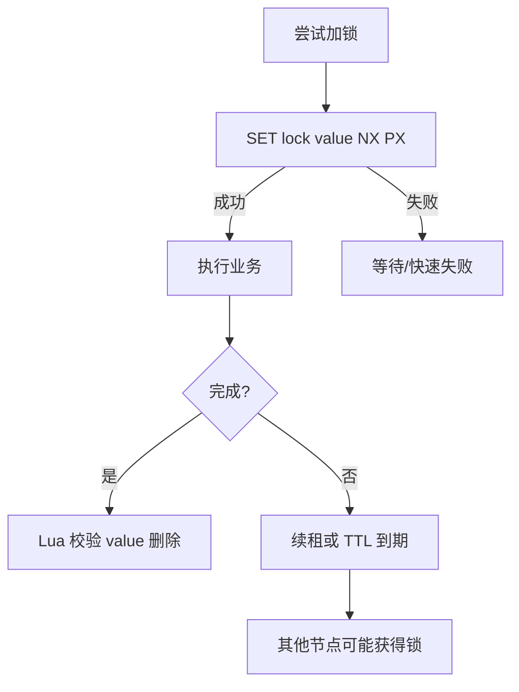

# 分布式锁

> [!abstract] 一句话总结
> 分布式锁是在多进程间保护临界区的协调手段，精通点是互斥、超时、续租、可重入、释放校验和业务幂等兜底。

## 📌 精准定位

- 负责降低同一资源被并发执行的概率。
- 不负责替代数据库唯一约束和事务，锁失效后业务仍要自保。
- 关键边界：外部锁都有租约窗口，网络暂停和 GC 会让持锁者产生错觉。

## 🧩 核心概念

| 概念 | 具体含义 | 精通要点 |
| ---- | -------- | -------- |
| Redis 锁 | SET key value NX PX ttl + Lua 校验删除。 | 简单高性能，依赖 Redis 可用性和时间。 |
| Watchdog | 持锁期间自动续租。 | 业务卡死时可能延长故障。 |
| ZooKeeper 锁 | 临时顺序节点。 | 强协调，延迟更高，适合严格排队。 |
| Fencing Token | 递增令牌。 | 下游只接受更大 token 防旧写。 |

## ⚙️ 工作原理 / 主流程



1. 锁 value 必须随机唯一，释放先比较再删除。
2. TTL 要覆盖 P99 业务耗时但不能无限长。
3. 长任务用续租，但要有最大续租时间。
4. 严格防旧写要引入 fencing token。
5. 业务层仍应有唯一键、状态机或乐观锁。

## 💻 代码 / 配置 / 伪代码

```lua
if redis.call('get', KEYS[1]) == ARGV[1] then
  return redis.call('del', KEYS[1])
else
  return 0
end
```

## 🔍 源码入口 / 关键组件

- Redis SET NX PX / Lua
- Redisson RLock watchdog
- ZooKeeper ephemeral sequential znode
- etcd lease + revision
- 数据库唯一约束/乐观锁

## ⚠️ 生产坑与注意事项

- SETNX 后单独 EXPIRE，中间宕机会死锁。
- 释放不校验 value，删掉别人锁。
- 业务超过 TTL 后另一个节点进入临界区。
- 拿锁后调用慢 RPC。
- 把 Redlock 当所有场景强一致锁。

## 🧭 排查路径

- 重复执行查 TTL、业务耗时、GC、续租日志。
- 锁删不掉看 value 是否匹配和 key 是否已过期重建。
- 竞争高统计等待时间和失败率。
- 严格一致需求检查 fencing token 或数据库约束。

## 🎯 面试问题

> [!question] 高频问题
> - Q: Redis 锁正确姿势？
>   - A: SET NX PX 原子加锁，Lua 比较 value 删除。
> - Q: 为什么要 value？
>   - A: 标识拥有者，防过期后误删别人锁。
> - Q: 过期没做完怎么办？
>   - A: 续租、缩短临界区、fencing token、业务幂等。
> - Q: ZK 锁优势？
>   - A: 临时顺序节点形成队列，前驱删除后唤醒。
> - Q: 分布式锁绝对安全吗？
>   - A: 不能，关键资源要有下游校验。

## ✅ 精通检查清单

- 能画出主流程，并标出最容易失败的节点。
- 能说出至少 3 个源码入口或关键组件。
- 能写出最小配置、SQL、伪代码或状态机。
- 能结合生产故障说明监控指标、排查命令和修复动作。
- 能和相邻方案做取舍对比，而不是只背定义。

## 🔗 关联笔记

- [[_index]]
- [[20-Java后端/00-总览/学习仪表盘]]

## 📚 参考资料

- Redis Distributed Locks
- ZooKeeper Recipes and Solutions
