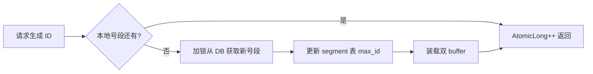

# 分布式ID

> [!abstract] 一句话总结
> 分布式 ID 要在多节点下生成唯一、可排序、可用且便于分片的标识，常见方案是雪花、号段、数据库序列和 Redis 自增。

## 📌 精准定位

- 负责消除单库自增 ID 在分布式写入和分片中的瓶颈。
- 不负责天然保证业务幂等，业务请求仍要独立幂等键。
- 关键边界：要明确时钟回拨、趋势递增、长度、信息泄露和容量上限。

## 🧩 核心概念

| 概念 | 具体含义 | 精通要点 |
| ---- | -------- | -------- |
| Snowflake | 时间戳 + 机器号 + 序列号。 | 高性能趋势递增，但依赖时钟。 |
| 号段模式 | DB 批量发号，应用内存递增。 | 稳定易控，可能浪费号段。 |
| Redis INCR | 单点原子递增。 | 简单但依赖 Redis 可用性和持久化。 |
| UUID/ULID | 去中心化生成。 | UUID 无序且长，ULID/UUIDv7 更适合排序。 |

## ⚙️ 工作原理 / 主流程



1. 先确定是否需要时间排序、是否暴露、是否用于分片。
2. 雪花位数要分配时间、worker、sequence 并算每毫秒容量。
3. workerId 要由配置中心或注册中心分配，避免重复。
4. 号段模式要双 buffer 预加载。
5. 监控 QPS、号段剩余、时钟回拨和重复冲突。

## 💻 代码 / 配置 / 伪代码

```java
long nextId() {
  long now = currentMillis();
  if (now < lastTimestamp) throw new ClockBackwardsException();
  if (now == lastTimestamp) sequence = (sequence + 1) & sequenceMask;
  else sequence = 0;
  lastTimestamp = now;
  return ((now - epoch) << timestampShift) | (workerId << workerShift) | sequence;
}
```

## 🔍 源码入口 / 关键组件

- Leaf segment / snowflake
- MyBatis/JPA 主键生成器
- Redis INCRBY
- 数据库 sequence/auto_increment
- NTP 时钟监控

## ⚠️ 生产坑与注意事项

- 多个实例配置同一个 workerId。
- 时钟回拨仍继续发号。
- 雪花 ID 转 JavaScript Number 精度丢失。
- 号段步长太小频繁访问 DB。
- ID 暴露时间和机器信息。

## 🧭 排查路径

- 重复 ID 查 workerId、时钟、重启日志。
- ID 倒序查 NTP 和回拨处理。
- 发号延迟高看号段预加载、DB 更新冲突、锁竞争。
- 前端精度丢失时 ID 以字符串返回。

## 🎯 面试问题

> [!question] 高频问题
> - Q: 雪花 ID 结构？
>   - A: 时间戳、机器号、序列号组合。
> - Q: 时钟回拨怎么办？
>   - A: 短等待、切换 workerId、拒绝发号并告警。
> - Q: 号段模式优缺点？
>   - A: 不强依赖时钟，吞吐高；需要 DB 发段并可能浪费。
> - Q: UUID 为什么不适合主键？
>   - A: 随机且长，B+ 树离散插入、索引大。
> - Q: ID 和幂等键区别？
>   - A: ID 标识实体，幂等键标识一次业务命令。

## ✅ 精通检查清单

- 能画出主流程，并标出最容易失败的节点。
- 能说出至少 3 个源码入口或关键组件。
- 能写出最小配置、SQL、伪代码或状态机。
- 能结合生产故障说明监控指标、排查命令和修复动作。
- 能和相邻方案做取舍对比，而不是只背定义。

## 🔗 关联笔记

- [[_index]]
- [[20-Java后端/00-总览/学习仪表盘]]

## 📚 参考资料

- Leaf Distributed ID Generate Service
- UUIDv7 / ULID specifications
