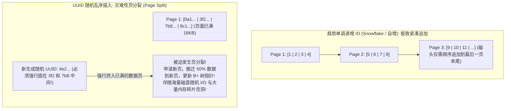
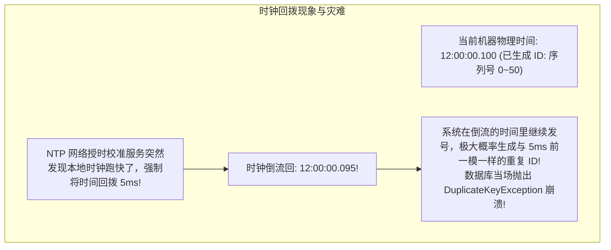

# 分布式 ID 设计与雪花算法

> [!abstract] 一句话心智模型
> 在单体单库时代，MySQL 的 `AUTO_INCREMENT` 就像**一家小诊所的挂号排队机**，按部就班递增发号；
> 一旦业务暴增进行**分库分表（拆为 16 个库 64 张表）**，每个库都各自从 1 开始发号，必然撞车产生海量重复主键！
> - **UUID（无序乱码随地扔）**：生成快，但又长又无序，把 MySQL 聚簇索引 B+ 树活活撑爆打成“碎裂地狱”；
> - **号段模式（批发总代理）**：美团 Leaf 方案，每次从数据库批量批发 1000 个号到本地内存发号，辅以双 Buffer 异步进货，消除网络毛刺；
> - **雪花算法（Snowflake 全球唯一身份证）**：纯本地内存位运算拼接，依靠**“时间戳（41位） + 机器编号（10位） + 毫秒内序列号（12位）”**，单机每秒可并发生成 400 万个趋势单调递增的 64 位数字主键！

---

## 🗺️ 一、主流分布式 ID 生成方案全景对比

| 方案 | 生成性能 | 趋势递增性 | 存储与索引成本 | 外部依赖 | 致命痛点与缺陷 |
| :--- | :--- | :--- | :--- | :--- | :--- |
| **UUID (v4)** | 极高（本地算） | **完全无序** | **极高**（36 字符字符串，极大膨胀） | 无 | **无序插入导致 MySQL B+ 树频繁页分裂，I/O 性能暴跌！** |
| **数据库自增步长** | 极低（瓶颈在DB） | 严格递增 | 低（BIGINT） | 强依赖 DB | 步长固定后水平扩容极度繁琐，单点写入瓶颈明显。 |
| **Redis INCRBY** | 较高（几万 QPS） | 严格递增 | 低（BIGINT） | 强依赖 Redis | 强依赖 Redis 集群可用性；RDB/AOF 挂掉有重号风险。 |
| **号段模式 (Leaf)** | 很高（内存发号） | 趋势递增 | 低（BIGINT） | 依赖 DB 批发 | 存在号码浪费空洞；需要双 Buffer 异步预取平滑毛刺。 |
| **Snowflake (雪花)** | **极致（单机400万/s）**| **全局趋势递增** | **极低（固定 64位 Long）** | **无（纯本地位运算）**| **强依赖系统本地物理时钟，遭遇时钟回拨会重号！** |

---

## 🚨 为什么严禁在 MySQL 聚簇索引中使用 UUID？（第一性原理）

很多初学者为了图省事，直接在实体类主键上写 `@GeneratedValue(generator = "UUID")`，这是高并发写入的**性能自杀行为**！



- **底层本质**：MySQL InnoDB 引擎的数据完全是按照**主键顺序组织存放在聚簇索引 B+ 树的叶子节点上的**（每个 Page 固定 16KB）。
- **趋势递增主键**：新插入的记录永远追加在最后一个数据页的末尾，页满开新页，**写性能极高，内存填充率高达 95% 以上**！
- **UUID 随机插入**：新生成的 UUID 大小完全随机，极大概率需要插入到已经写满的某个历史中间页中！InnoDB 必须将其强制切分为两个页（**页分裂 Page Split**），导致大量磁盘数据搬迁，写入吞吐断崖式暴跌，索引碎片率暴增 50% 以上！

---

## ❄️ 二、Twitter 雪花算法（Snowflake）64位深度拆解

雪花算法将一个 64 位（bit）的 Java `long` 整数巧妙地按位切分为四个部分：

```
0 - 0000000000 0000000000 0000000000 0000000000 0 - 00000 00000 - 000000000000
│   └───┬───────────────────────────────────────┘   └───┬─────┘   └───┬────────┘
│       │                                               │             │
1bit    41bit: 相对毫秒时间戳 (当前时间 - 纪元时间)     10bit: 机器ID 12bit: 毫秒内递增序列号
```

### 每一段的物理意义与推导：
1. **最高位 1 bit（符号位）**：
   - **固定为 0**！在 Java 中，二进制最高位是符号位，0 代表正数，1 代表负数。为了保证生成的分布式 ID 永远是正整数，最高位恒为 0。
2. **41 bit（相对毫秒级时间戳）**：
   - 记录自系统设定的“起始纪元时间”（如 `2026-01-01 00:00:00`）以来的毫秒差值。
   - **可用年限推导**：
     $$2^{41} - 1 = 2,199,023,255,551 \text{ 毫秒} \approx \frac{2,199,023,255,551}{1000 \times 3600 \times 24 \times 365} \approx \mathbf{69.7 \text{ 年！}}$$
   - 这意味着你的业务系统可以稳定运行整整 69 年不发生时间溢出！
3. **10 bit（工作节点 ID）**：
   - 通常拆分为：**5 bit 数据中心 ID（DataCenterId） + 5 bit 机器 ID（WorkerId）**。
   - 每个 5 bit 最大值是 $2^5 = 32$。
   - **全集群容量**：支持最多 $32 \times 32 = \mathbf{1024 \text{ 个独立工作节点}}$ 同时发号！
4. **12 bit（毫秒内序列号）**：
   - 记录同一个节点在同一毫秒内并发生成的递增序号。
   - **单机峰值并发吞吐推导**：
     $$2^{12} - 1 = \mathbf{4095 \text{ 个/毫秒}}$$
   - **单台机器每秒最大发号能力**：$4096 \times 1000 = \mathbf{4,096,000 \text{ 个 ID/秒}}$！对于绝大多数互联网业务而言，并发性能绰绰有余。

---

## ⏰ 三、雪花算法的阿喀琉斯之踵：时钟回拨（Clock Drift）

雪花算法最大的致命弱点：**它强依赖本地机器的物理时钟！**



### 工业级四大防御自愈方案：
1. **毫秒级短暂回拨（< 5ms）：自旋等待（Spin Wait）**
   - 如果发现 `currentTimestamp < lastTimestamp`，且差值很小（如小于 5 毫秒），代码直接通过 `Thread.sleep(diff)` 阻塞等待，直到系统时钟追赶上上次发号时间即可。
2. **较大回拨（5ms ~ 几十秒）：备用 WorkerId 切换**
   - 提前为该节点预留一组备用 `WorkerId`（例如平时用 1，回拨后瞬间切到 513）。由于节点 ID 变了，即便时间重叠，生成的 ID 也绝对不会冲突！
3. **美团 Leaf 进阶方案：Zookeeper / Nacos 上报协调**
   - 节点每隔几秒向注册中心上报自己的当前时间戳。
   - 节点启动时，比对本地时间与注册中心各节点的平均时间，如果发现本地时间明显滞后（时钟倒退），直接**报错拒绝启动**，人工介入排查。

---

## 💻 四、前端大数精度丢失暗坑（JavaScript 53 bit 限制）

这是所有使用 64 位 Long 型分布式 ID 的团队**几乎百分之百会踩的经典大坑**！

```
Java 64位 Long 最大值:  9,223,372,036,854,775,807 (19 位数字)
JavaScript 安全整数上限:             9,007,199,254,740,991 (16 位数字，即 2^53 - 1)
```

- **翻车现场**：
  - 后端生成订单 ID：`1456789123456789012`；
  - 后端直接以 JSON 格式返给前端 Vue / React：`{"orderId": 1456789123456789012}`；
  - 前端浏览器使用 `JSON.parse()` 解析时，由于 JavaScript 的 Number 采用 IEEE 754 双精度浮点数表示，**末尾 3 位数字被无情抹平变成了 0！**
  - 前端拿到的数据变成了：`1456789123456789000`！
  - 随后前端拿着这个错误的 ID 去调支付接口，后端报错：`订单不存在！`
- **优雅解法：后端 Jackson 序列化强制转 String**：
  ```java
  public class OrderVO {
      // 强制在序列化为 JSON 时，把 Long 转成前端安全的 String 字符串！
      @JsonSerialize(using = ToStringSerializer.class)
      private Long orderId;
  }
  ```

---

## ⚡ 一分钟面试必杀卡

> [!question]- Q1：为什么主键不推荐使用 UUID，而推荐雪花算法（Snowflake）？
> - **UUID 的致命缺陷**：36 位字符串占用空间巨大，最致命的是其**完全无序**。在 MySQL InnoDB 聚簇索引中，无序主键插入会导致 B+ 树叶子节点发生频繁剧烈的**页分裂（Page Split）**，产生海量磁盘随机 I/O 和内存碎片，导致写入吞吐雪崩。
> - **雪花算法的优势**：底层是 64 位整型（BIGINT），占用存储空间小；其最高位包含 41 位时间戳，**在全局上天然具备单调递增的趋势**，插入 MySQL 时磁头永远在数据页末尾顺序追加写入，性能极高。

> [!question]- Q2：雪花算法的结构是怎样的？如何解决时钟回拨问题？
> - **64 位结构**：1 bit 符号位（固定 0） + 41 bit 相对时间戳（可用约 69 年） + 10 bit 工作节点 ID（5位机房+5位机器，支持 1024 节点） + 12 bit 毫秒内自增序列号（单机单毫秒可并发 4096 个）。
> - **时钟回拨解决方案**：
>   1. 短暂回拨（< 5ms）：直接自旋 `Thread.sleep` 等待时钟追上；
>   2. 稍大回拨：动态切换到备用的 WorkerId（让节点号改变以避免重复）；
>   3. 结合注册中心（如 Leaf-ZK）周期性上报健康心跳时间戳，启动时强校验时钟差，异常则报警拒绝启动。