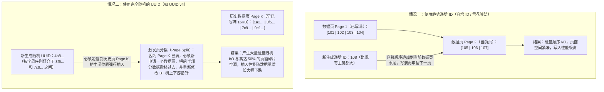
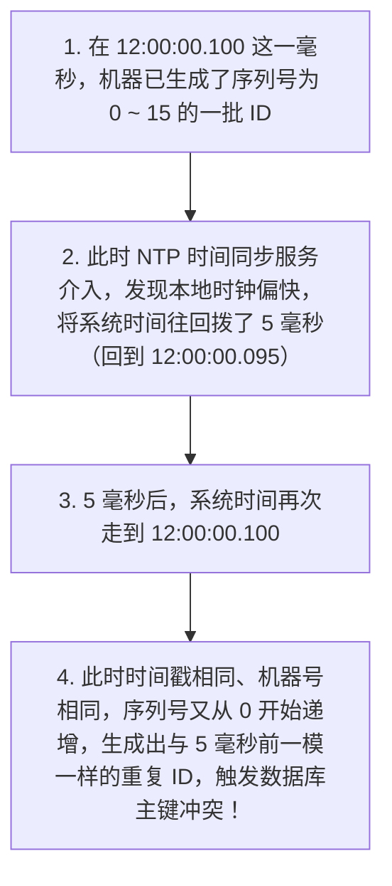

# 分布式 ID 设计与雪花算法

> [!abstract] 一句话心智模型
> 当数据表进行分库分表或多实例高并发写入时，单张表的数据库自增主键（`AUTO_INCREMENT`）无法再保证全局唯一。一个优秀的分布式 ID 不仅要保证**全局唯一**，还要满足**趋势递增**（以契合 MySQL InnoDB B+ 树聚簇索引的顺序追加特性，避免页分裂）与**高吞吐低延迟**。工业界最主流的两大方案是**美团 Leaf 号段模式**与**Twitter 雪花算法（Snowflake 64 位整数）**。

---

## 🎯 一、为什么需要分布式 ID？为什么不能直接用随机 UUID？

### 1. 分布式场景对主键 ID 的三个核心要求
在单体单库时代，我们建表时只需要给主键加上 `AUTO_INCREMENT`，让 MySQL 帮我们从 `1, 2, 3...` 依次递增生成即可。但在分布式与分库分表架构下，订单数据可能被拆分到 16 个不同的数据库表中，如果每张表都从 `1` 开始自增，不同表里就会出现大量重复的订单号。

因此，我们需要一套独立于单表的分布式 ID 生成机制，它必须同时满足三个条件：
1. **全局唯一性**：无论在哪个节点、哪张分表生成，ID 绝不能重复。
2. **趋势递增（有序性）**：新生成的 ID 要尽量比旧生成的 ID 大，这对底层数据库的写入性能至关重要。
3. **高性能与高可用**：生成 ID 的速度必须极快（微秒级），且不能因为单台机器故障导致全站无法生成订单。

---

### 2. 为什么 MySQL InnoDB 的主键不推荐使用随机 UUID（v4）？

很多初学者会问：“Java 自带了 `UUID.randomUUID().toString()`，本地生成又快又唯一，为什么大厂严禁用它做 MySQL 主键？”

要彻底明白这一点，必须回到 **MySQL InnoDB 聚簇索引（Clustered Index）** 的底层存储结构：
- 在 InnoDB 中，表里的数据行并不是随便堆放的，而是**严格按照主键 ID 的大小顺序，紧密排列在 B+ 树的叶子节点数据页（Page，默认每页 16KB）中**。

我们可以直接对比“趋势递增 ID”和“随机 UUID”在写入数据页时的巨大差异：



总结来说，随机 UUID 作为 InnoDB 主键有两大硬伤：
1. **频繁触发页分裂与随机 I/O**：每次生成的 UUID 大小毫无规律，新数据总是要往过去已经写满的旧数据页中间硬塞，导致 InnoDB 不断执行耗时的**页分裂（Page Split）**和数据移动，而且由于每次访问的都是不同的历史页，内存 Buffer Pool 缓存命中率极低，引发大量磁盘随机读写。
2. **占用空间过大，拖累所有二级索引**：UUID 字符串长达 36 个字节（即使去掉横杠或转为二进制也比 8 字节的 `BIGINT` 大得多）。而在 InnoDB 中，**所有的二级索引（普通索引）叶子节点存的都是主键值**！主键每膨胀一倍，整张表的所有二级索引体积都会跟着翻倍，浪费大量内存和磁盘空间。

---

## 🗺️ 二、主流分布式 ID 生成方案对比与演进

为了既保证全局唯一，又得到一个 8 字节（`BIGINT`）且趋势递增的整数 ID，工业界演进出了以下几种方案：

| 方案 | 实现方式 | 优点 | 缺点与瓶颈 |
| :--- | :--- | :--- | :--- |
| **1. 数据库自增步长** | 部署 $N$ 台数据库，分别设置不同的起始值和相同的自增步长（如 3 台库分别生成 `1,4,7...`、`2,5,8...`、`3,6,9...`） | 简单，直接复用数据库自增 | 每次发号都要访问数据库，高并发下数据库扛不住；且一旦定死步长，后续很难动态扩容新节点。 |
| **2. Redis `INCR` 自增** | 利用 Redis 单线程原子递增命令 `INCR`/`INCRBY` 生成序号（常拼上日期前缀如 `202609300001`） | 性能比数据库高，天然递增 | 每次发号仍需一次网络请求；若 Redis 发生主从异步切换，可能因为最新计数值未同步而产生重复号码。 |
| **3. 号段模式（美团 Leaf）** | 从数据库**按批次批发号段**（如一次领走 `1 ~ 1000`），在应用内存中用 `AtomicLong` 逐个分配 | **极高性能**（1000 次发号只访问 1 次数据库），即使数据库短暂抖动也能靠内存余量继续工作 | 服务重启会浪费当前未用完的余量号段（导致 ID 不连续，但一般业务允许空洞）。 |
| **4. 雪花算法（Snowflake）** | 纯本地内存按位拼接：`时间戳 + 机器号 + 序列号`，生成 64 位 `long` 整数 | **零网络开销**，纯本地 CPU 运算，吞吐量极高，自带时间信息 | **强依赖机器物理时钟**，若服务器发生时钟回拨（时间倒流），可能导致生成重复 ID。 |

### 重点拆解：美团 Leaf 号段模式的“双 Buffer 异步预加载”
号段模式是怎么消除数据库访问瓶颈的？
1. 数据库里只建一张发号表，记录当前业务已经批发出去的最大号码 `max_id` 和每次批发的步长 `step`（例如 `step = 1000`）。
2. 发号服务启动时，执行一条 `UPDATE table SET max_id = max_id + 1000 WHERE biz_tag = 'order'`，就把 `[1, 1000]` 这 1000 个号码领到了自己的 JVM 内存里，接下来 1000 次发号全在内存里自增返回，耗时不到 1 微秒。
3. **双 Buffer 优化**：如果等这 1000 个号彻底用光了再去查数据库领下一批，第 1001 个请求就会因为等待数据库 I/O 而出现延迟毛刺。为此，美团 Leaf 设计了**双 Buffer（两个号段缓存区）**：当当前正在使用的 Buffer 号码消耗到 **10%**（即只发了 100 个号）时，后台线程就提前异步去数据库把下一个号段 `[1001, 2000]` 领回来放进备用 Buffer 里。等第一个号段用完时，直接内存指针瞬间切换到备用 Buffer，真正做到全程无阻塞！

---

## ❄️ 三、Twitter 雪花算法（Snowflake）64 位结构深度拆解

如果不想维护专门的数据库号段表，希望能直接在各个微服务本地生成全局唯一且趋势递增的 64 位 `Long` 型 ID，最经典的方案就是 **雪花算法（Snowflake）**。

Java 中的 `long` 类型正好占据 **64 个二进制位（bit）**。雪花算法将这 64 位划分成四个明确的部分：

```text
 0 - 0000000000 0000000000 0000000000 0000000000 0 - 00000 00000 - 000000000000
 │   └─────────────────────┬────────────────────┘   └─────┬────┘  └─────┬────┘
1bit                     41bit                          10bit         12bit
符号位              毫秒级时间戳差值                   工作机器 ID       毫秒内递增序列号
(固定为0)      (当前时间 - 系统起始纪元时间)        (5位机房 + 5位机器)   (单毫秒最多4096个)
```

### 每一部分的设置原因与容量计算：

1. **第 1 位：符号位（1 bit，固定为 `0`）**
   - 在二进制补码中，最高位是符号位，`0` 表示正数，`1` 表示负数。因为我们希望生成的 ID 全都是正整数，所以最高位永远固定为 `0`。
2. **第 2 ~ 42 位：相对毫秒时间戳（41 bit）**
   - 存放的不是直接的 `System.currentTimeMillis()`，而是**“当前毫秒时间戳 - 系统上线时设定的起始纪元时间戳（Epoch，如 `2025-01-01 00:00:00`）”**的差值。
   - **为什么放在最高位？** 因为时间是一直往前走的，把时间戳放在高位，就能保证后生成的 ID 在二进制数值上一定比先生成的 ID 大，从而天然实现**按时间趋势递增**！
   - **能用多少年？** 41 个比特位能表示的最大正整数是 $2^{41} - 1 = 2,199,023,255,551$ 毫秒，换算成年数：
     $$\frac{2,199,023,255,551}{1000 \times 60 \times 60 \times 24 \times 365} \approx \mathbf{69.7 \text{ 年}}$$
     足够支撑一个业务系统运行近 70 年。
3. **第 43 ~ 52 位：工作机器 ID（10 bit）**
   - 用于区分集群中的不同发号节点，确保同一毫秒内不同机器生成的 ID 不会撞车。
   - 工程上常将其拆分为 **5 bit 数据中心 ID（DataCenterId，支持 $2^5 = 32$ 个机房） + 5 bit 机器 ID（WorkerId，每个机房支持 $2^5 = 32$ 台机器）**，总共可支持 $2^{10} = \mathbf{1024 \text{ 个节点}}$ 同时独立发号。
4. **第 53 ~ 64 位：毫秒内序列号（12 bit）**
   - 如果同一台机器在**同一毫秒内**收到了多个并发发号请求，时间戳和机器 ID 都一样，就靠最后这 12 位自增序列号来区分。
   - 12 个比特位能表示的范围是 $0 \sim 4095$（共 $2^{12} = \mathbf{4096 \text{ 个}}$）。也就是说，单台机器每毫秒最多可以生成 4096 个不重复的 ID（理论上每秒上限高达 409.6 万个）。如果某 1 毫秒内真的把 4096 个序号全用光了，算法只需循环等待到下一毫秒再继续生成即可。

---

## ⏰ 四、雪花算法的两大工程难题与解决方案

### 1. 核心难题：服务器时钟回拨（Clock Drift）

雪花算法之所以能保证单机生成的 ID 不重复，前提是**本地物理时间一直往前走**。但在生产环境中，服务器会开启 **NTP（网络时间协议）服务**定期与标准原子钟同步校准。如果某台服务器的硬件时钟走快了，NTP 校准时就会把机器的系统时间**往回拨慢几毫秒甚至几秒**。



#### 工程上如何解决时钟回拨？
在发号器内存中维护一个变量 `lastTimestamp`（记录上一次成功生成 ID 时的毫秒时间戳）。每次生成新 ID 时，如果发现 `currentTimestamp < lastTimestamp`，说明发生了时钟回拨，按回拨幅度分级处理：

1. **小幅回拨（例如回拨时间 $\le 5\text{ms}$）：阻塞等待时间追平**
   - 绝大多数 NTP 校准产生的回拨都在几毫秒以内。此时不需要报错，直接让当前线程短暂等待（如 `Thread.sleep` 或循环等待几毫秒），直到系统时间重新追上并超过 `lastTimestamp` 后再继续发号。
2. **中大幅度回拨（例如回拨几十毫秒到几秒）：利用扩展位或追赶历史最大时间**
   - **做法 A（直接顺延 `lastTimestamp`）**：发现回拨后，不采用倒退的系统时间，而是继续沿用内存里记录的 `lastTimestamp` 累加序列号发号（若序列号满 4096 则将 `lastTimestamp + 1`），直到真实物理时间重新追上 `lastTimestamp`。
   - **做法 B（回拨位 / 备用 WorkerId）**：从 10 位机器码或 12 位序列号中划出 2 个 bit 作为“时钟回拨次数位（0~3）”，每检测到一次回拨就将该标志位 `+1`，即使时间戳重复，由于回拨位不同，生成的 64 位整数依然唯一。
3. **严重回拨与重启防线**：
   - 如果回拨超过了预设的安全阈值（如超过数秒），应立即抛出异常拒绝发号并触发监控告警；
   - 为了防止机器在回拨期间重启导致内存里的 `lastTimestamp` 丢失，节点在分配 `WorkerId`（如通过 Redis 或 ZooKeeper 注册）时，同时定期把自己的 `lastTimestamp` 上报保存；重启时先检查当前机器时间是否大于上次上报的时间。

---

### 2. 经典实战踩坑：前端 JavaScript 大数精度丢失问题

当你高高兴兴地在后端用雪花算法生成了 64 位 `Long` 类型的订单 ID（例如 `1789234567890123456`，共 **19 位十进制数字**），通过 Spring Boot 接口返回 JSON 给前端页面时，前端调用详情或支付接口却总是报错“订单不存在”——为什么？

#### 原因剖析：JavaScript 的 `Number` 只有 53 bit 整数精度！
- Java 的 `Long` 是 **64 位整数**，最大可达 `9,223,372,036,854,775,807`（19 位十进制数）。
- 而前端浏览器中的 JavaScript 没有专门的 64 位整数类型，它的 `Number` 类型是按照 IEEE 754 双精度浮点数存储的，其中用于精确表示整数的有效尾数只有 **53 bit**（即 `Number.MAX_SAFE_INTEGER = 9,007,199,254,740,991`，只有 **16 位十进制数**）。
- 一旦后端返回的 JSON 里包含一个不带双引号的 19 位数字：`{"orderId": 1789234567890123456}`，前端调用 `JSON.parse()` 解析时，最后几位数字就会因为超出 53 位精度而被直接舍入改写（变成类似 `1789234567890123500`）！

#### 标准解决方案：后端序列化为 JSON 时统一将 `Long` 转为 `String`
只要把 JSON 变成带双引号的字符串 `{"orderId": "1789234567890123456"}`，前端按字符串接收和回传，就完全不会经过浮点数转换，精度一分不差：

```java
// 方式 1：在单个字段上加 Jackson 注解
public class OrderVO {
    @JsonSerialize(using = ToStringSerializer.class)
    private Long orderId;
}

// 方式 2（推荐）：在 Spring Boot 全局 Jackson 配置中统一将所有 Long 序列化为 String
@Bean
public Jackson2ObjectMapperBuilderCustomizer jackson2ObjectMapperBuilderCustomizer() {
    return builder -> {
        builder.serializerByType(Long.class, ToStringSerializer.instance);
        builder.serializerByType(Long.TYPE, ToStringSerializer.instance);
    };
}
```

---

## ⚡ 五、一分钟面试复盘

> [!question]- Q1：为什么 MySQL 数据库主键推荐使用雪花算法或自增 ID，而不推荐使用随机 UUID？
> 1. **B+ 树顺序追加 vs 随机插入页分裂**：MySQL InnoDB 的数据行是按主键大小顺序存放在聚簇索引 B+ 树的叶子节点数据页（16KB）中的。雪花算法和自增 ID 是**趋势递增**的，每次插入新数据都是往最后一个数据页的末尾顺序追加，写满一页再开新页，属于高效的顺序 I/O；而随机 UUID（v4）大小毫无规律，每次插入都要随机定位到历史已满的数据页中间，频繁触发**页分裂（Page Split）**和数据搬移，产生大量磁盘随机 I/O 和空间碎片。
> 2. **存储与二级索引体积**：雪花算法 ID 只是 8 字节的 `BIGINT`，而 UUID 字符串长达 36 字节。由于 InnoDB 所有二级索引的叶子节点都存储主键值，使用 UUID 会导致所有二级索引体积大幅膨胀，降低内存缓存命中率。

> [!question]- Q2：请画出雪花算法（Snowflake）的 64 位结构，并说明如何解决时钟回拨与前端精度丢失问题？
> 1. **64 位结构（`1 + 41 + 10 + 12`）**：
>    - **1 bit 符号位**：固定为 `0`，保证生成的 ID 为正数；
>    - **41 bit 毫秒时间戳差值**：记录当前时间与起始纪元的毫秒差，最多可用约 **69.7 年**；
>    - **10 bit 工作机器 ID**：通常分为 5 位机房 ID + 5 位机器 ID，最多支持 **1024 个节点**；
>    - **12 bit 毫秒内序列号**：同一节点同一毫秒内的自增序号，单机每毫秒最多生成 **4096 个** ID。
> 2. **解决时钟回拨**：记录上次发号时间 `lastTimestamp`，当发现当前时间小于 `lastTimestamp` 时：若回拨极小（如 $\le 5\text{ms}$），直接阻塞等待时间追平；若回拨稍大，可沿用 `lastTimestamp` 继续递增序列号或启用预留的回拨扩展位；严重回拨则触发告警并切换备用发号策略。
> 3. **解决前端精度丢失**：由于前端 JavaScript 的 `Number` 类型安全整数上限只有 53 bit（16 位数字），无法精确表示 64 bit（19 位数字）的 `Long` 型雪花 ID。只需在后端 Spring Boot 的 Jackson 序列化配置中，将 `Long` 类型统一配置为 `ToStringSerializer` 转为字符串传给前端即可。
