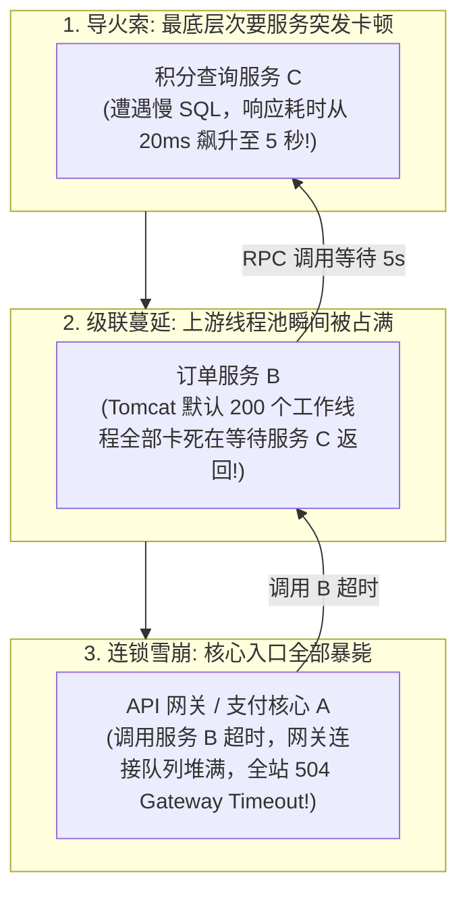
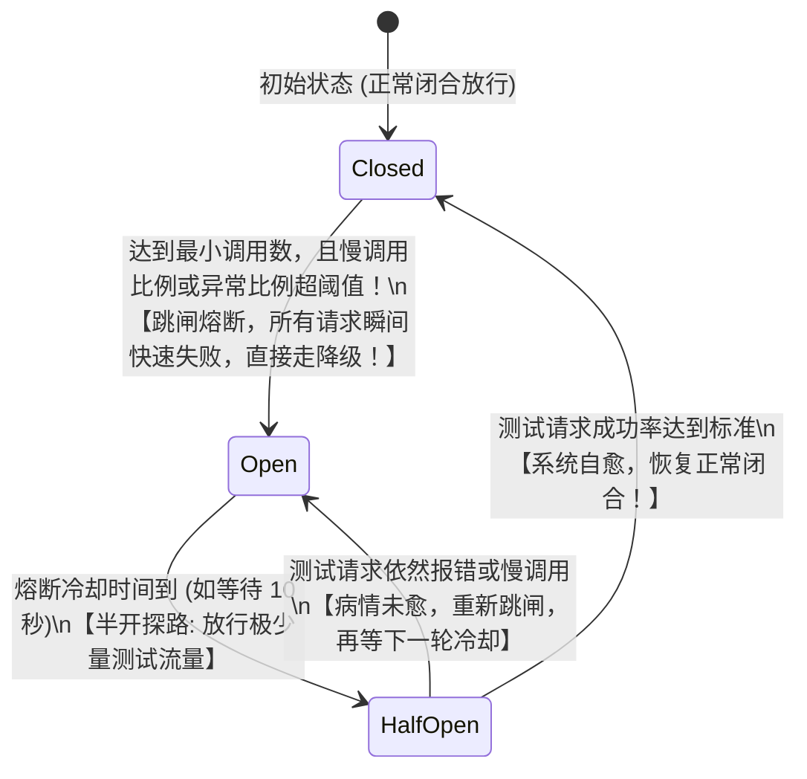
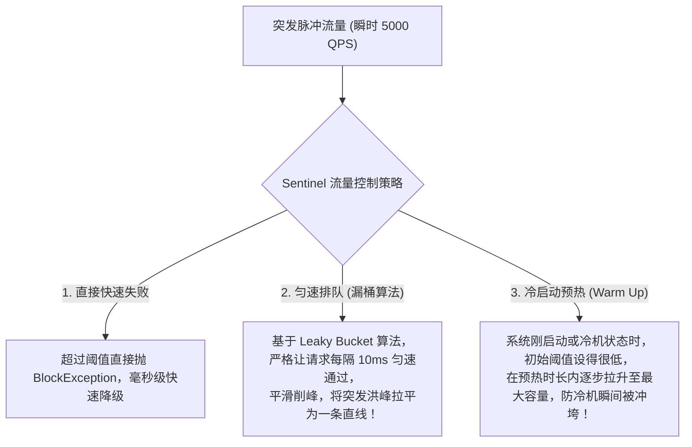

# 稳定性三板斧：限流、熔断与降级

> [!abstract] 一句话心智模型
> 如果把微服务集群比作**城市繁华的供电与商业网络**：
> - **微服务雪崩效应**：最底层一个变压器慢发热，拖垮整个输电网，引发全城大停电；
> - **限流（Rate Limiting，景区的旋转闸机）**：不管外面排队的人群有多庞大，入口闸机永远以恒定速率放行，把超标流量挡在门外；
> - **熔断（Circuit Breaking，家庭电路的空气开关）**：当下游某电器短路冒烟（慢调用或异常比例超标），空气开关**“啪”的一声瞬间自动跳闸断电（Open）**，绝不让火灾蔓延到主线路；
> - **降级（Fallback，智能托底方案）**：跳闸之后不能让用户眼前一黑（返回 500 报错），而是自动点亮应急备用小夜灯（返回兜底数据、默认值或友好的排队提示）。

---

## ⚡ 一、微服务“雪崩效应（Cascading Failure）”第一性原理

微服务架构最大的噩梦：**一个次要微服务的变慢，如何在 10 秒钟内将整个集群彻底拖死？**

### 破局核心：
**必须在故障蔓延之前，强行斩断故障调用链！** 宁可牺牲服务 C 的积分查询，也绝对不能让积分查询拖垮整个订单核心链路！

---

## 🔌 二、熔断器三大状态机（Circuit Breaker 状态流转）

熔断器的本质是一个精密的状态机，控制着请求是否允许真正发送到远程服务：

### 三大状态严格裁决：
1. **Closed（闭合状态）**：电路通畅，所有请求正常放行通过。熔断器在后台默默统计滑动时间窗口内的调用指标（慢调用比例、异常比例）；
2. **Open（打开/跳闸状态）**：当错误率达到阈值，熔断器瞬间跳闸！**此时后续所有的请求根本不会再发给远程网络，而是在本地内存被瞬间拦截（Fast-Fail）**，直接执行降级（Fallback）逻辑返回，彻底保护下游恢复喘息！
3. **Half-Open（半开试探状态）**：熔断一段时间后（如 10 秒），熔断器会小心翼翼地放行指定数量的探测请求（如放行 5 个请求）：
   - 如果这 5 个请求全部正常返回，说明下游已经自愈，**熔断器自动闭合（回到 Closed）**；
   - 只要有请求依然报错，说明下游还没修好，**立刻重新跳闸（回到 Open）**，开启下一轮冷却倒计时。

---

## 🛡️ 三、资源隔离的两大流派：线程池隔离 vs 信号量隔离

如何防止慢接口吃光整个 Tomcat 的所有工作线程？业内存在两大流派：

| 隔离方案 | 代表框架 | 核心工作机制 | 核心优势 | 致命代价 |
| :--- | :--- | :--- | :--- | :--- |
| **线程池隔离 (Thread Pool)** | **Netflix Hystrix** | 为每个下游依赖单独创建独立的线程池（如服务 B 分配 10 个线程，服务 C 分配 10 个线程）。 | **彻底物理隔离**：即便服务 C 线程全部卡死，也只影响属于它的 10 个线程，绝不干扰服务 B。支持真正的超时强制中断（`Future.cancel`）。 | **沉重的 CPU 上下文切换与内存开销**！大量小线程池严重消耗系统性能，在超高并发下性能损耗极大。 |
| **信号量/并发数隔离 (Semaphore)** | **Alibaba Sentinel** | 不创建任何新线程，仅仅依靠一个高性能原子计数器（AtomicInteger）记录正在并发执行的线程数。 | **零上下文切换开销，性能极高！** 仅仅是内存数字加减，非常适合高并发、低延迟的现代微服务架构。 | **无法强制中断异步 I/O 线程**，依赖客户端自身的 Socket 超时配置。 |

---

## 🥋 四、Alibaba Sentinel 核心流量整形黑科技

阿里开源的 **Sentinel** 是当前国内微服务生态的统治级流量防卫兵。

### 1. 匀速排队（Paced / Rate Limiter）：
- 很多后台批处理或者任务消费系统，系统处理能力上限是 1000 QPS。
- 突发来了 3000 个请求，如果直接拒绝太可惜。Sentinel 依靠**等待队列与间隔调度**，让请求严格按照 1ms 放行一个的节奏排队通过，将尖刺洪峰硬生生拉平成平缓的清风细雨！

### 2. 冷启动预热（Warm Up）：
- 某微服务刚发布重启，JVM 尚未进行 JIT 热点代码编译，数据库连接池尚未完全建立，系统各级本地缓存全空（冷机状态）。
- 如果此时直接把 5000 QPS 砸过来，冷机瞬间被打死！
- **Warm Up 模式**：阈值从设定的 $1/3$ 开始慢慢递增，在指定的预热时长（如 10 秒）内线性爬升到满载 5000 QPS，给系统的 JVM 和缓存留出充足的热机时间！

---

## ⚡ 一分钟面试必杀卡

> [!question]- Q1：限流、熔断、降级三者之间有什么本质区别与联系？
> - **限流（Rate Limiting）** 发生在**系统入口处**，用于防范外部流量洪峰超出系统总承载能力，超出部分被拦截（保护自己）；
> - **熔断（Circuit Breaking）** 发生在**调用下游依赖处**，当下游服务频繁报错或变慢时，主动切断调用链路、快速失败，防止自身线程被下游拖垮引发雪崩（保护自己与下游）；
> - **降级（Fallback）** 是**熔断或限流触发后的兜底补救措施**，负责返回有损的默认值、缓存旧数据或友好提示，确保用户端流程能够顺利收尾。

> [!question]- Q2：熔断器的三大状态及其流转机制是怎样的？
> - **Closed（闭合）**：正常状态，放行所有请求并统计滑动窗口内的慢调用或异常比例；
> - **Open（打开/跳闸）**：当错误率达到阈值时跳闸，所有后续请求被本地瞬间拦截（Fast-Fail），直接走 Fallback 兜底；
> - **Half-Open（半开）**：跳闸经过一段冷却时间后，允许极少量的探测请求通过。若探测请求成功，说明下游自愈，状态恢复为 Closed；若探测请求依然失败，重回 Open 状态开启新一轮冷却。