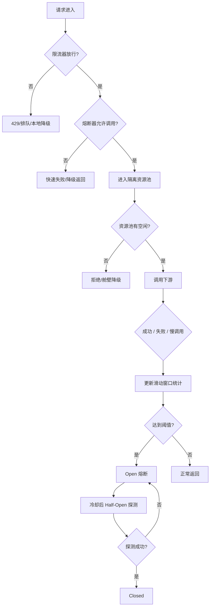
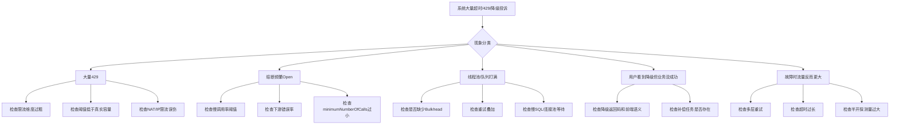

# 限流-熔断-降级

> [!abstract] 一句话总结
> 限流、熔断、降级的本质不是“挡请求”，而是在容量有限、依赖不稳定、局部故障不可避免的前提下，优先保护系统和核心交易，让故障停在局部而不是蔓延成雪崩。

## 📌 精准定位

- 限流解决“当前能放多少请求进来”，熔断解决“这个下游现在还值不值得继续打”，降级解决“打不了时给用户什么结果”。
- 三者通常要和超时、重试、隔离、容量评估一起设计，单独使用效果有限。
- 限流不是扩容，熔断不是修复下游，降级也不是把错误包装成成功。
- 关键边界：如果容量模型、依赖拓扑和业务优先级不清楚，保护策略大概率会误伤核心流量。
- 面试重点：要能讲清限流算法、熔断状态机、容量估算、重试风暴、半开探测和生产故障排查。

## 🧩 核心概念

| 概念 | 具体含义 | 工程要点 |
| ---- | -------- | -------- |
| 限流 | 控制单位时间允许通过的请求量。 | 既可以放在入口，也可以放在下游资源边界。 |
| 熔断 | 当失败率或慢调用率过高时，短时间内拒绝继续访问下游。 | 本质是快速失败，给下游恢复窗口。 |
| 降级 | 依赖异常或资源不足时，返回兜底结果。 | 返回语义必须让业务和用户都看得懂。 |
| 隔离 | 将线程池、连接池、队列按依赖拆分。 | 防止一个慢下游拖垮所有请求。 |
| 容量估算 | 用 QPS、RT、并发、CPU/线程/连接数推导系统承载能力。 | 没有容量模型，阈值只能拍脑袋。 |
| 慢调用熔断 | 不只是失败才熔断，慢到拖垮线程也要熔断。 | 比只看错误率更贴近生产问题。 |
| 重试风暴 | 上游多层重试叠加，导致下游在故障时流量被放大。 | 是微服务雪崩最常见诱因之一。 |

## ⚙️ 工作原理 / 主流程



主流程理解：

1. 入口先限流，确保总流量不把系统直接打穿。
2. 熔断器在调用下游前判断是否还允许继续尝试。
3. 舱壁或线程池隔离再限制资源占用，避免单个下游耗尽全局线程。
4. 调用结果会反馈给熔断器窗口，包括成功、失败和慢调用。
5. 达到阈值就 Open，冷却后半开探测，探测通过才恢复正常。

## 🧮 常见限流算法

| 算法 | 核心思想 | 优点 | 缺点 | 典型场景 |
| ---- | -------- | ---- | ---- | -------- |
| 固定窗口 | 按时间窗口计数，如 1 秒最多 N 次 | 实现简单 | 窗口切换处会突刺 | 简单接口保护 |
| 滑动窗口 | 统计最近一段时间内请求数 | 更平滑 | 实现复杂度更高 | 生产限流常用 |
| 令牌桶 | 以固定速率放令牌，请求拿到令牌才通过 | 允许突发流量 | 令牌参数不好配会误伤 | API 网关、秒杀入口 |
| 漏桶 | 请求先入桶，再按固定速率流出 | 输出平滑 | 不能很好吸收突发 | 下游需稳定消费速率 |
| 并发数限流 | 限制同时处理中的请求数 | 直接保护线程/连接资源 | 对瞬时 QPS 不敏感 | 慢接口、DB/远程调用 |

面试里最好补一句：

- 入口层更常用令牌桶或滑动窗口。
- 对慢接口，仅看 QPS 不够，还要看并发数、线程数、队列长度。
- “限流阈值”最终应来自容量压测和稳定性目标，而不是开发拍脑袋。

## 📏 容量估算与阈值设计

### 一个常见估算公式

如果某接口平均 RT 为 50ms，目标峰值是 2000 QPS，则理论并发约为：

```text
并发 = QPS × RT = 2000 × 0.05 = 100
```

再结合线程池、连接池、CPU 核数留冗余，例如：

- 理论并发 100
- 预留 30% 安全水位
- 则业务线程池不要长期跑满 100，最好把稳态控制在 60~70

### 设计阈值时要看什么

- 接口 RT：平均值没意义，重点看 P95/P99。
- CPU 使用率：是否已接近饱和。
- 线程池活跃数、队列积压。
- DB 连接池占用、Redis 连接数、下游接口配额。
- 不同租户、不同接口的优先级。

### 实战建议

- 核心交易和非核心查询不要共用同一套阈值。
- 网关限流、服务限流、下游资源限流三层阈值要一致协同。
- 阈值上线前先压测，不要直接拿生产试错。
- 热点活动要预估峰值、预热缓存、提前演练限流和降级动作。

## 🔥 熔断状态机与慢调用治理

### 熔断器状态机

- Closed：默认状态，统计最近窗口内失败率和慢调用率。
- Open：达到阈值后快速失败，不再放请求打下游。
- Half-Open：冷却后放少量探测流量，判断下游是否恢复。

### 生产上为什么要看慢调用率

很多时候下游不是彻底报错，而是：

- SQL 慢到 2 秒以上。
- Redis 抖动导致大量线程等待。
- 下游线程池满，响应极慢但最终返回 200。

如果只看错误率，这些请求不会触发熔断，但会持续占住线程，最终把调用方拖死。所以生产里一般会同时配置：

- `failureRateThreshold`
- `slowCallRateThreshold`
- `slowCallDurationThreshold`
- `minimumNumberOfCalls`
- `permittedNumberOfCallsInHalfOpenState`

## ⏱️ 超时、重试、熔断的配合关系


工程原则：

- 先定总 deadline，再谈 timeout、retry、circuit breaker。
- 超时是“单次调用多久算失败”，熔断是“最近一段时间内失败太多先别打了”，两者粒度不同。
- 重试必须服从总 budget，不能为了“提高成功率”无限补刀。
- 熔断打开后不应该再继续做远程 fallback，否则等于假熔断。
- 半开探测量必须很小，否则刚恢复的下游会被再次打挂。

## 💻 代码 / 配置 / 伪代码

```java
CircuitBreakerConfig cbConfig = CircuitBreakerConfig.custom()
    .failureRateThreshold(50)
    .slowCallRateThreshold(50)
    .slowCallDurationThreshold(Duration.ofMillis(800))
    .minimumNumberOfCalls(20)
    .permittedNumberOfCallsInHalfOpenState(5)
    .waitDurationInOpenState(Duration.ofSeconds(10))
    .build();

RateLimiterConfig rlConfig = RateLimiterConfig.custom()
    .limitRefreshPeriod(Duration.ofSeconds(1))
    .limitForPeriod(200)
    .timeoutDuration(Duration.ZERO)
    .build();
```

```java
Supplier<OrderResult> supplier = () -> inventoryClient.checkAndReserve(cmd);
Supplier<OrderResult> guarded = Decorators.ofSupplier(supplier)
    .withRateLimiter(rateLimiter)
    .withBulkhead(bulkhead)
    .withTimeLimiter(timeLimiter, scheduler)
    .withCircuitBreaker(circuitBreaker)
    .withRetry(retry)
    .decorate();
```

组合顺序理解：

- 一般先限流，再隔离，再超时/熔断，再决定是否重试。
- 如果把重试放在最外层，不加限制地重复进入限流和隔离，可能放大系统负担。
- 如果把限流放在最后，前面资源已经被占住，保护意义就弱了。

## 🛠️ 工程案例：秒杀入口保护

场景：

- 大促秒杀开始后，`placeOrder` 瞬时从 3k QPS 冲到 30k QPS。
- 下游库存和优惠券服务并不稳定，且 MySQL 连接池只有 200。

设计：

1. 网关层用令牌桶把总流量控制在系统可承载峰值附近。
2. 服务内按接口和租户做细粒度限流，保护核心资源。
3. 调库存和优惠券分别走独立 Bulkhead，避免一个依赖拖垮另一个。
4. 熔断看慢调用率和错误率，不只看异常数。
5. 降级策略：核心下单保留，非核心“优惠信息实时计算”可以关闭或返回缓存。
6. 页面和接口都明确提示“排队中”或“系统繁忙，请稍后再试”，而不是返回假成功。

结果：

- 峰值来临时，系统吞吐降低不明显，但错误从“全站超时”变成“非核心功能受限”。
- 排障时可以快速区分：是流量超出容量、某个下游抖动，还是线程池配置不合理。

## ⚠️ 常见故障图谱



## ⚠️ 生产坑与注意事项

- 限流 key 过粗，例如只按 IP，在 NAT 或公司出口场景会误伤大量正常用户。
- 限流 key 过细，例如按订单号限流，几乎起不到保护系统的作用。
- 只按 QPS 限流，不看慢请求和并发占用，线程一样会被打满。
- 熔断没有设置 `minimumNumberOfCalls`，少量抖动就反复打开关闭。
- 半开探测流量放得太大，下游刚恢复又被瞬间打死。
- 降级结果用 200 包装失败，前端和调用方误以为业务成功。
- 保护策略只配置，不做压测、不做演练，线上出问题时根本不知道阈值是否合理。
- 只在应用层限流，不在网关和消息入口做保护，流量早就把前面打穿了。

## 🧭 排查路径

### 1. 为什么大量 429

- 查限流维度：IP、用户、租户、接口、应用实例。
- 查限流位置：网关、应用还是某个资源方法。
- 查阈值是否低于真实峰值，是否和压测结果一致。
- 查是否突发活动、爬虫、重试流量或上游 bug 造成异常放量。

### 2. 为什么熔断频繁打开

- 看失败率和慢调用率哪个先超阈值。
- 看 `minimumNumberOfCalls` 是否过小导致样本不足。
- 看下游是真故障还是只是 RT 上升。
- 结合 trace 看是不是超时配置过小，导致“正常慢请求”被算成失败。

### 3. 为什么线程池满了

- 看线程池活跃数、队列长度、拒绝数、DB 连接池和下游响应时间。
- 查是否缺少 Bulkhead，多个依赖共用一个线程池。
- 查是否重试叠加，导致单个用户请求占住多个线程时间片。
- 查是不是熔断未生效，失败请求还在持续排队。

### 4. 为什么降级引发投诉

- 确认降级接口对用户返回的文案、状态码和业务状态。
- 看前端是否把“稍后再试”“排队中”“系统繁忙”错误当成成功页面展示。
- 查是否有异步补偿、消息补偿或订单状态回查机制。
- 判断降级是否只允许用于非核心功能，是否误降级到了支付、扣库存这类强一致流程。

## 🎯 面试问题

> [!question] 高频问题
> - Q: 令牌桶和漏桶有什么区别？
>   - A: 令牌桶允许一定突发，请求只要拿到令牌就能过；漏桶更强调固定速率输出，适合平滑流量。
> - Q: 限流、熔断、降级三者关系是什么？
>   - A: 限流防过载，熔断防持续打异常下游，降级负责在打不了时给业务一个可接受结果。
> - Q: 为什么生产上要看慢调用率而不是只看错误率？
>   - A: 因为很多故障不是直接报错，而是慢到占满线程和连接，最终把调用方拖死。
> - Q: 阈值怎么定？
>   - A: 结合容量压测、P99、线程池、连接池、CPU 和业务优先级，不是写个默认值就完事。
> - Q: 如何避免重试风暴？
>   - A: 统一超时预算，只允许少量幂等重试，最好一条链路只有一层重试，并配合熔断和隔离。

## 🎤 面试 3 层回答

### 30 秒版

限流、熔断、降级是稳定性三件套。限流控制进入流量，熔断在下游持续失败或过慢时快速失败，降级则保证系统在资源紧张时还能保住核心功能。真正的难点不是概念，而是阈值、容量和业务语义。

### 2 分钟版

在生产系统里，我会把保护分三层看：入口先限流，避免总流量把系统打穿；调用下游前用熔断和隔离控制故障扩散；打不了时再用降级保住核心链路。限流算法常见有固定窗口、滑动窗口、令牌桶、漏桶，但真正落地时还要结合线程池、连接池和 P99 设计阈值。熔断不能只看错误率，慢调用率同样重要，否则很多“200 但很慢”的请求会把线程拖死。最常见事故是多层重试叠加导致流量放大，所以要统一超时预算，并限制只对幂等请求重试。

### 项目版

我在秒杀或大促项目里做过保护设计：网关用令牌桶挡峰值，应用内按接口和租户限流，调用库存和优惠券服务分别做 Bulkhead 隔离，并用 Resilience4j 按慢调用率和错误率做熔断。非核心的优惠计算可以降级，核心下单链路尽量保留。如果活动开始后大量 429 或熔断，我会先看限流维度和阈值，再看下游 RT、线程池和是否存在重试风暴，最后再判断是否需要临时降级某些非核心功能。

## ✅ 精通检查清单

- 能解释常见限流算法及其适用场景。
- 能根据 QPS、RT、线程池、连接池做基础容量估算。
- 能讲清熔断状态机、慢调用熔断和半开探测。
- 能说明超时、重试、熔断、隔离之间的配合关系。
- 能从真实故障出发排查 429、线程池满、熔断频繁、降级投诉。

## 🔗 关联笔记

- [[_index]]
- [[20-Java后端/00-总览/学习仪表盘]]
- [[07-服务治理与负载均衡]]
- [[08-链路追踪]]
- [[../06-中间件/06-API网关]]
- [[../04-Spring生态/08-SpringCloud组件概览]]

## 📚 参考资料

- Sentinel Documentation
- Resilience4j User Guide
- Google SRE Workbook: Handling Overload
- Spring Cloud CircuitBreaker Reference
