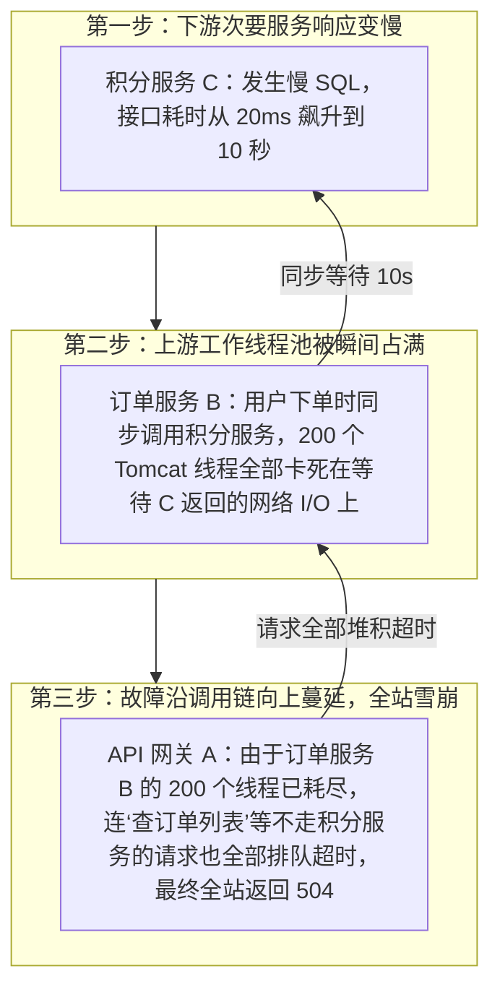
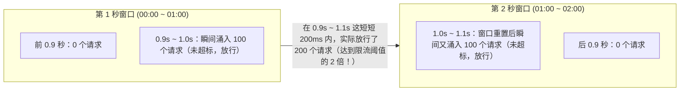
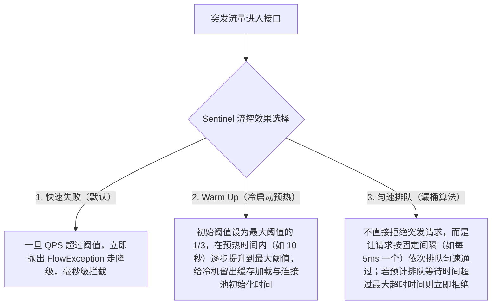
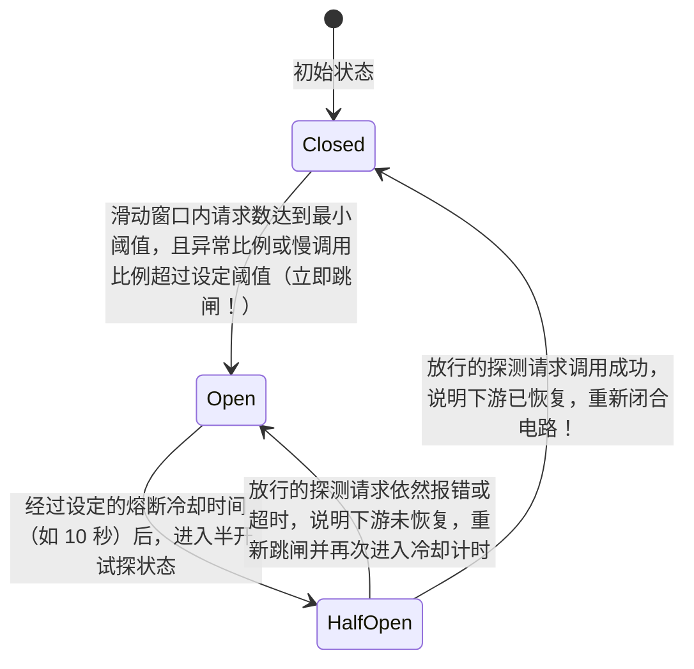

# 稳定性三板斧：限流、熔断与降级

> [!abstract] 一句话心智模型
> 在微服务长调用链中，任何一个下游次要服务变慢，都会阻塞上游服务的调用线程，进而像多米诺骨牌一样耗尽整条链路的线程池，引发全站**级联雪崩**。守护系统稳定性的核心手段有三项：**限流（在入口处拦截超出承载能力的流量洪峰，保护自己）、熔断（当下游依赖持续报错或响应过慢时主动跳闸断开调用，防止被下游拖死）、降级（在限流或熔断触发后返回有损的兜底结果，保证核心主流程走通）**。

---

## ⚡ 一、问题背景：一个次要服务变慢，是如何拖垮整个网站的？

假设我们的电商系统有一条常见的调用链：**API 网关 $\rightarrow$ 订单服务 $\rightarrow$ 积分服务 / 库存服务**。其中，订单服务使用 Tomcat 容器，默认配置了 **200 个工作线程**，既负责处理“创建订单”，也负责处理“查询订单列表”、“取消订单”等其他接口。

某天下午，最底层的**积分服务**因为数据库慢查询，原本 `20ms` 就能返回的接口，突然变成了需要 **`10 秒`** 才响应。如果没有做任何防护，灾难会在几秒钟内按以下三步爆发：

这就是分布式系统中最致命的 **级联雪崩效应（Cascading Failure）**。

要阻止这场雪崩，我们需要在系统的不同位置布设四道防线：
1. **超时与资源隔离（防线程耗尽）**：给远程调用设置严格的超时时间（如 `500ms`），并限制调用积分服务最多只能占用 20 个线程/并发槽位，绝不允许它把 200 个 Tomcat 线程全吃光。
2. **熔断（防持续卡顿）**：当发现积分服务在最近 10 秒内有一半以上的请求都超时或报错时，熔断器立刻“跳闸”，接下来 15 秒内不再向积分服务发起任何真实的网络请求，毫秒级直接放行。
3. **降级（兜底业务体验）**：熔断跳闸后，订单服务不再干等积分接口，而是直接走降级逻辑（例如把加积分任务写进消息队列稍后补偿，或者在页面显示“积分稍后到账”），让用户顺畅完成下单。
4. **限流（防外部洪峰）**：如果双十一零点外部突然涌入 10 万 QPS，而订单服务本身最高只能扛住 1 万 QPS，就直接在入口处把多出来的 9 万请求拦截掉，确保机器不被压垮。

---

## 🚦 二、第一板斧：限流（Rate Limiting）与四大经典算法

限流的核心目标是：**根据系统事先压测得出的最大承载能力（如单机 2000 QPS），对进入系统的请求速率进行限制**。工业界共有四种经典的限流算法：

### 1. 固定窗口计数器（Fixed Window）与它的“边界刺穿”缺陷
- **原理**：把时间划分为固定的窗口（例如每 1 秒为一个窗口），在窗口内维护一个计数器。每来一个请求计数器 `+1`，如果超过阈值（如 100 次/秒）就拒绝；当前 1 秒结束时，计数器清零。
- **致命缺陷（边界双倍流量刺穿）**：

如上图所示，虽然第 1 秒和第 2 秒各自都没超过 100 个请求，但在两个窗口交界的 `0.9s ~ 1.1s` 这短短 **0.2 秒** 内，系统实际上承受了 **200 个请求**（两倍于承载上限），很容易在窗口交界处把系统打挂。

---

### 2. 滑动时间窗口（Sliding Window，Alibaba Sentinel 核心统计结构）
为了解决固定窗口的边界突发问题，**滑动时间窗口**把 1 秒的大窗口进一步切分成多个更细的小格子（样本窗口，例如切分成 10 个 `100ms` 的小格子）：
- 每个小格子各自维护独立的计数器；
- 时间每往前走 `100ms`，整个 1 秒的统计框就往右平滑滑动一格（丢弃最老的那个 `100ms` 格子，纳入最新的 `100ms` 格子）；
- 每次判断当前 QPS 时，只需把**当前窗口覆盖的最近 10 个小格子的计数加起来**即可。这样无论请求卡在哪个时间点进来，任意连续 1 秒内的请求总数都绝不会超过阈值。

---

### 3. 漏桶算法（Leaky Bucket）vs 令牌桶算法（Token Bucket）

滑动窗口解决了“精准统计每秒请求数”的问题，但如果每秒限制 1000 个请求，这 1000 个请求全在第 1 毫秒同时砸进来，还是会造成瞬时毛刺。为了把流量变平滑，就有了**漏桶**和**令牌桶**：

| 对比维度 | 漏桶算法（Leaky Bucket） | 令牌桶算法（Token Bucket，Guava RateLimiter） |
| :--- | :--- | :--- |
| **核心工作原理** | 请求像水一样可以先任意倒进桶里（排队），但桶底的小孔**永远以恒定不变的速率**把水滴出去（如严格每隔 1ms 放行 1 个请求）；如果桶满了则直接拒绝新请求。 | 系统以恒定速率（如每秒 1000 个）往桶里放入令牌（桶满则不再放）；每个请求进来时必须先从桶里拿走 1 个令牌才能放行，拿不到令牌就拒绝或等待。 |
| **能否应对突发流量？** | **不能**。无论外面流量多急，流出的速度永远是一条绝对平坦的直线。 | **可以**！如果前几秒请求很少，桶里已经攒满了 1000 个令牌，当下一毫秒突然涌入 1000 个突发请求时，可以瞬间把桶里的存量令牌全拿走并立刻放行。 |
| **典型适用场景** | **保护脆弱的下游或数据库**（如调用第三方限速接口、数据库批量写入，需要把突发洪峰彻底削平，对应 Sentinel 的**匀速排队**模式）。 | **网关与微服务入口限流**（既限制长期平均速率，又允许合理范围内的瞬时并发脉冲）。 |

---

### 4. Sentinel 的三种流量控制效果（流控模式实战）

在实际使用 Alibaba Sentinel 配置限流规则时，主要通过以下三种流控效果来应对不同场景：

- **为什么要特别关注 Warm Up（冷启动预热）？**
  当一个微服务刚刚重启上线，或者在凌晨低谷期沉寂了很久之后，它处于“冷机状态”：数据库连接池还没建满、Redis 与本地缓存还没预热、JVM 的 JIT 热点代码也还没编译优化。如果一上来就直接放行满额的 5000 QPS，机器会当场卡死。开启 Warm Up 后，Sentinel 会先把限流阈值压低到约 $1/3$（如 1666 QPS），经过设定的预热时长（如 30 秒）再平滑放开到 5000 QPS，保护系统平稳度过冷启动期。

---

## 🔌 三、第二板斧：熔断器（Circuit Breaker）与三态状态机

如果说限流是“防止外部流量过大打死自己”，那么**熔断（Circuit Breaking）**就是“防止下游服务故障拖死自己”。

熔断器的设计灵感来自家里的空气开关（断路器）：当检测到下游服务频繁报错或响应极慢时，自动“跳闸”切断电路；等过了一段时间后，再试探性地放几个请求过去看看下游恢复了没有，一旦恢复就自动合上开关。

### 熔断器的三个状态与流转规则（面试高频必画）

1. **Closed（闭合状态——正常通行）**：
   - 默认初始状态。此时所有对下游的 RPC 调用都正常放行。
   - 同时，熔断器在后台利用滑动窗口实时统计调用指标：**慢调用比例**（例如响应超过 `500ms` 的请求占比）和**异常比例 / 异常数**。
2. **Open（打开状态——跳闸快速失败）**：
   - 当窗口内的总请求数达到最小统计基数（比如至少调了 20 次），且慢调用比例或异常比例超过了阈值（比如超过 50%），熔断器立刻切换到 **Open（打开）状态**。
   - 在 Open 状态下，**当前服务不会再向那个故障下游发送任何真实的网络请求**，所有调用在本地内存里耗时 0 毫秒直接报错拦截（Fast-Fail），并立即转入本地的 Fallback 降级逻辑。这既保护了自己的工作线程不被卡死，又减轻了下游服务的压力，给下游留出了宝贵的恢复时间。
3. **Half-Open（半开状态——自动探测恢复）**：
   - 跳闸后不能永远不调下游了。当经过设定的**熔断时长（例如 10 秒冷却期）**后，熔断器会自动从 Open 进入 **Half-Open（半开）状态**。
   - 此时熔断器会尝试放行极少量的**探测请求**（如放行 1 个或几个请求）去真实调用一次下游：
     - 如果探测请求**顺利返回且未超时**，说明下游服务已经恢复健康，熔断器立刻切换回 **Closed（闭合）状态**，恢复全量正常调用；
     - 如果探测请求**依然报错或超时**，说明下游还没好，熔断器立刻退回 **Open（打开）状态**，再等下一个 10 秒冷却期。

---

## 🛡️ 四、第三板斧：资源隔离（线程池隔离 vs 信号量隔离）与服务降级

### 1. 为什么要做资源隔离（舱壁模式 Bulkhead）？
就像泰坦尼克号如果底部船舱全部连通，一个舱室进水整艘船都会沉没；现代轮船会把船体分隔成多个互不相通的独立水密隔舱（Bulkhead），哪怕一个舱进水，也不会波及其他船舱。

在微服务中，如果订单服务同时依赖“商品服务”、“库存服务”、“积分服务”，我们就必须对这三个下游调用做资源隔离，防止“积分服务”变慢把“商品服务”和“库存服务”的调用线程也一起抢光。主要有两种隔离方式：

| 对比维度 | 线程池隔离（Thread Pool Isolation） | 信号量隔离（Semaphore Isolation） |
| :--- | :--- | :--- |
| **实现原理** | 为每一个下游依赖单独创建一个独立的线程池（如积分服务线程池最多 10 个线程）。主线程把调用任务丢进该线程池执行。 | 不创建新线程池，仍在原 Tomcat 线程中执行，但为每个下游接口维护一个原子计数器（如最多允许 10 个并发请求同时进入），第 11 个请求直接拒绝走降级。 |
| **核心优势** | 隔离最彻底，支持异步调用与排队缓冲；即使下游卡死，也最多只挂起那 10 个专属线程。 | **零线程切换开销**！极其轻量，没有上下文切换和额外内存消耗，性能极高。 |
| **主要缺点** | 线程数量多，频繁的跨线程上下文切换（Context Switch）会带来一定的 CPU 和内存开销。 | 不能脱离原线程异步超时中断，必须配合底层 HTTP/RPC 客户端自身的连接与读取超时设置。 |
| **代表框架** | Netflix Hystrix（早期默认）、Resilience4j ThreadPoolBulkhead | **Alibaba Sentinel（默认推荐并发线程数限流）**、Resilience4j SemaphoreBulkhead |

---

### 2. 服务降级（Fallback）的设计原则
当请求因为触发了**限流**、**熔断**或**信号量满额**而被拦截时，不能直接把一串丑陋的 `500 Internal Server Error` 异常栈甩给前端用户，而是要执行预设的**降级逻辑（Fallback）**：
1. **读接口降级**：如果查询实时推荐列表或商品评论超时，可以直接返回 Redis/本地缓存里的旧数据，或者返回一个默认的兜底热销列表。
2. **非核心写接口降级**：如果下单时调用积分服务被熔断了，降级逻辑可以将“给用户加积分”的请求写入本地数据库表或发往 MQ 消息队列，先让订单创建成功，事后再异步补发积分。
3. **核心写接口降级**：如果连核心的库存扣减或支付接口都达到了限流上限，降级逻辑必须**明确告知用户“当前抢购人数过多，请稍后重试”**（注意：像扣款、扣库存这类关键写操作，被限流或熔断时必须明确返回失败提示，绝不能在降级方法里伪造“支付成功”）。

---

## ⚡ 五、一分钟面试复盘

> [!question]- Q1：请说说限流、熔断、降级这三者分别解决什么问题？它们之间是如何配合的？
> 1. **限流（防外部洪峰，保护自己）**：守在网关或服务入口处，根据系统最大容量限制每秒进入的请求数（QPS）或最大并发数，把超出承载能力的流量提前拦在门外。
> 2. **熔断（防下游故障蔓延，保护自己与下游）**：守在调用下游微服务的客户端处，当统计到下游接口的错误率或慢调用比例超过阈值时，自动跳闸切断远程调用，防止自己的线程池被下游慢请求耗尽引发级联雪崩。
> 3. **降级（触发保护后的兜底方案）**：无论是因为触发了限流还是触发了熔断，请求被拦截后都会进入降级（Fallback）逻辑，通过返回缓存数据、默认空列表、转异步消息或返回“系统繁忙请重试”提示，保证用户体验和核心交易链路的稳定。

> [!question]- Q2：漏桶算法和令牌桶算法有什么区别？分别适合什么场景？
> 1. **漏桶算法（Leaky Bucket）**：请求先进入桶中排队，桶底永远以**固定不变的速率**向外放行请求。它的特点是**强行削平一切突发流量**，输出速率绝对恒定，非常适合用来保护下游承载能力固定、不能承受瞬时脉冲的数据库或第三方接口（对应 Sentinel 的匀速排队模式）。
> 2. **令牌桶算法（Token Bucket）**：系统以恒定速率向桶中放入令牌，请求到来时拿到令牌即可立即通过。它的特点是**既限制了长期的平均速率，又允许利用桶内积攒的存量令牌应对短时间的突发流量洪峰**，非常适合用于 API 网关或微服务入口限流。
