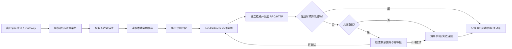
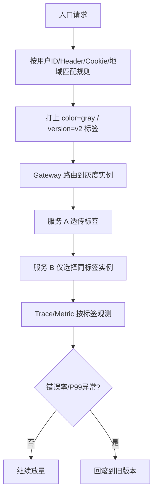
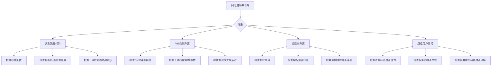

# 服务治理与负载均衡

> [!abstract] 一句话总结
> 服务治理的核心不是“让调用成功”，而是让服务发现、路由、负载均衡、超时、重试、隔离、灰度和观测形成一套可控机制，在实例抖动、版本变更、局部故障时仍能把风险锁在局部。

## 📌 精准定位

- 服务治理关注的是“调用链如何做决策”，包括发现谁、打给谁、多久超时、是否重试、何时熔断、如何灰度、怎么回滚。
- 负载均衡只是服务治理中的一个决策点，不等于服务治理全貌。
- 注册中心解决“实例列表从哪里来”，负载均衡解决“当前请求打给哪一个实例”，熔断限流解决“现在还能不能继续打”。
- 关键边界：治理可以约束失败扩散，但不能消除网络抖动、下游慢 SQL、连接池耗尽这类真实故障。
- 面试重点：不仅要会背轮询、随机、一致性哈希，更要能讲清超时预算、重试风暴、灰度发布、流量染色和故障排查路径。

## 🧩 核心概念

| 概念 | 具体含义 | 工程要点 |
| ---- | -------- | -------- |
| 服务发现 | 从注册中心获取实例列表并本地缓存。 | 注册中心挂掉后，短时间内仍可能靠本地缓存继续调用。 |
| 客户端负载均衡 | 调用方基于实例列表选择下游实例。 | Spring Cloud LoadBalancer、Dubbo Cluster 都属于此类。 |
| 服务端负载均衡 | 前面放 Nginx、LVS、SLB、Envoy 做转发。 | 适合统一入口，但看不到业务级调用语义。 |
| 超时预算 | 一次用户请求在整条链路上可消耗的时间上限。 | 必须从入口 SLA 倒推到每一跳，不能每层都配 3 秒。 |
| 重试预算 | 某次调用允许额外再试几次、在多久内再试。 | 只对幂等请求开启，且要受总 deadline 约束。 |
| 隔离 | 通过线程池、连接池、舱壁避免下游拖垮全局资源。 | 没有隔离的重试只会更快把线程打满。 |
| 灰度发布 | 新老版本按权重、人群、标签逐步放量。 | 入口灰度和服务间灰度要同时考虑。 |
| 流量染色 | 在入口给请求打标签，并沿调用链向下透传。 | 常见载体是 header、metadata、trace baggage。 |

## ⚙️ 工作原理 / 主流程



主流程拆解：

1. 入口先做认证、限流、流量染色，决定该请求属于哪一类用户、版本、租户或发布批次。
2. 调用方从本地缓存或注册中心订阅结果中拿到实例列表。
3. 路由规则先做过滤，例如只选同地域、同机房、同灰度标签实例。
4. 负载均衡策略再从候选实例中选一个，常见策略包括轮询、加权、最少活跃、一致性哈希。
5. 调用受超时预算约束，若失败再决定是否重试、是否熔断、是否降级。
6. 全过程必须打指标和日志，否则“治理规则生效了什么”根本看不见。

## 🧠 负载均衡策略对比

| 策略 | 适用场景 | 优点 | 风险点 |
| ---- | -------- | ---- | ------ |
| Round Robin 轮询 | 实例能力接近、请求成本接近 | 简单稳定 | 长连接、慢请求会让实际流量不均 |
| Random 随机 | 实例数量多、希望简单分散 | 实现简单 | 短时间波动可能较大 |
| Weighted 权重 | 机器规格不同、灰度放量 | 能表达实例能力差异 | 权重变更不代表长连接立刻切流 |
| Least Active 最少活跃 | 请求耗时差异大 | 更贴近当前负载 | 活跃数统计不准会误判 |
| Consistent Hash 一致性哈希 | 本地缓存、会话粘性、分片路由 | 命中稳定 | 实例上下线会引起局部抖动 |
| Zone/AZ Aware | 多机房多可用区 | 优先就近、降低跨区成本 | 单区过载时要允许回退 |

面试表达要点：

- “最均匀”不等于“最合适”，要看请求耗时、连接复用、实例异构、机房拓扑。
- 如果请求是长连接或流式处理，轮询通常不够好。
- 如果服务有本地缓存，优先考虑一致性哈希，否则缓存命中率会抖。
- 如果做灰度发布，权重只是第一步，还要配合流量染色和观测回滚。

## ⏱️ 超时预算与重试预算

### 预算分配思路

假设用户侧 SLA 是 1500ms，调用链是：

```text
Gateway -> order-service -> inventory-service -> db/cache
```

可以这样拆：

- Gateway 接入与转发：100ms
- order-service 业务处理：250ms
- inventory-service 调用预算：400ms
  - connect timeout：50ms
  - read timeout：250ms
  - 预留抖动：100ms
- 失败后的单次重试预算：最多再给 250ms
- 剩余时间给日志落盘、序列化、尾部抖动和前端网络

### 工程原则

- 先有总 deadline，再有每一跳 timeout，不能反过来拍脑袋配默认值。
- connect timeout 一般远小于 read timeout，因为连不上通常比读超时更快失败。
- 重试不能突破总 deadline，否则用户已经超时，服务还在后台重试。
- 同一条调用链最好只有一层做重试，典型是边缘层或最靠近失败点的一层。
- 非幂等接口默认不重试；要重试就必须有幂等键、去重表或业务幂等保障。

## 🌗 灰度发布与流量染色



### 流量染色常见做法

- 在入口网关写入 `X-Traffic-Color`、`X-Canary-Version` 等 header。
- 在服务间调用中透传 header 或把标签写进 trace baggage。
- 在注册中心实例 metadata 中标记版本、机房、租户、灰度组。
- LoadBalancer 先按 metadata 过滤，再按权重选择。

### 容易踩的坑

- 只在网关做灰度，服务 A 调服务 B 时没有继续透传标签，结果链路中途“串色”。
- 只按权重发流量，没有观察灰度分组的单独错误率和 P99。
- 定时任务、MQ 消费、补偿任务没有灰度隔离，导致老版本和新版本写同一批数据。
- 使用长连接或本地连接池时，权重调整后旧连接仍持续打旧实例。

## 💻 代码 / 配置 / 伪代码

```yaml
spring:
  cloud:
    openfeign:
      client:
        config:
          inventory-service:
            connectTimeout: 50
            readTimeout: 250
resilience4j:
  retry:
    instances:
      inventory:
        maxAttempts: 2
        waitDuration: 30ms
  timelimiter:
    instances:
      inventory:
        timeoutDuration: 400ms
```

```java
public ProductStock queryStock(String skuId, String trafficColor) {
    Deadline deadline = Deadline.afterMillis(400);
    List<ServiceInstance> candidates = discovery.pickByMetadata("inventory-service", "color", trafficColor);
    ServiceInstance target = loadBalancer.choose(candidates);
    return retryIfIdempotent(
        deadline,
        1,
        () -> inventoryClient.queryStock(target, skuId)
    );
}
```

## 🛠️ 工程案例：订单服务调用库存服务

场景：

- 大促期间 `order-service` 调 `inventory-service` 做扣减前校验。
- `inventory-service` 有 20 台实例，其中 2 台是新版本，准备放 5% 灰度流量。
- 用户端下单接口 SLA 是 1.5 秒。

落地设计：

1. Gateway 按白名单用户和 header 打灰度标签。
2. `order-service` 接到标签后透传给 `inventory-service`。
3. LoadBalancer 先过滤 `color=gray` 实例，再做权重分流。
4. `inventory-service` 超时预算 400ms，只允许 1 次快速重试。
5. 超时和错误率异常时，Resilience4j 熔断并回退为“库存确认中，请稍后重试”。
6. 监控拆成全量、灰度、实例三个维度看成功率和 P99。

为什么这样设计：

- 灰度必须是整条调用链一致，而不是某一跳单独切。
- 大促下最怕重试风暴，因此重试次数极低，且受 deadline 约束。
- 扣库存前校验可以重试，但真正扣减动作要依赖幂等单号，不能无脑重放。

## ⚠️ 常见故障图谱



## ⚠️ 生产坑与注意事项

- 每层都配重试，三层各 3 次，实际可能放大成 27 次请求。
- 超时配置只看单跳，不看整条链路预算，最终用户早已超时，系统还在忙重试。
- 健康检查只看端口存活，实例虽然“活着”，但线程池、DB 连接池已经耗尽。
- 实例 metadata 没统一规范，灰度、机房、租户标签混乱，路由规则不可维护。
- 连接池长时间复用导致权重调整后流量迁移慢，误以为负载均衡没生效。
- 一致性哈希 key 选得不好，例如按热点商家 ID 路由，导致单实例过热。
- 注册中心摘除实例有延迟，客户端本地缓存又有 TTL，坏实例会被短时间继续命中。

## 🧭 排查路径

### 1. 流量为什么不均

- 先看实例维度 QPS、连接数、活跃请求数、P99。
- 再看负载策略：是轮询、权重还是一致性哈希。
- 检查连接池是否复用过久，特别是 HTTP keep-alive、gRPC 长连接。
- 如果有热点用户或热点 key，看是否被一致性哈希固定到了某几台实例。

### 2. 调用为什么突然变慢

- 拆开看：DNS、建连、TLS、连接池等待、下游处理、序列化、重试耗时。
- 看 timeout 是否合理，是否出现“单次调用没超时，但整条链路超时”。
- 看是否某一层新增了重试，导致尾延迟被放大。
- 结合 trace 判断是网关慢、服务慢还是 DB/缓存慢。

### 3. 为什么故障会扩散

- 看是否缺少隔离：线程池、连接池、Bulkhead 是否拆分。
- 看重试是否在多个层级同时开启。
- 看熔断是否打开得太晚，或者根本没有熔断。
- 看失败返回是否还能继续占住业务线程，比如同步等待 fallback 远程结果。

### 4. 灰度为什么出问题

- 用 traceId 逐跳核对标签是否传递。
- 查 Gateway、Feign、MQ 消费者是否都保留了流量标签。
- 看灰度实例容量是否足够，是否只是版本对了但资源不足。
- 看回滚策略是否是改权重、摘标签还是直接摘实例。

## 🎯 面试问题

> [!question] 高频问题
> - Q: 负载均衡策略如何选？
>   - A: 先看请求成本是否均匀，再看是否需要会话粘性、缓存命中、机房优先和灰度权重；轮询不是默认最优。
> - Q: 为什么说重试很危险？
>   - A: 它会放大流量、放大尾延迟、放大线程占用；如果是非幂等请求，还会带来重复副作用。
> - Q: 超时预算怎么设计？
>   - A: 从用户 SLA 倒推总 deadline，再拆到网关、服务、下游，每层 timeout 和 retry 都不能突破总预算。
> - Q: 灰度发布为什么要流量染色？
>   - A: 因为灰度不是入口一次路由就结束，服务间调用、MQ、定时任务都要知道请求属于哪一批流量。
> - Q: 注册中心摘除了坏实例，为什么调用还会打过去？
>   - A: 因为客户端本地缓存、长连接复用和摘除传播延迟都可能让旧实例短时间继续被命中。

## 🎤 面试 3 层回答

### 30 秒版

服务治理是把服务发现、负载均衡、超时、重试、熔断、灰度和观测串起来，让调用链在故障和发布时可控。面试里我会重点讲超时预算、重试风暴和流量染色，而不是只背几个负载均衡算法名字。

### 2 分钟版

一次请求真正落到哪个实例，不只是轮询一下这么简单。调用方先从注册中心拿实例列表，再按机房、版本、灰度标签过滤候选实例，然后用轮询、权重或一致性哈希选一个目标实例。调用时还要受总 deadline 约束，失败后只有幂等请求才能有限重试，而且重试不能层层叠加，否则就会出现重试风暴。灰度发布也不能只在网关做一次路由，而要通过流量染色把标签透传到整条调用链，并单独观察灰度流量的成功率和延迟。

### 项目版

在电商下单链路里，我做过 `order-service -> inventory-service` 的治理。大促时库存服务抖动，原来 Feign 和业务层都开了重试，导致下游被打爆。我把策略改成从用户 SLA 倒推预算：库存调用 400ms，只允许 1 次快速重试，非幂等扣减禁止自动重放；同时按 header 做流量染色，让灰度用户全链路都进新版本库存实例。之后成功率稳定很多，而且灰度问题能通过 trace 很快定位到是哪一跳串色或超时。

## ✅ 精通检查清单

- 能区分注册发现、负载均衡、超时、重试、熔断、灰度各自职责。
- 能说出不同负载均衡策略适用场景和反例。
- 能从用户 SLA 倒推出超时预算与重试预算。
- 能解释灰度发布为什么必须配合流量染色和可观测。
- 能结合真实故障说明流量倾斜、重试风暴、串色灰度的排查过程。

## 🔗 关联笔记

- [[_index]]
- [[20-Java后端/00-总览/学习仪表盘]]
- [[06-限流-熔断-降级]]
- [[08-链路追踪]]
- [[../06-中间件/06-API网关]]
- [[../06-中间件/04-注册中心-Nacos]]
- [[../04-Spring生态/08-SpringCloud组件概览]]

## 📚 参考资料

- Spring Cloud LoadBalancer Reference
- Resilience4j Documentation
- Nacos Discovery Documentation
- Envoy Load Balancing Overview
