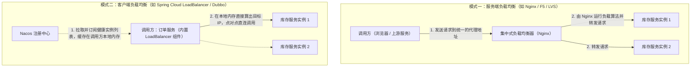
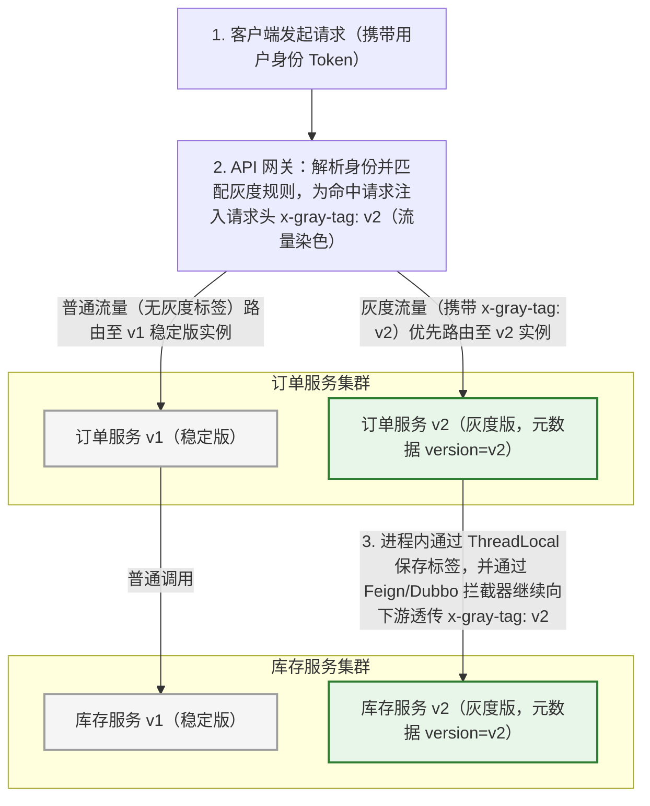

# 服务治理、负载均衡与全链路灰度发布

> [!abstract] 一句话心智模型
> 微服务多实例部署后，调用方需要通过**注册中心**动态感知可用节点，并通过**负载均衡器**将请求合理分发到不同实例上。日常流量分发依赖**平滑加权轮询、最小活跃数、一致性哈希**等算法；而在新版本上线验证时，则通过**网关入口流量染色 + 全链路上下文透传 + 负载均衡标签过滤**，实现平滑安全的全链路灰度发布。

---

## ⚖️ 一、服务端负载均衡 vs 客户端负载均衡

当订单服务需要调用库存服务，而库存服务部署了 10 台机器时，“到底由谁来决定把这次请求发给哪台机器？”根据决策位置的不同，分为两种架构模式：



| 对比维度 | 服务端负载均衡（Nginx / HAProxy） | 客户端负载均衡（Spring Cloud LoadBalancer / Dubbo） |
| :--- | :--- | :--- |
| **负载算法运行在哪里？** | 运行在独立的**中间代理服务器（如 Nginx）**上，调用方不知道后端真实有几台机器。 | 直接运行在**调用方微服务自己的 JVM 进程内存**中。 |
| **网络通信路径** | 调用方 $\rightarrow$ Nginx $\rightarrow$ 目标服务（**多经过一次中间代理转发**）。 | 调用方 $\rightarrow$ 目标服务（**点对点直连通信，少一次网络转发开销**）。 |
| **典型适用场景** | **外部南北向流量入口**（用户浏览器/App 请求先打到机房入口的 Nginx 或 API 网关）。 | **集群内部东西向微服务互调**（微服务 A 频繁调用微服务 B，配合注册中心实现直连负载均衡）。 |

---

## 🧮 二、五大核心负载均衡算法推导与适用场景

客户端拿到下游服务的健康实例列表后，该怎么挑机器？以下是工业界最常用的五种负载均衡算法：

### 1. 轮询（Round Robin）与加权轮询（Weighted Round Robin）
- **普通轮询**：维护一个递增计数器，每次按实例数量取模（`index = count++ % size`），依次按 `A -> B -> C -> A -> B -> C` 的顺序轮流分发。适合所有机器硬件配置完全一致的场景。
- **为什么要加权？** 生产环境中常有新老机器混布（例如机器 A 是 16 核高配机，机器 B 和 C 是 4 核低配机）。为了不让低配机累死、高配机闲死，我们给高配机配置更高的权重（如 `A:5, B:1, C:1`），让高配机承担更多流量。

---

### 2. 平滑加权轮询（Smooth Weighted Round Robin —— Nginx 与 Dubbo 核心算法）

#### 为什么不能用“简单加权轮询”？
假设三台机器的权重是 **`A = 5, B = 1, C = 1`**（总权重 `total = 7`）。
- 如果是**简单加权轮询**，前 5 个请求会连续全部打给 A，顺序是：**`A, A, A, A, A, B, C`**。
- **问题所在**：虽然从 7 次请求的总数来看 A 确实分到了 5 次，但这 5 次请求是**扎堆连续砸在 A 头上的**！在高并发下，这种脉冲式的连续轰炸很容易造成机器 A 的 CPU 和响应时间出现瞬时毛刺。

#### 平滑加权轮询是如何把流量打散成 `A, A, B, A, C, A, A` 的？
Nginx 和 Dubbo 采用的**平滑加权轮询算法**，为每个节点维护两个变量：
1. **`weight`（固定配置权重）**：机器配置的固定比例，始终不变（`A=5, B=1, C=1`，总权重 `totalWeight = 7`）；
2. **`currentWeight`（当前动态权重）**：初始值全部为 `0`，每来一个请求就按以下**三步口诀**动态调整：
   - **第一步（全员加固定权重）**：每个节点的 `currentWeight = currentWeight + weight`；
   - **第二步（选当前最大者）**：挑出当前 `currentWeight` **最大的那个节点**，作为本次处理请求的节点；
   - **第三步（选中者减总权重）**：把刚才被选中的那个节点的 `currentWeight = currentWeight - totalWeight`（减去所有节点固定权重之和 `7`），其他没被选中的节点保持不变。

我们用表格一步步推演前 7 次请求的完整计算过程，一看就懂：

| 请求轮次 | 第一步：全员加上各自的固定权重 `(5, 1, 1)` | 第二步：选出当前最大值（本次命中节点） | 第三步：命中节点减去总权重 `7` 后的结果 |
| :---: | :---: | :---: | :---: |
| **初始状态** | — | — | `(0, 0, 0)` |
| **第 1 次** | `(0+5, 0+1, 0+1)` = **`(5, 1, 1)`** | 最大值是 5 $\rightarrow$ **选中 A** | `(5-7, 1, 1)` = **`(-2, 1, 1)`** |
| **第 2 次** | `(-2+5, 1+1, 1+1)` = **`(3, 2, 2)`** | 最大值是 3 $\rightarrow$ **选中 A** | `(3-7, 2, 2)` = **`(-4, 2, 2)`** |
| **第 3 次** | `(-4+5, 2+1, 2+1)` = **`(1, 3, 3)`** | 最大值是 3 $\rightarrow$ **选中 B** | `(1, 3-7, 3)` = **`(1, -4, 3)`** |
| **第 4 次** | `(1+5, -4+1, 3+1)` = **`(6, -3, 4)`** | 最大值是 6 $\rightarrow$ **选中 A** | `(6-7, -3, 4)` = **`(-1, -3, 4)`** |
| **第 5 次** | `(-1+5, -3+1, 4+1)` = **`(4, -2, 5)`** | 最大值是 5 $\rightarrow$ **选中 C** | `(4, -2, 5-7)` = **`(4, -2, -2)`** |
| **第 6 次** | `(4+5, -2+1, -2+1)` = **`(9, -1, -1)`** | 最大值是 9 $\rightarrow$ **选中 A** | `(9-7, -1, -1)` = **`(2, -1, -1)`** |
| **第 7 次** | `(2+5, -1+1, -1+1)` = **`(7, 0, 0)`** | 最大值是 7 $\rightarrow$ **选中 A** | `(7-7, 0, 0)` = **`(0, 0, 0)`**（回到初始状态！） |

看最终选出的序列：**`A -> A -> B -> A -> C -> A -> A`**！
不仅严格保证了每 7 次请求里 A 处理 5 次、B 处理 1 次、C 处理 1 次，而且把 B 和 C 巧妙地穿插在了 A 之间，消除了连续请求扎堆的问题，第 7 轮结束后所有权重又刚好归零，进入下一个循环。

---

### 3. 随机（Random）与加权随机（Weighted Random）
- **原理**：假设三个节点权重为 `A=5, B=1, C=1`（总长 7），把它们看作数轴上的三段区间：`[0, 5)` 属于 A，`[5, 6)` 属于 B，`[6, 7)` 属于 C。每次生成一个 `[0, 7)` 之间的随机数，落在哪段区间就选哪个节点。
- **适用场景**：实现极其简单，无状态，在请求基数很大时，根据概率大数定律，各机器分到的流量比例完全符合权重设定。

### 4. 最小活跃调用数（Least Active）
- **原理**：在客户端本地记录当前发给每一台下游实例、但**还没收到响应的“正在处理中（Active）的请求数量”**。每次来新请求时，优先挑选当前正在处理的请求数**最少**的那台机器。
- **为什么它特别聪明？** 如果某台下游机器因为垃圾回收（GC）或网络抖动变慢了，发给它的请求迟迟不返回，这台慢机器的“活跃调用数”就会迅速堆积变大；于是负载均衡器就会**自动减少甚至停止往这台慢机器发请求**，把流量导向反应更快的健康机器，实现动态自适应调优。

### 5. 一致性哈希（Consistent Hash）
- **原理**：将整个哈希空间组织成一个 $0 \sim 2^{32}-1$ 的闭合圆环（哈希环），把各个服务实例（结合虚拟节点）分散映射到环上。当请求到来时，提取请求中的关键业务参数（如 `userId` 或 `shopId`）计算哈希值，顺时针找到环上的第一个节点进行路由。
- **适用场景**：需要**有状态路由或提高本地缓存（Caffeine/Guava Cache）命中率**的场景——确保同一个用户或同一个商家的请求永远打到同一台机器上；当某台机器上下线时，借助虚拟节点机制，只影响哈希环上相邻的一小部分数据，不会导致全网缓存大面积失效。

---

## 🎨 三、微服务全链路灰度发布与“流量染色（Traffic Coloring）”

### 1. 什么是全链路灰度发布？为什么需要它？
假设我们的系统有 **网关 $\rightarrow$ 订单服务 $\rightarrow$ 库存服务** 这条链路。线上原本每个服务都跑着 10 台稳定的 `v1` 版本机器。

现在我们开发了新功能，准备同时上线订单服务的 `v2` 版和库存服务的 `v2` 版。为了稳妥起见，我们先只部署 **1 台订单服务 `v2`** 和 **1 台库存服务 `v2`**（这就是**金丝雀/灰度实例**），希望**只让公司内部测试人员（或者尾号为 88 的 5% 用户）全程走 `v2` 新版本链路，而其余 95% 的正常用户全程走稳定的 `v1` 老版本链路**。

如果不在整条链路上做统一协调，就会发生错乱：网关好不容易把内测用户的请求发给了“订单服务 `v2`”，结果“订单服务 `v2`”在用负载均衡调库存服务时，按普通轮询把请求发给了“库存服务 `v1`”，导致灰度测试失效！

为了保证**“带灰度标记的流量，在整条调用链的每一跳都精准命中 `v2` 灰度节点”**，工业界普遍采用 **流量染色（Traffic Coloring）** 方案。

---

### 2. 全链路灰度发布的完整工作流程（三步闭环）



要实现上图中的全链路灰度，只需要在架构中打通以下三个环节：

#### 第一步：实例打标与网关入口“流量染色”
1. **服务实例注册元数据**：在部署灰度机器时，在 Nacos 注册配置中给该实例加上版本元数据标签，例如：`spring.cloud.nacos.discovery.metadata.version=v2`（普通机器为 `v1`）。
2. **网关入口染色**：所有外部请求先经过 API 网关（如 Spring Cloud Gateway）。网关首先清理掉外部请求可能自带的同名伪造 Header，然后根据登录用户的 `userId`、手机号尾号或地域规则进行匹配。一旦命中灰度规则，网关就在转发的 HTTP 请求头中注入染色标签：`x-gray-tag: v2`。

#### 第二步：服务内部持有与跨服务“标签透传”
当“订单服务 `v2`”收到网关传来的请求后，怎么保证它待会儿调“库存服务”时还能把这个 `x-gray-tag: v2` 传下去？
1. **接力第一棒（Servlet 拦截器存入 ThreadLocal）**：订单服务收到 HTTP 请求时，通过一个全局 `HandlerInterceptor` 从请求头里取出 `x-gray-tag`，存入当前线程的 `ThreadLocal`（若内部使用了异步线程池，则使用阿里的 `TransmittableThreadLocal` 跨线程传递），并在请求结束的 `afterCompletion`（`finally` 块）中及时调用 `remove()` 清理，防止线程复用导致标签串号。
2. **接力第二棒（RPC 拦截器写入下游请求头）**：当订单服务通过 OpenFeign 或 Dubbo 调用库存服务时，通过注册一个全局的 `RequestInterceptor`，自动把 `ThreadLocal` 里的染色标签取出来，塞进发往下游的请求头里：

```java
@Component
public class GrayFeignRequestInterceptor implements RequestInterceptor {
    @Override
    public void apply(RequestTemplate template) {
        // 从当前线程上下文取出灰度染色标签
        String grayTag = GrayContextHolder.getGrayTag();
        if (StringUtils.hasText(grayTag)) {
            // 自动注入到发往下游微服务的 HTTP Header 中
            template.header("x-gray-tag", grayTag);
        }
    }
}
```

*(注：如果链路中间经过了 RocketMQ / Kafka 消息队列，同样在发送消息时把 `x-gray-tag` 写入 Message 的 UserProperty 属性中，消费者消费时再取出来放进自己的 `ThreadLocal`，就能实现包含 MQ 在内的全链路灰度。)*

#### 第三步：负载均衡器按标签路由与兜底回退
在客户端负载均衡器（如自定义的 `ReactorServiceInstanceLoadBalancer`）挑选下游实例时：
1. 如果当前请求带有 `x-gray-tag: v2`，负载均衡器就从注册中心拉取的实例列表中，筛选出元数据 `version == v2` 的灰度实例进行调用；
2. 如果当前请求没有灰度标签，则只从 `version == v1` 的稳定版实例中挑选，绝不误入灰度机器；
3. **优雅兜底回退**：假设这次发版只改了订单服务（有 `v2`），而下游的库存服务根本没改代码（只有 `v1` 稳定版，没有部署 `v2` 实例）。当灰度流量从订单服务 `v2` 调库存服务时，负载均衡器发现库存服务没有 `v2` 节点，就会自动回退（Fallback）去调用库存服务的 `v1` 稳定版节点，从而无需为了灰度一个服务而把全公司几十个微服务全都额外部署一遍！

---

## ⚡ 四、一分钟面试复盘

> [!question]- Q1：请解释 Nginx / Dubbo 中的“平滑加权轮询”算法是如何工作的？它解决了什么问题？
> 1. **解决的问题**：在普通加权轮询中，如果节点权重配置悬殊（如 `A=5, B=1, C=1`），前 5 个请求会连续扎堆打到节点 A 上，导致节点 A 承受瞬时流量洪峰。平滑加权轮询可以将请求均匀穿插打散（变为 `A, A, B, A, C, A, A`）。
> 2. **核心三步逻辑**：每个节点维护固定权重 `weight` 和动态权重 `currentWeight`（初始为 0）。每次挑选节点时：
>    - **第一步**：所有节点的 `currentWeight` 加上各自的固定 `weight`；
>    - **第二步**：选出当前 `currentWeight` 值最大的节点作为本次选中的目标节点；
>    - **第三步**：将选中节点的 `currentWeight` 减去所有节点的固定权重总和（`totalWeight`），其余节点保持不变。

> [!question]- Q2：在微服务架构中，如何实现“全链路灰度发布”？
> 全链路灰度发布的核心是 **“实例打标 + 入口流量染色 + 全链路上下文透传 + 负载均衡路由过滤”**：
> 1. **实例打标**：灰度发布的机器在向 Nacos 注册时，携带版本元数据（如 `version=v2`）。
> 2. **网关入口染色**：API 网关根据用户 ID、手机号或灰度比例规则识别灰度请求，在 HTTP Header 中打上染色标记（如 `x-gray-tag: v2`）。
> 3. **全链路标签透传**：微服务收到请求后，通过 MVC 拦截器将染色标记存入 `ThreadLocal`（跨线程池用 `TransmittableThreadLocal`，请求结束在 `finally` 中清理）；在通过 Feign/Dubbo 调用下游或发送 MQ 消息时，通过拦截器自动将该染色标记写入下游请求头或消息头中，一路向下传递。
> 4. **负载均衡按标路由与回退**：各服务的客户端负载均衡器根据染色标记优先匹配同版本的实例；若某个下游服务未部署灰度实例，则自动降级回退到稳定版实例，保证整条链路既能精准隔离测试，又无需全量额外部署所有依赖服务。
