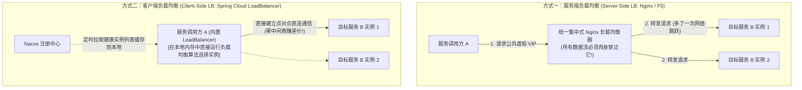
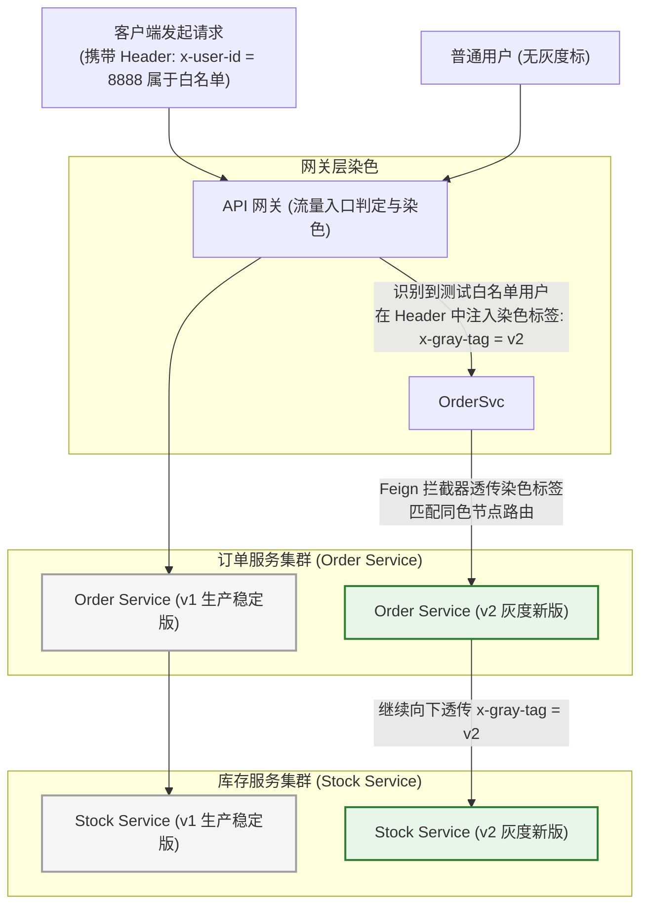

# 服务治理与负载均衡

> [!abstract] 一句话心智模型
> 如果把微服务调用比作**庞大交通网络中的市民出行打车**：
> - **服务端负载均衡（Nginx / F5）** 是**市中心的统一大客运站**：所有乘客必须先乘车到大客运站，由客运站保安手动把你分流到不同的大巴上（多跑了一趟冤枉路，存在单点瓶颈）；
> - **客户端负载均衡（Spring Cloud LoadBalancer / Ribbon）** 是**手机上的高德滴滴打车软件**：乘客在自己手机上直接查阅周围空闲出租车列表（从 Nacos 拉取），自己在手机里运行智能算法挑选一辆最优出租车直奔目的地（少走一跳网络，性能极高）；
> - **全链路流量染色（Traffic Coloring 灰度发布）** 是**贵宾专属的绿色车牌通行证**：从网关开始给请求打上金标，一路跨越十几个微服务，所有司机见到金标均优先引导驶入 VIP 专属高速车道（v2 灰度集群），与普通车流（v1 生产集群）物理隔离、秋毫无犯！

---

## ⚖️ 一、服务端负载均衡 vs 客户端负载均衡

在分布式微服务架构中，“在何处做负载均衡决策”是根本性的架构分水岭：



| 对比维度 | 服务端负载均衡（Nginx / L4 / L7） | 客户端负载均衡（Spring Cloud LoadBalancer） |
| :--- | :--- | :--- |
| **负载均衡算法执行位置** | 运行在独立的**中间硬件或代理服务器（Nginx）**上 | 直接运行在**调用方进程的本地 JVM 堆内存**中 |
| **网络数据流转路径** | 客户端 -> Nginx -> 服务端（**经过 2 次网络 I/O 跳跃**） | 客户端 -> 服务端（**点对点 1 次直达，网络开销最低**） |
| **服务实例感知方式** | 依赖 Nginx 配置文件手动维护，或通过 OpenResty 插件对接注册中心 | 客户端直接订阅 Nacos 注册中心，**实例动态扩缩容秒级无感感知** |
| **典型代表技术** | F5 硬件负载、LVS、Nginx、HAProxy | **Spring Cloud LoadBalancer**、Netflix Ribbon、gRPC 客户端负载 |

---

## 🧮 二、五大经典负载均衡算法底层数学逻辑

### 1. 轮询算法（Round Robin）
- **逻辑**：一个原子递增计数器 `AtomicInteger.getAndIncrement()`，每次调用对健康实例数求模：`index = count % size`。
- **优缺点**：绝对均匀；但忽略了不同机器硬件性能的差异（8C16G 与 2C4G 承担了一模一样的流量）。

### 2. 随机与加权随机（Weighted Random）
- **逻辑**：根据机器性能为节点分配权重（如节点 A 权重 10，节点 B 权重 20，总权重 30）。在 $[0, 30)$ 区间生成一个随机数，落在谁的权重区间就选谁。
- **优缺点**：在大样本并发下，实际分担比例非常贴近权重设定。

---

### 3. 平滑加权轮询（Smooth Weighted Round Robin，Nginx / Dubbo 王牌算法）

很多简单的加权轮询有一个致命痛点：**流量会聚团轰炸！**
- 假设有三个节点：A(权重5)、B(权重1)、C(权重1)。简单轮询会连续将 5 个请求全部打给 A，然后才给 B 和 C 一次机会。**这 5 个连续请求可能会直接把 A 机器打出瞬时毛刺甚至打死！**
- **Nginx 平滑加权轮询的破局数学推导**：
  - 每个节点维护两个权重：`weight`（固定配置权重）和 `current_weight`（动态变化权重，初始为 0）。
  - **每一轮选择三步走**：
    1. 所有节点的 `current_weight` 加上各自的固定 `weight`；
    2. 挑选出当前 `current_weight` **最大的节点**作为本次被选中的幸运儿；
    3. 将被选中的那个节点的 `current_weight` **减去所有节点的权重之和（totalWeight）**！

```text
三节点初始配置：A(5), B(1), C(1)，总权重 = 7

【第 1 轮】：
1. 加自身权重：A=5, B=1, C=1
2. 选最大者：选中 A！
3. 减去总权重：A = 5 - 7 = -2。此时三者为：A=-2, B=1, C=1

【第 2 轮】：
1. 加自身权重：A=-2+5=3, B=1+1=2, C=1+1=2
2. 选最大者：选中 A！
3. 减去总权重：A = 3 - 7 = -4。此时三者为：A=-4, B=2, C=2

【第 3 轮】：
1. 加自身权重：A=-4+5=1, B=2+1=3, C=2+1=3
2. 选最大者：B 和 C 都是 3，按顺序选中 B！
3. 减去总权重：B = 3 - 7 = -4。此时三者为：A=1, B=-4, C=3

【第 4 轮】：
1. 加自身权重：A=1+5=6, B=-4+1=-3, C=3+1=4
2. 选最大者：选中 A！
3. 减去总权重：A = 6 - 7 = -1。此时三者为：A=-1, B=-3, C=4

【第 5 轮】：
1. 加自身权重：A=-1+5=4, B=-3+1=-2, C=4+1=5
2. 选最大者：选中 C！
3. 减去总权重：C = 5 - 7 = -2。此时三者为：A=4, B=-2, C=-2
...
最终 7 轮的选择序列是：A -> A -> B -> A -> C -> A -> A！
```
- **核心收益**：**A 节点的 5 次请求被极其丝滑地均匀打散穿插在 B 和 C 之间！** 彻底消除了突发聚合毛刺！

---

### 4. 最小活跃调用数（Least Active）
- **第一性原理**：一个节点当前处理中的在途请求数越少，说明它的响应速度越快、性能越充沛！
- 优先将新请求分配给当前在途数最少的节点，**天然具备慢机自动绕道躲避能力**！

### 5. 一致性哈希（Consistent Hash）
- 将相同的业务 Key（如 `userId` 或 `orderId`）通过哈希环锁定路由到某一台固定的机器。
- **巨大收益**：极大提升该机器本地堆缓存（L1 Caffeine）的命中率，热点请求在本地直接消化。

---

## 🎨 三、全链路灰度发布与“流量染色（Traffic Coloring）”

在不停机发布新版本时，如何实现：**让测试人员或指定 10% 的内测用户访问包含全链路 v2 的新系统，而其他 90% 的普通用户完全不受干扰地走稳定老版本 v1？**



### 全链路透传（Context Propagation）工业实现两大关键：
1. **进程内传递（ThreadLocal / TransmittableThreadLocal）**：
   - 请求刚进入 Spring Boot，在 Filter 中从 HTTP 请求头提取 `x-gray-tag`，放入当前线程的 `ThreadLocal` 中；如果涉及异步多线程线程池，必须使用阿里开源的 **`TransmittableThreadLocal (TTL)`** 保证父子线程上下文不丢失！
2. **跨进程 RPC 透传（Feign RequestInterceptor）**：
   - 当微服务 A 准备通过 OpenFeign 调用微服务 B 时，必须注册一个全局请求拦截器：
     ```java
     @Component
     public class FeignGrayInterceptor implements RequestInterceptor {
         @Override
         public void apply(RequestTemplate template) {
             String grayTag = GrayContext.get(); // 从 ThreadLocal 中取出当前线程的染色标
             if (StringUtils.hasText(grayTag)) {
                 // 自动塞入下一个 HTTP 请求的 Header 中，一路向后传递！
                 template.header("x-gray-tag", grayTag);
             }
         }
     }
     ```
3. **负载均衡筛选器（Custom LoadBalancer）**：
   - 客户端负载均衡器在挑选实例时，读取当前请求的 `x-gray-tag`，**只在 Nacos 中匹配那些打了相同元数据标签（`metadata.version = v2`）的实例**！实现全链路闭环路由！

---

## ⚡ 一分钟面试必杀卡

> [!question]- Q1：客户端负载均衡相比服务端负载均衡有什么核心优势？
> 1. **网络链路更短、无单点瓶颈**：服务端负载均衡（如 Nginx）要求所有客户端的数据流都必须物理流经代理服务器，存在二次网络 I/O 延迟和代理集群的带宽瓶颈；客户端负载均衡直接在调用方的本地内存中运行选址算法，点对点直连发起 RPC 调用，延迟最低。
> 2. **微服务深度集成与智能路由**：客户端直接订阅注册中心，能秒级感知实例的上下线；同时能结合请求上下文、服务元数据（如机房同区域优先、全链路灰度版本标签）实现极其精细化的应用层路由。

> [!question]- Q2：什么是微服务全链路灰度发布？它是如何实现的？
> - 全链路灰度发布是指在微服务多级调用链中，让指定特征的用户流量一路精准经过各个微服务的灰度版本，而普通流量走稳定版本。
> - **核心实现原理（流量染色）**：
>   1. **入口染色**：在 API 网关处根据用户 ID、IP 或规则，为命中的灰度请求在 Header 中植入染色标记（如 `x-gray-tag: v2`）。
>   2. **全链路透传**：在微服务内部借助 `ThreadLocal` 保持上下文，在跨服务调用（如 Feign/Dubbo）时通过请求拦截器将染色标记自动透传到下游 HTTP Header 中。
>   3. **路由匹配**：重写微服务客户端负载均衡器，在选择目标实例时，优先匹配 Nacos 元数据中携带相同 `version: v2` 的实例，保证该请求全程只在灰度环境流转。