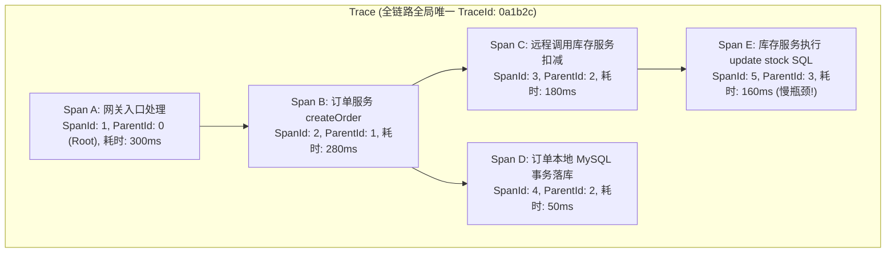
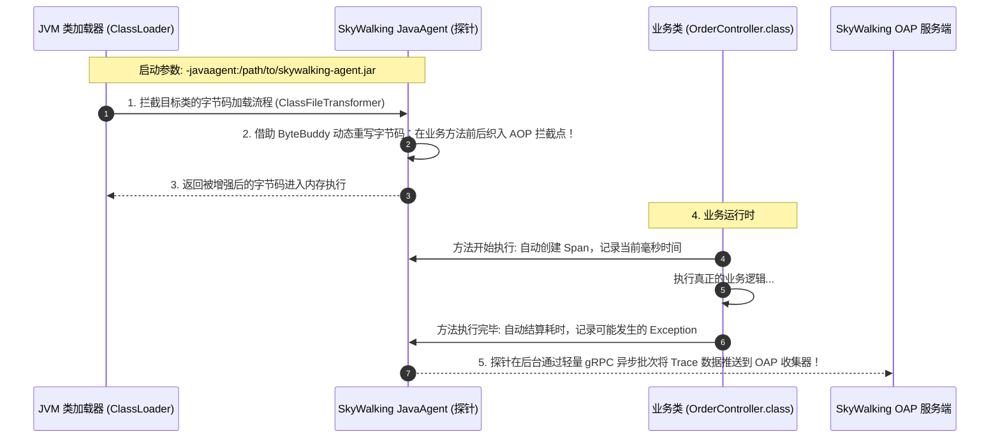
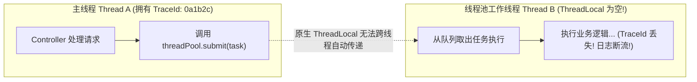
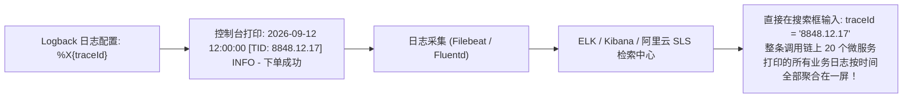

# 分布式链路追踪与 APM 监控

> [!abstract] 一句话心智模型
> 如果把一次用户点击下单比作**一份从北京发往全球的特快专递包裹**：
> - **没有链路追踪时（盲人摸象）**：包裹在途耗时 3 天，中间路过公路转运、海关、航空仓储、末端派送。客户投诉“太慢了”，没有任何一个部门认账，排障如同大海捞针；
> - **分布式链路追踪（APM: SkyWalking / OpenTelemetry）** 就是**包裹上的全球唯一条形码（TraceId）**：
>   - 每一个节点（网关、订单、库存、数据库）在接单和出单时扫码打卡（Span）；
>   - 系统自动绘制出**毫秒级全链路调用拓扑图与耗时瀑布图**，一眼看出到底是在哪个服务的哪个 SQL 查询上卡顿了 2.8 秒！
> - **SkyWalking 核心黑科技（无侵入 JavaAgent）**：依靠 JVM 底层字节码插桩技术，**无需在业务代码里写任何一行埋点**，静默完成全系统端到端性能捕获！

---

## 🧭 一、Google Dapper 核心三要素架构推导

所有现代链路追踪系统（SkyWalking、Zipkin、Jaeger、OpenTelemetry）的灵魂，都源自 Google 2010 年发表的经典论文 **《Dapper, a Large-Scale Distributed Systems Tracing Infrastructure》**。



### 1. 核心三要素拆解：
1. **Trace（调用链）与 TraceId**：
   - 代表**一次完整的端到端分布式请求**。
   - 在请求刚进入系统（如网关层）时，由网关生成一个**全局唯一的 64/128 位随机字符串（TraceId）**，该 ID 伴随请求跨越所有微服务、中间件、数据库，全程不变！
2. **Span（调用跨度）与 SpanId**：
   - 代表调用链路中的**某一个具体的独立工作单元**（例如一次 Controller 方法调用、一次 Feign RPC、一次 Redis 命令读取）。
   - 记录核心数据：`SpanId`（当前跨度编号）、操作名（如 `GET /orders`）、开始时间戳、结束时间戳、异常堆栈（Tags / Logs）。
3. **ParentSpanId（父跨度引用）**：
   - 记录“谁发起了当前这次调用”。通过 `SpanId` 与 `ParentSpanId` 的层级嵌套，整个分布式系统的错综调用关系被精准还原为一棵**有向无环图（DAG 调用树）**！

---

## 🕵️ 二、Apache SkyWalking 核心黑科技：JavaAgent 字节码插桩

在传统监控中，最让开发头疼的是“要在每个 Controller、每个 Service、每个 DB 工具类前后手动手写记录耗时的代码”。
**SkyWalking 之所以能在大厂独步天下，核心就在于它的“零代码侵入（Zero-code Injection）”！**



- **底层第一性原理**：基于 Java 5 引入的 **`Instrumentation` 机制**。在类加载阶段，SkyWalking 借助字节码操纵库（ByteBuddy），在不改动源代码的情况下，悄悄在 Spring MVC、OpenFeign、MyBatis、Jedis 等上百个常用框架的方法前后插入了监控探针代码。
- **极低开销**：采样率可配置（如生产环境采样 10%），数据传输走独立的后台异步线程与 gRPC 压缩协议，对业务性能损耗通常低于 2%！

---

## 🧵 三、异步线程池与多线程“TraceId 断流”难题

很多工程师在接入链路追踪后，发现一个诡异 Bug：**“在主线程里日志有 TraceId，一旦进了 `@Async` 或者自定义线程池，日志里的 TraceId 瞬间变成了空，链路被活生生截断了！”**



- **根因剖析**：SkyWalking 和主流 APM 的 Trace 上下文是存储在当前线程的 **`ThreadLocal`** 中的。当主线程向线程池提交任务时，线程池的工作线程是提前创建好的，**它根本感知不到提交方主线程的 `ThreadLocal` 变量**，导致上下文丢失！

### 工业级两大优雅解决方案：

#### 方案 1：使用 SkyWalking 官方提供的包装类（Wrapper）
```java
// 使用 RunnableWrapper 包装待提交的任务
CompletableFuture.runAsync(RunnableWrapper.of(() -> {
    // 此时子线程能够完美继承父线程的 TraceId！
    log.info("异步执行，TraceId 依然健在！");
}), myThreadPool);
```

#### 方案 2：引入阿里开源的 `TransmittableThreadLocal (TTL)`
在 Spring 线程池配置中，统一通过 `TtlExecutors.getTtlExecutorService(executor)` 对线程池进行代理，实现线程池内隐式全自动上下文捕获与还原！

---

## 📜 四、业务日志打通：MDC 注入实现“一行代码搜全链”

线上遇到突发报错，客户只提供了一个订单号或者报错截图。如何通过一条日志迅速把全链路日志全部调出来？



### Logback 标准集成姿势：
在 `logback-spring.xml` 的 Pattern 中加入 `%X{traceId}`（SLF4J 的 **MDC** 机制）：
```xml
<property name="LOG_PATTERN" 
  value="%d{yyyy-MM-dd HH:mm:ss.SSS} [%thread] [%X{traceId}] %-5level %logger{36} - %msg%n" />
```
- **生产威力**：排查生产线上疑难杂症时，只需要在 Kibana 中输入出问题的那一个 `traceId`，立刻就能将网关、认证服务、订单微服务、库存微服务在同一时间打印的所有日志完整聚合在一页中，破案只需 30 秒！

---

## ⚡ 一分钟面试必杀卡

> [!question]- Q1：分布式链路追踪的核心概念 TraceId、SpanId、ParentSpanId 是如何串联起整条调用链的？
> - **TraceId** 是整条链路唯一的全局身份证，当请求到达网关入口时生成，跨越所有微服务保持不变，用于把属于同一次请求的所有操作聚合在一起。
> - **SpanId** 代表当前微服务内部的某一个具体工作跨度（如一次 HTTP 请求或一次 SQL 操作）。
> - **ParentSpanId** 记录了当前 Span 的父级调用者 SpanId。通过在跨网络 RPC 调用时将当前的 TraceId 与 SpanId 作为 HTTP 请求头（如 W3C `traceparent`）透传给下游，下游以此构建出完整的树状层级调用关系图（DAG 拓扑树）。

> [!question]- Q2：SkyWalking 是如何做到零代码侵入进行全链路追踪埋点的？
> - 依赖 Java 的 **`JavaAgent`（探针）机制** 与底层字节码修改工具（ByteBuddy）。
> - 在 JVM 启动加载 Class 字节码时，SkyWalking 的 Agent 动态拦截目标类（如 Feign、MyBatis、Spring MVC），在目标方法执行前后自动织入 AOP 拦截逻辑，实现自动开启 Span、统计耗时、记录异常并在后台通过异步 gRPC 发送给收集端，对业务源代码实现了完全的零修改与零侵入。