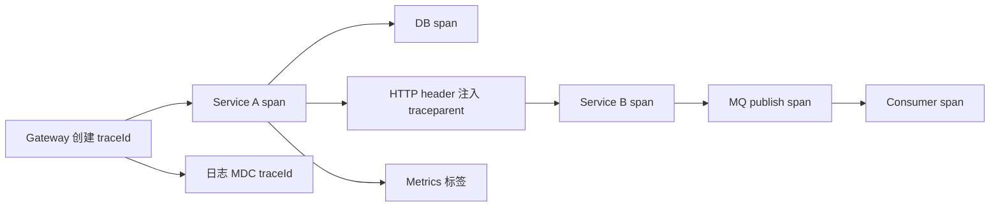
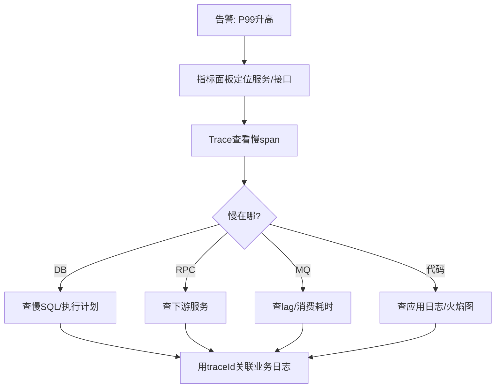

# 链路追踪

> [!abstract] 一句话总结
> 链路追踪用 traceId/spanId 把一次请求跨进程串起来，帮助定位延迟、错误和依赖拓扑；精通点是上下文传播、采样策略、日志指标联动和高基数治理。

## 📌 精准定位

- 负责跨服务请求路径、耗时分解、错误定位和依赖分析。
- 不负责替代业务日志，trace 说明链路形态，业务字段仍要日志记录。
- 关键边界：异步线程、MQ、定时任务都要显式传播上下文。
- 面试重点：能讲清 HTTP/RPC/MQ/线程池下 trace 如何不断链，以及如何用日志、指标、Trace 联动排障。

## 🧩 核心概念

| 概念 | 具体含义 | 精通要点 |
| ---- | -------- | -------- |
| Trace | 一次完整请求链路。 | 由多个 span 组成。 |
| Span | 一次操作，如 HTTP、SQL、MQ。 | 包含时间、标签、事件。 |
| Context Propagation | 通过 header/MDC/MQ 属性传递。 | W3C `traceparent` 常用。 |
| Sampling | 控制采集比例。 | 错误和关键接口优先保留。 |
| Baggage | 跨进程传播的业务上下文。 | 不能放敏感和高基数字段。 |
| MDC | 日志线程上下文。 | 日志里输出 traceId/spanId。 |

## ⚙️ 工作原理 / 主流程



1. 入口没有上下文时生成 traceId 和 root span。
2. RPC/HTTP/MQ 发送前注入上下文，接收端提取并建子 span。
3. 日志用 MDC 输出 traceId/spanId。
4. 采样要兼顾成本和排障，错误请求强制保留。
5. 指标、日志、trace 用 service、operation、traceId 关联。

## 🧵 上下文传播场景

| 场景 | 传播方式 | 常见坑 |
| ---- | -------- | ------ |
| HTTP/RPC | header，如 `traceparent` | 网关或客户端未透传 |
| MQ | message headers/properties | 只追发送，不追消费 |
| 线程池 | 包装 Runnable/Callable，复制 context/MDC | 异步执行丢 trace |
| 定时任务 | 启动时创建新 root trace | 没入口请求，不能复用旧 trace |
| 批处理 | 每个批次或任务创建 trace | 单个 trace span 过多 |

HTTP header 示例：

```text
traceparent: 00-4bf92f3577b34da6a3ce929d0e0e4736-00f067aa0ba902b7-01
```

日志格式：

```text
%d %-5level [%X{traceId:-},%X{spanId:-}] %logger - %msg%n
```

## 🔭 OpenTelemetry + Micrometer 实战

典型组合：

```text
Spring Boot 3
  -> Micrometer Tracing
  -> OpenTelemetry Bridge/Exporter
  -> Collector
  -> Tempo/Jaeger/Zipkin
  -> Grafana
```

关键配置关注：

- 服务名：`service.name`。
- 采样率：开发全采样，生产按比例 + 错误强采样。
- exporter：OTLP/HTTP 或 gRPC。
- 日志 MDC：输出 traceId/spanId。
- 指标标签：避免高基数。

## 📊 采样策略

| 策略 | 说明 | 适用 |
| ---- | ---- | ---- |
| Head Sampling | 请求入口决定是否采样 | 简单、成本低 |
| Tail Sampling | 请求结束后按结果决定是否保留 | 能保留慢请求/错误请求 |
| Error Sampling | 错误请求强制保留 | 排障优先 |
| Route Sampling | 关键接口高采样，普通接口低采样 | 成本和价值平衡 |

生产建议：

- 错误请求、慢请求、核心交易链路优先保留。
- 低价值高频健康检查不要采样。
- 采样规则要可动态调整。

## 🔗 日志-指标-Trace 联动排障



排障顺序：

1. 指标发现异常：P99、错误率、QPS、饱和度。
2. Trace 定位慢在哪个 span。
3. 日志用 traceId 查业务上下文。
4. 结合 DB/MQ/线程池指标确认根因。

## 🧨 高基数治理

不要把这些直接放 span tag：

- 手机号、身份证、token。
- orderId、userId 等高基数字段。
- 完整 SQL 参数。
- 大段请求/响应体。

建议：

- 高基数字段放业务日志，不作为指标标签。
- span tag 用低基数字段：接口名、错误类型、渠道、租户分组。
- 敏感字段脱敏或不采集。

## 🧪 典型故障案例

### 案例 1：异步线程丢 trace

现象：Controller 有 trace，异步任务日志没有 traceId。

原因：线程池切换后 ThreadLocal/MDC 没传播。

修复：包装任务，提交时复制 context，执行前恢复，执行后清理。

### 案例 2：MQ 消费链路断裂

现象：只看到发送端 span，看不到消费端。

原因：发送消息时没有把 trace context 写入 message header，消费者没有提取。

修复：统一 MQ producer/consumer 拦截器，注入和提取 `traceparent`。

### 案例 3：Trace 存储成本暴涨

现象：Trace 后端存储写入量暴涨。

原因：全采样 + span tag 包含订单号等高基数字段 + 批任务 span 过多。

修复：降低采样、过滤健康检查、清理高基数 tag、批任务聚合 span。

## ⚠️ 生产坑与注意事项

- 线程池异步执行丢 MDC 和 trace context。
- MQ 只追发送不追消费。
- 采样率太低，偶发错误没 trace。
- 把手机号、token 放进 span tag。
- span 名称包含订单号导致高基数爆炸。
- Trace 后端不可用时不能阻塞业务请求。
- baggage 滥用会增加请求头大小并泄露信息。

## 🧭 排查路径

- 链路断裂：检查 header 注入提取、网关转发、MQ 属性、线程池包装。
- trace 查不到：看采样、collector、exporter、时钟和 trace 后端存储。
- 延迟不闭合：看异步 span 是否结束、客户端/服务端时间是否一致。
- 存储成本高：看 tag 基数、采样率、span 数量和批任务。
- 日志关联不上：检查 MDC pattern、异步日志和线程切换。

## 🎯 面试问题

> [!question] 高频问题
> - Q: traceId 和 spanId 区别？
>   - A: traceId 标识整条链路，spanId 标识一次操作或一个阶段。
> - Q: 如何跨服务传播？
>   - A: HTTP/RPC 通过 header，MQ 通过 message properties，线程池通过 context 包装和 MDC 复制。
> - Q: 采样怎么设计？
>   - A: 基础比例采样，加错误强采样、关键接口高采样和尾采样，兼顾成本和排障。
> - Q: 日志和 trace 怎么关联？
>   - A: MDC 输出 traceId/spanId，指标定位服务，trace 定位慢 span，日志查业务上下文。
> - Q: 异步最大坑？
>   - A: 线程切换或消息投递丢上下文，导致链路断裂。

## 🎤 面试 3 层回答

### 30 秒版

链路追踪用 traceId 串起一次请求，用 span 拆分每个操作。生产上最关键的是跨 HTTP、MQ、线程池传播上下文，并把日志、指标、Trace 联动起来排障。

### 2 分钟版

入口请求生成 traceId，服务内部每次 HTTP、DB、MQ 都创建 span。跨服务时通过 `traceparent` header 传播，MQ 通过消息属性传播，异步线程要复制 context 和 MDC。采样上不能全量无脑采，也不能太低导致排障没有数据，通常错误和核心链路高采样。排障时先看指标，再点 trace 找慢 span，最后用 traceId 查业务日志。

### 项目版

在订单履约或秒杀系统里，我会把 HTTP 请求、MQ 发送、MQ 消费、数据库操作串到同一条链路。比如订单已支付但未发货，可以通过 trace 看到 outbox 投递、MQ 消费和履约服务耗时，再结合日志定位失败原因。

## ✅ 精通检查清单

- 能解释 trace/span/context/baggage/MDC。
- 能说明 HTTP、MQ、线程池上下文传播方式。
- 能设计采样策略。
- 能用日志、指标、Trace 联动排查慢请求。
- 能说明高基数标签和敏感字段治理。

## 🔗 关联笔记

- [[_index]]
- [[20-Java后端/00-总览/学习仪表盘]]
- [[06-限流-熔断-降级]]
- [[07-服务治理与负载均衡]]
- [[../09-项目实战/03-项目-订单履约系统]]

## 📚 参考资料

- OpenTelemetry Specification
- W3C Trace Context
- Micrometer Tracing Documentation
