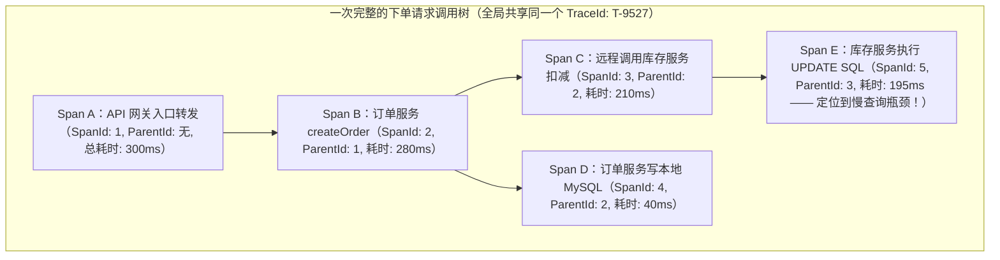
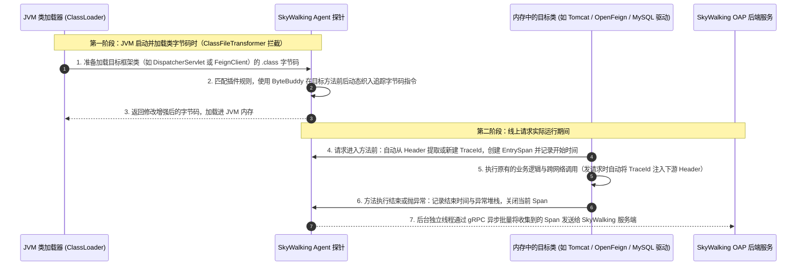
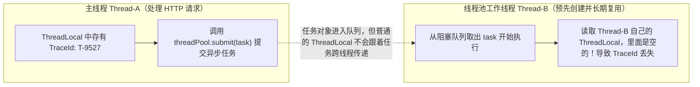
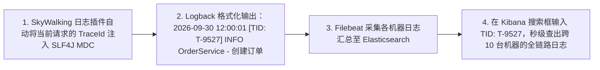

# 分布式链路追踪与可观测性（SkyWalking）

> [!abstract] 一句话心智模型
> 当一个用户请求需要跨越网关、订单、库存、支付等十几个微服务节点时，一旦出现接口变慢或报错，靠人工去几十台服务器上翻找日志如同大海捞针。**分布式链路追踪（Distributed Tracing）通过为每一次外部请求分配一个全局唯一的 `TraceId`，并为途经的每一步内部操作分配 `SpanId` 与 `ParentSpanId`，利用 `JavaAgent` 字节码插桩技术无侵入地将整条调用链还原为一棵可视化的耗时拓扑树**，并打通日志系统实现“输入一个 TraceId 查出全链路所有日志”。

---

## 🎯 一、问题背景：微服务架构下的两大排障痛点

在单体架构时代，所有的模块都在同一个 JVM 进程里运行：
- 如果接口报错了，打开日志文件看一眼完整的 Java 异常堆栈（Stack Trace），立刻就知道是哪一行代码空指针了；
- 如果接口变慢了，在方法前后打个时间戳就能算出耗时。

但在微服务架构下，一个普通的“提交订单”请求可能先后经过了：**API 网关 $\rightarrow$ 订单服务 $\rightarrow$ 商品服务 $\rightarrow$ 库存服务 $\rightarrow$ 优惠券服务 $\rightarrow$ MySQL / Redis / MQ**。如果某次请求总共花了 **3.5 秒** 才返回，或者中途报了错，研发人员会面临两大难题：
1. **慢在哪里不知道**：这 3.5 秒到底是因为网关转发慢？还是订单服务 GC 卡顿？还是库存服务的某条 SQL 没走索引？
2. **日志散落在几十台机器上无法关联**：每个服务都部署了多台实例，同一秒钟有成千上万个请求交织在一起，根本分不清哪台机器上的哪几行日志属于刚才报错的那个用户请求。

为了彻底解决这两个问题，Google 发表了经典的 **Dapper** 论文，奠定了现代分布式链路追踪（如 Apache SkyWalking、Zipkin、OpenTelemetry）的统一标准。

---

## 🧭 二、链路追踪核心模型：TraceId、SpanId 与 ParentSpanId

链路追踪是怎样把分散在不同机器上的调用拼接成一棵完整调用树的？核心全靠随请求一路传递的三个标识符：



### 三大核心概念拆解：

1. **Trace（调用链）与 `TraceId`**：
   - **含义**：代表**一次完整的端到端请求链路**。
   - **生命周期**：当用户的请求刚刚到达系统最外层的入口（如 API 网关或第一个微服务）时，追踪系统会生成一个全局唯一的 **`TraceId`**（例如 `T-9527`）。此后，无论这个请求在系统内部跨越了多少个微服务、调了多少次数据库、发了多少条 MQ 消息，这个 `TraceId` 都会放在请求头（Header）里**原封不动地一路透传到底**。它就是串联起整条链路的“唯一身份证”。
2. **Span（调用跨度）与 `SpanId`**：
   - **含义**：代表整条调用链中的**某一个具体的工作单元（操作步骤）**。比如“网关接收请求”是一个 Span，“发起一次 Feign 远程调用”是一个 Span，“执行一条 MyBatis SQL 查询”也是一个 Span。
   - **记录内容**：每个 Span 都有自己唯一的编号 `SpanId`，并详细记录该步骤的**操作名称（如 `POST /order/create`）、开始时间、结束时间、执行耗时、请求标签（Tags，如 HTTP 状态码、SQL 语句）以及异常堆栈信息**。
3. **`ParentSpanId`（父跨度编号）**：
   - **含义**：记录“是谁调用了我”，即当前 Span 的直接上游 Span 编号。
   - **如何拼成一棵树？** 看上面的流程图：网关入口 `Span A` 是根节点（没有父节点，`SpanId = 1`）；网关调用订单服务 `Span B` 时，把自己的 `SpanId = 1` 传给订单服务，订单服务生成的 `Span B` 就把 `ParentId` 记为 `1`；接着订单服务先后调用了库存服务 `Span C` 和本地数据库 `Span D`，它们的 `ParentId` 都记为 `2`。
   - 当所有节点把各自的 Span 数据异步上报给链路追踪服务端（如 SkyWalking OAP）后，服务端只需**先按相同的 `TraceId` 把所有碎片归拢到一起，再根据 `SpanId` 和 `ParentSpanId` 的父子指向关系，就能在界面上精确画出整条请求的先后顺序与耗时瀑布图**！

---

## 🕵️ 三、SkyWalking 是如何做到“零代码侵入”自动采集的？

理解了 `TraceId` 和 `SpanId` 的传递原理后，下一个问题是：**难道需要程序员在每个 Controller、每个 Feign 接口、每个 SQL 执行前后手动写代码生成 Span 并计算时间吗？**

当然不需要！在国内生产环境最主流的 **Apache SkyWalking** 中，业务代码不需要做任何修改，只需要在启动 Java 应用时多加一行 JVM 启动参数：

```bash
java -javaagent:/path/to/skywalking-agent.jar \
     -Dskywalking.agent.service_name=order-service \
     -jar order-service.jar
```

### 底层核心机制：JavaAgent + ByteBuddy 字节码插桩

SkyWalking 之所以能做到对业务代码完全透明，靠的是 JDK 1.5 引入的 **`Instrumentation`（JavaAgent 探针）机制** 和字节码增强框架 **ByteBuddy**：



整个过程可以概括为三句话：
1. **加载期改写字节码**：SkyWalking Agent 内部自带了上百个现成的插件（覆盖 Tomcat、Spring MVC、OpenFeign、Dubbo、MyBatis、JDBC、Redis、Kafka、RocketMQ 等几乎所有主流组件）。当 JVM 的 `ClassLoader` 把这些框架的类加载进内存之前，Agent 会拦截 `.class` 字节码，利用 **ByteBuddy** 在关键方法的前后织入计时和上下文传递代码。
2. **运行期自动接力**：当 HTTP 请求进入 Tomcat 时，织入的代码自动从 HTTP Header（如 `sw8` 请求头）里读取上游传来的 `TraceId`；当通过 OpenFeign 调下游时，织入的代码又自动把当前线程里的 `TraceId` 和 `SpanId` 塞进发出去的 HTTP Header 里。
3. **异步批量上报**：采集到的 Span 数据会先放入 Agent 本地内存的环形缓冲区（RingBuffer）中，由后台线程通过 gRPC 异步批量发送给服务端，避免阻塞正常的业务请求。

---

## 🧵 四、实战高频难题：异步线程池为什么会导致“TraceId 丢失”？

在接入链路追踪和日志系统后，几乎所有团队都会遇到一个经典问题：
**“在 Controller 和普通 Service 主线程里，调用链和日志里的 `TraceId` 都是正常的；但只要代码里用了 `CompletableFuture.runAsync(...)`、`threadPool.submit(...)` 或者 `@Async` 异步方法，子线程里的 `TraceId` 就突然变成空了，链路追踪也在这里彻底断掉了！”**

### 1. 为什么一进线程池，`TraceId` 就丢了？



原因非常直接：
- 无论是 SkyWalking 的追踪上下文，还是日志框架 SLF4J 的 `MDC`（用于打印日志 `TraceId`），它们在当前进程内都是保存在当前线程的 **`ThreadLocal`** 变量中的。
- `ThreadLocal` 的设计初衷就是“线程隔离”——主线程 A 往自己的 `ThreadLocal` 里存了 `TraceId`，而线程池里的工作线程 B 是在应用启动时就创建好并一直循环复用的，线程 B 自己的 `ThreadLocal` 里根本没有这个值！（注意：就连 JDK 自带的 `InheritableThreadLocal` 也只在 `new Thread()` 首次创建子线程的那一刻复制一次，对于线程池这种**线程复用**的场景同样无效）。

---

### 2. 怎么解决跨线程池的 `TraceId` 传递？（两大标准方案）

核心思路只有一条：**在主线程向线程池提交任务的那一瞬间，先把主线程里的 `TraceId` 拿出来保存在任务对象身上；等线程池里的工作线程开始执行这个任务前，再把 `TraceId` 塞进工作线程的 `ThreadLocal` 里；任务执行完毕后，在 `finally` 里把工作线程的 `ThreadLocal` 清理干净！**

在实际代码中，我们不需要自己手写这个繁琐的过程，直接用现成的工具即可：

#### 方案 A：针对 SkyWalking 调用链 —— 使用官方包装器或注解
SkyWalking 提供了专门用于跨线程传递追踪上下文的 `apm-toolkit-trace` 工具包：
1. **如果使用的是 `Runnable` / `Callable`（如配合 `CompletableFuture`）**，用 `RunnableWrapper.of(...)` 包一层即可：
   ```java
   // RunnableWrapper 会在创建时捕获父线程的 SkyWalking 上下文，并在子线程运行时自动挂载和清理
   CompletableFuture.runAsync(RunnableWrapper.of(() -> {
       log.info("异步发送通知，SkyWalking 调用链与 TraceId 不断连！");
   }), bizThreadPool);
   ```
2. **如果使用的是 Spring 的 `@Async` 异步方法**，只需在方法上加一个 `@TraceCrossThread` 注解即可。

#### 方案 B：针对业务日志 MDC（或自定义上下文） —— 使用 Spring `TaskDecorator` 或阿里 `TTL`
如果你在 Spring 线程池中希望业务日志的 `MDC`（以及全链路灰度的标签）对所有异步任务自动生效，最优雅的做法是在配置 `ThreadPoolTaskExecutor` 时设置一个 **`TaskDecorator`（任务装饰器）**，或者使用阿里开源的 **`TransmittableThreadLocal (TTL)`**：

```java
// Spring 线程池配置 TaskDecorator：一劳永逸解决所有 @Async 和线程池任务的 MDC TraceId 传递
@Bean("bizExecutor")
public ThreadPoolTaskExecutor bizExecutor() {
    ThreadPoolTaskExecutor executor = new ThreadPoolTaskExecutor();
    executor.setCorePoolSize(10);
    executor.setMaxPoolSize(20);
    executor.setQueueCapacity(200);
    // 核心：配置跨线程上下文装饰器
    executor.setTaskDecorator(runnable -> {
        // 1. 【主线程提交任务时】抓取当前主线程 MDC 中的所有上下文（包含 traceId）
        Map<String, String> contextMap = MDC.getCopyOfContextMap();
        return () -> {
            try {
                // 2. 【子线程开始执行前】将父线程的上下文塞入子线程的 MDC 中
                if (contextMap != null) {
                    MDC.setContextMap(contextMap);
                }
                runnable.run();
            } finally {
                // 3. 【子线程执行完毕后】必须在 finally 中清理，防止线程复用导致下一个任务串号！
                MDC.clear();
            }
        };
    });
    executor.initialize();
    return executor;
}
```

---

## 📜 五、打通最后一步：将 `TraceId` 注入业务日志（MDC 实战）

光在 SkyWalking 界面上看到哪个服务慢还不够，我们还需要看到那个服务当时打印的具体业务日志（比如传入了什么参数、走了哪个 `if` 分支）。

只要把 `TraceId` 自动打印在每一行 Logback 日志的开头，然后通过 Filebeat 收集到 **ELK（Elasticsearch + Logstash + Kibana）** 或阿里云 SLS 日志中心，排障时只需要**复制报错的 `TraceId` 到 Kibana 搜索框里一搜，整条链路上十几个微服务打印的所有相关日志就会按时间顺序整齐地列在一个屏幕上**！



### Logback 集成配置示例
引入 SkyWalking 的 `apm-toolkit-logback-1.x` 依赖后，只需在 `logback-spring.xml` 中配置 `%tid`（或通过拦截器放入 MDC 后使用 `%X{traceId}`）：

```xml
<!-- logback-spring.xml 中配置带 TraceId 的日志输出格式 -->
<appender name="CONSOLE" class="ch.qos.logback.core.ConsoleAppender">
    <encoder class="ch.qos.logback.core.encoder.LayoutWrappingEncoder">
        <layout class="org.apache.skywalking.apm.toolkit.log.logback.v1.x.TraceIdPatternLogbackLayout">
            <!-- [%tid] 会自动被替换为当前请求全局唯一的 TraceId -->
            <Pattern>%d{yyyy-MM-dd HH:mm:ss.SSS} [%thread] [%tid] %-5level %logger{36} - %msg%n</Pattern>
        </layout>
    </encoder>
</appender>
```

---

## ⚡ 六、一分钟面试复盘

> [!question]- Q1：分布式链路追踪中的 `TraceId`、`SpanId` 和 `ParentSpanId` 分别代表什么？它们是怎么拼出整条调用链的？
> 1. **`TraceId`（全局链路 ID）**：代表一次完整的用户请求。在请求刚进入网关或首个服务时生成，随后在所有跨服务 RPC 调用和 MQ 消息中全程透传，用于把同一次请求在所有机器上产生的数据归拢到一起。
> 2. **`SpanId`（当前操作跨度 ID）**：代表调用链中的某一个具体步骤（如一次 HTTP 接收、一次 RPC 调用、一次 SQL 执行），记录该步骤的开始时间、耗时和异常状态。
> 3. **`ParentSpanId`（父操作跨度 ID）**：记录调用当前步骤的上游 `SpanId`。服务端收集到同一个 `TraceId` 下的所有 Span 后，根据 `SpanId` 与 `ParentSpanId` 的父子引用关系，就能还原出完整的树状调用拓扑图和耗时分布。

> [!question]- Q2：SkyWalking 是如何做到不修改业务代码就能采集调用链的？如果业务里用了异步线程池导致 `TraceId` 丢失，该怎么解决？
> 1. **无侵入采集原理**：基于 JDK 的 **`JavaAgent`（`Instrumentation` 机制）** 和 **ByteBuddy 字节码增强技术**。在应用启动加载 `.class` 文件时，Agent 自动拦截 Tomcat、Spring MVC、OpenFeign、MyBatis 等主流框架的类，在方法执行前后动态织入生成 Span、统计耗时以及向请求头注入/提取 `TraceId` 的字节码指令。
> 2. **线程池丢失 `TraceId` 的原因与解法**：
>    - **原因**：`TraceId` 和日志 `MDC` 上下文保存在当前线程的 `ThreadLocal` 中，而线程池中的工作线程是预先创建并复用的，无法自动获取提交方主线程的 `ThreadLocal` 数据。
>    - **解法**：使用 SkyWalking 官方提供的 `RunnableWrapper.of()` / `@TraceCrossThread` 包装异步任务，或者在 Spring 线程池上配置 `TaskDecorator`（以及阿里的 `TransmittableThreadLocal`）：在主线程提交任务时先抓取当前上下文，在子线程开始执行前写入子线程的 `ThreadLocal`，并在 `finally` 块中及时清理。
