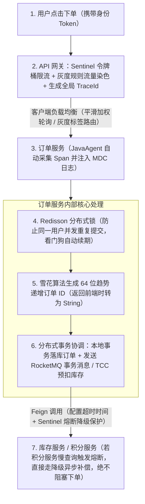

# 分布式与微服务：本章总结与复习

> [!abstract] 一句话心智模型
> 分布式与微服务架构的所有技术方案，本质上都是在解决“把单机拆成多机跨网络协作”后带来的四个核心问题：**多副本之间怎么保持数据一致（CAP/BASE 与 Raft）、跨服务怎么改数据和防并发冲突（分布式事务、分布式锁、分布式 ID）、怎么防止局部故障拖垮全站（限流、熔断、降级、隔离）、怎么管理多实例流量与快速排障（负载均衡、全链路灰度、链路追踪）**。

---

## 🗺️ 一、全章核心问题与解决方案全景速查表

| 专题模块 | 解决的核心痛点 | 核心机制与原理要点 | 生产落地首选方案与避坑准则 |
| :--- | :--- | :--- | :--- |
| **01 CAP 与 BASE** | 跨机房/跨节点网络中断时，如何权衡数据准确性与服务可用性？ | 网络分区（P）客观必然存在；分区发生时必须在强一致（CP，拒绝旧数据响应）与高可用（AP，返回本地旧数据）之间二选一。 | 核心账务/选主走强一致；绝大多数互联网高并发业务遵循 **BASE 理论**，用本地事务 + 异步消息重试 + 定时对账实现**最终一致性**。 |
| **02 Raft 共识算法** | 多节点集群如何选出唯一主节点，并保证宕机切换时不丢已确认的数据？ | 1. **选主**：心跳超时触发竞选，用**随机选举超时**避免选票平分；2. **日志复制**：写满**超过半数（$\lfloor N/2 \rfloor + 1$）**节点即提交；3. **安全约束**：投票时比对最后一条日志的任期与长度，落后节点选不上 Leader。 | 集群节点数应部署为 **奇数（3、5、7 台）**，因为 4 台和 3 台同样只能容忍 1 台宕机；通过多数派交集机制天然防止脑裂双写。 |
| **03 分布式事务** | 订单库和库存库拆分后，单个 `@Transactional` 无法跨库回滚怎么办？ | ① **2PC/XA**：两阶段持锁等待；② **Seata AT**：数据源代理拦截 SQL，一阶段连同前后镜像 `undo_log` 直接提交释放锁，二阶段反向补偿；③ **TCC**：业务层手写 Try（冻结）、Confirm（核销）、Cancel（退回）；④ **可靠消息**：本地消息表或 RocketMQ 半消息。 | **生产选型优先级**：优先选**本地消息表 / RocketMQ 事务消息**（高并发异步解耦）；强实时预扣选 **TCC**（配合状态控制表解决**幂等、空回滚、防悬挂**）；长流程选 **Saga**；内部低频短事务可用 **Seata AT**。 |
| **04 分布式锁** | 多实例并发操作同一条业务数据时，单机 `synchronized` 失效怎么办？ | ① `SET key val NX PX` 原子加锁设过期时间（防死锁）；② Value 存入唯一 `UUID:threadId`（防误删他人锁）；③ **Lua 脚本**原子完成比对与删除；④ **Redisson 看门狗**每隔 $1/3$ 周期（10s）自动刷新 TTL（防业务未完锁过期）。 | Redis 主从异步复制切换或客户端长 GC 停顿仍可能导致锁失效。因此**涉及资金与库存扣减时，必须遵循“分布式锁抗并发，数据库乐观锁版本号（`version`）或唯一索引做最终兜底”**。 |
| **05 分布式 ID** | 分库分表与多实例并发下，如何生成全局唯一且不降低数据库性能的主键？ | 随机 UUID（v4）会导致 InnoDB 聚簇索引频繁发生**页分裂**与随机 I/O。**雪花算法（Snowflake）** 将 64 位划分为：`1位符号位(0) + 41位毫秒时间戳(69年) + 10位机器ID(1024节点) + 12位序列号(4096/ms)`。 | ① **时钟回拨**：小幅回拨（$\le 5\text{ms}$）阻塞等待追平，大幅回拨顺延 `lastTimestamp` 或启用回拨扩展位/告警；② **前端精度丢失**：JS 的 `Number` 仅有 53 位精度（16 位数字），后端返回 19 位 `Long` 型雪花 ID 时必须通过 Jackson **序列化为 `String` 字符串**。 |
| **06 限流熔断降级** | 下游某个非核心服务变慢，如何防止它占满上游所有线程引发全站雪崩？ | ① **限流**：滑动窗口统计 QPS，漏桶匀速排队，令牌桶应对突发，Warm Up 冷机预热；② **熔断器三态**：`Closed`（正常）$\rightarrow$ `Open`（错误率超标跳闸快速失败）$\rightarrow$ `Half-Open`（冷却期后放行探测请求，成功则回 Closed，失败则回 Open）；③ **隔离**：线程池隔离 vs 信号量并发数隔离。 | 远程调用必须设置**超时时间**；限流保自身容量，熔断切断慢下游，降级提供兜底返回（注意：扣款等核心写操作被降级时必须明确提示失败，绝不能伪造成功）。 |
| **07 负载均衡与灰度** | 如何将流量均匀打给不同权重的机器？如何在发版时让内测流量全程走新版本？ | ① **平滑加权轮询**：每轮全员加固定权重 $\rightarrow$ 选当前最大者 $\rightarrow$ 选中者减去总权重，把连续扎堆流量均匀打散；② **全链路灰度**：网关入口注入染色 Header（`x-gray-tag: v2`）$\rightarrow$ 进程内 `ThreadLocal` + RPC 拦截器透传 $\rightarrow$ 负载均衡按标签优先匹配。 | 网关层需先清理外部伪造灰度头；进程内 `ThreadLocal` 必须在 `finally` 中清理；若下游某个服务未部署灰度实例，负载均衡器应支持自动回退到稳定版实例。 |
| **08 链路追踪** | 请求跨越十几个微服务变慢或报错时，如何秒级定位瓶颈并捞出全链路日志？ | ① **核心模型**：`TraceId` 标识整条请求链路，`SpanId` 标识单步操作，`ParentSpanId` 记录父子调用关系；② **采集机制**：SkyWalking 利用 `JavaAgent` + `ByteBuddy` 在类加载时动态织入字节码，零侵入采集并异步上报。 | 异步线程池会导致 `ThreadLocal` 中的 `TraceId` 丢失（断链），需使用 `RunnableWrapper`、`TaskDecorator` 或阿里 `TransmittableThreadLocal (TTL)` 跨线程传递上下文，并结合 Logback `MDC` 将 `TraceId` 打入每行日志。 |

---

## 🔗 二、整章核心链路串联图：一次高并发下单请求是如何跑完的？

我们可以用一次真实的**“电商大促用户下单”**请求，把本章学到的所有组件串联成一条完整的生产架构流水线：

---

## ⚡ 三、高频面试 10 大必考题（考前冲刺背诵版）

> [!question]- Q1：CAP 为什么不能简单说成“任意三选二”？平时系统和网络故障时有什么区别？
> 1. 只要是跨机器部署的分布式系统，物理网络中断（**网络分区 P**）就是客观存在的事实，无法通过软件消除，因此不存在放弃 P 的“CA 分布式系统”。
> 2. 在平时网络正常（无分区）时，系统完全可以同时保证数据一致（C）和服务可用（A）。
> 3. **C 与 A 的二选一冲突只在网络分区发生期间才会出现**：当节点间断网无法同步最新数据时，如果要求绝不返回旧数据（保 C），失联节点就只能报错或拒绝响应（弃 A）；如果要求节点必须正常返回响应（保 A），就只能返回本地尚未同步的旧数据（弃 C）。

> [!question]- Q2：Raft 算法是如何保证“选出来的 Leader 一定包含所有已提交数据”且“不会发生脑裂双写”的？
> 1. **多数派交集保证数据不丢**：Raft 中一条日志必须写入**超过半数节点**才算已提交；而 Candidate 竞选 Leader 也必须拿到**超过半数节点**的投票，且投票节点会严格比对最后一条日志的任期号（`LastLogTerm`）和长度（`LastLogIndex`），拒绝给日志比自己落后的候选人投票。两个超过半数的集合必定至少有一个重叠节点，因此漏掉已提交数据的落后节点永远拿不到多数票。
> 2. **多数派提交阻止脑裂双写**：当发生网络分区将集群切为两半时，最多只有一个分区能包含超过半数的节点。即使旧 Leader 落在了少数派分区，它收到的写请求也无法凑够半数以上的节点确认，因此无法完成提交；而多数派分区会选出更高任期（`Term`）的新 Leader 正常服务。网络恢复后，旧 Leader 看到更高 `Term` 会自动退回 Follower 并对齐日志。

> [!question]- Q3：生产环境中遇到跨服务的分布式事务，应该按什么优先级选型？为什么？
> 1. **首选：本地消息表 / RocketMQ 事务消息（最终一致性）**。通过将跨服务调用转化为“本地事务写业务表与消息表 + MQ 异步投递 + 下游幂等消费 + 定时对账”，全程无跨库锁等待，吞吐量最高，覆盖生产 80% 以上的场景（如下单后发券、加积分、通知仓储）。
> 2. **次选：TCC 或 Saga**。对于必须同步拿到结果且并发极高的核心资源扣减（如资金冻结、库存预占），使用 **TCC** 在业务层实现冻结预留、确认与取消；对于跨多个外部系统的长流程业务，使用 **Saga** 进行正向执行与逆向补偿。
> 3. **兜底：Seata AT 或 2PC**。对于并发不高的内部后台管理系统，希望零代码侵入快速实现跨库回滚，可使用 **Seata AT**（利用数据源代理记录前后镜像 `undo_log`，一阶段直接提交释放本地锁）。高并发链路应避免使用长时间锁行的传统 2PC。

> [!question]- Q4：TCC 模式中的“空回滚”和“悬挂”是怎么产生的？怎么解决？
> 1. **空回滚**：Try 请求因网络丢包没到达参与者，协调者超时后直接发来了 Cancel 请求。如果此时直接执行回滚加库存，就会凭空多出库存。
> 2. **悬挂**：协调者已经触发了空回滚（Cancel 已执行完），那个网络延迟的 Try 请求才迟迟到达。如果此时还去执行 Try 冻结库存，后续再也不会有 Cancel 来释放它，这笔库存就会永久被冻结。
> 3. **解法**：在数据库建一张 **TCC 事务状态控制表**（以 `xid + branch_id` 为主键）。Cancel 先到发现没记录时，直接插入一条 `CANCELLED` 状态的记录并返回（不改业务库存，防空回滚）；随后迟到的 Try 到达时，发现表中已有 `CANCELLED` 记录，直接拒绝执行（防悬挂）；同时在 Confirm/Cancel 前校验状态，解决重复调用的幂等性问题。

> [!question]- Q5：用 Redis 实现分布式锁有哪些必做的安全措施？Redisson 看门狗是如何工作的？
> 1. **三大安全措施**：
>    - 加锁与设置过期时间必须原子执行（`SET key value NX PX 30000`），防止持锁机器宕机导致死锁；
>    - Value 必须设为当前线程独有的唯一标识（如 `UUID:threadId`），防止锁过期后误删别的线程正在持有的锁；
>    - 解锁时必须使用 **Lua 脚本** 将“获取 Value 比对”和“DEL 删除”合并为一步原子操作。
> 2. **Redisson 看门狗（Watchdog）**：当调用不指定过期时间的 `lock.lock()` 时，默认加锁 30 秒，同时在后台启动 Netty 时间轮定时任务，每隔 **`30 / 3 = 10` 秒** 检查当前线程是否仍持有锁；若业务未执行完则自动通过 Lua 脚本将过期时间重置回 30 秒。若机器宕机，没人再续期，锁在 30 秒后自动过期。
> 3. **数据库最终兜底**：为防范 Redis 主从异步切换丢锁或客户端长时间 Full GC 停顿导致锁过期，涉及资金和库存的修改必须在数据库层配合**乐观锁版本号（`WHERE version = oldVersion`）或唯一索引**做最终拦截。

> [!question]- Q6：为什么 MySQL InnoDB 主键不推荐用随机 UUID？雪花算法的 64 位是怎么划分的？
> 1. **不用随机 UUID 的原因**：InnoDB 聚簇索引按主键大小顺序将数据存放在 16KB 的数据页中。随机 UUID 插入时毫无顺序，总是随机往已写满的历史页中间插入，频繁触发耗时的**页分裂（Page Split）**与磁盘随机 I/O，且 36 字节长度会让所有二级索引体积大幅膨胀。
> 2. **雪花算法 64 位结构**：
>    - **1 bit 符号位**：固定为 `0`（保证正整数）；
>    - **41 bit 毫秒时间戳差值**：可用约 69.7 年（放在高位保证按时间趋势递增，顺序追加写页）；
>    - **10 bit 机器 ID**：5 位机房 + 5 位机器，支持 1024 个节点；
>    - **12 bit 毫秒内序列号**：单机每毫秒最多生成 4096 个 ID。

> [!question]- Q7：雪花算法遇到“时钟回拨”和“前端精度丢失”分别怎么处理？
> 1. **时钟回拨处理**：在内存中记录上次发号时间 `lastTimestamp`。若发现当前时间小于 `lastTimestamp`：回拨极小（如 $\le 5\text{ms}$）时阻塞等待时间追上；回拨稍大时可沿用 `lastTimestamp` 继续自增序列号或使用预留的回拨扩展位；严重回拨则告警并切换备用号段。
> 2. **前端精度丢失处理**：Java `Long` 型雪花 ID 长达 19 位十进制数（64 bit），而前端 JavaScript 的 `Number` 安全整数精度只有 53 bit（最多 16 位十进制数），直接传数字会导致后几位被四舍五入。解法是在后端 Jackson 配置中使用 `ToStringSerializer` 将 `Long` 统一序列化为 **`String` 字符串**传给前端。

> [!question]- Q8：熔断器的三个状态是什么？它们是怎么流转的？
> 1. **Closed（闭合状态）**：正常放行所有请求，同时在滑动窗口内统计慢调用比例和异常比例。
> 2. **Open（打开/跳闸状态）**：当请求数达到最小基数且慢调用或异常比例超过阈值时，立刻跳闸进入 Open 状态。此时不再向故障下游发起任何网络请求，本地直接快速失败并走 Fallback 降级逻辑。
> 3. **Half-Open（半开探测状态）**：在 Open 状态等待一段设定的冷却时间（如 10 秒）后，自动进入 Half-Open 状态，放行极少量探测请求去试探下游：若探测成功，则恢复为 **Closed** 状态；若探测仍然失败，则重新退回 **Open** 状态继续冷却。

> [!question]- Q9：什么是平滑加权轮询？微服务全链路灰度发布是怎么实现的？
> 1. **平滑加权轮询**：为解决普通加权轮询中流量连续扎堆打向高权重节点的问题，每轮选择时执行三步：① 所有节点的动态权重加上各自的固定权重；② 选出当前动态权重最大的节点处理请求；③ 将被选中节点的动态权重减去所有节点的固定权重之和。例如权重 `(5, 1, 1)` 会生成均匀交错的 `A, A, B, A, C, A, A`。
> 2. **全链路灰度实现**：① **实例打标**：灰度机器在 Nacos 注册元数据 `version=v2`；② **网关染色**：网关匹配灰度用户规则，在请求头注入 `x-gray-tag: v2`；③ **全链路透传**：服务内用 `ThreadLocal`（跨线程用 `TTL`）暂存标签，调下游时通过 Feign/Dubbo 拦截器自动写入下游请求头；④ **负载均衡路由**：客户端负载均衡器优先挑选同版本标签实例，若下游无灰度实例则自动回退到 `v1` 稳定版。

> [!question]- Q10：SkyWalking 是如何实现无侵入链路追踪的？异步线程池里 `TraceId` 丢失怎么解决？
> 1. **无侵入原理**：利用 JVM 的 `-javaagent`（`Instrumentation` API）和 **ByteBuddy** 字节码框架，在类加载期间动态拦截 Tomcat、OpenFeign、MyBatis 等组件的方法，在方法前后织入创建 Span、记录耗时及在 HTTP Header 中传递 `TraceId` 的字节码指令。
> 2. **线程池 `TraceId` 丢失解法**：由于 `TraceId` 和日志 `MDC` 保存在当前线程的 `ThreadLocal` 中，线程池复用工作线程时无法自动继承。可通过 SkyWalking 的 `RunnableWrapper.of()` / `@TraceCrossThread`，或者在 Spring 线程池中配置 `TaskDecorator`（以及阿里的 `TransmittableThreadLocal`），在主线程提交任务时捕获上下文，在子线程执行前挂载到子线程的 `ThreadLocal`，并在 `finally` 中清理。
