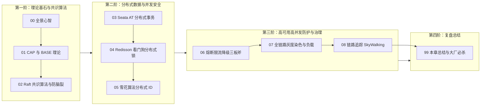

# 🌐 07 · 分布式与微服务

> [!info] 本区心智模型
> 分布式微服务 = **现代联合国与跨国商业联邦体系**。
> CAP 与 BASE 是联邦宪法，Raft 共识是议会多数派表决，Seata AT 是跨国履约与反悔合同，Redisson 看门狗是全球限量争夺通行证，雪花算法是全球唯一身份证，Sentinel 是防踩踏闸机与电网空气开关，SkyWalking 是跨国特快快递单号。用工程基础设施驯服网络不可靠的物理现实！

---

## 📚 知识笔记清单

- [x] [[00-分布式与微服务全景与心智模型]] — **宏观心智模型**（跨国联邦比喻、单体走向微服务的得与失、分布式治理全景路线图）
- [x] [[01-CAP与BASE理论]] — **理论宪法**（物理网络分区 P 必然存在、线性一致性 C 与可用性 A 的二选一推导、BASE 最终一致性哲学）
- [x] [[02-分布式一致性-Paxos-Raft]] — **议会表决机制**（Raft 三态流转、随机化超时时间防瓜分选票、二阶段日志复制、选举限制与 Quorum 防脑裂数学推导）
- [x] [[03-分布式事务-2PC-TCC-Saga]] — **跨国履约保障**（2PC 三大硬伤、TCC 空回滚与防悬挂底层原理、阿里 Seata AT 模式前后镜像与 Undo Log 机制）
- [x] [[04-分布式锁]] — **全球限量通行证**（手写锁四大连环翻车陷阱、Redisson 看门狗自动续期内幕、Redlock 红锁与 Martin 经典 Fencing Token 防线）
- [x] [[05-分布式ID]] — **全球身份证编码**（UUID 聚簇索引页分裂罪证、Snowflake 64 位数学结构拆解、NTP 时钟回拨防御自愈与前端 53 位精度丢失避坑）
- [x] [[06-限流-熔断-降级]] — **防踩踏与空气开关**（微服务级联雪崩第一性原理、熔断器三态状态机流转、线程池与信号量隔离对比、Sentinel 流量整形）
- [x] [[07-服务治理与负载均衡]] — **智能调度与专道**（客户端 vs 服务端 LB 对比、Nginx 平滑加权轮询数学推导、微服务全链路流量染色灰度发布实战）
- [x] [[08-链路追踪]] — **唯一快递面单轨迹**（Google Dapper 核心三要素、SkyWalking JavaAgent 字节码插桩内幕、线程池断流解决方案与 MDC 全链检索）
- [x] [[99-本章总结与复习]] — **全景复盘**（分布式全景对照表、大厂 30 秒必杀 10 连问、生产架构避坑指南）

---

## 🧭 四阶通关路线

---

## 🧪 终极通关能力自测

1. 为什么在真实的跨机房多节点分布式网络中，“CA 架构”在物理定律上根本不存在？
2. Raft 算法是如何通过“随机化选举超时时间”彻底解决节点竞选瓜分选票（Split Vote）死锁问题的？
3. Seata 的 AT 模式底层是如何通过数据源代理拦截 SQL、生成前后镜像并在二阶段完成无感回滚的？
4. 手写 Redis 分布式锁时，为什么必须使用包含随机 Token 的 Lua 脚本释放锁？Redisson 看门狗是如何实现自动续期的？
5. 为什么 MySQL 聚簇索引主键严禁使用 UUID？雪花算法生成的 64 位 ID 传给前端浏览器为什么会出现末尾数字精度截断？
6. 什么是微服务级联雪崩？熔断器的 Closed、Open、Half-Open 三态流转规则是什么？
7. 如何借助“流量染色（Traffic Coloring）”与请求头透传实现全链路灰度发布？
8. SkyWalking 是如何依靠 JavaAgent 字节码插桩在不修改业务代码的情况下实现全链路性能监控的？

---

## 🔗 跨模块串联

- 上级：[[20-Java后端/00-总览/学习仪表盘|Java 学习仪表盘]]
- 前置中间件：[[20-Java后端/06-中间件/_index|06 · 中间件]]（MQ 与注册中心是微服务通信与服务发现的基础设施）
- 后续系统设计：[[20-Java后端/08-系统设计/_index|08 · 系统设计]]（秒杀系统、订单系统、短链系统等综合系统架构实战）
- 专项实战：[[20-Java后端/10-知识串联与专题/04-从Spring事务到分布式一致性]]
