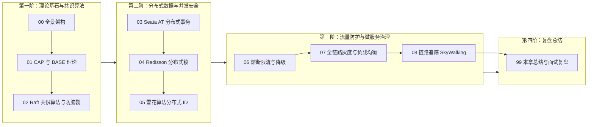

# 🌐 07 · 分布式与微服务

> [!info] 本区心智模型
> 分布式与微服务体系是应对大规模高并发与复杂业务演进的现代架构方案。核心涵盖：分布式基石理论（CAP/BASE）、一致性共识算法（Raft）、分布式事务（2PC/TCC/Seata）、分布式锁与全局唯一 ID、高可用防护（限流/熔断/降级）以及服务治理与链路追踪（SkyWalking）。

---

## 📚 知识笔记清单

- [x] [[00-分布式与微服务全景与心智模型]] — **架构概览**（单体到微服务架构演进、核心挑战与分布式治理全景图）
- [x] [[01-CAP与BASE理论]] — **理论基石**（网络分区 P 的物理必然性、一致性 C 与可用性 A 的权衡、BASE 最终一致性模型）
- [x] [[02-分布式一致性-Paxos-Raft]] — **共识算法**（Raft 角色流转、随机选举超时、日志复制、Quorum 机制与防脑裂）
- [x] [[03-分布式事务-2PC-TCC-Saga]] — **事务一致性**（2PC 阻塞问题、TCC 幂等/防悬挂/空回滚、Seata AT 模式前后镜像与 Undo Log）
- [x] [[04-分布式锁]] — **分布式并发控制**（Redis 分布式锁原子性实现、Redisson 看门狗自动续期、Redlock 算法与 Fencing Token）
- [x] [[05-分布式ID]] — **全局唯一 ID**（UUID 缺陷、Snowflake 64 位结构推导、时钟回拨解决方案与前端精度兼容）
- [x] [[06-限流-熔断-降级]] — **高可用流量防护**（级联雪崩防范、熔断器三态状态机、线程池与信号量隔离、Sentinel 流量整形）
- [x] [[07-服务治理与负载均衡]] — **负载与服务治理**（客户端/服务端负载均衡、平滑加权轮询算法、全链路流量染色与灰度发布）
- [x] [[08-链路追踪]] — **全链路可观测性**（OpenTelemetry/Dapper 规范、SkyWalking JavaAgent 字节码插桩、跨线程 TraceId 传递）
- [x] [[99-本章总结与复习]] — **全景复盘**（分布式全景对照表、大厂高频面试题复盘与生产架构规约）

---

## 🧭 四阶通关路线

---

## 🧪 终极通关能力自测

1. 为什么在真实的跨机房多节点分布式网络中，“CA 架构”在物理定律上根本不存在？
2. Raft 算法是如何通过“随机化选举超时时间”彻底解决节点竞选瓜分选票（Split Vote）死锁问题的？
3. Seata 的 AT 模式底层是如何通过数据源代理拦截 SQL、生成前后镜像并在二阶段完成无感回滚的？
4. 手写 Redis 分布式锁时，为什么必须使用包含随机 Token 的 Lua 脚本释放锁？Redisson 看门狗是如何实现自动续期的？
5. 为什么 MySQL 聚簇索引主键严禁使用 UUID？雪花算法生成的 64 位 ID 传给前端浏览器为什么会出现末尾数字精度截断？
6. 什么是微服务级联雪崩？熔断器的 Closed、Open、Half-Open 三态流转规则是什么？
7. 如何借助“流量染色（Traffic Coloring）”与请求头透传实现全链路灰度发布？
8. SkyWalking 是如何依靠 JavaAgent 字节码插桩在不修改业务代码的情况下实现全链路性能监控的？

---

## 🔗 跨模块串联

- 上级：[[../00-总览/学习仪表盘|Java 学习仪表盘]]
- 前置中间件：[[../06-中间件/_index|06 · 中间件]]（MQ 与注册中心是微服务通信与服务发现的基础设施）
- 后续系统设计：[[../08-系统设计/_index|08 · 系统设计]]（秒杀系统、订单系统、短链系统等综合系统架构实战）
- 专项实战：[[../10-知识串联与专题/04-从Spring事务到分布式一致性]]
