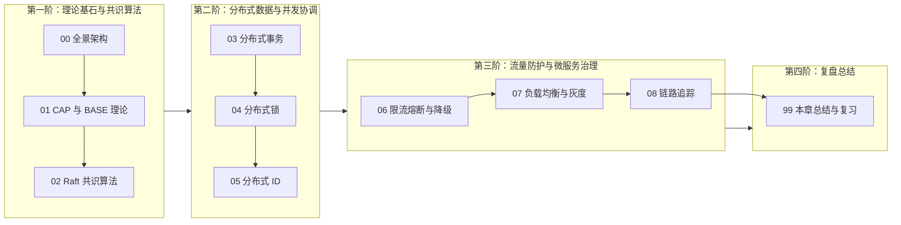

# 🌐 07 · 分布式与微服务

> [!info] 本区心智模型
> 当业务规模和团队规模超出了单体应用的承载边界，系统会被拆分为多个跨网络协作的微服务。拆分带来了独立开发、独立部署和按需扩容的收益，但也把进程内的函数调用变成了不可靠的跨网络调用，把单库事务拆成了跨库数据协调。本模块围绕分布式系统的核心矛盾展开：**网络分区下的数据一致性（CAP/BASE 与 Raft）、跨服务的数据与并发协调（分布式事务、分布式锁、分布式 ID）、高并发下的故障隔离与流量防护（限流、熔断、降级），以及微服务流量治理与全链路可观测性（负载均衡、全链路灰度、链路追踪）**。

---

## 📚 知识笔记清单

- [x] [[00-分布式与微服务全景与心智模型]] — **架构概览**（从单体到微服务的演进动因、拆分引入的四大核心问题与技术体系全景图）
- [x] [[01-CAP与BASE理论]] — **理论基石**（跨节点数据同步与网络分区的矛盾、CP 与 AP 的取舍逻辑、BASE 最终一致性模型）
- [x] [[02-分布式一致性-Paxos-Raft]] — **共识算法**（Raft 角色状态流转、随机超时选主、多数派日志复制、选举安全性约束与防脑裂机制）
- [x] [[03-分布式事务-2PC-TCC-Saga]] — **事务一致性**（2PC/XA、TCC 空回滚与防悬挂、Saga 长事务补偿、Seata AT 前后镜像、本地消息表与 MQ 事务消息选型）
- [x] [[04-分布式锁]] — **分布式并发控制**（Redis 分布式锁演进、UUID + Lua 原子释放、Redisson 看门狗自动续期、主从切换丢锁与 Fencing Token 防护）
- [x] [[05-分布式ID]] — **全局唯一 ID**（B+ 树聚簇索引与顺序写入原理、号段模式、Snowflake 64 位结构、时钟回拨处理与前端 Long 精度丢失解决）
- [x] [[06-限流-熔断-降级]] — **高可用流量防护**（调用链级联雪崩成因、熔断器三态流转机制、线程池与信号量隔离、Sentinel 滑动窗口与流量整形）
- [x] [[07-服务治理与负载均衡]] — **负载与服务治理**（服务端与客户端负载均衡对比、平滑加权轮询算法推导、基于流量染色的全链路灰度发布）
- [x] [[08-链路追踪]] — **全链路可观测性**（TraceId 与 SpanId 调用树模型、SkyWalking JavaAgent 字节码插桩、跨线程上下文传递与 MDC 日志串联）
- [x] [[99-本章总结与复习]] — **全景复盘**（核心问题与架构方案对照表、高频面试核心链路复盘与工程落地原则）

---

## 🧭 四阶通关路线

---

## 🧪 总结复习能力自测

1. 当两个节点之间的网络断开时，为什么系统在“立刻返回响应（A）”和“保证读到最新写入的数据（C）”之间必须做出取舍？
2. Raft 算法是如何通过“心跳超时 -> 随机超时拉票 -> 多数派复制提交 -> 日志新旧比对”这一整套流程来选出唯一 Leader 并保证已提交数据不丢失的？
3. 在下单扣库存场景中，2PC、TCC、Saga、Seata AT 以及本地消息表/MQ 事务消息分别是如何工作的？为什么高并发生产环境优先采用基于 MQ 或本地消息表的最终一致性方案？
4. 用 Redis 实现分布式锁时，为什么要同时满足“加锁设过期时间”、“Value 存唯一标识”、“Lua 脚本原子解锁”三个条件？Redisson 的看门狗是如何给未执行完的任务自动续期的？
5. 为什么 MySQL InnoDB 表的主键推荐使用趋势递增的 Snowflake ID 或自增 ID，而不推荐完全随机的 UUID？后端的 64 位 Long 型 ID 传给前端浏览器为什么会出现精度丢失？
6. 下游一个次要服务响应变慢是如何一步步拖垮整个微服务集群的？限流、熔断和降级分别在调用链的什么位置起作用？
7. 什么是 Nginx 和 Dubbo 使用的“平滑加权轮询”？如何通过网关染色和请求头透传实现微服务的全链路灰度发布？
8. SkyWalking 是如何利用 JavaAgent 在不修改业务代码的情况下采集调用链的？当请求进入异步线程池时，如何解决 TraceId 丢失的问题？

---

## 🔗 跨模块串联

- 上级：[[../00-总览/学习仪表盘|Java 学习仪表盘]]
- 前置中间件：[[../06-中间件/_index|06 · 中间件]]（消息队列、Redis 与注册中心是微服务通信与状态协调的基础设施）
- 后续系统设计：[[../08-系统设计/_index|08 · 系统设计]]（秒杀系统、订单系统、短链系统等综合系统架构实战）
- 专项实战：[[../10-知识串联与专题/04-从Spring事务到分布式一致性]]
