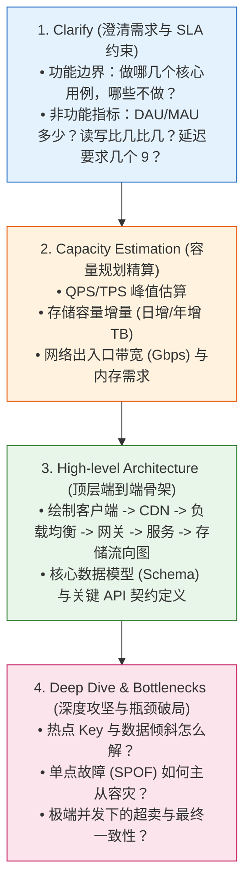
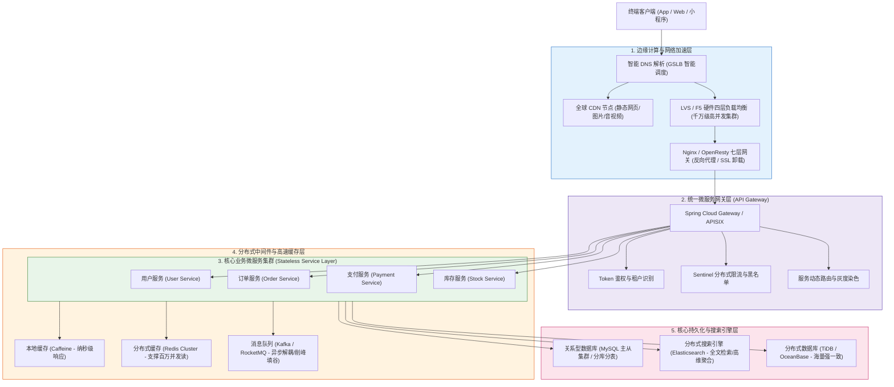
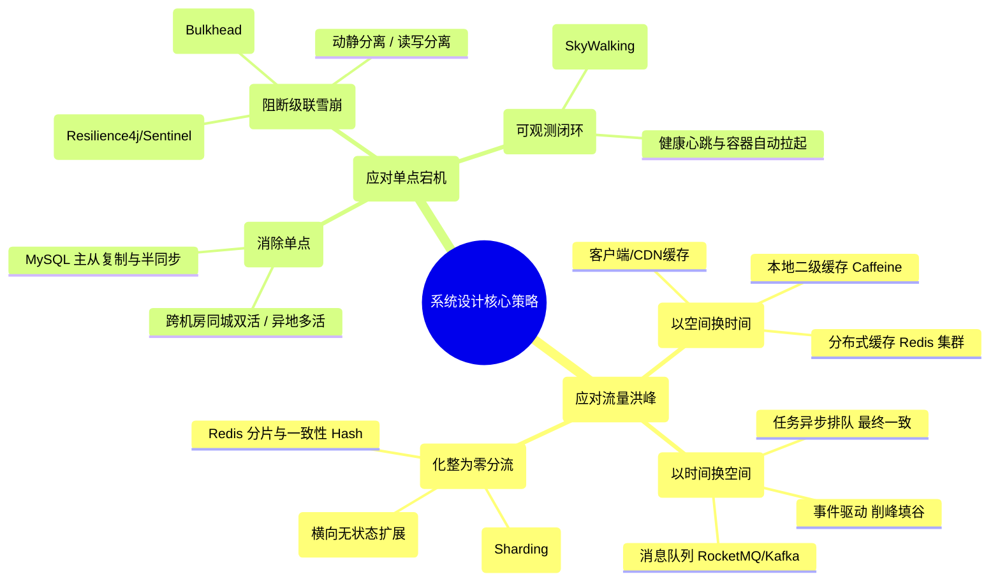

# 🏗️ 系统设计全景与心智模型：大厂架构师的“大禹治水”工程哲学

> [!abstract] 一句话总结
> 系统设计的第一性原理是**“面对有限的硬件物理资源（CPU/内存/磁盘/网络），运用‘大禹治水’三板斧（缓存蓄洪、异步削峰、分片拓宽），在CAP理论、成本控制与极致吞吐之间达成最佳商业与技术平衡”**。

---

## 🗣️ 白话版（先建立直觉）

如果把瞬时暴涨的千万级并发流量比作**“百年一遇的特大洪峰”**：
- **愚蠢的填石堵水（垂直堆机器）**：
  水来土掩，疯狂给单一服务器加 CPU 和内存。结果洪水一冲而过（流量超过单机物理总线上限），大坝当场决堤崩塌，全线瘫痪！
- **大禹治水的现代水利枢纽工程（高并发系统架构）**：
  1. **上游蓄洪池（缓存 Cache）**：在最靠近水源的地方建蓄洪湖，90% 只是来看看水景的游人（读流量），直接在湖面引走，根本不需要惊动下游水库；
  2. **中游滞洪区与排队减速阀（异步削峰 MQ）**：对于必须要通过的大水（写流量），让它先流进平缓的滞洪缓冲区排队，下游水闸按照每秒能承受的最大流量匀速放水，宁可让水流慢一点，绝不冲毁水坝；
  3. **下游开山凿渠（分片拓宽 Sharding）**：原本一条狭窄的河道，开凿出 16 条分流运河（分库分表、微服务水平扩容），把万钧水力化整为零！
  4. **防汛应急炸坝分流（限流与降级 Fallback）**：如果洪峰实在超过了整个水利工程的设计极限，为了保住大坝本体不垮，在入口处直接开启溢洪闸，把一部分非核心支流的水拦在门外（返回“系统繁忙，请稍后再试”）。

**这就是系统设计：没有神秘的银弹，全是关于“分流、排队、换空间、保核心”的物理学取舍！**

---

## 📌 第一性原理：大厂架构面试 4C 黄金答题框架

在阿里、字节、腾讯等大厂面试中，面对“请你设计一个淘宝秒杀/微博热搜/微信朋友圈”这类宏观大题，90% 的人一上来就手忙脚乱地报组件：“用 Redis、用 Kafka、用 MySQL”。这是典型的**低段位扣分答法**！

资深架构师严格遵循 **4C 黄金准则** 步步为营：

---

## 🔢 架构师必备：容量估算的第一性原理速算公式

在真正动手画架构图之前，必须用**纸笔完成数学推导**：

### 1. 并发吞吐（QPS）速算公式（二八定律）
假设系统拥有 **1000 万日活（DAU）**，每个活跃用户每天平均产生 **20 次核心请求**：
- **全天总请求量**：$10,000,000 \times 20 = 200,000,000\text{ 次（2 亿次）}$
- **全天平均 QPS**：$\frac{2\text{ 亿}}{86,400\text{ 秒}} \approx 2,314\text{ QPS}$
- **峰值 QPS（按二八原则：80% 的请求集中在 20% 的时间段，即 4.8 小时内）**：
  $$\text{Peak QPS} \approx \frac{2\text{ 亿} \times 0.8}{86400 \times 0.2} \approx \frac{1.6\text{ 亿}}{17,280} \approx 9,259\text{ QPS}$$
- **留足 3~5 倍容量冗余**：实际系统容量规划应按 **$30,000 \sim 50,000\text{ QPS}$** 进行集群设计！

### 2. 存储容量增量速算
- 假设单条核心业务记录（如订单/日志）大小为 **$1\text{ KB}$**；
- 每天新增记录 2000 万条；
- **日增存储**：$20,000,000 \times 1\text{ KB} \approx 20\text{ GB / 天}$；
- **年增存储**：$20\text{ GB} \times 365 \approx 7.3\text{ TB / 年}$；
- **推导结论**：单表在 MySQL 中超过 2000 万行性能严重下滑，系统运行不到一个月就必须分表！因此**必须前置规划分库分表或冷热数据归档**。

---

## 🗺️ 现代企业级大型分布式系统架构全景大图

---

## ⚖️ 高并发三板斧 vs 高可用铁三角

---

## 🧭 本章经典实战战役通关路线

本专栏精选了**大厂最高频、最具代表性的 7 大经典架构设计战役**：

> [!TIP]
> **架构师通关法则**：
> 学习系统设计，切忌背诵组件名词。每一个系统设计的背后，都必然对应着一个**具体的物理冲突**：
> - 秒杀系统的矛盾：**极致并发写入 vs 单一库存行锁冲突**；
> - 短链系统的矛盾：**百亿级短码生成 vs 碰撞去重与低延迟 302 重定向**；
> - 即时通讯的矛盾：**数百万长连接的内存占用 vs 跨节点消息广播与弱网丢包**；
> - 订单系统的矛盾：**复杂多状态流转 vs 分布式事务最终一致性与跨表统计**。
>
> 抓住矛盾的核心第一性原理，架构方案自然呼之欲出！
