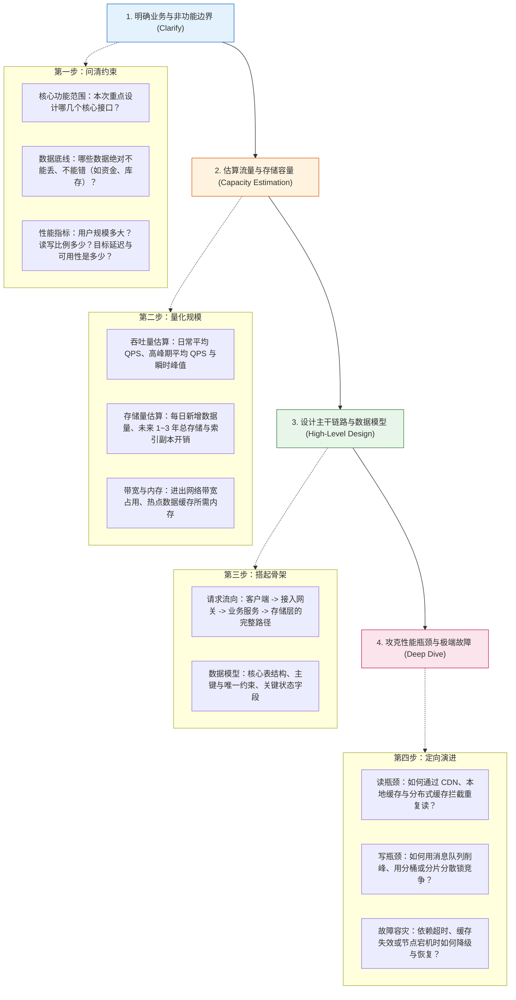
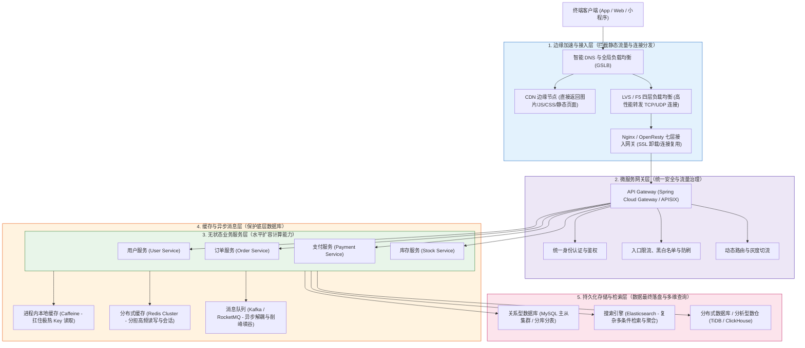
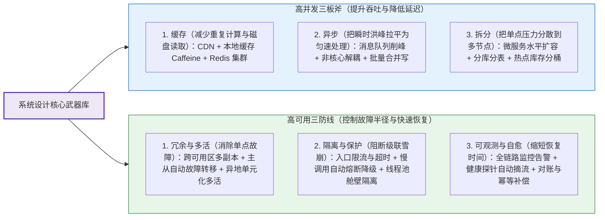
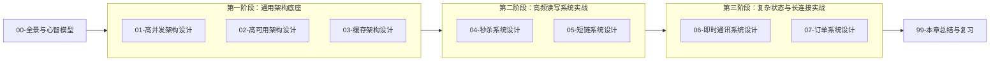

# 🏗️ 系统设计全景与心智模型：从需求拆解到架构演进

> [!abstract] 一句话总结
> 系统设计的核心不是把所有热门中间件堆在一起，而是先理清业务边界与数据一致性底线，算清楚流量与存储量级，找出真正的性能瓶颈或单点隐患，再用最简单直接的工程手段去解决它。

---

## 1. 核心难点：为什么做系统设计容易无从下手？

很多工程师在面对“设计一个秒杀系统”或“设计一个订单中心”时，第一反应往往是直接画上 Nginx、Redis、Kafka 和 MySQL 分库分表。但如果继续追问：“为什么要加消息队列？Redis 挂了怎么办？数据库到底需不需要分表？”就很容易卡壳。

做系统设计最核心的难点在于：**脱离了具体的业务量级和约束条件，任何架构方案都是空中楼阁。**
- 如果日活只有几千人、每秒只有几十次请求，单台应用服务器配一主一从的 MySQL 就足够稳定，强行引入分库分表和分布式缓存只会徒增维护成本和数据不一致的风险。
- 反过来，当每秒有十万次请求涌入，或者单表数据量持续暴涨导致索引树变深、缓冲池命中率下降时，单机数据库就会因为连接耗尽或磁盘 I/O 饱和而瘫痪。

因此，好的系统设计永远遵循一条清晰的推导路径：**先定边界 → 再算容量 → 画出主干 → 针对瓶颈做演进**。

---

## 2. 系统设计四步推导法

无论是实际工程立项还是技术面试，都可以按照以下四个步骤由浅入深地推进设计：

---

## 3. 容量估算：用简单算数看清系统量级

在画架构图之前，先做几道简单的乘法和除法，就能立刻判断系统到底需要什么级别的组件。

### 3.1 并发吞吐量（QPS / TPS）怎么算？

假设我们要设计一个日活（DAU）**1000 万** 的业务系统，平均每个活跃用户每天发起 **20 次** 请求：

1. **全天总请求量**：
   $$10,000,000 \times 20 = 200,000,000 \text{ 次（2 亿次/天）}$$
2. **全天平均 QPS**（一天有 $86,400$ 秒，粗算可按 $10^5$ 秒估算量级）：
   $$\text{Average QPS} = \frac{200,000,000}{86,400} \approx 2,315 \text{ QPS}$$
3. **业务高峰期平均 QPS**：
   用户的访问不会均匀分布在 24 小时内。按照常见的二八规律，假设全天 80% 的流量集中在白天最繁忙的 20% 时间（约 4.8 小时）内：
   $$\text{Busy-Period QPS} = \frac{200,000,000 \times 0.8}{86,400 \times 0.2} \approx 9,259 \text{ QPS}$$
4. **瞬时峰值与容量规划**：
   高峰期的平均 QPS 还不等于某一秒的瞬时脉冲峰值（例如整点抢购、突发热点推送）。在工程实践中，我们需要把**读请求**和**写请求**分开统计，结合压测测出的单机安全吞吐水位，并在峰值基础上预留足够的容灾余量（确保某一台机器或一个可用区下线时，剩余机器仍能扛住流量）。

### 3.2 存储容量怎么算？

假设系统每天新增 **2000 万条** 订单或消息记录，每条记录平均大小为 **1 KB**：

1. **每日新增原始数据**：
   $$20,000,000 \times 1 \text{ KB} \approx 20 \text{ GB / 天}$$
2. **一年新增原始数据**：
   $$20 \text{ GB} \times 365 \approx 7.3 \text{ TB / 年}$$
3. **工程实际落地容量**：
   算出原始数据量后，还不能直接按 7.3 TB 去买磁盘。实际生产环境中还需要算上 **B+ 树二级索引开销**、**主从高可用副本（通常一主一从或一主两从）**、**Binlog 与 Redo Log 日志空间**以及**定期备份与磁盘水位冗余**。
   当单表数据持续增长到数千万乃至上亿行、导致高频查询的缓冲池命中率下降或 DDL 维护困难时，就需要结合实际的查询条件和压测表现，推进**历史冷数据归档**、**分区表**或**分库分表**。

---

## 4. 架构演进：大型分布式系统是如何一层层长出来的？

当业务规模从几百 QPS 增长到十万 QPS 时，系统架构会顺着瓶颈自然演进出五个核心层次：

为什么需要这五层？每一层都在解决上一层解决不了的具体问题：
1. **边缘与接入层**：图片、样式表和固定页面没必要每次都打到后端服务器，直接用 CDN 在离用户最近的节点返回；剩下的动态请求先经过 LVS 和 Nginx 承接海量并发连接并完成 HTTPS 解密。
2. **微服务网关层**：如果让每个业务服务自己去写登录校验、限流和防刷逻辑，不仅代码重复，而且异常流量已经进入了内网。网关层把这些通用能力收口，把恶意或超额流量挡在业务集群之外。
3. **无状态业务服务层**：将业务服务设计成“无状态”（不在本机内存保存用户专属会话），这样当计算压力变大时，随时可以通过增加机器实例来水平分担流量。
4. **缓存与异步消息层**：业务服务可以轻松加机器，但底层的数据库加机器很难。因此，高频读请求先由本地缓存（Caffeine）和分布式缓存（Redis）拦截；瞬时高并发写请求则通过消息队列（RocketMQ / Kafka）缓冲削峰，让数据库按照自己的安全能力匀速消费。
5. **持久化存储与检索层**：MySQL 负责保证核心交易数据的 ACID 事务安全；当遇到复杂的全文搜索或卖家多条件筛选时，通过监听 Binlog 将数据同步到 Elasticsearch 中查询，实现读写职责的彻底分离。

---

## 5. 核心武器库：高并发三板斧与高可用三防线

在后续的具体设计中，我们所有的技术方案都围绕这两套核心组合展开：

---

## 6. 本章学习路线：从基础套路到四大实战场景

掌握了上述分析框架后，接下来我们将按照“先掌握通用底座，再攻克具体业务”的顺序展开学习：

> [!TIP]
> **阅读建议**：
> 在阅读后面每一篇具体系统设计时，建议先思考该场景**最棘手的工程矛盾**是什么：
> - **秒杀系统**：瞬间几万人抢几百件商品，直接打数据库会把库打挂，且并发扣减极易超卖；
> - **短链系统**：要把长网址映射成不重复的 6 位短码，且点击时必须在几毫秒内完成重定向跳转；
> - **即时通讯（IM）**：需要维护百万级长连接，保证跨网关节消息不丢、不重、不乱序，并解决大群广播的写放大问题；
> - **订单系统**：要管好复杂的订单状态流转，处理超时关单与晚到支付回调的并发冲突，并兼顾买家与卖家的双维度高效查询。
> 
> 顺着这些核心难点往下读，你会发现每一个组件和机制的引入都水到渠成。
