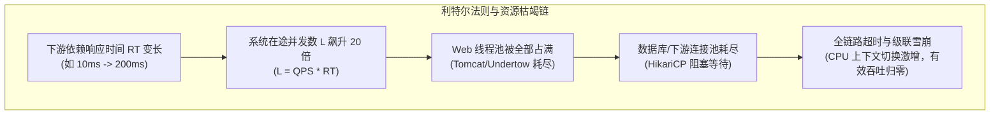
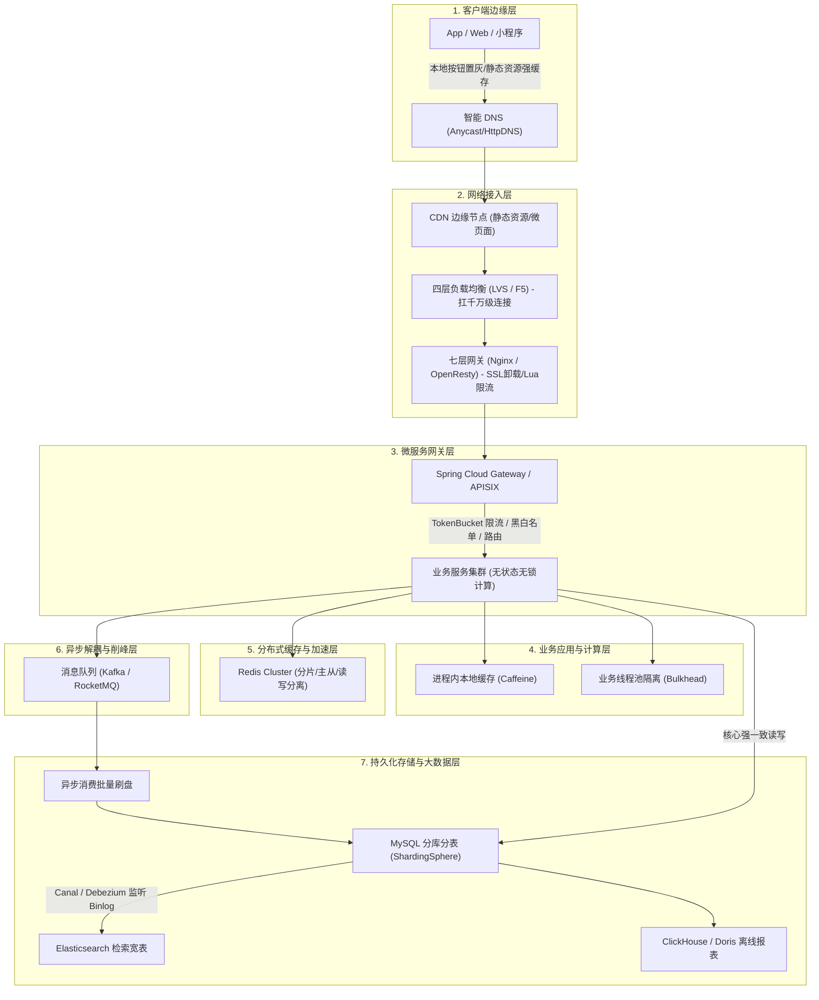
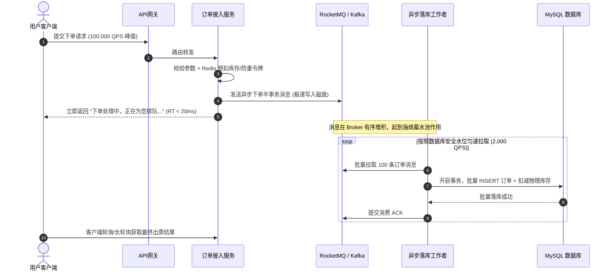
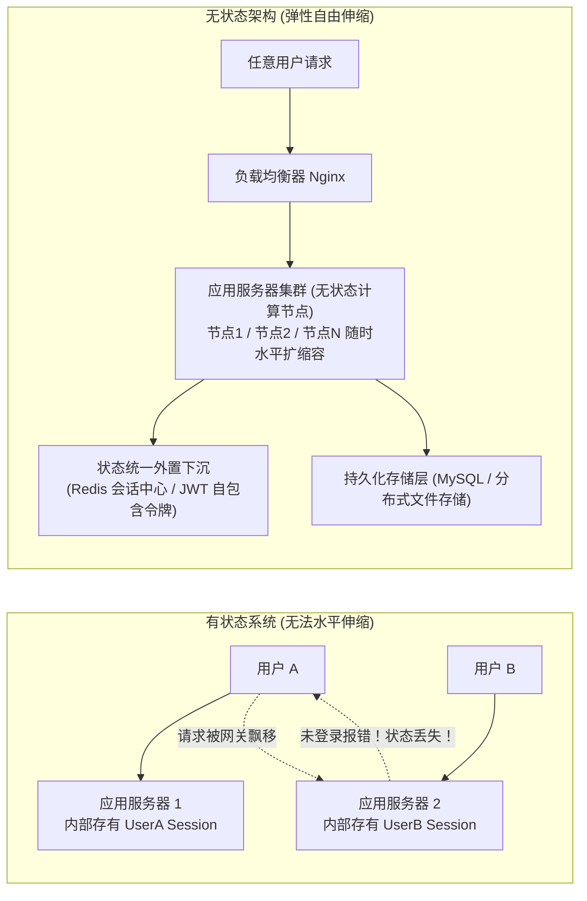

# 高并发架构设计：从第一性原理到全链路极限压榨

> **前置知识**：[[00-系统设计全景与心智模型]]、[[../03-并发编程/00-并发编程心智模型与学习路线|并发编程全景]]、[[../06-中间件/01-Kafka原理与应用|Kafka高吞吐]]

---

## 1. 为什么需要高并发架构？（第一性原理与心智模型）

### 1.1 并发的本质：排队论与利特尔法则（Little's Law）
很多工程师一听到高并发，脑海里就只有“加服务器、加 Redis、加 MQ”三板斧。但如果问他：“为什么加了 10 台机器，接口反而更慢甚至崩了？”他就回答不上来。

在第一性原理视角下，任何软硬件计算系统，本质上都是一个**排队系统（Queueing System）**。
根据应用数学中的**利特尔法则（Little's Law）**：
$$L = \lambda \times W$$
- **$L$（System Concurrency / In-flight Requests）**：系统内部正在并发处理的平均“在途请求数”。
- **$\lambda$（Throughput / QPS）**：系统单位时间处理完成的平均请求到达率（吞吐量）。
- **$W$（Latency / RT）**：请求在系统内的平均驻留时间（响应延迟）。

```text
【致命推论与雪崩效应】
假设系统 QPS = 10,000，平时单次请求平均 RT = 10ms (0.01s)：
系统的在途并发数 L = 10,000 * 0.01 = 100 个请求。系统线程池、数据库连接池轻松承载。

突然，下游数据库因慢 SQL 导致接口 RT 劣化到 200ms (0.2s)：
为维持 10,000 QPS 吞吐，系统在途并发数骤升为：
L = 10,000 * 0.2 = 2,000 个请求！
直接暴增 20 倍！Tomcat 线程池（默认 200）和数据库连接池（HikariCP 默认 10）瞬间被挤爆，
新请求进入阻塞队列或被直接拒绝，系统彻底雪崩瘫痪！
```



### 1.2 高并发治理的“三大生活化心智模型”
1. **大禹治水，疏重于堵（动静分离与空间换时间）**：河道（主库与核心服务）只有那么宽，把占体积最大的沙石（图片、JS、静态数据）在源头（CDN、本地缓存）分流走，别让它们涌入核心河道。
2. **银行叫号机（时间换空间，异步削峰）**：大堂经理只有 3 个（数据库写入能力有限），1000 人蜂拥而入必然踩踏。发排队小票（MQ 队列），客户坐在大厅等候，窗口按最高安全速率从容办理。
3. **超市结账分流（化整为零，分片伸缩）**：只有一个收银台，排队一公里；立刻开 20 个收银台（无状态扩容），或者按客户姓氏拼音去不同楼层结账（分库分表、哈希分片）。

---

## 2. 全链路高并发架构总蓝图

高并发从来不是某一个组件的独角戏，而是从**用户指尖到磁盘磁道**的全链路协同作战。



---

## 3. 核心招式一：读并发的极限榨取（多级缓存与动静分离）

互联网业务 90% 以上的场景都是“**读多写少**”（如浏览电商商品详情、看朋友圈、刷信息流）。把读请求压榨到极致，是性价比最高的架构方案。

### 3.1 动静分离与 CDN 边缘计算
- **纯静态资源（HTML/CSS/JS/图片/视频）**：构建阶段直接上传对象存储（OSS/S3），打上强缓存头 `Cache-Control: public, max-age=31536000, immutable`，通过版本号做更新控制，请求 100% 命中 CDN，**0 流量穿透到源站**。
- **微页面与动静结合（ESI / 客户端拼接）**：
  - 骨架数据（商品基本信息、规格、静态文案）：CDN 边缘缓存 5 分钟。
  - 动态个性化数据（用户实时优惠券、到手价、库存、地址运费）：客户端通过异步 AJAX 接口回源拉取，将大包拆成极致轻量的几百字节 JSON。

### 3.2 多级缓存协同金字塔
从离 CPU 最近的地方开始，逐级设卡：

| 缓存层级 | 存储介质 | 访问时延 | 命中并发容量 | 适用数据特征 |
| :--- | :--- | :--- | :--- | :--- |
| **L1 浏览器/客户端** | 内存 / 磁盘 Cache | $\approx 0 \text{ ms}$ | 纯本地无上限 | 静态素材、配置元数据 |
| **L2 CDN 边缘** | 边缘节点内存/SSD | $5 \sim 20 \text{ ms}$ | 千万级 QPS | 公共静态页、商品详情骨架 |
| **L3 Nginx 共享内存** | OpenResty `lua_shared_dict` | $< 1 \text{ ms}$ | 百万级 QPS | 全局开关、热点白名单、静态路由 |
| **L4 应用进程内存** | Java Heap (`Caffeine`) | $< 0.1 \text{ ms}$ (纳秒级) | 单机 50万+ QPS | 顶级热点商品（HotKey）、字典数据 |
| **L5 分布式缓存** | `Redis Cluster` | $1 \sim 3 \text{ ms}$ | 集群百万级 QPS | 用户会话、订单状态、库存预扣 |
| **L6 持久化数据库** | `MySQL` / `TiDB` | $10 \sim 50 \text{ ms}$ | 单机 2000~5000 QPS | 最终资金、强一致账户、物理库存 |

```java
/**
 * 生产级多级缓存读取范式（防击穿、防穿透、防雪崩标准模版）
 */
@Service
@RequiredArgsConstructor
public class MultiLevelCacheService {

    private final Cache<String, ProductDTO> localCache; // Caffeine 本地缓存
    private final StringRedisTemplate redisTemplate;     // 分布式缓存
    private final RedissonClient redissonClient;
    private final ProductRepository productRepository;

    public ProductDTO getProductDetail(Long productId) {
        String cacheKey = "product:detail:" + productId;

        // 1. 一级缓存：查本地内存（极速，纳秒级）
        ProductDTO product = localCache.getIfPresent(cacheKey);
        if (product != null) {
            return product;
        }

        // 2. 二级缓存：查分布式 Redis
        String json = redisTemplate.opsForValue().get(cacheKey);
        if (StringUtils.isNotBlank(json)) {
            // 防穿透：判断是否是预设的空对象占位符
            if ("{}".equals(json)) {
                return null;
            }
            product = JSON.parseObject(json, ProductDTO.class);
            localCache.put(cacheKey, product); // 回填本地缓存
            return product;
        }

        // 3. 缓存击穿防御：仅允许一个并发线程去回源查数据库（分布式互斥锁）
        String lockKey = "lock:product:" + productId;
        RLock lock = redissonClient.getLock(lockKey);
        try {
            // 尝试加锁，最多等待 1 秒，锁定 5 秒
            if (lock.tryLock(1, 5, TimeUnit.SECONDS)) {
                try {
                    // Double Check：防止等待锁期间前面的线程已经回填好了
                    json = redisTemplate.opsForValue().get(cacheKey);
                    if (StringUtils.isNotBlank(json)) {
                        return "{}".equals(json) ? null : JSON.parseObject(json, ProductDTO.class);
                    }

                    // 真正回源数据库
                    product = productRepository.findById(productId);

                    if (product != null) {
                        // 防雪崩：在固定过期时间上加随机漂移量 (1小时 ± 5分钟)
                        long expireSeconds = 3600 + ThreadLocalRandom.current().nextInt(300);
                        redisTemplate.opsForValue().set(cacheKey, JSON.toJSONString(product), expireSeconds, TimeUnit.SECONDS);
                        localCache.put(cacheKey, product);
                    } else {
                        // 防穿透：空值缓存，给极短 TTL（如 60 秒）
                        redisTemplate.opsForValue().set(cacheKey, "{}", 60, TimeUnit.SECONDS);
                    }
                    return product;
                } finally {
                    lock.unlock();
                }
            } else {
                // 没抢到锁的并发请求：降级策略（直接重试或返回兜底旧数据）
                Thread.sleep(50);
                return getProductDetail(productId);
            }
        } catch (InterruptedException e) {
            Thread.currentThread().interrupt();
            throw new BusinessException("系统繁忙，请稍后重试");
        }
    }
}
```

---

## 4. 核心招式二：写并发的极限治理（异步削峰与行锁粉碎）

高并发下最脆弱、最难横向扩展的是**关系型数据库的单行数据写并发**（如超爆款商品的 `UPDATE stock = stock - 1 WHERE id = 1`）。因为行级排他锁（X锁）是串行化的，单行并发极限只有数百 QPS。

### 4.1 异步削峰：时间换空间
当瞬时写请求高达 10 万 QPS，而数据库只能承受 2000 QPS 时，强行直连数据库会导致连接池瞬间打满、线程排队暴死。



### 4.2 热点行锁粉碎术：库存分段分桶（Segmented Lock）
如果业务必须实时同步修改数据库（不允许进入异步排队），如何突破 MySQL 单行记录并发瓶颈？
- **物理分桶思想**：将一个原本为 10,000 件库存的商品，拆分成 100 个物理子分桶（Bucket 0 ~ 99），每个桶 100 件库存。
- **并发分散**：用户下单时，通过 `userId % 100` 或随机路由到对应的分桶进行原子扣减。原本针对单行记录的排他锁竞争，被均匀稀释到 100 行记录上，**数据库并发写吞吐瞬间提升近 100 倍**！

```sql
-- 原始单行记录（并发死穴）
-- UPDATE t_stock SET stock = stock - 1 WHERE product_id = 1001 AND stock >= 1;

-- 分桶库存表结构设计
CREATE TABLE t_product_stock_bucket (
    id BIGINT PRIMARY KEY AUTO_INCREMENT,
    product_id BIGINT NOT NULL,
    bucket_id INT NOT NULL,     -- 桶编号：0 ~ 9
    stock_count INT NOT NULL,   -- 当前桶库存
    UNIQUE KEY uk_prod_bucket (product_id, bucket_id)
);

-- 下单扣减时，根据 Hash 路由扣减指定分桶
UPDATE t_product_stock_bucket 
SET stock_count = stock_count - #{buyCount}
WHERE product_id = #{productId} 
  AND bucket_id = #{bucketId} 
  AND stock_count >= #{buyCount};
-- 若当前桶扣减失败（该桶售罄但其他桶还有），触发跨桶重试或合并扣减
```

---

## 5. 核心招式三：水平扩展与状态下沉（Stateless Architecture）

要让系统具备“只要加机器，吞吐就能线性增长”的弹性扩展能力，**应用层必须做到绝对的“无状态化”（Stateless）**。



### 5.1 生产级无状态改造规范
1. **彻底废弃 Servlet 容器本地 Session**：全面采用分布式 Session（Spring Session + Redis）或密码学签名自包含令牌（JWT + 集中式黑名单）。
2. **禁止在本地内存维护全局业务状态**：
   - 错误做法：在 Spring 容器的 `@Component` 里维护一个 `ConcurrentHashMap` 记录用户防刷计数或在线列表。
   - 正确做法：状态统一外置到 Redis 的 ZSet 或 HyperLogLog。
3. **本地缓存（Caffeine）仅用于幂等不可变数据或允许短暂不一致的读取加速**，绝不能作为业务状态的主存储。

---

## 6. 高并发经典故障与排障 SOP

### 6.1 场景一：上线扩容后，CPU 利用率反而下降，但接口全部超时爆满
- **根因推导**：盲目增加应用实例，每个实例配置了 50 个数据库连接。原本 4 台机器占用 200 个连接，扩容到 40 台后向 MySQL 请求 2000 个连接。MySQL 默认 `max_connections` 只有 1000，且大量线程在 InnoDB 内部产生激烈的锁冲突和上下文切换，导致数据库整体吞吐断崖式下跌。
- **排障三步法**：
  1. 立即观察 MySQL `SHOW PROCESSLIST` 或性能仪表盘，检查是否有大量 `Waiting for table metadata lock` 或行锁等待。
  2. 按照 **HikariCP 黄金连接数公式** 重新收缩连接池大小：
     $$\text{Connections} = (\text{CPU Cores} \times 2) + \text{Disk Effective Spindle Count}$$
     （对于 16 核 SSD 云主机，单实例分配 10~20 个连接足矣，宁缺毋滥）。
  3. 引入网关层连接复用与排队机制，迅速缩减无意义的应用实例。

### 6.2 场景二：突发热点引发“击穿”，单台 Redis 节点网卡被 100% 打满
- **根因推导**：全网突然爆出大热点（如某明星突发大瓜），该内容的所有读请求全部精准命中 Redis 集群中的某**单台 Master 节点**（HotKey）。单机网卡千兆带宽（125MB/s）瞬间被挤爆，导致同一机器上的其他正常 Key 读写也全部超时。
- **应急与根治手段**：
  1. **实时探测与本地广播**：部署 HotKey 实时探测组件（如京东 HotKey、阿里 Sentinel），当检测到某个 Key QPS > 5000 时，立即向所有业务应用集群广播。
  2. **毫秒级加载本地缓存**：应用收到通知后，动态将该 HotKey 数据写入本地 Caffeine 缓存（设置 10 秒 TTL），**直接将后续 99.9% 的请求拦截在 JVM 内部**，Redis 压力瞬间归零。

---

## 7. 大厂 30 秒面试绝杀（高频追问 3 连击）

> [!question]- Q1：为什么单纯加机器无法解决“爆款商品秒杀扣减库存”的并发写问题？
> 1. **本质定位**：加机器横向扩展（Scale-Out）只对**无状态的计算型任务**或**读并发**线性生效；而单行库存写操作的核心瓶颈在**持久化数据库的最底层行级排他锁（X锁）**。
> 2. **锁争用恶化**：单行记录在数据库内核层面是严格串行化的（排队执行）。加了 10 倍的应用机器，等于让 10 倍的线程同时涌入抢夺同一把行锁，不仅无法提高写吞吐，反而会引发灾难性的死锁检测（Deadlock Detection）开销与 CPU 上下文切换，导致数据库有效吞吐不升反降。
> 3. **破局方案**：粉碎竞争，将写操作前置与拆分——前端利用 Redis Lua 脚本原子预扣库存，或者在数据库端采用“库存分段分桶”化整为零，最后通过 MQ 异步削峰、合并批量刷盘。

> [!question]- Q2：异步削峰会导致数据写入延迟，用户支付后立刻刷新页面显示“订单待支付”，引发恐慌和重复下单，怎么解决？
> 1. **前端交互心智欺骗（乐观 UI 更新）**：用户支付成功后，前端立即展示“支付成功，订单确认中”的状态，同时开启防重复点击与倒计时蒙层。
> 2. **智能短轮询与长轮询结合**：客户端每隔 800ms 向网关轮询一次订单最终状态，轮询上限为 5 次；若 5 秒后仍未落库完成，引导用户点击“查看订单中心”，同时后台下发补偿任务。
> 3. **内存读穿透（先发即读）**：在订单异步落库的同时，写入一条带有 30 秒有效期的 Redis 临时标记（`user:order:paying:{orderId}`）。用户刷新页面时优先读取该 Redis 标记，直接向用户展示“正在处理中”，从而抹平前后端数据的一致性时间差。

> [!question]- Q3：高并发系统如何在保障高吞吐的同时，彻底防止系统被突发流量冲垮？
> 遵循**全链路防御纵深原则**，构建“三道防火墙”：
> 1. **入口层严格限流（Rate Limiting）**：在 API 网关层配置令牌桶算法，设定系统最大承载水位，多出的恶意或超额流量直接返回 HTTP 429 或友情提示，坚决不放入内网。
> 2. **核心资源舱壁隔离（Bulkhead）**：核心业务与边缘业务（如打卡、积分、推荐）采用独立线程池与独立数据源。非核心业务即便崩溃，绝不能抢占核心下单线程池资源。
> 3. **自动熔断降级（Circuit Breaker）**：当慢调用比例或错误率突破阈值（如响应延迟 > 500ms 占比超过 50%），Sentinel/Resilience4j 自动熔断下游弱依赖，秒级返回默认兜底数据，保全系统主干生命线。

---

## 8. 一分钟复盘记忆卡

```text
======================= 高并发架构核心记忆口诀 =======================
高并发核心看排队，利特尔法则定乾坤（L = QPS * RT）。
时延微增在途爆，池化耗尽满盘崩。
疏重于堵多级缓，动静分离走边缘；
异步削峰建水库，行锁粉碎拆分桶；
无状态化伸缩易，本地缓存截热点；
限流熔断护核心，弹性高吞永不倒。
======================================================================
```
